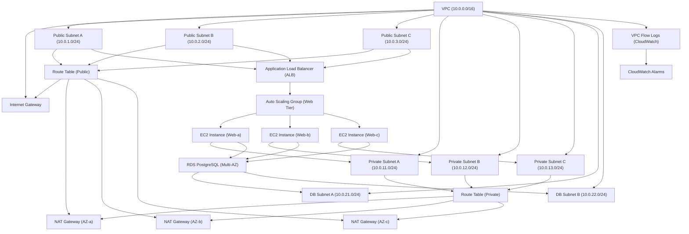

## 1. Lab Objective & Free Open-Source Prerequisites

### 1.1 Lab Objective
The purpose of this hands‑on lab is to **design, provision, and validate a production‑grade, multi‑AZ, three‑tier architecture** on Amazon Web Services (AWS) using **Infrastructure as Code (IaC)** with **Terraform**. By the end of the lab you will have:

1. A **VPC** spanning three Availability Zones (AZs) with **public**, **private**, and **database** subnets.
2. **NAT Gateways** in each public subnet to provide outbound internet access for private resources.
3. An **Application Load Balancer (ALB)** front‑ending a **stateless web tier** (EC2 Auto Scaling Group) across AZs.
4. A **managed relational database** (Amazon RDS PostgreSQL) isolated in its own private subnets.
5. **IAM roles, policies, and instance profiles** that follow the principle of least privilege.
6. **Logging, monitoring, and security hardening** (VPC Flow Logs, CloudWatch Alarms, encryption at rest/in‑transit).
7. A **repeatable, version‑controlled Terraform codebase** that can be destroyed and rebuilt without manual intervention.

### 1.2 Free Open‑Source Prerequisites
| Tool | Minimum Version | Installation Link | Why It’s Needed |
|------|----------------|-------------------|-----------------|
| **Terraform** | 1.6.0 | https://developer.hashicorp.com/terraform/downloads | Declarative provisioning of AWS resources |
| **AWS CLI** | 2.13.0 | https://aws.amazon.com/cli/ | Quick ad‑hoc verification and credential management |
| **Git** | 2.40.0 | https://git-scm.com/downloads | Source control for the Terraform repo |
| **jq** | 1.6 | https://stedolan.github.io/jq/download/ | JSON parsing for verification scripts |
| **Docker** (optional) | 24.0.0 | https://www.docker.com/get-started | Run a local containerized Terraform workspace if you lack a Linux/macOS host |
| **Visual Studio Code** (or any IDE) | Latest | https://code.visualstudio.com/ | Syntax highlighting and linting for Terraform/HCL |
| **Python 3.11** (optional) | 3.11.x | https://www.python.org/downloads/ | For optional helper scripts (e.g., health‑check) |

> **Note:** All tools listed above are free, open‑source (or free tier) and run on Windows, macOS, and Linux. The lab assumes you have an **AWS account** with sufficient IAM permissions to create VPCs, EC2, RDS, IAM, CloudWatch, and related resources.

#### 1.2.1 AWS Account Permissions Checklist
Create an IAM policy (or attach the managed policy `AdministratorAccess` for a sandbox account) that includes at least the following actions:

```json
{
  "Version": "2012-10-17",
  "Statement": [
    {"Effect":"Allow","Action":["ec2:*","elasticloadbalancing:*","rds:*","iam:*","logs:*","cloudwatch:*","autoscaling:*"],"Resource":"*"}
  ]
}
```

> **Security Tip:** In a real production environment you would split these privileges across multiple roles (e.g., a “TerraformApply” role with limited scope). For the lab we keep it simple.

---

## 2. Enterprise Architecture Topology

Below is a **Mermaid** diagram that visualises the full three‑tier architecture. Every node label is wrapped in double quotes as required by the “CRITICAL MERMAID RULE”.



### 2.1 Diagram Walk‑through
* **VPC (10.0.0.0/16)** – The container for all resources.
* **Internet Gateway (IGW)** – Provides inbound/outbound internet connectivity for public subnets.
* **Public Subnets (AZ‑a/b/c)** – Host the ALB and NAT Gateways.
* **Private Subnets (AZ‑a/b/c)** – Host the web‑tier EC2 instances (via an Auto Scaling Group) and have outbound internet via NAT.
* **DB Subnets (AZ‑a/b)** – Dedicated subnets for the RDS instance, isolated from the internet.
* **NAT Gateways** – One per AZ to avoid a single point of failure.
* **Application Load Balancer (ALB)** – Distributes traffic across the web tier.
* **VPC Flow Logs** – Sent to CloudWatch for security monitoring.
* **CloudWatch Alarms** – Trigger on abnormal metrics (e.g., high latency, unhealthy targets).

---

## 3. Addressing & Resource Inventory Table

| Resource | Logical Name | CIDR / Identifier | AZ | Terraform Resource Type | Remarks |
|----------|--------------|-------------------|----|------------------------|---------|
| VPC | `main_vpc` | 10.0.0.0/16 | – | `aws_vpc` | Enable DNS hostnames |
| Internet Gateway | `igw` | – | – | `aws_internet_gateway` | Attach to VPC |
| Public Subnet A | `public_subnet_a` | 10.0.1.0/24 | `us-east-1a` | `aws_subnet` | Map public IP auto‑assign |
| Public Subnet B | `public_subnet_b` | 10.0.2.0/24 | `us-east-1b` | `aws_subnet` | – |
| Public Subnet C | `public_subnet_c` | 10.0.3.0/24 | `us-east-1c` | `aws_subnet` | – |
| Private Subnet A | `private_subnet_a` | 10.0.11.0/24 | `us-east-1a` | `aws_subnet` | No public IP |
| Private Subnet B | `private_subnet_b` | 10.0.12.0/24 | `us-east-1b` | `aws_subnet` | – |
| Private Subnet C | `private_subnet_c` | 10.0.13.0/24 | `us-east-1c` | `aws_subnet` | – |
| DB Subnet A | `db_subnet_a` | 10.0.21.0/24 | `us-east-1a` | `aws_subnet` | RDS subnet group |
| DB Subnet B | `db_subnet_b` | 10.0.22.0/24 | `us-east-1b` | `aws_subnet` | – |
| NAT Gateway A | `nat_gw_a` | Elastic IP A | `us-east-1a` | `aws_nat_gateway` | One per AZ |
| NAT Gateway B | `nat_gw_b` | Elastic IP B | `us-east-1b` | `aws_nat_gateway` | – |
| NAT Gateway C | `nat_gw_c` | Elastic IP C | `us-east-1c` | `aws_nat_gateway` | – |
| Public Route Table | `rt_public` | – | – | `aws_route_table` | Routes 0.0.0.0/0 → IGW |
| Private Route Table | `rt_private` | – | – | `aws_route_table` | Routes 0.0.0.0/0 → NAT GW(s) |
| ALB | `app_alb` | – | – | `aws_lb` | Internet‑facing |
| Target Group | `tg_web` | – | – | `aws_lb_target_group` | Port 80, health check |
| Listener | `alb_listener_http` | – | – | `aws_lb_listener` | HTTP → TG |
| Auto Scaling Group | `asg_web` | – | – | `aws_autoscaling_group` | Min 2, Max 6 |
| Launch Template | `lt_web` | – | – | `aws_launch_template` | Amazon Linux 2, user‑data |
| RDS Subnet Group | `rds_subnet_grp` | – | – | `aws_db_subnet_group` | Private subnets only |
| RDS Instance | `rds_pg` | – | Multi‑AZ | `aws_db_instance` | PostgreSQL 15 |
| IAM Role (EC2) | `ec2_role` | – | – | `aws_iam_role` | SSM, CloudWatch Logs |
| IAM Instance Profile | `ec2_instance_profile` | – | – | `aws_iam_instance_profile` | Attach to EC2 |
| VPC Flow Log | `vpc_flow_log` | – | – | `aws_flow_log` | CloudWatch log group |
| CloudWatch Log Group | `cw_log_group` | – | – | `aws_cloudwatch_log_group` | Retention 30 days |
| CloudWatch Alarm (ALB 5xx) | `alb_5xx_alarm` | – | – | `aws_cloudwatch_metric_alarm` | Threshold 5% |

---

## 4. Step‑By‑Step Configuration

> **All commands are copy‑paste ready.** Inline comments (`#`) explain each line.  
> The lab uses a **single‑module** Terraform layout for simplicity, but you can split into sub‑modules for larger teams.

### 4.1 Directory Structure

```text
aws-3tier-lab/
├── main.tf
├── variables.tf
├── outputs.tf
├── provider.tf
├── terraform.tfvars
├── scripts/
│   └── user_data.sh
└── README.md
```

### 4.2 Provider & Backend (`provider.tf`)

```hcl
terraform {
  required_version = ">= 1.6.0"
  required_providers {
    aws = {
      source  = "hashicorp/aws"
      version = "~> 5.0"
    }
  }

  # OPTIONAL: Remote state in an S3 bucket (replace bucket/key with your own)
  backend "s3" {
    bucket = "my-terraform-state-bucket"
    key    = "aws-3tier-lab/terraform.tfstate"
    region = "us-east-1"
    encrypt = true
  }
}

provider "aws" {
  region = var.aws_region
}
```

### 4.3 Variables (`variables.tf`)

```hcl
variable "aws_region" {
  description = "AWS region to deploy the lab"
  type        = string
  default     = "us-east-1"
}

variable "project_name" {
  description = "Prefix for all resources"
  type        = string
  default     = "3tierlab"
}

variable "allowed_ip" {
  description = "Your public IP for SSH/RDP access (CIDR notation)"
  type        = string
  default     = "0.0.0.0/0" # Replace with your IP for tighter security
}
```

### 4.4 Core Infrastructure (`main.tf`)

> **Note:** The file is long; sections are broken down with comments for readability.

```hcl
# -------------------------------------------------
# 1️⃣ VPC & Core Networking
# -------------------------------------------------
resource "aws_vpc" "main" {
  cidr_block           = "10.0.0.0/16"
  enable_dns_support   = true
  enable_dns_hostnames = true
  tags = {
    Name = "${var.project_name}-vpc"
  }
}

resource "aws_internet_gateway" "igw" {
  vpc_id = aws_vpc.main.id
  tags = {
    Name = "${var.project_name}-igw"
  }
}

# -------------------------------------------------
# 2️⃣ Subnets (Public, Private, DB)
# -------------------------------------------------
locals {
  azs = data.aws_availability_zones.available.names
}

data "aws_availability_zones" "available" {}

# Public Subnets (one per AZ)
resource "aws_subnet" "public" {
  for_each = {
    for idx, az in local.azs : az => {
      cidr = cidrsubnet(aws_vpc.main.cidr_block, 8, idx + 1) # 10.0.1.0/24, 10.0.2.0/24, …
    }
  }
  vpc_id                  = aws_vpc.main.id
  cidr_block              = each.value.cidr
  availability_zone       = each.key
  map_public_ip_on_launch = true
  tags = {
    Name = "${var.project_name}-public-${each.key}"
  }
}

# Private Subnets (one per AZ)
resource "aws_subnet" "private" {
  for_each = {
    for idx, az in local.azs : az => {
      cidr = cidrsubnet(aws_vpc.main.cidr_block, 8, idx + 11) # 10.0.11.0/24, …
    }
  }
  vpc_id            = aws_vpc.main.id
  cidr_block        = each.value.cidr
  availability_zone = each.key
  tags = {
    Name = "${var.project_name}-private-${each.key}"
  }
}

# DB Subnets (use first two AZs only for RDS Multi‑AZ)
resource "aws_subnet" "db" {
  for_each = {
    for idx, az in slice(local.azs, 0, 2) : az => {
      cidr = cidrsubnet(aws_vpc.main.cidr_block, 8, idx + 21) # 10.0.21.0/24, 10.0.22.0/24
    }
  }
  vpc_id            = aws_vpc.main.id
  cidr_block        = each.value.cidr
  availability_zone = each.key
  tags = {
    Name = "${var.project_name}-db-${each.key}"
  }
}

# -------------------------------------------------
# 3️⃣ NAT Gateways (one per AZ)
# -------------------------------------------------
resource "aws_eip" "nat" {
  for_each = aws_subnet.public
  vpc      = true
  tags = {
    Name = "${var.project_name}-eip-nat-${each.key}"
  }
}

resource "aws_nat_gateway" "nat" {
  for_each = aws_subnet.public
  allocation_id = aws_eip.nat[each.key].id
  subnet_id     = each.value.id
  tags = {
    Name = "${var.project_name}-nat-${each.key}"
  }
  depends_on = [aws_internet_gateway.igw]
}

# -------------------------------------------------
# 4️⃣ Route Tables
# -------------------------------------------------
# Public RT (0.0.0.0/0 → IGW)
resource "aws_route_table" "public" {
  vpc_id = aws_vpc.main.id
  tags = {
    Name = "${var.project_name}-rt-public"
  }
}

resource "aws_route" "public_internet" {
  route_table_id         = aws_route_table.public.id
  destination_cidr_block = "0.0.0.0/0"
  gateway_id             = aws_internet_gateway.igw.id
}

# Associate each public subnet with the public RT
resource "aws_route_table_association" "public_assoc" {
  for_each = aws_subnet.public
  subnet_id      = each.value.id
  route_table_id = aws_route_table.public.id
}

# Private RT (0.0.0.0/0 → NAT GW in same AZ)
resource "aws_route_table" "private" {
  vpc_id = aws_vpc.main.id
  tags = {
    Name = "${var.project_name}-rt-private"
  }
}

resource "aws_route" "private_nat" {
  for_each = aws_nat_gateway.nat
  route_table_id         = aws_route_table.private.id
  destination_cidr_block = "0.0.0.0/0"
  nat_gateway_id         = each.value.id
}

# Associate each private subnet with the private RT
resource "aws_route_table_association" "private_assoc" {
  for_each = aws_subnet.private
  subnet_id      = each.value.id
  route_table_id = aws_route_table.private.id
}

# -------------------------------------------------
# 5️⃣ Security Groups
# -------------------------------------------------
# ALB SG – allow inbound HTTP/HTTPS from anywhere, outbound to private tier
resource "aws_security_group" "alb_sg" {
  name        = "${var.project_name}-alb-sg"
  description = "Allow inbound HTTP/HTTPS"
  vpc_id      = aws_vpc.main.id

  ingress {
    description = "HTTP"
    from_port   = 80
    to_port     = 80
    protocol    = "tcp"
    cidr_blocks = ["0.0.0.0/0"]
  }

  ingress {
    description = "HTTPS"
    from_port   = 443
    to_port     = 443
    protocol    = "tcp"
    cidr_blocks = ["0.0.0.0/0"]
  }

  egress {
    description = "Allow to private tier"
    from_port   = 0
    to_port     = 0
    protocol    = "-1"
    cidr_blocks = ["10.0.0.0/16"]
  }

  tags = {
    Name = "${var.project_name}-alb-sg"
  }
}

# Web Tier SG – allow inbound from ALB SG, outbound to internet via NAT, and to RDS
resource "aws_security_group" "web_sg" {
  name        = "${var.project_name}-web-sg"
  description = "Web tier SG"
  vpc_id      = aws_vpc.main.id

  ingress {
    description = "From ALB"
    from_port   = 80
    to_port     = 80
    protocol    = "tcp"
    security_groups = [aws_security_group.alb_sg.id]
  }

  egress {
    description = "Outbound to internet (via NAT)"
    from_port   = 0
    to_port     = 0
    protocol    = "-1"
    cidr_blocks = ["0.0.0.0/0"]
  }

  egress {
    description = "PostgreSQL to RDS"
    from_port   = 5432
    to_port     = 5432
    protocol    = "tcp"
    security_groups = [aws_security_group.rds_sg.id]
  }

  tags = {
    Name = "${var.project_name}-web-sg"
  }
}

# RDS SG – allow inbound from web tier only
resource "aws_security_group" "rds_sg" {
  name        = "${var.project_name}-rds-sg"
  description = "RDS SG – only web tier"
  vpc_id      = aws_vpc.main.id

  ingress {
    description = "PostgreSQL from web tier"
    from_port   = 5432
    to_port     = 5432
    protocol    = "tcp"
    security_groups = [aws_security_group.web_sg.id]
  }

  egress {
    description = "Allow all outbound (required by RDS)"
    from_port   = 0
    to_port     = 0
    protocol    = "-1"
    cidr_blocks = ["0.0.0.0/0"]
  }

  tags = {
    Name = "${var.project_name}-rds-sg"
  }
}

# -------------------------------------------------
# 6️⃣ IAM Role for EC2 (SSM + CloudWatch Logs)
# -------------------------------------------------
data "aws_iam_policy_document" "ec2_assume_role" {
  statement {
    actions = ["sts:AssumeRole"]
    principals {
      type        = "Service"
      identifiers = ["ec2.amazonaws.com"]
    }
  }
}

resource "aws_iam_role" "ec2_role" {
  name               = "${var.project_name}-ec2-role"
  assume_role_policy = data.aws_iam_policy_document.ec2_assume_role.json
  tags = {
    Name = "${var.project_name}-ec2-role"
  }
}

# Attach AmazonSSMManagedInstanceCore (for Session Manager)
resource "aws_iam_role_policy_attachment" "ssm" {
  role       = aws_iam_role.ec2_role.name
  policy_arn = "arn:aws:iam::aws:policy/AmazonSSMManagedInstanceCore"
}

# Attach CloudWatchAgentServerPolicy (for metrics)
resource "aws_iam_role_policy_attachment" "cw_agent" {
  role       = aws_iam_role.ec2_role.name
  policy_arn = "arn:aws:iam::aws:policy/CloudWatchAgentServerPolicy"
}

resource "aws_iam_instance_profile" "ec2_profile" {
  name = "${var.project_name}-ec2-profile"
  role = aws_iam_role.ec2_role.name
}

# -------------------------------------------------
# 7️⃣ Launch Template + User Data (simple Nginx)
# -------------------------------------------------
# Store user data script in a separate file for readability
data "template_file" "user_data" {
  template = file("${path.module}/scripts/user_data.sh")
  vars = {
    project_name = var.project_name
  }
}

resource "aws_launch_template" "web_lt" {
  name_prefix   = "${var.project_name}-lt-"
  image_id      = data.aws_ami.amazon_linux.id
  instance_type = "t3.micro"
  key_name      = aws_key_pair.ssh_key.key_name

  iam_instance_profile {
    name = aws_iam_instance_profile.ec2_profile.name
  }

  network_interfaces {
    associate_public_ip_address = false
    security_groups             = [aws_security_group.web_sg.id]
  }

  user_data = base64encode(data.template_file.user_data.rendered)

  tag_specifications {
    resource_type = "instance"
    tags = {
      Name = "${var.project_name}-web"
    }
  }
}

# Fetch latest Amazon Linux 2 AMI (HVM, SSD)
data "aws_ami" "amazon_linux" {
  most_recent = true
  owners      = ["amazon"]
  filter {
    name   = "name"
    values = ["amzn2-ami-hvm-*-x86_64-gp2"]
  }
}

# SSH Key Pair (replace with your own public key)
resource "aws_key_pair" "ssh_key" {
  key_name   = "${var.project_name}-key"
  public_key = file("~/.ssh/id_rsa.pub")
}

# -------------------------------------------------
# 8️⃣ Auto Scaling Group (Web Tier)
# -------------------------------------------------
resource "aws_autoscaling_group" "web_asg" {
  name                      = "${var.project_name}-asg"
  max_size                  = 6
  min_size                  = 2
  desired_capacity          = 2
  vpc_zone_identifier       = [for s in aws_subnet.private : s.id]
  launch_template {
    id      = aws_launch_template.web_lt.id
    version = "$Latest"
  }

  target_group_arns = [aws_lb_target_group.web_tg.arn]

  health_check_type         = "ELB"
  health_check_grace_period = 300

  tag {
    key                 = "Name"
    value               = "${var.project_name}-web-asg"
    propagate_at_launch = true
  }

  lifecycle {
    create_before_destroy = true
  }
}

# -------------------------------------------------
# 9️⃣ Application Load Balancer + Target Group + Listener
# -------------------------------------------------
resource "aws_lb" "app_alb" {
  name               = "${var.project_name}-alb"
  internal           = false
  load_balancer_type = "application"
  security_groups    = [aws_security_group.alb_sg.id]
  subnets            = [for s in aws_subnet.public : s.id]

  enable_deletion_protection = false

  tags = {
    Name = "${var.project_name}-alb"
  }
}

resource "aws_lb_target_group" "web_tg" {
  name        = "${var.project_name}-tg"
  port        = 80
  protocol    = "HTTP"
  vpc_id      = aws_vpc.main.id
  target_type = "instance"

  health_check {
    path                = "/"
    protocol            = "HTTP"
    matcher             = "200-299"
    interval            = 30
    timeout             = 5
    healthy_threshold   = 3
    unhealthy_threshold = 2
  }

  tags = {
    Name = "${var.project_name}-tg"
  }
}

resource "aws_lb_listener" "http" {
  load_balancer_arn = aws_lb.app_alb.arn
  port              = "80"
  protocol          = "HTTP"

  default_action {
    type             = "forward"
    target_group_arn = aws_lb_target_group.web_tg.arn
  }
}

# -------------------------------------------------
# 🔟 RDS Subnet Group + PostgreSQL Instance (Multi‑AZ)
# -------------------------------------------------
resource "aws_db_subnet_group" "rds_subnet_grp" {
  name       = "${var.project_name}-rds-subnet"
  subnet_ids = [for s in aws_subnet.db : s.id]

  tags = {
    Name = "${var.project_name}-rds-subnet"
  }
}

resource "aws_db_instance" "postgres" {
  identifier              = "${var.project_name}-pg"
  engine                  = "postgres"
  engine_version          = "15.5"
  instance_class          = "db.t3.micro"
  allocated_storage       = 20
  storage_type            = "gp2"
  username                = "adminuser"
  password                = random_password.db_password.result
  db_subnet_group_name    = aws_db_subnet_group.rds_subnet_grp.name
  vpc_security_group_ids  = [aws_security_group.rds_sg.id]
  multi_az                = true
  publicly_accessible     = false
  skip_final_snapshot     = true
  deletion_protection     = false
  backup_retention_period = 7
  backup_window           = "03:00-04:00"
  maintenance_window      = "Sun:05:00-Sun:06:00"
  apply_immediately       = true
  storage_encrypted       = true
  performance_insights_enabled = true

  tags = {
    Name = "${var.project_name}-postgres"
  }
}

resource "random_password" "db_password" {
  length  = 16
  special = true
  override_special = "!@#$%^&*()-_=+"
}

# -------------------------------------------------
# 1️⃣1️⃣ VPC Flow Logs → CloudWatch
# -------------------------------------------------
resource "aws_cloudwatch_log_group" "vpc_flow_log" {
  name              = "/aws/vpc/flow-logs/${var.project_name}"
  retention_in_days = 30
  tags = {
    Name = "${var.project_name}-flow-logs"
  }
}

resource "aws_flow_log" "vpc_flow" {
  log_destination      = aws_cloudwatch_log_group.vpc_flow_log.arn
  traffic_type         = "ALL"
  vpc_id               = aws_vpc.main.id
  log_format           = "${join(" ", [
    "${account-id}",
    "${interface-id}",
    "${srcaddr}",
    "${dstaddr}",
    "${srcport}",
    "${dstport}",
    "${protocol}",
    "${packets}",
    "${bytes}",
    "${start}",
    "${end}",
    "${action}",
    "${log-status}"
  ])}"
  max_aggregation_interval = 600
  tags = {
    Name = "${var.project_name}-flow-log"
  }
}

# -------------------------------------------------
# 1️⃣2️⃣ CloudWatch Alarms (ALB 5xx > 5% for 5 mins)
# -------------------------------------------------
resource "aws_cloudwatch_metric_alarm" "alb_5xx_alarm" {
  alarm_name          = "${var.project_name}-alb-5xx"
  comparison_operator = "GreaterThanThreshold"
  evaluation_periods  = 5
  metric_name         = "HTTPCode_ELB_5XX_Count"
  namespace           = "AWS/ApplicationELB"
  period              = 60
  statistic           = "Sum"
  threshold           = 5
  alarm_description   = "ALB 5xx errors exceed 5 counts over 5 minutes"
  dimensions = {
    LoadBalancer = aws_lb.app_alb.arn_suffix
  }

  alarm_actions = [] # Add SNS ARN in production
  ok_actions    = []
  insufficient_data_actions = []
}
```

### 4.5 User Data Script (`scripts/user_data.sh`)

```bash
#!/bin/bash
# -------------------------------------------------
# Simple Nginx web server with a custom index page
# -------------------------------------------------
yum update -y
yum install -y nginx

# Create a basic HTML page that displays the instance ID and AZ
INSTANCE_ID=$(curl -s http://169.254.169.254/latest/meta-data/instance-id)
AZ=$(curl -s http://169.254.169.254/latest/meta-data/placement/availability-zone)

cat > /usr/share/nginx/html/index.html <<EOF
<!DOCTYPE html>
<html>
<head>
  <title>${project_name} – Web Tier</title>
  <style>
    body {font-family: Arial, sans-serif; background:#f0f0f0; margin:2rem;}
    .card {background:#fff; padding:2rem; border-radius:8px; box-shadow:0 2px 4px rgba(0,0,0,0.1);}
  </style>
</head>
<body>
  <div class="card">
    <h1>Welcome to ${project_name}!</h1>
    <p><strong>Instance ID:</strong> $INSTANCE_ID</p>
    <p><strong>Availability Zone:</strong> $AZ</p>
    <p>This page is served by Nginx on an Amazon Linux 2 host.</p>
  </div>
</body>
</html>
EOF

systemctl enable nginx
systemctl start nginx

# Install and start the CloudWatch Agent (optional)
yum install -y amazon-cloudwatch-agent
/opt/aws/amazon-cloudwatch-agent/bin/amazon-cloudwatch-agent-ctl -a fetch-config -m ec2 -c file:/opt/aws/amazon-cloudwatch-agent/etc/amazon-cloudwatch-agent.json -s
```

> **Explanation:** The script installs Nginx, creates a dynamic index page that prints the EC2 instance ID and AZ, and starts the service. It also boots the CloudWatch Agent (the default JSON config is used; you can replace it with a custom one later).

### 4.6 Outputs (`outputs.tf`)

```hcl
output "vpc_id" {
  description = "VPC ID"
  value       = aws_vpc.main.id
}

output "public_subnet_ids" {
  description = "IDs of public subnets"
  value       = [for s in aws_subnet.public : s.id]
}

output "private_subnet_ids" {
  description = "IDs of private subnets"
  value       = [for s in aws_subnet.private : s.id]
}

output "alb_dns_name" {
  description = "DNS name of the internet‑facing ALB"
  value       = aws_lb.app_alb.dns_name
}

output "rds_endpoint" {
  description = "PostgreSQL endpoint"
  value       = aws_db_instance.postgres.endpoint
}

output "rds_port" {
  description = "PostgreSQL port"
  value       = aws_db_instance.postgres.port
}
```

### 4.7 Terraform Execution Workflow

```bash
# 1️⃣ Clone the repo (or create the directory)
git clone https://github.com/yourorg/aws-3tier-lab.git
cd aws-3tier-lab

# 2️⃣ Initialise the working directory (downloads providers, sets up backend)
terraform init

# 3️⃣ Validate the configuration (optional but recommended)
terraform validate

# 4️⃣ Generate an execution plan – review before applying
terraform plan -out tfplan