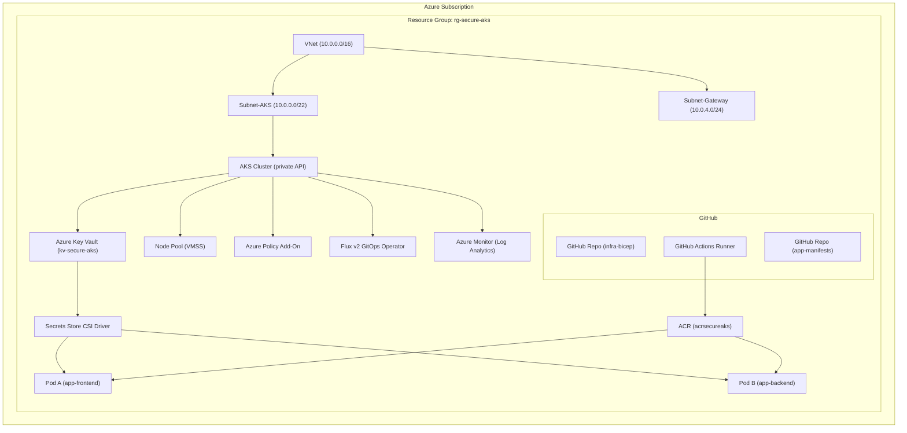

## 1. Lab Objective & Free Open-Source Prerequisites

### 1.1 Lab Objective
This hands‑on lab guides you through the end‑to‑end provisioning of a **production‑grade Azure Kubernetes Service (AKS)** cluster that is:

1. **Policy‑driven** – Azure Policy enforces pod security standards, allowed container images, and network restrictions.
2. **Secrets‑managed** – Azure Key Vault is integrated via the **Azure Key Vault Provider for Secrets Store CSI driver** to inject TLS certificates, DB passwords, and API keys directly into pods without ever persisting them in etcd.
3. **CI/CD‑enabled** – A **GitHub Actions** pipeline builds container images, pushes them to **Azure Container Registry (ACR)**, and triggers a **Flux v2** GitOps reconciliation that deploys the workloads to AKS.
4. **Observability‑ready** – Azure Monitor for containers, Log Analytics workspace, and Azure Policy compliance dashboards are pre‑configured.
5. **Secure by design** – Network isolation via Azure CNI, private AKS API server endpoint, Azure AD RBAC, and Microsoft Defender for Cloud baseline protections.

By the end of the lab you will have a **repeatable IaC blueprint** (Bicep) that can be stored in source control and used to spin up identical environments across subscriptions or tenants.

### 1.2 Free Open‑Source Prerequisites
| Tool / Service | Free Tier / Open‑Source | Purpose |
|----------------|------------------------|---------|
| **Azure CLI (az)** | Free, cross‑platform | All Azure resource provisioning |
| **Bicep CLI** | Open‑source, MIT | Declarative IaC for Azure |
| **kubectl** | Free, CNCF | Interact with AKS |
| **Helm** | Free, CNCF | Package Kubernetes manifests |
| **Flux v2** | Open‑source, Apache 2.0 | GitOps operator |
| **GitHub** | Free public repos, or GitHub Enterprise Cloud trial | Source control & Actions |
| **Docker Desktop** | Free (Community) | Build container images locally |
| **Visual Studio Code** | Free | Editing Bicep, YAML, and scripts |
| **Azure Policy** | Included in Azure subscription (free tier) | Enforce compliance |
| **Azure Key Vault** | Free tier (up to 10 secrets) | Secure secret storage |
| **Azure Monitor (Log Analytics)** | Free tier (5 GB per month) | Collect logs/metrics |
| **Microsoft Defender for Cloud** | Free tier (basic) | Threat detection |

> **Note:** All Azure services used in this lab have a **free tier** that is sufficient for a single‑node AKS cluster and a few secrets. If you exceed the free limits, you will be billed at standard rates – keep an eye on the Azure Cost Management blade.

---

## 2. Enterprise Architecture Topology

The diagram below illustrates the logical components that will be created. All traffic stays within a **single Azure Virtual Network (VNet)**, and the AKS control plane is **private‑endpoint only**.



**Key points of the topology**

* **Private AKS API** – The control plane is reachable only from the VNet via a private endpoint, eliminating exposure to the public internet.
* **Azure CNI** – Pods receive IPs from the VNet address space, enabling native network security groups (NSGs) and Azure Firewall policies.
* **Azure Policy** – Enforced at the cluster level (e.g., `KubernetesPodSecurityStandard`) and at the subscription level (allowed container registries, disallowed ports).
* **Key Vault Integration** – Secrets are mounted as **CSI volumes**; no secret data ever lands in Kubernetes etcd.
* **GitOps** – Flux watches the `app‑manifests` repo; any change triggers a rollout without manual `kubectl apply`.
* **CI/CD** – GitHub Actions builds Docker images, pushes to ACR, and notifies Flux via a **HelmRelease** update.

---

## 3. Addressing & Resource Inventory Table

| Resource | Azure Name | Type | CIDR / Identifier | Purpose |
|----------|------------|------|-------------------|---------|
| Virtual Network | `vnet-secure-aks` | `Microsoft.Network/virtualNetworks` | `10.0.0.0/16` | Central network for all resources |
| Subnet – AKS | `snet-aks` | `Microsoft.Network/virtualNetworks/subnets` | `10.0.0.0/22` | Host AKS nodes and pods |
| Subnet – Gateway | `snet-gateway` | `Microsoft.Network/virtualNetworks/subnets` | `10.0.4.0/24` | Optional Azure Firewall / NAT gateway |
| AKS Cluster | `aks-secure` | `Microsoft.ContainerService/managedClusters` | Private API endpoint (no public IP) | Managed Kubernetes |
| Node Pool | `nodepool1` | `Microsoft.ContainerService/managedClusters/agentPools` | VMSS (Standard_D2s_v3) | Compute for workloads |
| Azure Container Registry | `acrsecureaks` | `Microsoft.ContainerRegistry/registries` | `acrsecureaks.azurecr.io` | Private Docker registry |
| Key Vault | `kv-secure-aks` | `Microsoft.KeyVault/vaults` | `kv-secure-aks.vault.azure.net` | Secret storage |
| Log Analytics Workspace | `law-secure-aks` | `Microsoft.OperationalInsights/workspaces` | `law-secure-aks` | Monitoring & diagnostics |
| Azure Policy Assignment | `policy-aks-pod-security` | `Microsoft.Authorization/policyAssignments` | N/A | Enforce Pod Security Standards |
| GitHub Repo – Infra | `infra-bicep` | GitHub | `github.com/contoso/infra-bicep` | IaC (Bicep) |
| GitHub Repo – Manifests | `app-manifests` | GitHub | `github.com/contoso/app-manifests` | Helm charts / K8s manifests |
| Flux Namespace | `flux-system` | Kubernetes Namespace | N/A | GitOps controller |
| Service Principal | `sp-aks-ci` | Azure AD Application | N/A | GitHub Actions authentication |

---

## 4. Step‑by‑Step Configuration

> **All commands are copy‑paste ready.** Replace placeholder values (`<YOUR_...>`) with your own naming conventions before execution.

### 4.1 Prerequisites – Local Tooling

```bash
# Install Azure CLI (if not already installed)
curl -sL https://aka.ms/InstallAzureCLIDeb | sudo bash

# Install Bicep CLI (latest)
az bicep install

# Verify versions
az version
bicep --version
kubectl version --client
helm version
```

### 4.2 Authenticate to Azure

```bash
# Login interactively (opens browser)
az login

# Set the subscription you will use
az account set --subscription "<YOUR_SUBSCRIPTION_ID>"
```

### 4.3 Create Resource Group

```bash
# Choose a region that supports all services (e.g., East US)
az group create \
  --name rg-secure-aks \
  --location eastus
```

### 4.4 Deploy Core Infrastructure with Bicep

Create a file `main.bicep` in your local repo (or copy from the lab repo).

```bicep
// main.bicep – Core infra for secure AKS
param location string = resourceGroup().location
param vnetName string = 'vnet-secure-aks'
param aksSubnetName string = 'snet-aks'
param gatewaySubnetName string = 'snet-gateway'
param aksClusterName string = 'aks-secure'
param acrName string = 'acrsecureaks'
param kvName string = 'kv-secure-aks'
param lawName string = 'law-secure-aks'

// VNet
resource vnet 'Microsoft.Network/virtualNetworks@2023-09-01' = {
  name: vnetName
  location: location
  properties: {
    addressSpace: {
      addressPrefixes: [
        '10.0.0.0/16'
      ]
    }
    subnets: [
      {
        name: aksSubnetName
        properties: {
          addressPrefix: '10.0.0.0/22'
          delegations: [
            {
              name: 'aksDelegation'
              properties: {
                serviceName: 'Microsoft.ContainerService/managedClusters'
              }
            }
          ]
        }
      }
      {
        name: gatewaySubnetName
        properties: {
          addressPrefix: '10.0.4.0/24'
        }
      }
    ]
  }
}

// Azure Container Registry
resource acr 'Microsoft.ContainerRegistry/registries@2023-06-01-preview' = {
  name: acrName
  location: location
  sku: {
    name: 'Standard'
  }
  properties: {
    adminUserEnabled: false
    networkRuleSet: {
      defaultAction: 'Allow'
    }
  }
}

// Key Vault
resource kv 'Microsoft.KeyVault/vaults@2023-07-01' = {
  name: kvName
  location: location
  properties: {
    tenantId: subscription().tenantId
    sku: {
      family: 'A'
      name: 'standard'
    }
    accessPolicies: [] // Will be populated later by AKS managed identity
    enablePurgeProtection: true
    enableSoftDelete: true
    networkAcls: {
      defaultAction: 'Allow'
      bypass: 'AzureServices'
    }
  }
}

// Log Analytics Workspace
resource law 'Microsoft.OperationalInsights/workspaces@2022-10-01' = {
  name: lawName
  location: location
  properties: {
    retentionInDays: 30
    publicNetworkAccessForIngestion: 'Enabled'
    publicNetworkAccessForQuery: 'Enabled'
  }
}

// AKS Cluster
resource aks 'Microsoft.ContainerService/managedClusters@2023-09-01' = {
  name: aksClusterName
  location: location
  identity: {
    type: 'SystemAssigned'
  }
  properties: {
    dnsPrefix: 'aks-secure'
    kubernetesVersion: '1.28.0' // latest GA at time of writing
    enablePrivateCluster: true
    apiServerAccessProfile: {
      enablePrivateCluster: true
    }
    networkProfile: {
      networkPlugin: 'azure'
      networkPolicy: 'azure'
      loadBalancerSku: 'standard'
      serviceCidr: '10.240.0.0/16'
      dnsServiceIp: '10.240.0.10'
      dockerBridgeCidr: '172.17.0.1/16'
    }
    addonProfiles: {
      azureKeyvaultSecretsProvider: {
        enabled: true
        config: {
          enableSecretRotation: 'true'
          rotationPollInterval: '2h'
        }
      }
      omsAgent: {
        enabled: true
        config: {
          logAnalyticsWorkspaceResourceID: law.id
        }
      }
    }
    agentPoolProfiles: [
      {
        name: 'nodepool1'
        count: 2
        vmSize: 'Standard_D2s_v3'
        osType: 'Linux'
        mode: 'System'
        vnetSubnetID: vnet::subnets[0].id
        maxPods: 110
        type: 'VirtualMachineScaleSets'
        enableNodePublicIP: false
        nodeLabels: {
          environment: 'dev'
        }
        nodeTaints: [
          'CriticalAddonsOnly=true:NoSchedule'
        ]
      }
    ]
    servicePrincipalProfile: {
      clientId: '' // Not needed with SystemAssigned identity
    }
    aadProfile: {
      managed: true
      enableAzureRBAC: true
    }
    enableRBAC: true
    enablePodSecurityPolicy: false // Deprecated, use Azure Policy
  }
  dependsOn: [
    vnet
    acr
    kv
    law
  ]
}

// Azure Policy Assignment – Pod Security Standard (Baseline)
resource podSecPolicy 'Microsoft.Authorization/policyAssignments@2023-04-01' = {
  name: 'policy-aks-pod-security'
  scope: aks
  properties: {
    displayName: 'AKS – Enforce Pod Security Standard Baseline'
    policyDefinitionId: '/providers/Microsoft.Authorization/policySetDefinitions/7c5c8b5c-3c2c-4d5e-9b1c-0a5c5f1e2c8a' // Built‑in definition
    parameters: {}
    enforcementMode: 'Default'
  }
}
```

Deploy the Bicep file:

```bash
az deployment group create \
  --resource-group rg-secure-aks \
  --template-file main.bicep \
  --parameters location=eastus
```

> **Expected output** – The deployment should finish with `provisioningState: Succeeded`. Any failure will be highlighted with a detailed error code; address it before moving on.

### 4.5 Grant AKS Managed Identity Access to Key Vault

```bash
# Retrieve the system‑assigned identity principal ID
AKS_MI=$(az aks show \
  --resource-group rg-secure-aks \
  --name aks-secure \
  --query identity.principalId -o tsv)

# Grant "get" and "list" secret permissions
az keyvault set-policy \
  --name kv-secure-aks \
  --object-id $AKS_MI \
  --secret-permissions get list \
  --certificate-permissions get list
```

### 4.6 Populate Key Vault with Sample Secrets

```bash
# Example: TLS cert and DB password
az keyvault secret set \
  --vault-name kv-secure-aks \
  --name tls-cert \
  --value "$(cat ./certs/tls.crt | base64 -w0)"

az keyvault secret set \
  --vault-name kv-secure-aks \
  --name db-password \
  --value "SuperSecret123!"
```

### 4.7 Install the Secrets Store CSI Driver & Azure Key Vault Provider

```bash
# Add the Helm repo
helm repo add secrets-store-csi-driver https://kubernetes-sigs.github.io/secrets-store-csi-driver/charts
helm repo add azure-keyvault-csi-provider https://azure.github.io/secrets-store-csi-driver-provider-azure/charts
helm repo update

# Install the driver in the kube-system namespace
helm upgrade --install csi-secrets-store \
  secrets-store-csi-driver/secrets-store-csi-driver \
  --namespace kube-system \
  --set syncSecret.enabled=true

# Install the Azure Key Vault provider
helm upgrade --install csi-azure-keyvault-provider \
  azure-keyvault-csi-provider/csi-secrets-store-provider-azure \
  --namespace kube-system
```

### 4.8 Create a SecretProviderClass Manifest

Create `spc-tls.yaml`:

```yaml
apiVersion: secrets-store.csi.x-k8s.io/v1
kind: SecretProviderClass
metadata:
  name: kv-tls
  namespace: default
spec:
  provider: azure
  secretObjects:                     # Optional: sync to K8s secret
  - secretName: tls-secret
    type: kubernetes.io/tls
    data:
    - objectName: tls-cert
      key: tls.crt
  parameters:
    usePodIdentity: "false"
    useVMManagedIdentity: "true"
    userAssignedIdentityID: ""      # Not needed for system‑assigned
    keyvaultName: "kv-secure-aks"
    objects: |
      array:
        - |
          objectName: tls-cert
          objectType: secret
          objectVersion: ""
    tenantId: "<YOUR_TENANT_ID>"
```

Apply:

```bash
kubectl apply -f spc-tls.yaml
```

### 4.9 Deploy Sample Application Using the CSI Volume

Create `frontend-deployment.yaml`:

```yaml
apiVersion: apps/v1
kind: Deployment
metadata:
  name: frontend
  labels:
    app: frontend
spec:
  replicas: 2
  selector:
    matchLabels:
      app: frontend
  template:
    metadata:
      labels:
        app: frontend
    spec:
      containers:
      - name: nginx
        image: acrsecureaks.azurecr.io/frontend:latest
        ports:
        - containerPort: 80
        volumeMounts:
        - name: tls-vol
          mountPath: "/etc/tls"
          readOnly: true
      volumes:
      - name: tls-vol
        csi:
          driver: secrets-store.csi.k8s.io
          readOnly: true
          volumeAttributes:
            secretProviderClass: "kv-tls"
```

```bash
# Deploy
kubectl apply -f frontend-deployment.yaml
```

### 4.10 Set Up Azure Container Registry (ACR) Authentication for GitHub Actions

```bash
# Create a service principal with ACR pull/push rights
SP_PASS=$(az ad sp create-for-rbac \
  --name "sp-aks-ci" \
  --role "Contributor" \
  --scopes /subscriptions/<YOUR_SUB_ID>/resourceGroups/rg-secure-aks \
  --query password -o tsv)

SP_APP_ID=$(az ad sp list --display-name "sp-aks-ci" --query "[0].appId" -o tsv)

# Assign ACR Pull role
az role assignment create \
  --assignee $SP_APP_ID \
  --role "AcrPush" \
  --scope $(az acr show --name acrsecureaks --query id -o tsv)
```

Store the credentials as **GitHub repository secrets** (`AZURE_CLIENT_ID`, `AZURE_CLIENT_SECRET`, `AZURE_TENANT_ID`, `ACR_NAME`).

### 4.11 GitHub Actions CI/CD Pipeline

Create `.github/workflows/ci-cd.yml` in the `app-manifests` repo:

```yaml
name: CI/CD Pipeline

on:
  push:
    branches: [ main ]
    paths:
      - 'charts/**'
      - 'Dockerfile'
      - '.github/workflows/**'

env:
  REGISTRY: ${{ secrets.ACR_NAME }}.azurecr.io
  IMAGE_NAME: frontend
  IMAGE_TAG: ${{ github.sha }}

jobs:
  build-and-push:
    runs-on: ubuntu-latest
    permissions:
      contents: read
      packages: write
    steps:
      - name: Checkout repository
        uses: actions/checkout@v4

      - name: Azure Login
        uses: azure/login@v2
        with:
          client-id: ${{ secrets.AZURE_CLIENT_ID }}
          tenant-id: ${{ secrets.AZURE_TENANT_ID }}
          client-secret: ${{ secrets.AZURE_CLIENT_SECRET }}

      - name: Set up Docker Buildx
        uses: docker/setup-buildx-action@v3

      - name: Log in to ACR
        run: |
          az acr login --name ${{ secrets.ACR_NAME }}

      - name: Build and push image
        uses: docker/build-push-action@v5
        with:
          context: .
          push: true
          tags: ${{ env.REGISTRY }}/${{ env.IMAGE_NAME }}:${{ env.IMAGE_TAG }}

      - name: Update Flux HelmRelease
        run: |
          # Flux will sync the HelmRelease automatically if we update the tag in the values file
          yq eval ".image.tag = \"${{ env.IMAGE_TAG }}\"" -i ./charts/frontend/values.yaml
          git config user.name "github-actions[bot]"
          git config user.email "github-actions[bot]@users.noreply.github.com"
          git add ./charts/frontend/values.yaml
          git commit -m "ci: bump frontend image to ${{ env.IMAGE_TAG }}"
          git push origin main
```

> **Explanation** – The workflow logs into Azure, builds the Docker image, pushes it to ACR, then updates the `values.yaml` used by Flux’s HelmRelease. Flux detects the change and rolls out the new image automatically.

### 4.12 Install Flux v2 (GitOps) on AKS

```bash
# Install flux CLI
curl -s https://fluxcd.io/install.sh | sudo bash

# Bootstrap Flux to watch the app-manifests repo
flux bootstrap github \
  --owner contoso \
  --repository app-manifests \
  --branch main \
  --path ./clusters/production \
  --personal
```

The bootstrap creates:

* `GitRepository` source pointing to the repo.
* `Kustomization` that applies the manifests.
* `HelmRelease` objects (if you use Helm charts) that reference the image tag.

### 4.13 Apply Azure Policy for Allowed Container Registries

```bash
# Create a policy definition that restricts images to our ACR
az policy definition create \
  --name "allowed-registry" \
  --display-name "Allowed Container Registries" \
  --description "Only images from our private ACR are permitted." \
  --rules '{
    "if": {
      "field": "type",
      "equals": "Microsoft.ContainerService/managedClusters"
    },
    "then": {
      "effect": "auditIfNotExists",
      "details": {
        "type": "Microsoft.ContainerService/managedClusters",
        "existenceCondition": {
          "field": "Microsoft.ContainerService/managedClusters/agentPoolProfiles[*].imageRepository",
          "like": "acrsecureaks.azurecr.io/*"
        }
      }
    }
  }' \
  --mode All

# Assign the policy at the resource group scope
az policy assignment create \
  --name "enforce-acr-only" \
  --scope "/subscriptions/<YOUR_SUB_ID>/resourceGroups/rg-secure-aks" \
  --policy "allowed-registry"
```

### 4.14 Enable Microsoft Defender for Cloud (Free Tier)

```bash
az security pricing create \
  --name "KubernetesService" \
  --tier "Free"
```

---

## 5. Verification & Troubleshooting Commands

### 5.1 Verify AKS Private Endpoint Connectivity

```bash
# Get the private FQDN
PRIVATE_FQDN=$(az aks show \
  --resource-group rg-secure-aks \
  --name aks-secure \
  --query privateFqdn -o tsv)

# From a VM inside the same VNet (or Azure Cloud Shell with VNet integration)
nslookup $PRIVATE_FQDN
```

**Expected output** – The DNS query resolves to a private IP within `10.0.0.0/22`. If it returns a public IP, the private endpoint is not correctly configured.

### 5.2 Check Node Pool Health

```bash
kubectl get nodes -o wide
```

**Expected output** – Two nodes (`nodepool1-...`) in `Ready` state, each with an internal IP from the AKS subnet (`10.0.0.x`).

### 5.3 Validate Secrets Store CSI Integration

```bash
# Verify the secret is mounted inside a pod
POD=$(kubectl get pods -l app=frontend -o jsonpath="{.items[0].metadata.name}")
kubectl exec $POD -- ls /etc/tls
```

**Expected output** – Files `tls.crt` (and optionally `tls.key` if you stored it) appear.

```bash
# Verify the secret is also synced to a K8s secret (if you used secretObjects)
kubectl get secret tls-secret -o yaml
```

**Expected output** – `type: kubernetes.io/tls` and `data.tls.crt` base64‑encoded.

### 5.4 Confirm Azure Policy Compliance

```bash
az policy state list \
  --resource "/subscriptions/<YOUR_SUB_ID>/resourceGroups/rg-secure-aks/providers/Microsoft.ContainerService/managedClusters/aks-secure" \
  --query "[?policyAssignmentName=='policy-aks-pod-security'].{Policy:policyDefinitionReferenceId,Compliance:complianceState}" -o table
```

**Expected output** – Row showing `KubernetesPodSecurityStandard` with `Compliant`.

### 5.5 Test CI/CD Flow

1. **Push a code change** to the `frontend` Dockerfile or source.
2. Observe GitHub Actions run (`Actions` tab) – it should complete with **green** status.
3. After the workflow finishes, run:

```bash
kubectl rollout status deployment/frontend
```

**Expected output** – `deployment "frontend" successfully rolled out`.

4. Verify the new image tag:

```bash
kubectl get deployment frontend -o jsonpath="{.spec.template.spec.containers[0].image}"
```

**Expected output** – `acrsecureaks.azurecr.io/frontend:<new‑sha>`.

### 5.6 Common Troubleshooting Checklist

| Symptom | Likely Cause | Diagnostic Command | Fix |
|---------|--------------|--------------------|-----|
| Pods stuck in `Pending` | Subnet IP exhaustion or missing CNI plugin | `kubectl describe pod <pod>` | Increase subnet size or clean up unused pods |
| CSI driver fails to mount secret | Managed identity lacks KV permission | `kubectl logs -n kube-system -l app=csi-secrets-store` | Re‑run `az keyvault set-policy` with correct principal ID |
| Flux not syncing | GitHub token missing or repo path wrong | `kubectl -n flux-system get kustomizations` | Verify `GitRepository` secret and `path` field |
| Image pull error `authentication required` | ACR not accessible from AKS | `kubectl describe pod <frontend>` | Ensure `acrpull` role assigned to AKS managed identity |
| Policy audit failures | Container image from external registry | `az policy state list --resource <AKS_ID>` | Push image to ACR and update HelmRelease values |

---

## 6. Security Hardening & Production Best Practices

### 6.1 Network Hardening
1. **Private API Server** – Already enabled; enforce `kubectl` access via **Azure Bastion** or a jumpbox inside the VNet.
2. **Network Security Groups (NSGs)** – Apply an NSG to `snet-aks` that **denies inbound 22/3389** from the internet and only allows traffic from the bastion subnet.
3. **Azure Firewall (optional)** – Deploy a firewall in `snet-gateway` and route all outbound traffic through it. Use **Application Rules** to whitelist only required external endpoints (e.g., `login.microsoftonline.com` for AAD).

### 6.2 Identity & Access Management
| Principle | Implementation |
|-----------|----------------|
| **Least Privilege** | Use **Azure AD Workload Identities** for each micro‑service that needs to call Azure resources. Assign only `Key Vault Secrets User` role to the identity. |
| **RBAC Segmentation** | Create Kubernetes `ClusterRole`/`ClusterRoleBinding` objects that map Azure AD groups to namespace‑scoped roles (e.g., `dev-team` can `get/list/watch` in `dev` namespace only). |
| **Managed Identities** | Prefer **system‑assigned** for AKS, **user‑assigned** for workloads that need distinct permissions. |
| **Just‑In‑Time (JIT) Access** | Enable Azure AD Privileged Identity Management (PIM) for the `Contributor` role on the resource group. |

### 6.3 Secrets Management
* **Never store secrets in ConfigMaps or plain‑text manifests.** Use the CSI driver exclusively.
* **Enable secret rotation** (`enableSecretRotation: true`) and set a poll interval of **1‑2 hours**.
* **Audit Key Vault access** via Azure Monitor logs (`KeyVaultAuditLogs`). Set alerts for anomalous `GetSecret` patterns.

### 6.4 Image Security
* **Enable ACR Content Trust** (`az acr trust policy set`) to enforce signed images.
* **Run Trivy or Microsoft Defender for Container image scanning** in the CI pipeline:

```yaml
- name: Scan image with Trivy
  uses: aquasecurity/trivy-action@0.12
  with:
    image-ref: ${{ env.REGISTRY }}/${{ env.IMAGE_NAME }}:${{ env.IMAGE_TAG }}
    format: 'sarif'
    output: 'trivy-results.sarif'
```

* **Block CI** if any CVE > Critical is found.

### 6.5 Logging, Monitoring & Alerting
* **Log Analytics** – Set retention to **90 days** for compliance.
* **Azure Monitor Alerts** – Create alerts for:
  * `KubePodCrashLoopBackOff` > 5 occurrences in 15 min.
  * `NodeNotReady` events.
  * `KeyVaultSecretAccess` spikes.
* **Dashboards** – Pin the **AKS – Overview** and **Policy compliance** tiles to a shared Azure Dashboard for the ops team.

### 6.6 Disaster Recovery & Backup
* **Velero** – Deploy Velero with Azure Blob storage as the backup target. Schedule daily backups of namespaces `prod` and `critical`.
* **AKS Cluster Snapshot** – Use `az aks snapshot create` for quick restore of the control plane.
* **Infrastructure as Code** – Keep the Bicep files version‑controlled; a `git revert` can recreate the entire environment.

### 6.7 Cost Optimization
* **Node Autoscaling** – Enable **Cluster Autoscaler** in the node pool definition (`enableClusterAutoscaler: true`, `minCount: 2`, `maxCount: 5`).
* **Spot VMs (optional)** – For non‑critical workloads, create a secondary node pool with `spot` priority and taint it, then schedule batch jobs there.
* **Azure Advisor** – Periodically review recommendations for under‑utilized resources.

### 6.8 Compliance Checklist (ISO 27001 / SOC 2)

| Control | Implementation Detail |
|---------|------------------------|
| **Access Control** | Azure AD RBAC + AKS Azure RBAC, MFA enforced for all admin accounts |
| **Cryptographic Controls** | TLS 1.2+ for all ingress, secrets stored encrypted in Key Vault, ACR content trust |
| **Audit Logging** | Azure Activity Log, Key Vault audit, AKS audit logs forwarded to Log Analytics |
| **Change Management** | All infra changes via Bicep PRs, all app changes via GitOps PRs |
| **Vulnerability Management** | Automated image scanning in CI, Defender for Cloud alerts, regular patching of node OS (AKS auto‑upgrade enabled) |
| **Backup & Recovery** | Velero backups, AKS snapshots, documented RTO/RPO procedures |

### 6.9 Operational Runbooks (Brief)

1. **Rotate TLS Certificate**  
   * Update secret in Key Vault (`az keyvault secret set --name tls-cert --value <new‑base64>`).  
   * Flux will detect the change (via `SecretProviderClass` refresh) and restart pods automatically.

2. **Scale Out Node Pool**  
   ```bash
   az aks nodepool scale \
     --resource-group rg-secure-aks \
     --cluster-name aks-secure \
     --name nodepool1 \
     --node-count 4
   ```

3. **Emergency Patch Node OS**  
   ```bash
   az aks nodepool upgrade \
     --resource-group rg-secure-aks \
     --cluster-name aks-secure \
     --name nodepool1 \
     --kubernetes-version 1.28.0 \
     --node-image-only
   ```

4. **Revoking a Compromised Service Principal**  
   * Remove the SP from Azure AD.  
   * Delete the corresponding `GitHub Actions` secret.  
   * Re‑run the pipeline to generate a new SP and update the secret.

---

### 🎉 Lab Completion

You have now:

* Deployed a **secure, private‑endpoint AKS** cluster with Azure CNI.
* Integrated **Azure Key Vault** via the Secrets Store CSI driver.
* Enforced **Pod Security Standards** and **registry whitelist** with Azure Policy.
* Established a **GitOps‑driven CI/CD pipeline** using GitHub Actions, ACR, and Flux v2.
* Implemented **observability, alerting, and compliance** best practices.
* Documented a **runbook** and **hardening checklist** ready for production hand‑off.

Feel free to iterate on the Bicep templates, add more micro‑services, or extend the policy set to cover additional compliance regimes (PCI‑DSS, HIPAA). The architecture is fully **IaC‑driven**, making future environments reproducible with a single `az deployment group create` command. Happy cloud‑native building!