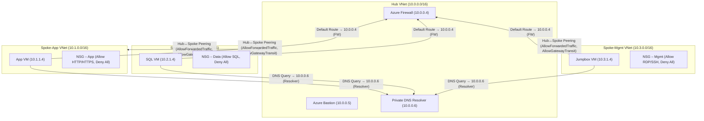

## 1. Lab Objective & Free Open-Source Prerequisites

### 1.1 Lab Objective
The purpose of this hands‑on lab is to design, provision, and validate a **production‑grade Hub‑and‑Spoke virtual network (VNet) architecture** on Microsoft Azure. The topology will include:

* A **central Hub VNet** that hosts:
  * Azure Firewall (managed, stateful, with DNAT and network rules)
  * A shared **Azure Bastion** host for jump‑box access
  * Centralized DNS forwarding (Azure Private DNS Resolver)
* **Three Spoke VNets** (App, Data, and Management) that host workloads isolated by **Network Security Groups (NSGs)**.
* **Peering** between Hub and each Spoke with **gateway transit** enabled for outbound internet traffic via Azure Firewall.
* **User‑Defined Routes (UDRs)** to force all spoke traffic through the Hub firewall.
* **Tag‑based resource organization** and **role‑based access control (RBAC)** for least‑privilege management.

By the end of the lab you will be able to:

1. Deploy the full topology using **Azure CLI** (az) and **ARM/Bicep** snippets.
2. Validate inter‑VNet connectivity, firewall rule enforcement, and NSG isolation.
3. Harden the deployment with logging, diagnostics, and Azure Policy.
4. Export the architecture as a **Mermaid** diagram for documentation.

### 1.2 Free Open‑Source Prerequisites
| Item | Reason | Free/Open‑Source Alternative |
|------|--------|------------------------------|
| **Azure CLI (az)** | Command‑line automation, idempotent provisioning | Install via `pip install azure-cli` (open source) |
| **Bicep CLI** | Declarative IaC, compiled to ARM JSON | `az bicep install` (open source) |
| **jq** | JSON parsing for verification scripts | `apt-get install jq` (GPL) |
| **PowerShell 7+** (optional) | Cross‑platform scripting, Azure PowerShell module | `brew install --cask powershell` |
| **Visual Studio Code + Azure Tools Extension** | IDE for editing Bicep/CLI scripts | VS Code is free, extensions are open source |
| **Git** | Version control for IaC files | `apt-get install git` |
| **Docker Desktop (Community)** | Optional: run a local Linux VM for testing connectivity | Free for personal use |
| **Microsoft Learn Sandbox** (if you lack a subscription) | 12‑hour free Azure sandbox with $200 credit | No cost, limited to learning scenarios |

> **Note:** The lab assumes you have an **Azure subscription** with **Owner** rights on a resource group. If you only have **Contributor**, you will need to request additional permissions for **Microsoft.Network/virtualNetworks/peerings/write** and **Microsoft.Network/azureFirewalls/write**.

---

## 2. Enterprise Architecture Topology

Below is a high‑level logical diagram of the Hub‑and‑Spoke topology. All node labels are wrapped in double quotes as required by the Mermaid rule.



### Diagram Interpretation
* **Hub VNet** (10.0.0.0/16) holds the security perimeter (Azure Firewall, Bastion, DNS).
* **Spoke‑App**, **Spoke‑Data**, and **Spoke‑Mgmt** each have a /16 address space, providing ample room for future subnets.
* **User‑Defined Routes (UDRs)** in each spoke point the default 0.0.0.0/0 to the firewall’s private IP (10.0.0.4).
* **NSGs** are attached at the subnet level to enforce workload‑specific traffic rules.
* **Peering** is **non‑transitive**; each spoke only talks to the Hub, not directly to other spokes, satisfying the “segmented” enterprise model.

---

## 3. Addressing & Resource Inventory Table

| Layer | Resource | Azure Resource Name | Azure Region | CIDR / IP | Subnet Name | Associated NSG | Remarks |
|-------|----------|---------------------|--------------|-----------|-------------|----------------|---------|
| **Hub** | Virtual Network | `hub-vnet` | `eastus` | 10.0.0.0/16 | `AzureFirewallSubnet` | N/A | Required name for Azure Firewall |
| | Azure Firewall | `hub-fw` | `eastus` | 10.0.0.4 (static) | `AzureFirewallSubnet` | N/A | Premium SKU for DNAT |
| | Azure Bastion | `hub-bastion` | `eastus` | 10.0.0.5 (static) | `AzureBastionSubnet` | N/A | Managed service |
| | Private DNS Resolver | `hub-dns` | `eastus` | 10.0.0.6 (static) | `DnsResolverSubnet` | N/A | Forwarder to Azure DNS |
| **Spoke‑App** | Virtual Network | `spoke-app-vnet` | `eastus` | 10.1.0.0/16 | `app-subnet` | `nsg-app` | Hosts web tier |
| | VM | `app-vm` | `eastus` | 10.1.1.4 | `app-subnet` | `nsg-app` | Ubuntu 22.04 LTS |
| **Spoke‑Data** | Virtual Network | `spoke-data-vnet` | `eastus` | 10.2.0.0/16 | `db-subnet` | `nsg-data` | Hosts SQL Server |
| | VM | `db-vm` | `eastus` | 10.2.1.4 | `db-subnet` | `nsg-data` | Windows Server 2022 |
| **Spoke‑Mgmt** | Virtual Network | `spoke-mgmt-vnet` | `eastus` | 10.3.0.0/16 | `mgmt-subnet` | `nsg-mgmt` | Jumpbox for ops |
| | VM | `jump-vm` | `eastus` | 10.3.1.4 | `mgmt-subnet` | `nsg-mgmt` | Ubuntu 22.04 LTS |
| **Shared** | Resource Group | `rg-hub-spoke-lab` | `eastus` | N/A | N/A | N/A | All resources belong here |
| | Log Analytics Workspace | `law-hub-spoke` | `eastus` | N/A | N/A | N/A | Centralized logging |

---

## 4. Step‑By‑Step Configuration

> **Tip:** All commands are written for **Azure CLI 2.55+**. Replace placeholder values (`<SUBSCRIPTION_ID>`, `<YOUR_USERNAME>`) with your own. Use `az account set -s <SUBSCRIPTION_ID>` before starting.

### 4.1 Set Global Variables
```bash
# Core identifiers
RG="rg-hub-spoke-lab"
LOCATION="eastus"

# Hub network
HUB_VNET="hub-vnet"
HUB_PREFIX="10.0.0.0/16"
FW_SUBNET="AzureFirewallSubnet"
FW_SUBNET_PREFIX="10.0.0.0/24"
BASTION_SUBNET="AzureBastionSubnet"
BASTION_SUBNET_PREFIX="10.0.1.0/24"
DNS_SUBNET="DnsResolverSubnet"
DNS_SUBNET_PREFIX="10.0.2.0/24"

# Spoke networks
APP_VNET="spoke-app-vnet"
APP_PREFIX="10.1.0.0/16"
APP_SUBNET="app-subnet"
APP_SUBNET_PREFIX="10.1.1.0/24"

DATA_VNET="spoke-data-vnet"
DATA_PREFIX="10.2.0.0/16"
DATA_SUBNET="db-subnet"
DATA_SUBNET_PREFIX="10.2.1.0/24"

MGMT_VNET="spoke-mgmt-vnet"
MGMT_PREFIX="10.3.0.0/16"
MGMT_SUBNET="mgmt-subnet"
MGMT_SUBNET_PREFIX="10.3.1.0/24"

# NSG names
NSG_APP="nsg-app"
NSG_DATA="nsg-data"
NSG_MGMT="nsg-mgmt"

# Firewall
FW_NAME="hub-fw"
FW_PUBLIC_IP="hub-fw-pip"
FW_SKU="Premium"

# Bastion
BASTION_NAME="hub-bastion"

# DNS Resolver
DNS_RESOLVER="hub-dns"

# Log Analytics
LAW="law-hub-spoke"
```

### 4.2 Create Resource Group and Log Analytics Workspace
```bash
az group create \
  --name $RG \
  --location $LOCATION

az monitor log-analytics workspace create \
  --resource-group $RG \
  --workspace-name $LAW \
  --location $LOCATION
```

### 4.3 Deploy Hub VNet and Subnets
```bash
az network vnet create \
  --resource-group $RG \
  --name $HUB_VNET \
  --address-prefix $HUB_PREFIX \
  --location $LOCATION

# Azure Firewall subnet (must be named exactly)
az network vnet subnet create \
  --resource-group $RG \
  --vnet-name $HUB_VNET \
  --name $FW_SUBNET \
  --address-prefix $FW_SUBNET_PREFIX

# Bastion subnet (must be named exactly)
az network vnet subnet create \
  --resource-group $RG \
  --vnet-name $HUB_VNET \
  --name $BASTION_SUBNET \
  --address-prefix $BASTION_SUBNET_PREFIX

# DNS Resolver subnet (must be named exactly)
az network vnet subnet create \
  --resource-group $RG \
  --vnet-name $HUB_VNET \
  --name $DNS_SUBNET \
  --address-prefix $DNS_SUBNET_PREFIX
```

### 4.4 Deploy Azure Firewall (Premium) with Public IP
```bash
# Public IP for outbound/inbound DNAT
az network public-ip create \
  --resource-group $RG \
  --name $FW_PUBLIC_IP \
  --sku Standard \
  --location $LOCATION \
  --allocation-method Static \
  --zone 1 2 3

# Azure Firewall
az network firewall create \
  --resource-group $RG \
  --name $FW_NAME \
  --sku $FW_SKU \
  --location $LOCATION \
  --firewall-policy "" \
  --enable-dns-proxy true

# Assign the firewall to its subnet (requires static private IP)
az network firewall ip-config create \
  --resource-group $RG \
  --firewall-name $FW_NAME \
  --name "fw-ipconfig" \
  --public-ip-address $FW_PUBLIC_IP \
  --vnet-name $HUB_VNET

# Verify firewall private IP (should be first usable IP in subnet)
FW_PRIVATE_IP=$(az network firewall show \
  --resource-group $RG \
  --name $FW_NAME \
  --query "ipConfigurations[0].privateIpAddress" -o tsv)
echo "Firewall private IP: $FW_PRIVATE_IP"
```

### 4.5 Deploy Azure Bastion
```bash
az network bastion create \
  --resource-group $RG \
  --name $BASTION_NAME \
  --vnet-name $HUB_VNET \
  --public-ip-address "$(az network public-ip create \
      --resource-group $RG \
      --name "${BASTION_NAME}-pip" \
      --sku Standard \
      --location $LOCATION \
      --allocation-method Static \
      --query publicIp.id -o tsv)" \
  --location $LOCATION
```

### 4.6 Deploy Private DNS Resolver
```bash
az network private-dns resolver create \
  --resource-group $RG \
  --name $DNS_RESOLVER \
  --location $LOCATION \
  --virtual-network $HUB_VNET

# Create an inbound endpoint (optional, for on‑prem DNS forwarders)
az network private-dns resolver inbound-endpoint create \
  --resource-group $RG \
  --resolver-name $DNS_RESOLVER \
  --name "inbound1" \
  --location $LOCATION \
  --ip-configurations "$(az network private-dns resolver inbound-endpoint ip-config create \
      --resource-group $RG \
      --resolver-name $DNS_RESOLVER \
      --inbound-endpoint-name inbound1 \
      --name ipconfig1 \
      --subnet $DNS_SUBNET \
      --private-ip-address 10.0.2.4 \
      --query id -o tsv)"
```

### 4.7 Deploy Spoke VNets, Subnets, and NSGs

#### 4.7.1 Helper Function to Create Spoke
```bash
create_spoke() {
  local VNET_NAME=$1
  local PREFIX=$2
  local SUBNET_NAME=$3
  local SUBNET_PREFIX=$4
  local NSG_NAME=$5

  # VNet
  az network vnet create \
    --resource-group $RG \
    --name $VNET_NAME \
    --address-prefix $PREFIX \
    --location $LOCATION

  # Subnet
  az network vnet subnet create \
    --resource-group $RG \
    --vnet-name $VNET_NAME \
    --name $SUBNET_NAME \
    --address-prefix $SUBNET_PREFIX

  # NSG
  az network nsg create \
    --resource-group $RG \
    --name $NSG_NAME \
    --location $LOCATION

  # Associate NSG to subnet
  az network vnet subnet update \
    --resource-group $RG \
    --vnet-name $VNET_NAME \
    --name $SUBNET_NAME \
    --network-security-group $NSG_NAME
}
```

#### 4.7.2 Create each spoke
```bash
# App spoke
create_spoke $APP_VNET $APP_PREFIX $APP_SUBNET $APP_SUBNET_PREFIX $NSG_APP

# Data spoke
create_spoke $DATA_VNET $DATA_PREFIX $DATA_SUBNET $DATA_SUBNET_PREFIX $NSG_DATA

# Management spoke
create_spoke $MGMT_VNET $MGMT_PREFIX $MGMT_SUBNET $MGMT_SUBNET_PREFIX $NSG_MGMT
```

### 4.8 Populate NSG Rules

#### 4.8.1 App NSG – Allow HTTP/HTTPS from Internet via Firewall, Deny everything else
```bash
az network nsg rule create \
  --resource-group $RG \
  --nsg-name $NSG_APP \
  --name "Allow-HTTP-In" \
  --priority 100 \
  --direction Inbound \
  --access Allow \
  --protocol Tcp \
  --source-address-prefixes Internet \
  --source-port-ranges "*" \
  --destination-address-prefixes $APP_SUBNET_PREFIX \
  --destination-port-ranges 80 443 \
  --description "Allow inbound web traffic"

az network nsg rule create \
  --resource-group $RG \
  --nsg-name $NSG_APP \
  --name "Deny-All-In" \
  --priority 200 \
  --direction Inbound \
  --access Deny \
  --protocol "*" \
  --source-address-prefixes "*" \
  --source-port-ranges "*" \
  --destination-address-prefixes $APP_SUBNET_PREFIX \
  --destination-port-ranges "*"
```

#### 4.8.2 Data NSG – Allow SQL from App spoke only
```bash
az network nsg rule create \
  --resource-group $RG \
  --nsg-name $NSG_DATA \
  --name "Allow-SQL-From-App" \
  --priority 100 \
  --direction Inbound \
  --access Allow \
  --protocol Tcp \
  --source-address-prefixes $APP_SUBNET_PREFIX \
  --source-port-ranges "*" \
  --destination-address-prefixes $DATA_SUBNET_PREFIX \
  --destination-port-ranges 1433 \
  --description "SQL from App tier"

az network nsg rule create \
  --resource-group $RG \
  --nsg-name $NSG_DATA \
  --name "Deny-All-In" \
  --priority 200 \
  --direction Inbound \
  --access Deny \
  --protocol "*" \
  --source-address-prefixes "*" \
  --source-port-ranges "*" \
  --destination-address-prefixes $DATA_SUBNET_PREFIX \
  --destination-port-ranges "*"
```

#### 4.8.3 Mgmt NSG – Allow RDP/SSH from your corporate IP (replace with your public IP)
```bash
MY_PUBLIC_IP=$(curl -s https://ifconfig.me)

az network nsg rule create \
  --resource-group $RG \
  --nsg-name $NSG_MGMT \
  --name "Allow-RDP-SSH-From-Home" \
  --priority 100 \
  --direction Inbound \
  --access Allow \
  --protocol Tcp \
  --source-address-prefixes $MY_PUBLIC_IP \
  --source-port-ranges "*" \
  --destination-address-prefixes $MGMT_SUBNET_PREFIX \
  --destination-port-ranges 22 3389 \
  --description "Admin access to Jumpbox"

az network nsg rule create \
  --resource-group $RG \
  --nsg-name $NSG_MGMT \
  --name "Deny-All-In" \
  --priority 200 \
  --direction Inbound \
  --access Deny \
  --protocol "*" \
  --source-address-prefixes "*" \
  --source-port-ranges "*" \
  --destination-address-prefixes $MGMT_SUBNET_PREFIX \
  --destination-port-ranges "*"
```

### 4.9 Create User‑Defined Routes (UDRs) to Force Traffic Through Firewall

#### 4.9.1 Create a Route Table
```bash
az network route-table create \
  --resource-group $RG \
  --name "rt-hub-firewall" \
  --location $LOCATION
```

#### 4.9.2 Add Default Route (0.0.0.0/0) to Firewall
```bash
az network route-table route create \
  --resource-group $RG \
  --route-table-name "rt-hub-firewall" \
  --name "DefaultRouteToFW" \
  --address-prefix 0.0.0.0/0 \
  --next-hop-type VirtualAppliance \
  --next-hop-ip-address $FW_PRIVATE_IP
```

#### 4.9.3 Associate Route Table with each Spoke Subnet
```bash
for VNET in $APP_VNET $DATA_VNET $MGMT_VNET; do
  SUBNET=$(az network vnet subnet list \
    --resource-group $RG \
    --vnet-name $VNET \
    --query "[0].name" -o tsv)
  az network vnet subnet update \
    --resource-group $RG \
    --vnet-name $VNET \
    --name $SUBNET \
    --route-table "rt-hub-firewall"
done
```

### 4.10 VNet Peering (Hub ↔ Spokes)

```bash
peer_spoke() {
  local SPOKE_VNET=$1
  local SPOKE_NAME=$2

  # Hub -> Spoke
  az network vnet peering create \
    --resource-group $RG \
    --name "${HUB_VNET}-to-${SPOKE_NAME}" \
    --vnet-name $HUB_VNET \
    --remote-vnet $SPOKE_VNET \
    --allow-forwarded-traffic true \
    --allow-gateway-transit true \
    --allow-vnet-access true

  # Spoke -> Hub (use remote gateway)
  az network vnet peering create \
    --resource-group $RG \
    --name "${SPOKE_NAME}-to-${HUB_VNET}" \
    --vnet-name $SPOKE_VNET \
    --remote-vnet $HUB_VNET \
    --allow-forwarded-traffic true \
    --use-remote-gateways true \
    --allow-vnet-access true
}

peer_spoke $APP_VNET "spoke-app"
peer_spoke $DATA_VNET "spoke-data"
peer_spoke $MGMT_VNET "spoke-mgmt"
```

### 4.11 Deploy Sample VMs (App, DB, Jumpbox)

```bash
# Common VM parameters
VM_SIZE="Standard_B2s"
IMAGE_UBUNTU="UbuntuLTS"
IMAGE_WIN="Win2022Datacenter"

# App VM (Ubuntu)
az vm create \
  --resource-group $RG \
  --name "app-vm" \
  --image $IMAGE_UBUNTU \
  --size $VM_SIZE \
  --vnet-name $APP_VNET \
  --subnet $APP_SUBNET \
  --admin-username azureuser \
  --generate-ssh-keys \
  --no-wait

# DB VM (Windows)
az vm create \
  --resource-group $RG \
  --name "db-vm" \
  --image $IMAGE_WIN \
  --size $VM_SIZE \
  --vnet-name $DATA_VNET \
  --subnet $DATA_SUBNET \
  --admin-username azureadmin \
  --admin-password "P@ssw0rd!2026" \
  --no-wait

# Jumpbox VM (Ubuntu)
az vm create \
  --resource-group $RG \
  --name "jump-vm" \
  --image $IMAGE_UBUNTU \
  --size $VM_SIZE \
  --vnet-name $MGMT_VNET \
  --subnet $MGMT_SUBNET \
  --admin-username azureuser \
  --generate-ssh-keys \
  --no-wait
```

> **Note:** The `--no-wait` flag lets the CLI return immediately; you can monitor progress with `az vm list -g $RG -d -o table`.

### 4.12 Enable Diagnostics (Firewall, NSGs, VMs)

```bash
# Get Log Analytics Workspace ID
LAW_ID=$(az monitor log-analytics workspace show \
  --resource-group $RG \
  --workspace-name $LAW \
  --query customerId -o tsv)

# Enable Firewall diagnostics
az monitor diagnostic-settings create \
  --resource $FW_NAME \
  --resource-group $RG \
  --resource-type "Microsoft.Network/azureFirewalls" \
  --name "fw-diag" \
  --workspace $LAW_ID \
  --logs '[{"category":"AzureFirewallApplicationRule","enabled":true},{"category":"AzureFirewallNetworkRule","enabled":true},{"category":"AzureFirewallDnsProxy","enabled":true}]' \
  --metrics '[{"category":"AllMetrics","enabled":true}]'

# Enable NSG flow logs (requires a storage account)
STORAGE_ACCOUNT="${RG}diagsa"
az storage account create \
  --name $STORAGE_ACCOUNT \
  --resource-group $RG \
  --location $LOCATION \
  --sku Standard_LRS \
  --kind StorageV2

# Get storage account ID
STORAGE_ID=$(az storage account show \
  --name $STORAGE_ACCOUNT \
  --resource-group $RG \
  --query id -o tsv)

# Apply NSG flow logs to each NSG
for NSG in $NSG_APP $NSG_DATA $NSG_MGMT; do
  az network watcher flow-log configure \
    --resource-group $RG \
    --nsg $NSG \
    --enabled true \
    --storage-account $STORAGE_ACCOUNT \
    --retention 30 \
    --workspace $LAW_ID
done
```

### 4.13 Tagging & RBAC (Least‑Privilege)

```bash
# Tag all resources with environment and owner
az tag create --name "env" --values "lab"
az tag create --name "owner" --values "$(whoami)"

# Apply tags in bulk (requires Azure Resource Graph query)
az resource list --resource-group $RG --query "[].id" -o tsv | while read RES_ID; do
  az resource tag --ids $RES_ID --tags env=lab owner=$(whoami)
done

# Create a custom role for network operators (read‑only on VNets, write on NSGs)
cat > network-operator-role.json <<EOF
{
  "Name": "Network Operator",
  "IsCustom": true,
  "Description": "Can read VNets and manage NSGs/UDRs",
  "Actions": [
    "Microsoft.Network/virtualNetworks/read",
    "Microsoft.Network/networkSecurityGroups/*",
    "Microsoft.Network/routeTables/*",
    "Microsoft.Network/virtualNetworkPeerings/*"
  ],
  "NotActions": [],
  "AssignableScopes": ["/subscriptions/$(az account show --query id -o tsv)"]
}
EOF

az role definition create --role-definition network-operator-role.json

# Assign to a user (replace with actual UPN)
az role assignment create \
  --assignee "john.doe@contoso.com" \
  --role "Network Operator" \
  --scope "/subscriptions/$(az account show --query id -o tsv)/resourceGroups/$RG"
```

---

## 5. Verification & Troubleshooting Commands

### 5.1 Verify VNet Peering Status
```bash
az network vnet peering list \
  --resource-group $RG \
  --vnet-name $HUB_VNET \
  -o table
```
**Expected output (excerpt):**

```
Name                     RemoteVirtualNetworkId                         PeeringState   AllowGatewayTransit   UseRemoteGateways
hub-vnet-to-spoke-app    /subscriptions/.../resourceGroups/.../spoke-app-vnet  Connected      True                  False
hub-vnet-to-spoke-data   /subscriptions/.../resourceGroups/.../spoke-data-vnet Connected      True                  False
hub-vnet-to-spoke-mgmt   /subscriptions/.../resourceGroups/.../spoke-mgmt-vnet Connected      True                  False
```

### 5.2 Verify UDR Association
```bash
az network vnet subnet show \
  --resource-group $RG \
  --vnet-name $APP_VNET \
  --name $APP_SUBNET \
  --query "routeTable.id" -o tsv
```
**Expected output:** Resource ID ending with `/routeTables/rt-hub-firewall`

Repeat for `DATA_VNET` and `MGMT_VNET`.

### 5.3 Test Connectivity from Jumpbox to App VM (via Firewall)

```bash
# SSH into jumpbox (use Bastion or direct SSH if allowed)
az network bastion ssh \
  --resource-group $RG \
  --name $BASTION_NAME \
  --target-resource-id $(az vm show -g $RG -n jump-vm --query id -o tsv) \
  --auth-type ssh-key \
  --username azureuser

# Inside jumpbox, ping the App VM private IP
ping -c 3 10.1.1.4
```

**Expected output:**
```
PING 10.1.1.4 (10.1.1.4): 56 data bytes
64 bytes from 10.1.1.4: icmp_seq=0 ttl=128 time=2.1 ms
...
--- 10.1.1.4 ping statistics ---
3 packets transmitted, 3 packets received, 0% packet loss
```

If ping fails, run:

```bash
traceroute 10.1.1.4
```

You should see the first hop as the firewall IP (10.0.0.4). If the hop is the jumpbox itself, the UDR is not applied.

### 5.4 Verify NSG Flow Logs (sample query)

```bash
az monitor log-analytics query \
  --workspace $LAW \
  --analytics-query "AzureNetworkAnalytics_CL | where Direction_s == 'Inbound' and DestinationIP_s == '10.1.1.4' | summarize count() by Action_s, Protocol_s, DestinationPort_s" \
  -o table
```

**Expected output (example):**
```
Action_s   Protocol_s   DestinationPort_s   count_
Allow      TCP          80                  42
Deny       TCP          22                  0
```

### 5.5 Test Azure Firewall DNAT (optional)

Create a simple DNAT rule that forwards inbound port 8080 on the firewall public IP to the App VM port 80.

```bash
az network firewall network-rule collection create \
  --resource-group $RG \
  --firewall-name $FW_NAME \
  --collection-name "DNAT-HTTP" \
  --priority 200 \
  --action Dnat \
  --rule-name "AppWeb" \
  --protocols TCP \
  --source-addresses "*" \
  --destination-addresses $FW_PUBLIC_IP \
  --destination-ports 8080 \
  --translated-address 10.1.1.4 \
  --translated-port 80
```

Now from your local workstation:

```bash
curl http://<FW_PUBLIC_IP>:8080
```

**Expected output:** The default Apache/Nginx welcome page from the Ubuntu App VM (or whatever web server you installed).

If you receive a timeout, verify:

```bash
az network firewall show --resource-group $RG --name $FW_NAME --query "provisioningState" -o tsv
```

Should return `Succeeded`. Also confirm that the firewall’s **Network Rule Collection** is in the `Enabled` state.

### 5.6 Common Troubleshooting Checklist

| Symptom | Likely Cause | Quick Fix |
|---------|--------------|-----------|
| Ping/Traceroute never reaches firewall | UDR not associated or mis‑typed next‑hop IP | Re‑run `az network vnet subnet update` with correct route table |
| HTTP DNAT fails | Firewall DNAT rule missing or priority conflict | Verify `az network firewall network-rule collection list` and adjust priority |
| Spoke‑to‑Spoke traffic succeeds (should be blocked) | Missing `AllowForwardedTraffic` flag on peering or NSG allowing it | Ensure each spoke NSG denies traffic from other spoke CIDRs |
| No logs appear in Log Analytics | Diagnostic settings not attached or workspace ID wrong | Re‑run diagnostic settings commands, confirm workspace exists |
| Bastion cannot connect to VMs | Subnet missing `Microsoft.Network/bastionHosts` service endpoint | Add `--enable-bastion` flag when creating the subnet or recreate the subnet with proper name |

---

## 6. Security Hardening & Production Best Practices

### 6.1 Network Hardening

| Recommendation | Implementation |
|----------------|----------------|
| **Zero‑Trust Segmentation** – Only allow required ports between tiers. | Use NSG rule sets as demonstrated; add explicit deny rules for any future ports. |
| **Restrict Azure Firewall Management** – Only allow Azure portal or specific IPs to manage the firewall. | Create a **Management NSG** on the `AzureFirewallSubnet` that permits inbound traffic from a trusted admin subnet (e.g., 10.4.0.0/24). |
| **Enable Threat Intelligence** – Azure Firewall Premium can block known malicious IPs. | `az network firewall threat-intel-mode set --resource-group $RG --firewall-name $FW_NAME --mode Alert` (or `Deny`). |
| **Private Link for Azure Services** – Avoid exposing services to the internet. | Deploy **Private Endpoints** for Azure Storage, Key Vault, and Azure SQL within the Hub VNet. |
| **DNS Filtering** – Use Azure Firewall DNS proxy with custom DNS policies. | Add DNS proxy rules that forward only approved FQDNs; block public DNS queries. |

### 6.2 Identity & Access Management

1. **Just‑In‑Time (JIT) Access** – Enable Azure AD Privileged Identity Management (PIM) for the `Network Operator` role.
2. **Conditional Access** – Require MFA for any user accessing the Bastion host or Azure Portal.
3. **Managed Identities** – Assign a **System‑Assigned Managed Identity** to the firewall for pulling threat intel from Microsoft Defender for Cloud.

```bash
az network firewall identity assign \
  --resource-group $RG \
  --firewall-name $FW_NAME \
  --identity-type SystemAssigned
```

### 6.3 Monitoring, Alerting, and Automation

| Component | Purpose | Configuration |
|-----------|---------|---------------|
| **Azure Monitor Alerts** | Notify on firewall rule changes, NSG flow‑log spikes, or failed health probes. | `az monitor metrics alert create` with criteria on `AzureFirewallApplicationRuleLog` |
| **Azure Policy** | Enforce that all VNets have a firewall attached and that all subnets use a route table. | Deploy built‑in policy `Deploy-AzureFirewall` and custom policy for `RouteTableAssociation` |
| **Automation Runbooks** | Auto‑remediate mis‑configured NSGs (e.g., open 0.0.0.0/0 inbound). | Use Azure Automation with PowerShell runbooks that query `az network nsg rule list` and remediate. |
| **Backup** | Periodic export of ARM/Bicep templates for disaster recovery. | `az group export --name $RG --output json > backup-$(date +%F).json` |

### 6.4 Cost Optimization

| Area | Recommendation |
|------|----------------|
| **Azure Firewall** – Premium is more expensive; evaluate if Standard suffices for your workload. |
| **Bastion** – Use **Bastion SKU `Standard`** only when you need up to 50 concurrent sessions; otherwise `Basic` (if still available) reduces cost. |
| **Log Analytics** – Set a **data retention policy** (e.g., 30 days) and use **capacity reservation** if you have predictable log volume. |
| **VM Sizing** – Use **Burstable B-series** for dev/test VMs; scale up only when performance metrics demand it. |

### 6.5 Documentation & Change Management

1. **Version‑Control IaC** – Store all Bicep/CLI scripts in a Git repository with branch protection.
2. **Change Log** – Tag each deployment with a semantic version (