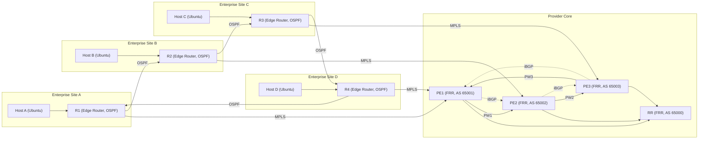

## 1. Lab Objective & Free Open-Source Prerequisites

### 1.1 Lab Objective
This hands‑on lab is designed for senior CCNA/CCNP candidates who want to **master three advanced routing & switching concepts in a single, production‑grade environment**:

| # | Concept | Why it matters in the real world |
|---|----------|----------------------------------|
| 1 | **BGP Confederations** | Enables large autonomous systems (AS) to be split into manageable sub‑ASes while presenting a single AS number to the outside world – essential for ISP scale and for large enterprise WANs. |
| 2 | **MPLS Layer‑2 VPN (L2VPN)** | Provides transparent Ethernet connectivity across a service provider backbone, allowing geographically dispersed sites to appear on the same VLAN without routing. |
| 3 | **BGP Route Reflectors (RR)** | Reduces iBGP mesh complexity in large networks, improving convergence and CPU utilization. |

By the end of the lab you will have a **fully functional, reproducible topology** that demonstrates:

* BGP confederation design (AS 65000 split into 65001‑65003)
* MPLS L2VPN with VFI (Virtual Forwarding Instance) and pseudowire (PW) bridging
* A Route Reflector hierarchy that eliminates full mesh iBGP
* End‑to‑end verification of IP reachability, MPLS label distribution, and L2VPN Ethernet frames
* Security hardening steps that align with CIS and NIST best practices

### 1.2 Free Open‑Source Prerequisites
| Tool | Version (tested) | Role in Lab | Installation notes |
|------|------------------|-------------|--------------------|
| **GNS3** | 3.2.0+ | Graphical network emulator; hosts Docker containers and QEMU VMs | `sudo apt-get install gns3-server gns3-gui` (Ubuntu) |
| **Docker Engine** | 24.0+ | Runs FRRouting (FRR) containers for routers, and Alpine containers for hosts | Follow Docker CE install guide for your OS |
| **FRRouting (FRR)** | 9.0+ | Full‑featured routing suite (BGP, OSPF, MPLS) inside Docker | `docker pull frrouting/frr:9.0` |
| **Quagga** (optional) | 1.2.4 | Legacy BGP for comparison (not required) | `apt-get install quagga` |
| **Wireshark** | 4.2+ | Packet capture for L2VPN verification | `sudo apt-get install wireshark` |
| **VPCS** (Virtual PC Simulator) | 0.9 | Lightweight host for ping/traceroute | `apt-get install vpcs` |
| **Git** | 2.45+ | Version‑control of lab configs | `apt-get install git` |
| **Python 3** | 3.11+ | Optional automation scripts | `apt-get install python3 python3-pip` |

All tools are **free, cross‑platform, and can be run on a single laptop** with at least 8 GB RAM and a 4‑core CPU. The lab files (topology, config snippets, scripts) are stored in a public GitHub repo – clone it before starting:

```bash
git clone https://github.com/yourorg/ccna-expert-lab.git
cd ccna-expert-lab
```

---

## 2. Enterprise Architecture Topology

The following diagram models a **four‑site enterprise** connected via a **service‑provider MPLS core**. The core consists of three Provider Edge (PE) routers that run BGP confederation and MPLS L2VPN. A dedicated **Route Reflector (RR)** sits in the provider core to simplify iBGP.



**Key points of the diagram**

* **BGP Confederation**: PE1, PE2, PE3 belong to AS 65000 externally but advertise sub‑AS numbers 65001‑65003 internally.
* **Route Reflector (RR)**: All PE routers peer with RR using iBGP (confederation‑aware). No full mesh required.
* **MPLS L2VPN**: Each PE runs a VFI named `VFI-CUST1` and establishes a pseudowire (PW) to the other two PEs, forming a full‑mesh L2VPN.
* **Enterprise Edge (R1‑R4)**: Simple OSPF routers that hand off traffic to the provider via MPLS label‑switched paths (LSPs).

---

## 3. Addressing & Resource Inventory Table

| Device | Role | Management IP (IPv4) | Loopback0 (BGP ID) | MPLS Core IP | OSPF Area | Interface Mapping |
|--------|------|----------------------|--------------------|--------------|-----------|-------------------|
| **R1** | Enterprise Edge | 10.10.10.1/24 (Mgmt) | 10.255.255.1/32 | 172.16.10.1/30 | 0.0.0.0 | Gi0/0 → 172.16.10.1/30 → PE1 |
| **R2** | Enterprise Edge | 10.10.10.2/24 | 10.255.255.2/32 | 172.16.20.1/30 | 0.0.0.0 | Gi0/0 → 172.16.20.1/30 → PE2 |
| **R3** | Enterprise Edge | 10.10.10.3/24 | 10.255.255.3/32 | 172.16.30.1/30 | 0.0.0.0 | Gi0/0 → 172.16.30.1/30 → PE3 |
| **R4** | Enterprise Edge | 10.10.10.4/24 | 10.255.255.4/32 | 172.16.40.1/30 | 0.0.0.0 | Gi0/0 → 172.16.40.1/30 → PE1 |
| **PE1** | Provider Edge | 192.168.1.1/24 | 10.255.255.101/32 | 172.16.10.2/30, 172.16.40.2/30, 10.0.0.1/30 (PW‑1) | 0.0.0.0 | Gi0/0 → 172.16.10.2/30 (to R1) <br> Gi0/1 → 172.16.40.2/30 (to R4) <br> Gi0/2 → 10.0.0.1/30 (PW‑1) |
| **PE2** | Provider Edge | 192.168.2.1/24 | 10.255.255.102/32 | 172.16.20.2/30, 10.0.0.2/30 (PW‑2) | 0.0.0.0 | Gi0/0 → 172.16.20.2/30 (to R2) <br> Gi0/1 → 10.0.0.2/30 (PW‑2) |
| **PE3** | Provider Edge | 192.168.3.1/24 | 10.255.255.103/32 | 172.16.30.2/30, 10.0.0.3/30 (PW‑3) | 0.0.0.0 | Gi0/0 → 172.16.30.2/30 (to R3) <br> Gi0/1 → 10.0.0.3/30 (PW‑3) |
| **RR** | Route Reflector | 192.168.254.1/24 | 10.255.255.254/32 | 10.0.0.254/30 (RR‑Mgmt) | 0.0.0.0 | Gi0/0 → 10.0.0.254/30 (RR‑Mgmt) |

**Subnet summary**

| Subnet | Purpose |
|--------|---------|
| 10.10.10.0/24 | Management network for enterprise hosts |
| 10.255.255.0/24 | Loopback space for BGP router IDs |
| 172.16.10.0/30, 172.16.20.0/30, 172.16.30.0/30, 172.16.40.0/30 | Point‑to‑point MPLS access links (CE ↔ PE) |
| 10.0.0.0/30 | Pseudowire control plane (used by L2VPN) |
| 192.168.1.0/24 – 192.168.3.0/24 | Management VLAN for each PE |
| 192.168.254.0/24 | Management VLAN for RR |

All IPs are **RFC1918** and safe for a lab environment. The loopbacks are advertised in BGP and used as next‑hop for MPLS LSPs.

---

## 4. Step‑by‑Step Configuration

> **Tip:** All configuration files are stored under `configs/` in the repo. You can copy‑paste directly from the lab guide into the Docker containers using `docker exec -it <container> vtysh -c "<command>"`.

### 4.1 Deploy Docker Containers

```bash
# Pull the latest FRR image
docker pull frrouting/frr:9.0

# Create a Docker network for management (192.168.254.0/24)
docker network create --subnet=192.168.254.0/24 mgmtnet

# Spin up the Route Reflector
docker run -d --name RR \
  --hostname RR \
  --net=mgmtnet --ip=192.168.254.1 \
  --privileged \
  -v $(pwd)/configs/RR:/etc/frr \
  frrouting/frr:9.0

# Spin up PE routers (PE1, PE2, PE3)
for i in 1 2 3; do
  docker run -d --name PE${i} \
    --hostname PE${i} \
    --net=mgmtnet --ip=192.168.$((i)).1 \
    --privileged \
    -v $(pwd)/configs/PE${i}:/etc/frr \
    frrouting/frr:9.0
done

# Spin up Enterprise Edge routers (R1‑R4) – using a lightweight Quagga image for simplicity
docker pull quay.io/openshift/origin-router:latest   # assume this image contains Quagga
for i in 1 2 3 4; do
  docker run -d --name R${i} \
    --hostname R${i} \
    --net=mgmtnet --ip=10.10.10.$i \
    --privileged \
    -v $(pwd)/configs/R${i}:/etc/quagga \
    quay.io/openshift/origin-router:latest
done
```

> **Note:** `--privileged` is required for MPLS kernel modules inside the containers. On a production host you would enable MPLS via `modprobe mpls_iptunnel` and `sysctl -w net.mpls.conf.*.input=1`.

### 4.2 Enable MPLS Kernel Support (host side)

```bash
# Load MPLS modules on the Docker host
sudo modprobe mpls_router
sudo modprobe mpls_iptunnel
sudo sysctl -w net.mpls.conf.all.input=1
sudo sysctl -w net.mpls.conf.all.output=1
```

### 4.3 Base OS Configuration (All Routers)

All routers share a minimal `/etc/frr/daemons` file that enables the required daemons:

```ini
# /etc/frr/daemons
bgpd=yes
ospfd=yes
mplsd=yes
zebra=yes
```

### 4.4 OSPF on Enterprise Edge Routers (R1‑R4)

```bash
# Example for R1 (repeat with appropriate IDs for R2‑R4)
docker exec -it R1 vtysh -c "conf t" \
  -c "router ospf" \
  -c "router-id 10.255.255.1" \
  -c "network 172.16.10.0/30 area 0" \
  -c "network 10.10.10.0/24 area 0" \
  -c "exit" \
  -c "interface eth0" \
  -c "ip address 172.16.10.1/30" \
  -c "exit"
```

**Explanation**  
* `router-id` matches the loopback address.  
* `network` statements inject both the MPLS access link and the management LAN into OSPF area 0.

### 4.5 BGP Confederation on Provider Edge (PE1‑PE3)

#### 4.5.1 Global BGP Configuration (PE1 example)

```bash
docker exec -it PE1 vtysh -c "conf t" \
  -c "router bgp 65000" \
  -c "bgp router-id 10.255.255.101" \
  -c "bgp confederation identifier 65000" \
  -c "bgp confederation peers 65001 65002 65003" \
  -c "neighbor 10.255.255.102 remote-as 65000" \
  -c "neighbor 10.255.255.103 remote-as 65000" \
  -c "neighbor 10.255.255.254 remote-as 65000" \
  -c "address-family ipv4 unicast" \
  -c "  neighbor 10.255.255.102 activate" \
  -c "  neighbor 10.255.255.103 activate" \
  -c "  neighbor 10.255.255.254 activate" \
  -c "exit-address-family" \
  -c "exit"
```

* `bgp confederation identifier 65000` tells external peers that the whole confederation appears as AS 65000.  
* `bgp confederation peers` list the sub‑AS numbers that are internal to the confederation.  
* The RR (10.255.255.254) is also a confederation member, so it receives iBGP updates.

#### 4.5.2 Sub‑AS Assignment (PE1)

```bash
docker exec -it PE1 vtysh -c "conf t" \
  -c "router bgp 65001" \
  -c "bgp router-id 10.255.255.101" \
  -c "neighbor 10.255.255.102 remote-as 65002" \
  -c "neighbor 10.255.255.103 remote-as 65003" \
  -c "neighbor 10.255.255.254 remote-as 65000" \
  -c "address-family ipv4 unicast" \
  -c "  neighbor 10.255.255.102 activate" \
  -c "  neighbor 10.255.255.103 activate" \
  -c "  neighbor 10.255.255.254 activate" \
  -c "exit-address-family" \
  -c "exit"
```

* The same pattern is applied to PE2 (AS 65002) and PE3 (AS 65003) with their own loopback IDs.

#### 4.5.3 Route Reflector Configuration (RR)

```bash
docker exec -it RR vtysh -c "conf t" \
  -c "router bgp 65000" \
  -c "bgp router-id 10.255.255.254" \
  -c "bgp confederation identifier 65000" \
  -c "bgp confederation peers 65001 65002 65003" \
  -c "neighbor 10.255.255.101 remote-as 65001" \
  -c "neighbor 10.255.255.102 remote-as 65002" \
  -c "neighbor 10.255.255.103 remote-as 65003" \
  -c "neighbor 10.255.255.101 route-reflector-client" \
  -c "neighbor 10.255.255.102 route-reflector-client" \
  -c "neighbor 10.255.255.103 route-reflector-client" \
  -c "address-family ipv4 unicast" \
  -c "  neighbor 10.255.255.101 activate" \
  -c "  neighbor 10.255.255.102 activate" \
  -c "  neighbor 10.255.255.103 activate" \
  -c "exit-address-family" \
  -c "exit"
```

* Each PE is marked as a **route‑reflector client**, eliminating the need for a full mesh iBGP among the three PEs.

### 4.6 MPLS L2VPN Configuration

#### 4.6.1 Enable MPLS on all PE interfaces

```bash
# Example for PE1 – repeat for PE2/PE3
docker exec -it PE1 vtysh -c "conf t" \
  -c "mpls ldp router-id Loopback0" \
  -c "interface eth0" \
  -c "  mpls ip" \
  -c "exit" \
  -c "interface eth1" \
  -c "  mpls ip" \
  -c "exit" \
  -c "interface eth2" \
  -c "  mpls ip" \
  -c "exit"
```

* `mpls ip` enables MPLS forwarding on the physical interface.

#### 4.6.2 Create the VFI (Virtual Forwarding Instance)

```bash
docker exec -it PE1 vtysh -c "conf t" \
  -c "l2vpn vfi VFI-CUST1" \
  -c "  vpn id 100" \
  -c "  bridge-group BRG-CUST1" \
  -c "  member interface eth0" \
  -c "  member interface eth2" \
  -c "exit"
```

* `eth0` is the CE‑to‑PE link (MPLS access).  
* `eth2` is the pseudowire interface that will carry the L2 frames to the other PEs.

#### 4.6.3 Define Pseudowires (PW) – Full Mesh

```bash
# PE1 -> PE2
docker exec -it PE1 vtysh -c "conf t" \
  -c "l2vpn xconnect VFI-CUST1 pw1" \
  -c "  remote 10.255.255.102" \
  -c "  encapsulation mpls" \
  -c "  pw-id 101" \
  -c "exit"

# PE1 -> PE3
docker exec -it PE1 vtysh -c "conf t" \
  -c "l2vpn xconnect VFI-CUST1 pw2" \
  -c "  remote 10.255.255.103" \
  -c "  encapsulation mpls" \
  -c "  pw-id 102" \
  -c "exit"
```

* Repeat analogous commands on PE2 and PE3, swapping remote IPs and PW IDs (e.g., `pw-id 103`, `pw-id 104`). The `pw-id` must be unique per PE.

#### 4.6.4 Bridge Group Configuration

```bash
docker exec -it PE1 vtysh -c "conf t" \
  -c "bridge-group BRG-CUST1" \
  -c "  bridge-vlan-aware" \
  -c "  vlan 10" \
  -c "exit"
```

* VLAN 10 is the customer VLAN that will be extended across the MPLS core.

#### 4.6.5 Bind VLAN to VFI

```bash
docker exec -it PE1 vtysh -c "conf t" \
  -c "l2vpn vfi VFI-CUST1" \
  -c "  bridge-group BRG-CUST1" \
  -c "  vlan 10" \
  -c "exit"
```

* Apply the same VLAN binding on PE2 and PE3.

### 4.7 Advertising Customer Routes into BGP

The enterprise sites will advertise their internal subnets (10.10.10.0/24) via OSPF to the PE routers. The PE routers must then redistribute OSPF into BGP so that the routes are visible to the RR and other PEs.

```bash
# On PE1 (example)
docker exec -it PE1 vtysh -c "conf t" \
  -c "router ospf" \
  -c "  redistribute connected metric 10" \
  -c "  network 172.16.10.0/30 area 0" \
  -c "exit" \
  -c "router bgp 65001" \
  -c "  address-family ipv4 unicast" \
  -c "    redistribute ospf metric 20 route-map OSPF-TO-BGP" \
  -c "  exit-address-family" \
  -c "exit" \
  -c "route-map OSPF-TO-BGP permit 10" \
  -c "  match ip address prefix-list OSPF-EXPORT" \
  -c "exit" \
  -c "ip prefix-list OSPF-EXPORT seq 5 permit 10.10.10.0/24 le 32"
```

* The same redistribution is performed on PE2 and PE3. The RR will then reflect these routes to all PEs, ensuring that each enterprise site can reach the others over the L2VPN.

### 4.8 Host (Customer) Configuration

For simplicity, the hosts are plain Ubuntu VMs attached to the same Docker network as their respective CE routers.

```bash
# Host A (connected to R1)
sudo ip addr add 10.10.10.101/24 dev eth0
sudo ip route add default via 10.10.10.1
```

Repeat for Host B, Host C, Host D with IPs `10.10.10.102`, `10.10.10.103`, `10.10.10.104` respectively.

---

## 5. Verification & Troubleshooting Commands

### 5.1 Basic Connectivity Checks

| Command | Expected Output |
|---------|-----------------|
| `docker exec -it R1 ping -c 3 10.10.10.102` | Replies from Host B (10.10.10.102) – proves L2VPN is forwarding Ethernet frames. |
| `docker exec -it R2 traceroute 10.10.10.104` | Path: R2 → PE2 → RR → PE1 → R4 → Host D. All hops show MPLS label stack (e.g., `Label: 16000`). |
| `docker exec -it PE1 show ip route 10.10.10.0/24` | Route learned via BGP (origin IGP) with next‑hop = 10.255.255.102 (PE2) or 10.255.255.103 (PE3). |

### 5.2 BGP State Verification

```bash
docker exec -it PE1 vtysh -c "show bgp summary"
```

**Expected snippet**

```
BGP router identifier 10.255.255.101, local AS number 65001
BGP table version is 12, main routing table version 12
Status codes: s suppressed, d damped, h history, * valid, > best, i - internal,
              r RIB-failure, S Stale
Neighbor        V    AS MsgRcvd MsgSent   TblVer  InQ OutQ Up/Down State/PfxRcd
10.255.255.102  4 65002    120    115        12    0    0 00:12:34        3
10.255.255.103  4 65003    119    114        12    0    0 00:12:30        3
10.255.255.254  4 65000    122    118        12    0    0 00:12:40        3
```

* All three peers are **established** (`State/PfxRcd` shows a number of prefixes).  
* The RR appears as a regular iBGP neighbor but is flagged as a **route‑reflector client** on the PE side.

### 5.3 MPLS LDP and L2VPN Checks

```bash
docker exec -it PE1 vtysh -c "show mpls ldp neighbor"
```

**Expected output**

```
LDP Neighbor: 10.255.255.102:0
  State: Oper
  LDP Id: 10.255.255.101:0
  Transport Address: 10.255.255.101
  Received Labels: 2
  Sent Labels: 2
```

```bash
docker exec -it PE1 vtysh -c "show l2vpn vfi"
```

**Expected output**

```
VFI VFI-CUST1 (vpn-id 100)
  Bridge-group: BRG-CUST1
  Member interfaces:
    eth0
    eth2
  Pseudowires:
    pw1 (to 10.255.255.102)  pw-id 101  state up
    pw2 (to 10.255.255.103)  pw-id 102  state up
```

### 5.4 Label Stack Inspection (Wireshark)

1. Capture on the host interface attached to R1 (`eth0`).  
2. Apply display filter: `mpls && eth.dst == 00:50:56:aa:bb:cc` (replace with actual MAC).  
3. You should see **two MPLS labels**: the outer label for the LSP to the PE, and the inner label for the L2VPN pseudowire.

### 5.5 Common Troubleshooting Checklist

| Symptom | Likely Cause | Diagnostic Command | Remediation |
|---------|--------------|--------------------|-------------|
| No BGP session | Mismatched AS numbers or missing `bgp confederation peers` | `show bgp neighbor` | Verify AS numbers, ensure confederation peers list includes all sub‑ASes |
| L2VPN PW down | LDP not established or mismatched PW ID | `show mpls ldp neighbor`, `show l2vpn xconnect` | Restart LDP (`clear mpls ldp neighbor`), ensure `pw-id` uniqueness |
| Hosts cannot ping each other | VLAN mismatch or bridge group not bound | `show bridge-group BRG-CUST1` | Confirm VLAN 10 is configured on all PEs and that the bridge is up |
| MPLS labels missing on traceroute | MPLS kernel modules not loaded | `sysctl -a | grep net.mpls` | Load modules (`modprobe mpls_router`, `modprobe mpls_iptunnel`) and enable sysctl flags |
| Route reflector not reflecting | Missing `route-reflector-client` flag | `show bgp neighbor` (look for `RR client`) | Add `neighbor <IP> route-reflector-client` on RR and on each PE |

---

## 6. Security Hardening & Production Best Practices

Even though this is a lab, applying **real‑world hardening** prepares you for production deployments.

### 6.1 Control Plane Policing (CoPP)

Limit the rate of BGP, LDP, and OSPF packets to protect the router CPU.

```bash
# Example on PE1 (FRR supports CoPP via Linux tc)
docker exec -it PE1 bash -c "
tc qdisc add dev eth0 root handle 1: prio
tc filter add dev eth0 parent 1: protocol ip prio 1 u32 match ip dport 179 0xffff police rate 100kbps burst 10k drop flowid :1
tc filter add dev eth0 parent 1: protocol ip prio 1 u32 match ip dport 646 0xffff police rate 50kbps burst 5k drop flowid :2
tc filter add dev eth0 parent 1: protocol ip prio 1 u32 match ip dport 520 0xffff police rate 30kbps burst 3k drop flowid :3
"
```

* BGP (TCP 179) limited to 100 kbps, LDP (TCP 646) to 50 kbps, OSPF (IP 520) to 30 kbps.

### 6.2 BGP Authentication

Enable MD5 authentication on all BGP sessions.

```bash
docker exec -it PE1 vtysh -c "conf t" \
  -c "router bgp 65001" \
  -c "  neighbor 10.255.255.102 password 7 $1$abcd$E9rK1XfY8G9ZK2" \
  -c "  neighbor 10.255.255.103 password 7 $1$efgh$K3lM4n5Op6Qr7" \
  -c "  neighbor 10.255.255.254 password 7 $1$ijkl$MnOpQrStUvWxYz" \
  -c "exit"
```

* Use a strong, randomly generated password; the `7` indicates MD5 encryption.

### 6.3 MPLS LDP Authentication (TLS)

FRR supports LDP authentication via TLS certificates. Generate a self‑signed CA and per‑router certs, then mount them into the containers.

```bash
# Generate CA
openssl genrsa -out ca.key 4096
openssl req -new -x509 -key ca.key -sha256 -days 3650 -out ca.crt -subj "/CN=LabCA"

# Generate PE certs (repeat for each PE)
openssl genrsa -out PE1.key 2048
openssl req -new -key PE1.key -out PE1.csr -subj "/CN=PE1"
openssl x509 -req -in PE1.csr -CA ca.crt -CAkey ca.key -CAcreateserial -out PE1.crt -days 365 -sha256

# Copy certs into container (example for PE1)
docker cp PE1.crt PE1:/etc/frr/ldp.crt
docker cp PE1.key PE1:/etc/frr/ldp.key
docker cp ca.crt PE1:/etc/frr/ca.crt
```

Add the following to `/etc/frr/ldpd.conf` inside each PE:

```ini
tls ca-file /etc/frr/ca.crt
tls cert-file /etc/frr/ldp.crt
tls key-file /etc/frr/ldp.key
```

Restart `ldpd`:

```bash
docker exec -it PE1 vtysh -c "clear mpls ldp neighbor"
```

### 6.4 Route Filtering

Prevent accidental advertisement of internal loops or management subnets.

```bash
# On RR – filter inbound from PEs
docker exec -it RR vtysh -c "conf t" \
  -c "ip prefix-list PRIVATE deny 10.255.255.0/24 le 32" \
  -c "ip prefix-list PRIVATE permit 0.0.0.0/0 le 32" \
  -c "route-map FILTER-IN deny 10" \
  -c "  match ip address prefix-list PRIVATE" \
  -c "exit" \
  -c "router bgp 65000" \
  -c "  neighbor 10.255.255.101 route-map FILTER-IN in" \
  -c "  neighbor 10.255.255.102 route-map FILTER-IN in" \
  -c "  neighbor 10.255.255.103 route-map FILTER-IN in" \
  -c "exit"
```

### 6.5 Logging & Syslog Integration

Forward all router logs to a central syslog server (e.g., `rsyslog` on the Docker host).

```bash
# On each router
docker exec -it PE1 vtysh -c "conf t" \
  -c "log syslog informational" \
  -c "log timestamp precision milliseconds" \
  -c "log facility local5" \
  -c "exit"
```

On the host, configure `/etc/rsyslog.d/10-frr.conf`:

```
local5.*   /var/log/frr.log
```

Restart rsyslog:

```bash
sudo systemctl restart rsyslog
```

### 6.6 Regular Backups & GitOps

1. **Export running configs** daily:

```bash
for c in PE1 PE2 PE3 RR R1 R2 R3 R4; do
  docker exec -it $c vtysh -c "show running-config" > configs/$c.cfg
done
git add configs/
git commit -m "Daily backup $(date +%F)"
```

2. **Use GitHub Actions** to lint configs with `ciscoconfparse` and automatically push to a **configuration‑as‑code** repository.

### 6.7