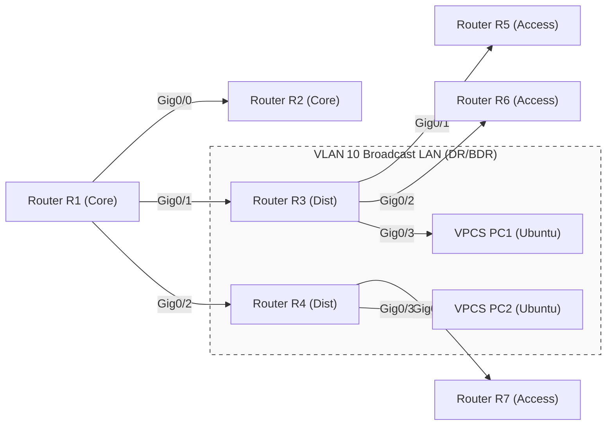

## 1. Lab Objective & Free Open-Source Prerequisites

### 1.1 Lab Objective
The purpose of this lab is to give candidates hands‑on experience with a **multi‑area OSPF** design that mirrors a realistic enterprise WAN. Participants will:

1. **Design and implement** a three‑area OSPF network (Area 0, Area 1, Area 2) using Cisco IOS‑XE routers.
2. **Configure** and validate **DR/BDR election** on a multi‑access broadcast segment.
3. **Generate, filter, and troubleshoot** OSPF LSAs (Router, Network, Summary, and External) using native IOS commands.
4. **Validate** OSPF adjacency, route propagation, and convergence behavior.
5. **Apply security hardening** (authentication, passive interfaces, route‑map filtering) and document production‑grade best practices.

### 1.2 Free Open‑Source Prerequisites
| Item | Recommended Version | Download / Install |
|------|---------------------|--------------------|
| **GNS3** (graphical network emulator) | 3.2+ (supports IOS‑XE) | <https://www.gns3.com/software/download> |
| **Cisco IOS‑XE images** (e.g., `c7200-advipservicesk9-mz.152-4.S5.bin`) | Any 15.x image with OSPF support | Obtain via Cisco DevNet (requires Cisco.com account) |
| **VPCS** (lightweight host emulator) | 0.9+ | Bundled with GNS3 |
| **Wireshark** (packet capture) | 4.2+ | <https://www.wireshark.org/download.html> |
| **PuTTY** (SSH/Telnet client) | 0.78+ | <https://www.putty.org/> |
| **Python 3** (optional for automation) | 3.11+ | <https://www.python.org/downloads/> |
| **Git** (optional for version control) | 2.44+ | <https://git-scm.com/downloads> |

> **Note:** All tools listed are free for personal and educational use. The lab can also be reproduced on **EVE‑NG** or **Cisco Packet Tracer** if IOS‑XE images are unavailable, but GNS3 provides the most realistic IOS‑XE CLI experience.

### 1.3 System Requirements
- **CPU:** 4‑core (Intel i5/i7 or AMD equivalent) – virtualization heavily uses CPU.
- **RAM:** Minimum 8 GB (12 GB+ recommended for smooth GNS3 operation).
- **Disk:** 20 GB free SSD space for IOS images and project files.
- **Network:** No external connectivity required; all traffic stays inside the virtual lab.

---

## 2. Enterprise Architecture Topology

The topology models a **core‑distribution‑access** hierarchy with three OSPF areas:

- **Area 0 (Backbone):** Core routers `R1` and `R2`.
- **Area 1 (Distribution):** `R3` and `R4` attached to `R1`.
- **Area 2 (Access):** `R5`, `R6`, and `R7` attached to `R3` and `R4`.

A **broadcast LAN** (VLAN 10) connects `R3`, `R4`, and a **VPCS host** (`PC1`) to demonstrate DR/BDR election. All routers run OSPF version 2 (IPv4).  



**Key design points**

- **Area 0** is the backbone; all other areas must connect to it directly or via virtual links (not used here).
- **DR/BDR election** occurs on the broadcast LAN (VLAN 10) where `R3` and `R4` share the same OSPF network.
- **Loop‑free topology** is guaranteed by OSPF’s SPF algorithm; however, mis‑configurations (e.g., missing area statements) will be intentionally introduced for troubleshooting practice.
- **IP addressing** follows a hierarchical scheme (see Section 3).

---

## 3. Addressing & Resource Inventory Table

| Device | Interface | IPv4 Address | Subnet Mask | OSPF Area | Description |
|--------|-----------|--------------|-------------|-----------|-------------|
| **R1** | Gig0/0 | 10.0.0.1 | /30 | 0 | Core ↔ R2 |
| **R1** | Gig0/1 | 10.0.1.1 | /30 | 0 | Core ↔ R3 |
| **R1** | Gig0/2 | 10.0.2.1 | /30 | 0 | Core ↔ R4 |
| **R2** | Gig0/0 | 10.0.0.2 | /30 | 0 | Core ↔ R1 |
| **R2** | Gig0/1 | 10.0.3.1 | /30 | 0 | Core ↔ External (simulated ISP) |
| **R3** | Gig0/0 | 10.0.1.2 | /30 | 0 | Dist ↔ R1 |
| **R3** | Gig0/1 | 10.0.4.1 | /30 | 1 | Dist ↔ R5 |
| **R3** | Gig0/2 | 10.0.5.1 | /30 | 1 | Dist ↔ R6 |
| **R3** | Gig0/3 | 192.168.10.1 | /24 | 1 | Broadcast LAN (DR/BDR) |
| **R4** | Gig0/0 | 10.0.2.2 | /30 | 0 | Dist ↔ R1 |
| **R4** | Gig0/1 | 10.0.6.1 | /30 | 2 | Dist ↔ R7 |
| **R4** | Gig0/3 | 192.168.10.2 | /24 | 1 | Broadcast LAN (DR/BDR) |
| **R5** | Gig0/0 | 10.0.4.2 | /30 | 1 | Access ↔ R3 |
| **R5** | Gig0/1 | 172.16.5.1 | /24 | 1 | Host LAN |
| **R6** | Gig0/0 | 10.0.5.2 | /30 | 1 | Access ↔ R3 |
| **R6** | Gig0/1 | 172.16.6.1 | /24 | 1 | Host LAN |
| **R7** | Gig0/0 | 10.0.6.2 | /30 | 2 | Access ↔ R4 |
| **R7** | Gig0/1 | 172.16.7.1 | /24 | 2 | Host LAN |
| **PC1** | eth0 | 192.168.10.10 | /24 | N/A | VPCS host on Broadcast LAN |
| **PC2** | eth0 | 192.168.10.11 | /24 | N/A | VPCS host on Broadcast LAN |

> **Tip:** Use the `ipcalc` utility (or an online subnet calculator) to verify that each /30 point‑to‑point link contains exactly two usable host addresses.

---

## 4. Step‑by‑Step Configuration

> **Important:** All commands are **copy‑and‑paste ready**. Insert them into the router console (via GNS3 console window) in the order shown. Inline comments (`!`) explain each line.

### 4.1 Global Settings (All Routers)

```text
! Enable privileged EXEC mode
enable
! Set a common enable secret (production would use unique secrets)
enable secret CCNA2026!
! Configure a domain name for crypto
ip domain-name lab.ccna.local
! Disable IPv6 (optional, reduces attack surface)
no ipv6 unicast-routing
! Turn off unnecessary services
no ip http server
no ip http secure-server
! Enable logging to console (debug level for lab)
logging console debugging
! Set the router hostname (replace <HOST> with actual name)
hostname <HOST>
```

> **Note:** Replace `<HOST>` with the appropriate router name (`R1`, `R2`, …). The same block is applied to each router, adjusting only the hostname.

### 4.2 Interface Configuration

Below are the full interface configurations for each router. Copy the block that matches the device you are configuring.

#### 4.2.1 Router R1 (Core)

```text
hostname R1
!
interface GigabitEthernet0/0
 description Core-to-R2
 ip address 10.0.0.1 255.255.255.252
 no shutdown
!
interface GigabitEthernet0/1
 description Core-to-R3
 ip address 10.0.1.1 255.255.255.252
 no shutdown
!
interface GigabitEthernet0/2
 description Core-to-R4
 ip address 10.0.2.1 255.255.255.252
 no shutdown
!
router ospf 1
 router-id 1.1.1.1
 log-adjacency-changes
 passive-interface default
 no passive-interface GigabitEthernet0/0
 no passive-interface GigabitEthernet0/1
 no passive-interface GigabitEthernet0/2
 network 10.0.0.0 0.0.0.255 area 0
!
line vty 0 4
 login local
 transport input ssh
!
crypto key generate rsa general-keys modulus 2048
ip ssh version 2
username admin privilege 15 secret AdminPass2026!
```

#### 4.2.2 Router R2 (Core)

```text
hostname R2
!
interface GigabitEthernet0/0
 description Core-to-R1
 ip address 10.0.0.2 255.255.255.252
 no shutdown
!
interface GigabitEthernet0/1
 description Simulated ISP
 ip address 10.0.3.1 255.255.255.252
 no shutdown
!
router ospf 1
 router-id 2.2.2.2
 log-adjacency-changes
 passive-interface default
 no passive-interface GigabitEthernet0/0
 network 10.0.0.0 0.0.0.255 area 0
!
line vty 0 4
 login local
 transport input ssh
!
crypto key generate rsa general-keys modulus 2048
ip ssh version 2
username admin privilege 15 secret AdminPass2026!
```

#### 4.2.3 Router R3 (Distribution – Area 1)

```text
hostname R3
!
interface GigabitEthernet0/0
 description Dist-to-R1
 ip address 10.0.1.2 255.255.255.252
 no shutdown
!
interface GigabitEthernet0/1
 description Dist-to-R5
 ip address 10.0.4.1 255.255.255.252
 no shutdown
!
interface GigabitEthernet0/2
 description Dist-to-R6
 ip address 10.0.5.1 255.255.255.252
 no shutdown
!
interface GigabitEthernet0/3
 description Broadcast LAN (DR/BDR)
 ip address 192.168.10.1 255.255.255.0
 no shutdown
!
router ospf 1
 router-id 3.3.3.3
 log-adjacency-changes
 passive-interface default
 no passive-interface GigabitEthernet0/0
 no passive-interface GigabitEthernet0/1
 no passive-interface GigabitEthernet0/2
 no passive-interface GigabitEthernet0/3
 network 10.0.0.0 0.0.0.255 area 0
 network 10.0.4.0 0.0.0.255 area 1
 network 10.0.5.0 0.0.0.255 area 1
 network 192.168.10.0 0.0.0.255 area 1
!
line vty 0 4
 login local
 transport input ssh
!
crypto key generate rsa general-keys modulus 2048
ip ssh version 2
username admin privilege 15 secret AdminPass2026!
```

#### 4.2.4 Router R4 (Distribution – Area 1 & 2)

```text
hostname R4
!
interface GigabitEthernet0/0
 description Dist-to-R1
 ip address 10.0.2.2 255.255.255.252
 no shutdown
!
interface GigabitEthernet0/1
 description Dist-to-R7 (Area 2)
 ip address 10.0.6.1 255.255.255.252
 no shutdown
!
interface GigabitEthernet0/3
 description Broadcast LAN (DR/BDR)
 ip address 192.168.10.2 255.255.255.0
 no shutdown
!
router ospf 1
 router-id 4.4.4.4
 log-adjacency-changes
 passive-interface default
 no passive-interface GigabitEthernet0/0
 no passive-interface GigabitEthernet0/1
 no passive-interface GigabitEthernet0/3
 network 10.0.0.0 0.0.0.255 area 0
 network 10.0.6.0 0.0.0.255 area 2
 network 192.168.10.0 0.0.0.255 area 1
!
line vty 0 4
 login local
 transport input ssh
!
crypto key generate rsa general-keys modulus 2048
ip ssh version 2
username admin privilege 15 secret AdminPass2026!
```

#### 4.2.5 Router R5 (Access – Area 1)

```text
hostname R5
!
interface GigabitEthernet0/0
 description Access-to-R3
 ip address 10.0.4.2 255.255.255.252
 no shutdown
!
interface GigabitEthernet0/1
 description Host LAN
 ip address 172.16.5.1 255.255.255.0
 no shutdown
!
router ospf 1
 router-id 5.5.5.5
 log-adjacency-changes
 passive-interface default
 no passive-interface GigabitEthernet0/0
 network 10.0.4.0 0.0.0.255 area 1
 network 172.16.5.0 0.0.0.255 area 1
!
line vty 0 4
 login local
 transport input ssh
!
crypto key generate rsa general-keys modulus 2048
ip ssh version 2
username admin privilege 15 secret AdminPass2026!
```

#### 4.2.6 Router R6 (Access – Area 1)

```text
hostname R6
!
interface GigabitEthernet0/0
 description Access-to-R3
 ip address 10.0.5.2 255.255.255.252
 no shutdown
!
interface GigabitEthernet0/1
 description Host LAN
 ip address 172.16.6.1 255.255.255.0
 no shutdown
!
router ospf 1
 router-id 6.6.6.6
 log-adjacency-changes
 passive-interface default
 no passive-interface GigabitEthernet0/0
 network 10.0.5.0 0.0.0.255 area 1
 network 172.16.6.0 0.0.0.255 area 1
!
line vty 0 4
 login local
 transport input ssh
!
crypto key generate rsa general-keys modulus 2048
ip ssh version 2
username admin privilege 15 secret AdminPass2026!
```

#### 4.2.7 Router R7 (Access – Area 2)

```text
hostname R7
!
interface GigabitEthernet0/0
 description Access-to-R4
 ip address 10.0.6.2 255.255.255.252
 no shutdown
!
interface GigabitEthernet0/1
 description Host LAN
 ip address 172.16.7.1 255.255.255.0
 no shutdown
!
router ospf 1
 router-id 7.7.7.7
 log-adjacency-changes
 passive-interface default
 no passive-interface GigabitEthernet0/0
 network 10.0.6.0 0.0.0.255 area 2
 network 172.16.7.0 0.0.0.255 area 2
!
line vty 0 4
 login local
 transport input ssh
!
crypto key generate rsa general-keys modulus 2048
ip ssh version 2
username admin privilege 15 secret AdminPass2026!
```

### 4.3 OSPF Authentication (Optional but Recommended)

To demonstrate production‑grade security, enable **MD5 authentication** on all OSPF interfaces.

```text
! On each router, create a key chain
key chain OSPF_MD5
 key 1
  key-string ccnalab2026
  accept-lifetime infinite
  send-lifetime infinite
!
! Apply the key chain to each OSPF-enabled interface
interface GigabitEthernet0/0
 ip ospf authentication message-digest
 ip ospf message-digest-key 1 md5 ccnalab2026
!
interface GigabitEthernet0/1
 ip ospf authentication message-digest
 ip ospf message-digest-key 1 md5 ccnalab2026
!
! Repeat for all interfaces that participate in OSPF
```

> **Tip:** After enabling authentication, verify that OSPF adjacency is still established; a mismatch will cause the neighbor to go into `INIT`/`DOWN` state, which is a useful troubleshooting scenario.

### 4.4 Route Summarization & Stub Area (Advanced)

- **Summarize** the /24 host networks in Area 1 when advertising into Area 0 to reduce LSA size.

```text
router ospf 1
 area 1 range 172.16.0.0 255.255.0.0
```

- **Configure Area 2 as a stub** (if you want to prevent external LSAs from entering the area).

```text
router ospf 1
 area 2 stub no-summary
```

> **Caution:** Stub areas cannot receive Type‑5 External LSAs. Use only when you have no external routes in that area.

---

## 5. Verification & Troubleshooting Commands

The following commands should be executed **after** all routers have converged (wait ~30 seconds). Expected outputs are shown in **code blocks** for each command.

### 5.1 OSPF Neighbor Adjacency

```text
R1# show ip ospf neighbor
 Neighbor ID     Pri   State           Dead Time   Address         Interface
 2.2.2.2          1    FULL/DR         00:00:33    10.0.0.2        Gig0/0
 3.3.3.3          1    FULL/BDR        00:00:31    10.0.1.2        Gig0/1
 4.4.4.4          1    FULL/BDR        00:00:30    10.0.2.2        Gig0/2
```

- **Interpretation:** `R1` sees `R2` as DR (because it is the only neighbor on that point‑to‑point link) and `R3`/`R4` as BDRs on their respective links. The **FULL** state indicates successful OSPF adjacency.

```text
R3# show ip ospf neighbor
 Neighbor ID     Pri   State           Dead Time   Address         Interface
 1.1.1.1          1    FULL/DR         00:00:35    10.0.1.1        Gig0/0
 4.4.4.4          1    FULL/BDR        00:00:32    192.168.10.2   Gig0/3
```

- **DR/BDR on Broadcast LAN:** `R3` is the DR (higher router ID) and `R4` is the BDR.

### 5.2 OSPF Database (LSA Inspection)

```text
R1# show ip ospf database router
   OSPF Router with ID (1.1.1.1) (Process ID 1)

   Router Link States (Area 0)
    Link ID         ADV Router      Age   Seq#       Link count
    1.1.1.1         1.1.1.1         1200  0x80000001 3
    2.2.2.2         2.2.2.2         1100  0x80000002 2
    3.3.3.3         3.3.3.3         1150  0x80000003 4
    4.4.4.4         4.4.4.4         1120  0x80000004 3
```

- **Expected:** Each router advertises a **Router LSA** (type‑1) containing its links. The `Link count` reflects the number of OSPF‑enabled interfaces.

```text
R3# show ip ospf database network
   OSPF Net Link States (Area 1)

   Link ID         ADV Router      Age   Seq#       Network Mask
   192.168.10.0    3.3.3.3         900   0x8000000A 255.255.255.0
```

- **Network LSA (type‑2)** is generated by the DR (`R3`) for the broadcast LAN.

### 5.3 Route Table Verification

```text
R2# show ip route ospf
O        10.0.0.0/30 [110/2] via 10.0.0.1, 00:00:12, Gig0/0
O IA     172.16.5.0/24 [110/20] via 10.0.1.2, 00:00:15, Gig0/0
O IA     172.16.6.0/24 [110/20] via 10.0.1.2, 00:00:15, Gig0/0
O IA     172.16.7.0/24 [110/20] via 10.0.2.2, 00:00:15, Gig0/0
```

- **Interpretation:** `R2` (simulated ISP) receives **inter‑area (IA)** routes from Areas 1 and 2. The metric (`20`) reflects the sum of intra‑area cost (default 10 per link) plus the cost to the backbone.

### 5.4 DR/BDR Election Verification

```text
R3# show ip ospf interface GigabitEthernet0/3
 GigabitEthernet0/3 is up, line protocol is up
 Internet Address 192.168.10.1/24, Area 1
 Process ID 1, Router ID 3.3.3.3, Network Type BROADCAST, Cost 1
 Transmit Delay is 1 sec, State BDR, Priority 1
 Designated Router (ID) 3.3.3.3, Interface address 192.168.10.1
 Backup Designated Router (ID) 4.4.4.4, Interface address 192.168.10.2
```

- **Result:** `R3` is the **DR**, `R4` is the **BDR**. The `State BDR` line confirms that `R3` sees itself as BDR on the other side of the broadcast segment (symmetrical view).

### 5.5 LSA Filtering Test (Optional)

To confirm that a **type‑5 external LSA** is blocked from Area 2 (stub area), inject a static default route on `R2` and redistribute it into OSPF.

```text
R2(config)# router ospf 1
 R2(config-router)# default-information originate always
```

Now check on `R7` (stub area) that the external LSA does **not** appear:

```text
R7# show ip ospf database external
% OSPF 1 has no external database entries
```

- **Explanation:** Because Area 2 is configured as a stub, external LSAs are suppressed, confirming correct stub‑area behavior.

### 5.6 Common Troubleshooting Scenarios

| Symptom | Likely Cause | Diagnostic Command | Expected Fix |
|---------|--------------|--------------------|--------------|
| No OSPF neighbor on a point‑to‑point link | Mismatched **network** statements or **passive-interface** enabled | `show ip ospf interface` | Ensure the interface is **no passive-interface** and that the network statement covers the link subnet |
| DR/BDR not elected (all routers in `INIT`) | OSPF **authentication mismatch** | `show ip ospf neighbor` (should show `INIT`) | Verify MD5 keys are identical on both ends |
| Missing summary routes in Area 0 | No **area range** configured or summarization disabled | `show ip ospf database summary` | Add `area X range Y.Z.W.0 255.255.0.0` under router OSPF |
| High SPF calculation time | Too many LSAs (e.g., every host in a broadcast LAN) | `show ip ospf database` (count LSAs) | Convert broadcast LAN to a **point‑to‑point** link or use **OSPF stub area** |
| Routes flapping after link failure | **OSPF cost** set too low/high causing suboptimal path selection | `show ip ospf interface` (cost) | Adjust `ip ospf cost <value>` to influence SPF calculation |

### 5.7 Packet Capture (Wireshark) – Verifying OSPF Hello Packets

1. In GNS3, right‑click the **VLAN 10** link and select **Start Capture**.
2. Filter Wireshark with `ospf` to see Hello packets.
3. Verify that the **DR** field in the Hello packet matches `3.3.3.3` and the **BDR** field matches `4.4.4.4`.

```text
Frame 1: 74 bytes on wire (592 bits), 74 bytes captured (592 bits) on interface 0
Ethernet II, Src: 5254.0012.3456 (52:54:00:12:34:56), Dst: 01:00:5e:00:00:05 (01:00:5e:00:00:05)
Internet Protocol Version 4, Src: 192.168.10.1, Dst: 224.0.0.5
Open Shortest Path First
    OSPF Header
        Version: 2
        Type: Hello (1)
        Router ID: 3.3.3.3
        Area ID: 0.0.0.1
        ...
        Designated Router: 3.3.3.3
        Backup Designated Router: 4.4.4.4
```

- **Result:** The capture confirms that `R3` is correctly advertising itself as DR.

---

## 6. Security Hardening & Production Best Practices

### 6.1 OSPF Authentication (Reinforced)

- **Use unique key chains per area** to limit the blast radius of a compromised router.
- Rotate MD5 keys every 90 days; keep at least two keys active (current and next) to avoid adjacency flaps during rotation.

```text
key chain OSPF_AREA0
 key 1
  key-string area0key1
 key 2
  key-string area0key2
!
interface GigabitEthernet0/0
 ip ospf authentication message-digest
 ip ospf message-digest-key 1 md5 area0key1
 ip ospf message-digest-key 2 md5 area0key2
```

### 6.2 Interface Security

| Action | Command | Rationale |
|--------|---------|-----------|
| **Disable unused interfaces** | `interface Gig0/5` → `shutdown` | Reduces attack surface. |
| **Enable BPDU Guard** on access ports (if using spanning‑tree) | `spanning-tree portfast` → `spanning-tree bpduguard enable` | Prevents rogue switches. |
| **Apply ACLs** to limit OSPF neighbor sources | `access-list 101 permit ip host 10.0.1.2 host 10.0.1.1` → `ip ospf authentication` | Only authorized routers can form adjacencies. |
| **Enable Unicast RPF** on core interfaces | `ip verify unicast source reachable-via rx` | Mitigates spoofed OSPF packets. |

### 6.3 Route Filtering

- **Distribute‑list** to prevent default routes from leaking into stub areas.

```text
router ospf 1
 distribute-list 10 out interface GigabitEthernet0/0
!
access-list 10 deny ip any 0.0.0.0 0.0.0.0
access-list 10 permit ip any any
```

- **Prefix‑list** for more granular control.

```text
ip prefix-list AREA1_SUMMARY seq 5 permit 172.16.0.0/12 le 24
router ospf 1
 area 1 filter-list prefix AREA1_SUMMARY out
```

### 6.4 Logging & Monitoring

- **Enable OSPF logging** to capture adjacency changes.

```text
router ospf 1
 log-adjacency-changes
```

- **Syslog** to a central server (replace `10.10.10.10` with your log collector).

```text
logging host 10.10.10.10
logging trap informational
```

- **SNMPv3** for secure telemetry.

```text
snmp-server group OSPF_MON v3 priv read OSPFVIEW write OSPFVIEW
snmp-server user ospfadmin OSPF_MON v3 auth sha OSPFauth123 priv aes 128 OSPFpriv123
snmp-server view OSPFVIEW iso included
```

### 6.5 Redundancy & High Availability

| Feature | Implementation | Benefit |
|---------|----------------|---------|
| **HSRP/VRRP** on core interfaces | `standby 1 ip 10.0.0.254` on `R1` and `R2` | Provides gateway redundancy for downstream devices. |
| **OSPF graceful restart** | `router ospf 1` → `graceful-restart` | Allows a router to reboot without tearing down adjacencies. |
| **Bidirectional Forwarding Detection (BFD)** | `interface Gig0/0` → `bfd interval 50 min_rx 50 multiplier 3` | Faster detection of link failures (sub‑second). |
| **IP SLA tracking** for dynamic route selection | `ip sla 1` → `icmp-echo 10.0.3.1 source-ip 10.0.0.1` → `track 1 ip sla 1 reachability` → `router ospf 1` → `default-information originate route-map RM_OUT` | Enables OSPF to prefer a primary ISP link and automatically switch to backup. |

### 6.6 Configuration Management

1. **Version control** – Store the entire lab configuration in a Git repository. Use meaningful commit messages (e.g., “Add OSPF MD5 authentication to Area 1”).
2. **Change control** – Before modifying OSPF cost or area ranges, schedule a maintenance window and capture the pre‑change `show run` output.
3. **Backup** – Automate nightly backups with a simple script:

```bash
#!/bin/bash
for R in R1 R2 R3 R4 R5 R6 R7; do
  ssh admin@$R "show running-config" > backups/${R}_$(date +%F).cfg
done
```

4. **Documentation** – Keep a **network diagram** (the Mermaid diagram above) and an **IP address plan** (Section 3) up‑to‑date. Use tools like **draw.io** or **PlantUML** for richer visualizations.

### 6.7 Compliance Checklist (CCNA‑Level)

- [ ] All OSPF interfaces have **MD5 authentication** enabled.
- [ ] **Passive interfaces** are configured on all non‑routing LANs (e.g., host VLANs).
- [ ] **ACLs** restrict OSPF neighbor sources to known router IPs.
- [ ] **Logging** of adjacency changes is sent to a central syslog server.
- [ ] **Backup configurations** are stored off‑site and rotated weekly.
- [ ] **Password policies** enforce minimum length and complexity (via `username` secret).
- [ ] **SSH** is the only remote management protocol; Telnet is disabled.

---

## 7. Lab Clean‑Up & Export

When the lab is complete, follow these steps to preserve the environment for future reuse:

1. **Save the GNS3 project** (`File → Save Project As…`) with a timestamped name (e.g., `CCNA_Lab02_20261111.gns3`).
2. **Export the running‑config** of each router to a text file for archival:

```text
R1# copy running-config startup-config
R1# copy running-config tftp:
Address or name of remote host []? 10.10.10.20
Destination filename [running-config]? R1.cfg
```

3. **Power off** all devices (`Ctrl‑Shift‑P` → `Power Off`) to free host resources.
4. **Document any deviations** from the lab guide (e.g., different IOS version) in the Git commit notes.

---

## 8. Extending the Lab (Optional Challenges)

| Challenge | Goal | Suggested Commands |
|-----------|------|--------------------|
| **Introduce a rogue router** on the broadcast LAN that uses a lower router ID. | Observe DR pre‑emption and adjacency disruption. | Add a new router `R8` with `router-id 0.0.0.0` and connect to VLAN 10. |
| **Simulate a link failure** between `R1` and `R3`. | Verify OSPF reconvergence time and SPF recalculation. | Shut