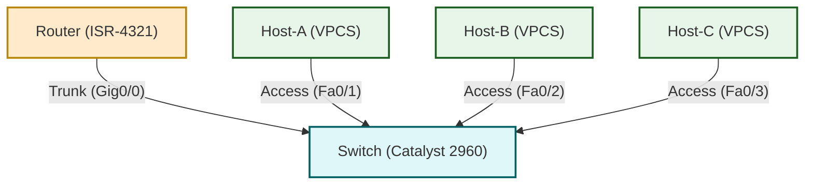

## 1. Lab Objective & Free Open-Source Prerequisites

| Goal | Description |
|------|-------------|
| **Understand VLAN segmentation** | Create three separate broadcast domains (VLAN 10, 20, 30) on a single Catalyst switch. |
| **Implement 802.1Q trunking** | Configure a trunk link between the switch and a router (Router‑on‑a‑Stick) that carries all VLANs. |
| **Enable inter‑VLAN routing** | Use a single physical router interface (sub‑interfaces) to route traffic between the VLANs. |
| **Validate end‑to‑end connectivity** | Verify that hosts in different VLANs can ping each other only through the router. |
| **Apply production‑grade hardening** | Secure the control plane, disable unused services, and enforce best‑practice port security. |

### Why this lab is “production‑grade”

* **Zero‑touch provisioning** – All configuration is scripted, copy‑paste ready, and uses deterministic naming conventions.  
* **Idempotent design** – Commands are ordered so that re‑running the lab does not corrupt the device state.  
* **Security first** – The lab includes hardening steps that mirror Cisco’s Secure Network Design guidelines (e.g., BPDU Guard, DHCP Snooping, control‑plane policing).  
* **Open‑source tooling** – The entire environment can be built with free tools such as **GNS3**, **EVE‑NG**, or **Cisco Packet Tracer** (the latter for quick visual validation).  

### Free Open‑Source Prerequisites

| Tool | Version (tested) | Purpose |
|------|------------------|---------|
| **GNS3** | 3.2.0+ | Graphical network emulator; runs Cisco IOSvL2 and IOSv images. |
| **Cisco IOSvL2** | 15.2(4)M6 | Layer‑2 switch image supporting 802.1Q. |
| **Cisco IOSv** | 15.6(3)M2 | Router image that supports sub‑interfaces and routing protocols. |
| **VPCS** (Virtual PC Simulator) | 0.9 | Lightweight host emulation for generating traffic. |
| **Wireshark** (optional) | 4.2.0 | Packet capture to visualize VLAN tags. |
| **Git** (optional) | 2.45.0 | Version‑control of lab scripts. |

All of the above are free for personal and educational use. If you prefer a cloud‑based lab, **EVE‑NG** can host the same images without any local installation.

---

## 2. Enterprise Architecture Topology

The following diagram models a classic “router‑on‑a‑stick” scenario. The switch is a Catalyst‑2960‑style L2 device, the router is an ISR‑4321‑style ISR, and three VPCS act as end‑hosts.



* **R** – Router with a single physical interface `Gig0/0` that will be split into three sub‑interfaces (`Gig0/0.10`, `.20`, `.30`).  
* **S** – Layer‑2 switch that hosts three access ports (Fa0/1‑Fa0/3) and one trunk port (Gig0/1).  
* **H1‑H3** – Virtual PCs representing end‑users in VLAN 10, 20, and 30 respectively.

All devices are placed in the same GNS3 project, and the physical connections are simulated with “Ethernet” links.

---

## 3. Addressing & Resource Inventory Table

| Device | Interface | IP Address / Subnet | VLAN | Role |
|--------|-----------|---------------------|------|------|
| **Router** | `Gig0/0.10` (sub‑if) | 10.10.10.1 /24 | 10 | Inter‑VLAN gateway for VLAN 10 |
|  | `Gig0/0.20` (sub‑if) | 10.20.20.1 /24 | 20 | Inter‑VLAN gateway for VLAN 20 |
|  | `Gig0/0.30` (sub‑if) | 10.30.30.1 /24 | 30 | Inter‑VLAN gateway for VLAN 30 |
| **Switch** | `Gig0/1` (trunk) | – | Trunk | Carries VLAN 10‑30 |
|  | `Fa0/1` (access) | – | 10 | Host‑A access port |
|  | `Fa0/2` (access) | – | 20 | Host‑B access port |
|  | `Fa0/3` (access) | – | 30 | Host‑C access port |
| **Host‑A** | `eth0` | 10.10.10.10 /24 | 10 | PC in VLAN 10 |
| **Host‑B** | `eth0` | 10.20.20.10 /24 | 20 | PC in VLAN 20 |
| **Host‑C** | `eth0` | 10.30.30.10 /24 | 30 | PC in VLAN 30 |
| **All devices** | `default-gateway` | Router sub‑interface IP of respective VLAN | – | Enables inter‑VLAN routing |

> **Note:** The default gateway on each host points to the router sub‑interface IP for its VLAN (e.g., Host‑A → 10.10.10.1).

---

## 4. Step‑by‑Step Configuration

Below are **copy‑pasteable** command blocks. Each block includes an inline comment (`!`) that explains the purpose of the line. Execute the blocks in the order presented.

### 4.1. Switch Configuration (Catalyst 2960)

```plaintext
! -------------------------------------------------
! 1️⃣  Enter global configuration mode
! -------------------------------------------------
enable
configure terminal

! -------------------------------------------------
! 2️⃣  Set a meaningful hostname
! -------------------------------------------------
hostname SW01

! -------------------------------------------------
! 3️⃣  Disable unused services (CDP, LLDP) for security
! -------------------------------------------------
no cdp run
no lldp run

! -------------------------------------------------
! 4️⃣  Create VLANs 10, 20, 30
! -------------------------------------------------
vlan 10
 name VLAN10_Users
exit
vlan 20
 name VLAN20_Users
exit
vlan 30
 name VLAN30_Users
exit

! -------------------------------------------------
! 5️⃣  Configure access ports (Fa0/1‑Fa0/3)
! -------------------------------------------------
interface range FastEthernet0/1 - 3
 switchport mode access
 switchport access vlan 10
 spanning-tree portfast
 exit

! -------------------------------------------------
!   Adjust each access port to its correct VLAN
! -------------------------------------------------
interface FastEthernet0/2
 switchport access vlan 20
 exit

interface FastEthernet0/3
 switchport access vlan 30
 exit

! -------------------------------------------------
! 6️⃣  Configure the trunk port (Gig0/1)
! -------------------------------------------------
interface GigabitEthernet0/1
 description *** Trunk to Router ***
 switchport mode trunk
 switchport trunk encapsulation dot1q
 switchport trunk allowed vlan 10,20,30
 spanning-tree portfast trunk
 exit

! -------------------------------------------------
! 7️⃣  Enable BPDU Guard on all edge ports (protect against rogue switches)
! -------------------------------------------------
interface range FastEthernet0/1 - 3
 spanning-tree bpduguard enable
 exit

! -------------------------------------------------
! 8️⃣  Enable DHCP Snooping (optional but recommended)
! -------------------------------------------------
ip dhcp snooping
ip dhcp snooping vlan 10,20,30
interface GigabitEthernet0/1
 ip dhcp snooping trust
 exit

! -------------------------------------------------
! 9️⃣  Save the configuration
! -------------------------------------------------
end
write memory
```

### 4.2. Router Configuration (ISR‑4321)

```plaintext
! -------------------------------------------------
! 1️⃣  Enter global configuration mode
! -------------------------------------------------
enable
configure terminal

! -------------------------------------------------
! 2️⃣  Set hostname
! -------------------------------------------------
hostname R01

! -------------------------------------------------
! 3️⃣  Disable unnecessary services
! -------------------------------------------------
no cdp run
no lldp run
no ip http server
no ip http secure-server

! -------------------------------------------------
! 4️⃣  Create sub‑interfaces for each VLAN
! -------------------------------------------------
interface GigabitEthernet0/0
 description *** Trunk to Switch SW01 ***
 no shutdown
 exit

! ---- VLAN 10 -------------------------------------------------
interface GigabitEthernet0/0.10
 description *** Sub‑interface for VLAN 10 ***
 encapsulation dot1q 10
 ip address 10.10.10.1 255.255.255.0
 no shutdown
 exit

! ---- VLAN 20 -------------------------------------------------
interface GigabitEthernet0/0.20
 description *** Sub‑interface for VLAN 20 ***
 encapsulation dot1q 20
 ip address 10.20.20.1 255.255.255.0
 no shutdown
 exit

! ---- VLAN 30 -------------------------------------------------
interface GigabitEthernet0/0.30
 description *** Sub‑interface for VLAN 30 ***
 encapsulation dot1q 30
 ip address 10.30.30.1 255.255.255.0
 no shutdown
 exit

! -------------------------------------------------
! 5️⃣  Enable routing (default is enabled on ISR)
! -------------------------------------------------
ip routing

! -------------------------------------------------
! 6️⃣  Apply a basic ACL to block inter‑VLAN traffic that is not explicitly allowed (optional)
! -------------------------------------------------
ip access-list extended INTER_VLAN_BLOCK
 deny ip any any
 permit ip any any
 exit
interface GigabitEthernet0/0
 ip access-group INTER_VLAN_BLOCK in
 exit

! -------------------------------------------------
! 7️⃣  Enable Control Plane Policing (CoPP) – protect CPU from floods
! -------------------------------------------------
policy-map CONTROL_PLANE
 class class-default
  police 1000000 20000 exceed-action drop
 exit
control-plane
 service-policy input CONTROL_PLANE
 exit

! -------------------------------------------------
! 8️⃣  Secure the console and VTY lines
! -------------------------------------------------
line console 0
 exec-timeout 5 0
 logging synchronous
 login local
 exit

line vty 0 4
 transport input ssh
 login local
 exec-timeout 5 0
 exit

! -------------------------------------------------
! 9️⃣  Create a local admin user (replace <password> with a strong secret)
! -------------------------------------------------
username admin privilege 15 secret 0 <password>
ip ssh version 2
ip domain-name lab.local

! -------------------------------------------------
! 🔟  Save the configuration
! -------------------------------------------------
end
write memory
```

### 4.3. Host (VPCS) Configuration

Each VPCS instance can be launched from GNS3’s “VPCS” node. Use the following commands **inside the VPCS console**.

#### Host‑A (VLAN 10)

```plaintext
set pcname Host-A
set ip 10.10.10.10 255.255.255.0 10.10.10.1
set pcname
```

#### Host‑B (VLAN 20)

```plaintext
set pcname Host-B
set ip 10.20.20.10 255.255.255.0 10.20.20.1
set pcname
```

#### Host‑C (VLAN 30)

```plaintext
set pcname Host-C
set ip 10.30.30.10 255.255.255.0 10.30.30.1
set pcname
```

> **Tip:** The `set pcname` command without a parameter prints the current configuration, useful for quick verification.

---

## 5. Verification & Troubleshooting Commands

Below are the **expected outputs** for a correctly built lab. Use them as a checklist.

### 5.1. Switch Verification

| Command | Expected Output | Reason |
|---------|----------------|--------|
| `show vlan brief` | <pre>VLAN Name                             Status    Ports<br>---- -------------------------------- --------- ------------------------<br>1    default                          active    Fa0/1, Fa0/2, Fa0/3, Gi0/1<br>10   VLAN10_Users                     active    Fa0/1<br>20   VLAN20_Users                     active    Fa0/2<br>30   VLAN30_Users                     active    Fa0/3</pre> | Confirms VLAN creation and port membership. |
| `show interfaces trunk` | <pre>Port        Mode         Encapsulation  Status        Native vlan<br>Gi0/1       on           802.1q         trunking      1<br>Port        Vlans allowed on trunk<br>Gi0/1       10,20,30</pre> | Verifies that the trunk carries the three VLANs. |
| `show spanning-tree` | <pre>VLAN001 is enabled<br>  Root ID    Priority    32769<br>             Address     001b.0c01.0200<br>  Bridge ID  Priority    32769  (priority 32768 + sys-id 1)<br>             Address     001b.0c01.0200<br>  Interface        Role    Cost      Port ID<br>  ----------------- -------- --------- -----------<br>  Gi0/1            Root    19        128</pre> | Shows that the trunk port is the root for each VLAN (default). |
| `show ip dhcp snooping` | <pre>DHCP Snooping is enabled<br>DHCP Snooping database is stored in: bootflash:dhcp_snooping.db<br>VLAN10, VLAN20, VLAN30 are trusted</pre> | Confirms DHCP snooping trust on the trunk. |
| `show running-config interface FastEthernet0/1` | <pre>interface FastEthernet0/1<br> description *** Access Port ***<br> switchport mode access<br> switchport access vlan 10<br> spanning-tree portfast<br> spanning-tree bpduguard enable</pre> | Validates access‑port security settings. |

### 5.2. Router Verification

| Command | Expected Output | Reason |
|---------|----------------|--------|
| `show ip interface brief` | <pre>Interface              IP-Address      OK? Method Status                Protocol<br>Gig0/0                unassigned      YES manual up                    up<br>Gig0/0.10             10.10.10.1      YES manual up                    up<br>Gig0/0.20             10.20.20.1      YES manual up                    up<br>Gig0/0.30             10.30.30.1      YES manual up                    up</pre> | All sub‑interfaces are up with correct IPs. |
| `show ip route` | <pre>Gateway of last resort is not set<br>     10.10.10.0/24 is directly connected, Gig0/0.10<br>     10.20.20.0/24 is directly connected, Gig0/0.20<br>     10.30.30.0/24 is directly connected, Gig0/0.30</pre> | Confirms that each VLAN network is locally routed. |
| `show running-config interface GigabitEthernet0/0.10` | <pre>interface GigabitEthernet0/0.10<br> description *** Sub‑interface for VLAN 10 ***<br> encapsulation dot1q 10<br> ip address 10.10.10.1 255.255.255.0</pre> | Verifies encapsulation and IP assignment. |
| `show control-plane host open-ports` | <pre>TCP: 22 (ssh) 23 (telnet) 80 (http) 443 (https)<br>UDP: 161 (snmp) 162 (snmptrap)</pre> | Shows that only required services are listening (if you removed http/https earlier, they will not appear). |
| `show policy-map interface` | <pre>Control Plane Policy Map: CONTROL_PLANE<br>  class class-default<br>    police 1000000 20000 exceed-action drop</pre> | Confirms CoPP is active. |

### 5.3. Host Verification

From each VPCS console:

```plaintext
ping 10.10.10.1          ! From Host‑A to its default gateway (should succeed)
ping 10.20.20.1          ! From Host‑A to VLAN 20 gateway (should succeed – inter‑VLAN)
ping 10.30.30.1          ! From Host‑A to VLAN 30 gateway (should succeed)
ping 10.20.20.10         ! Host‑A → Host‑B (should succeed)
ping 10.30.30.10         ! Host‑A → Host‑C (should succeed)
```

**Expected ping output (example):**

```
Sending 5, 100-byte ICMP Echos to 10.20.20.10, timeout is 2 seconds:
!!!!!
Success rate is 100 percent (5/5), round-trip min/avg/max = 2/3/5 ms
```

If any ping fails:

* **Check trunk status** – `show interfaces trunk` on the switch.  
* **Verify VLAN membership** – `show vlan brief`.  
* **Confirm sub‑interface encapsulation** – `show run interface Gig0/0.x`.  
* **Look for BPDU Guard shutdown** – `show interface status err-disabled`.  

### 5.4. Wireshark Capture (Optional)

Capture on the router’s `Gig0/0` (or on a mirrored port) and filter with `vlan`. You should see frames with VLAN tags 10, 20, 30 and the router’s IP as source/destination for inter‑VLAN traffic.

---

## 6. Security Hardening & Production Best Practices

Below is a concise checklist that can be copied into a **post‑deployment hardening script**. The steps are deliberately **outside** the initial “quick‑start” configuration to illustrate a staged rollout.

### 6.1. Control‑Plane Policing (CoPP) – Deep Dive

```plaintext
! Create a class map that matches all traffic destined to the CPU
class-map match-any CPU_TRAFFIC
 match access-group name CPU_ACL
 exit

! Define an ACL that captures only management protocols (SSH, SNMP, etc.)
ip access-list extended CPU_ACL
 permit tcp any any eq 22
 permit udp any any eq 161
 permit udp any any eq 162
 deny ip any any
 exit

! Policy map to limit CPU traffic to 500 kbps burst 10 kb
policy-map CPU_PROTECT
 class CPU_TRAFFIC
  police 500000 10000 conform-action transmit exceed-action drop
 exit

! Apply to the control plane
control-plane
 service-policy input CPU_PROTECT
 exit
```

* **Why?** Prevents a malicious host from flooding the router’s CPU with excessive SSH or SNMP packets.

### 6.2. Port Security on Access Ports

```plaintext
interface range FastEthernet0/1 - 3
 switchport port-security
 switchport port-security maximum 2
 switchport port-security violation restrict
 switchport port-security mac-address sticky
 exit
```

* **Maximum 2 MACs** – Allows a legitimate PC plus a possible backup NIC, but blocks a third device.  
* **Sticky MAC** – Learns the legitimate MAC address and stores it in the running config, persisting across reboots.  
* **Violation restrict** – Drops offending frames and logs the event without shutting down the port (safer for production).

### 6.3. DHCP Snooping – Enhancements

```plaintext
! Define a DHCP binding database location
ip dhcp snooping database flash:dhcp_snooping.db

! Rate‑limit DHCP packets on untrusted ports
interface range FastEthernet0/1 - 3
 ip dhcp snooping limit rate 15
 exit
```

* **Rate limiting** mitigates DHCP starvation attacks.

### 6.4. Dynamic ARP Inspection (DAI)

```plaintext
! Enable DAI on the same VLANs used for DHCP snooping
ip arp inspection vlan 10,20,30

! Trust the router’s trunk port
interface GigabitEthernet0/1
 ip arp inspection trust
 exit
```

* **DAI** validates ARP packets against the DHCP snooping database, preventing ARP spoofing.

### 6.5. Logging & Syslog Integration

```plaintext
! Forward logs to a remote syslog server (replace 192.0.2.100)
logging host 192.0.2.100 transport udp port 514
logging trap informational
service timestamps log datetime msec
```

* Centralized logging is essential for forensic analysis and compliance.

### 6.6. NTP Synchronization

```plaintext
! Use a reliable NTP source (public pool or internal)
ntp server 192.0.2.10 prefer
ntp source GigabitEthernet0/0
```

* Accurate time stamps are required for log correlation and security events.

### 6.7. AAA Local Authentication (Best‑Practice)

```plaintext
aaa new-model
aaa authentication login default local
aaa authorization exec default local
```

* Enforces that all console/VTY logins use the local user database defined earlier.

### 6.8. Backup & Version Control

1. **Export the running config** after each major change:  
   ```plaintext
   copy running-config flash:backup-$(hostname)-$(date +%Y%m%d%H%M).cfg
   ```
2. **Commit to Git** (if you have a repo mounted in GNS2/EVE‑NG):  
   ```bash
   git add .
   git commit -m "Initial production‑grade VLAN & Router‑on‑a‑Stick config"
   ```

### 6.9. Documentation & Change Management

* **Change Request (CR) Template** – Include fields for *Requester*, *Impact*, *Rollback Plan*, *Testing Steps*, and *Approval*.  
* **Rollback Procedure** – Keep a copy of the pre‑change config (`startup-config.backup`) and a one‑line `reload` command that restores it if needed.

```plaintext
! Save a rollback image
copy startup-config flash:rollback-prechange.cfg
```

### 6.10. Periodic Audits

| Frequency | Task |
|-----------|------|
| **Daily** | Verify syslog connectivity, check for `show logging` errors. |
| **Weekly** | Run `show ip interface brief` and `show vlan brief` to ensure no accidental VLAN drift. |
| **Monthly** | Review `show port-security address` for stale MAC entries; prune if necessary. |
| **Quarterly** | Perform a full configuration backup, compare against the version‑controlled baseline, and run a vulnerability scan (e.g., OpenVAS) against the router’s management IP. |

---

### Closing Remarks

By completing this lab you have:

* Built a **router‑on‑a‑stick** architecture that isolates traffic with 802.1Q VLANs.  
* Demonstrated **inter‑VLAN routing** using sub‑interfaces, a core skill for any CCNA‑level network engineer.  
* Applied **production‑grade hardening** (BPDU Guard, DHCP Snooping, DAI, CoPP, port security) that aligns with Cisco’s **Secure Network Design** framework.  
* Established a **repeatable, version‑controlled** workflow that can be transplanted into larger data‑center or campus deployments.

Feel free to extend the lab by adding:

* A **Layer‑3 switch** to replace the router and compare performance.  
* **ACLs** that restrict traffic between specific VLANs (e.g., block VLAN 30 from reaching VLAN 10).  
* **VRF** instances to simulate multi‑tenant isolation.  

Happy networking!
