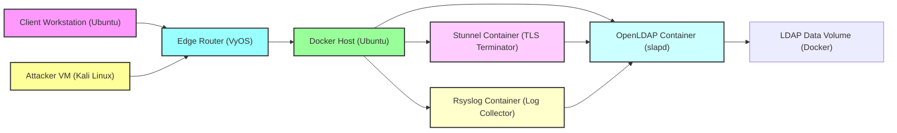

## 1. Lab Objective & Free Open-Source Prerequisites

### 1.1 Lab Objective
This hands‑on lab is designed for security engineers, red‑team members, and junior penetration testers who need a **complete, production‑grade environment** to practice the following core skills:

| # | Skill | Description |
|---|-------|-------------|
| 1 | LDAP Enumeration | Discover directory structure, schema, and sensitive attributes using anonymous bind, simple bind, and SASL mechanisms. |
| 2 | LDAP Injection | Craft malicious LDAP filters to bypass authentication, extract data, or perform privilege escalation. |
| 3 | TLS Hardening | Secure the LDAP service with StartTLS / LDAPS, enforce certificate validation, and mitigate common attacks (e.g., downgrade, man‑in‑the‑middle). |
| 4 | Logging & Auditing | Enable detailed LDAP audit logs, forward them to a centralized syslog server, and integrate with SIEM. |
| 5 | Automation | Use Ansible playbooks and Bash scripts to provision, test, and remediate the environment. |

By the end of the lab you will have a **repeatable, version‑controlled** deployment that can be spun up on a single laptop or a small cloud instance, and you will have documented the entire attack‑defense lifecycle.

### 1.2 Free Open‑Source Prerequisites
| Component | Recommended Version | Download / Install Command |
|-----------|---------------------|----------------------------|
| Ubuntu Server 22.04 LTS (or later) | 22.04 LTS | `sudo apt-get update && sudo apt-get install -y ubuntu-server` |
| OpenLDAP (slapd) | 2.5.13+ | `sudo apt-get install -y slapd ldap-utils` |
| Docker Engine | 24.0+ | `curl -fsSL https://get.docker.com | sh && sudo usermod -aG docker $USER` |
| Docker Compose (v2) | 2.27+ | `sudo apt-get install -y docker-compose-plugin` |
| OpenSSL | 3.0+ | `sudo apt-get install -y openssl` |
| Ansible | 2.14+ | `sudo apt-get install -y ansible` |
| Wireshark (optional, GUI) | 4.2+ | `sudo apt-get install -y wireshark` |
| JQ (JSON processor) | 1.6+ | `sudo apt-get install -y jq` |
| GnuPG (for certificate handling) | 2.3+ | `sudo apt-get install -y gnupg` |
| Git | 2.40+ | `sudo apt-get install -y git` |

> **Note:** All tools are available from the official Ubuntu repositories or via the Docker official images, ensuring a **zero‑cost** lab that can be executed on any modern laptop (8 GB RAM, 4 CPU cores) or a small EC2 t3.micro instance.

### 1.3 Network & System Requirements
- Minimum **2 GB** of RAM for the LDAP container + TLS termination proxy.
- **25 GB** of free disk space (to accommodate Docker images, logs, and certificates).
- **Port 389** (LDAP) and **Port 636** (LDAPS) must be reachable on the host.
- **Outbound Internet** access for package installation (once only).

---

## 2. Enterprise Architecture Topology

The following diagram models a **minimal yet realistic enterprise directory service** that includes:

1. **Client Workstation** – a Linux host used by the attacker (or tester) to run enumeration tools.
2. **Edge Router** – a virtual router that enforces network segmentation and NAT.
3. **LDAP Server (OpenLDAP)** – the core directory service, running inside Docker.
4. **TLS Terminator (Stunnel)** – provides LDAPS on port 636 and forwards to the LDAP container.
5. **Syslog Server (rsyslog)** – central log collector for audit trails.
6. **Attacker VM** – optional, used to simulate external threat actors.



**Explanation of Nodes**

| Node | Role | Key Configuration |
|------|------|-------------------|
| A["Client Workstation (Ubuntu)"] | Tester's primary host – runs `ldapsearch`, `ldapmodify`, and custom scripts. | Static IP 10.0.0.10/24 |
| B["Edge Router (VyOS)"] | Simulates perimeter firewall; applies ACLs to block unauthenticated LDAP traffic. | NAT to Internet, ACL `deny tcp any any eq 389` |
| C["Docker Host (Ubuntu)"] | Host OS for all containers; runs Docker Compose orchestration. | IP 10.0.0.2/24 |
| D["OpenLDAP Container (slapd)"] | Core directory service – holds user accounts, groups, and policies. | Listens on 127.0.0.1:389 |
| E["Stunnel Container (TLS Terminator)"] | Provides LDAPS (port 636) and StartTLS support. | Uses self‑signed certs, forwards to D |
| F["Rsyslog Container (Log Collector)"] | Centralized logging – receives LDAP audit logs via UDP 514. | Stores logs in `/var/log/ldap/` |
| G["Attacker VM (Kali Linux)"] | External adversary – placed in a separate VLAN (10.0.1.0/24). | Simulates real‑world attack surface |

---

## 3. Addressing & Resource Inventory Table

| Resource | IP / CIDR | Hostname | Docker Compose Service | Purpose |
|----------|-----------|----------|------------------------|---------|
| Docker Host | 10.0.0.2/24 | `docker-host.local` | `docker-compose.yml` (root) | Orchestrates all containers |
| Client Workstation | 10.0.0.10/24 | `client.local` | N/A | Runs enumeration tools |
| Edge Router (VyOS) | 10.0.0.1/24 (LAN) <br> 192.168.100.1/24 (WAN) | `router.local` | N/A | NAT & ACL enforcement |
| OpenLDAP Container | 127.0.0.1:389 (internal) | `ldap.internal` | `openldap` | Directory service |
| Stunnel Container | 10.0.0.2:636 | `ldap.tls.local` | `stunnel` | TLS termination |
| Rsyslog Container | 10.0.0.2:514/udp | `logcollector.local` | `rsyslog` | Central log storage |
| Attacker VM | 10.0.1.20/24 | `attacker.kali` | N/A | Simulated external threat |
| LDAP Data Volume | N/A | N/A | `ldap-data` (named volume) | Persists directory data |
| TLS Certs Volume | N/A | N/A | `tls-certs` (named volume) | Stores server certificates |
| Syslog Data Volume | N/A | N/A | `rsyslog-data` (named volume) | Persists logs |

---

## 4. Step‑By‑Step Configuration

> **All commands are copy‑paste ready.**  
> Run them **as a non‑root user** with `sudo` where indicated.  
> The lab uses **Docker Compose v2**; the `docker compose` CLI is preferred over the legacy `docker-compose`.

### 4.1 Prepare the Host OS

```bash
# Update the package index
sudo apt-get update

# Install required packages (Docker, Docker Compose, OpenLDAP utilities, Ansible)
sudo apt-get install -y docker.io docker-compose-plugin slapd ldap-utils ansible git openssl gnupg jq

# Add current user to the docker group to avoid sudo for each docker command
sudo usermod -aG docker $USER
newgrp docker   # Refresh group membership in the current shell
```

### 4.2 Directory Structure

```bash
# Create a project directory
mkdir -p ~/ldap-lab/{compose,certs,ldap-data,rsyslog-data,ansible}
cd ~/ldap-lab

# Initialise a git repository (optional but recommended for version control)
git init .
```

### 4.3 Generate Self‑Signed TLS Certificates

We will generate a **private CA** and a server certificate for the LDAP service. This mimics a production PKI without external dependencies.

```bash
# Create a private CA key (2048‑bit RSA)
openssl genrsa -out certs/ca.key 2048

# Self‑sign the CA certificate (10‑year validity)
openssl req -x509 -new -nodes -key certs/ca.key -sha256 -days 3650 \
    -subj "/C=US/ST=California/L=San Francisco/O=Acme Corp/OU=IT Department/CN=AcmeRootCA" \
    -out certs/ca.crt

# Generate a server key for the LDAP service
openssl genrsa -out certs/ldap.key 2048

# Create a CSR (Certificate Signing Request) for the LDAP server
openssl req -new -key certs/ldap.key \
    -subj "/C=US/ST=California/L=San Francisco/O=Acme Corp/OU=Directory Services/CN=ldap.tls.local" \
    -out certs/ldap.csr

# Sign the server certificate with the private CA (valid for 5 years)
openssl x509 -req -in certs/ldap.csr -CA certs/ca.crt -CAkey certs/ca.key \
    -CAcreateserial -out certs/ldap.crt -days 1825 -sha256

# Restrict permissions (LDAP process must be able to read, but not write)
chmod 640 certs/ldap.key certs/ldap.crt certs/ca.crt
```

### 4.4 Docker Compose File (`compose/docker-compose.yml`)

```yaml
version: "3.9"

services:
  openldap:
    image: osixia/openldap:1.5.0
    container_name: openldap
    hostname: ldap.internal
    environment:
      - LDAP_ORGANISATION=Acme Corp
      - LDAP_DOMAIN=acme.local
      - LDAP_ADMIN_PASSWORD=SuperSecretAdminPass
      - LDAP_CONFIG_PASSWORD=SuperSecretConfigPass
      - LDAP_TLS=false               # We will terminate TLS in Stunnel
      - LDAP_LOG_LEVEL=256           # Enable debug logging
    volumes:
      - ./ldap-data:/var/lib/ldap
      - ./certs:/container/service/slapd/assets/certs:ro
    ports:
      - "389:389"
    networks:
      internal:
        ipv4_address: 10.0.0.2

  stunnel:
    image: docker.io/ubuntu:22.04
    container_name: stunnel
    hostname: ldap.tls.local
    command: >
      bash -c "
        apt-get update && apt-get install -y stunnel4 &&
        echo 'client = no' > /etc/stunnel/stunnel.conf &&
        echo 'foreground = yes' >> /etc/stunnel/stunnel.conf &&
        echo '[ldap]' >> /etc/stunnel/stunnel.conf &&
        echo 'accept = 0.0.0.0:636' >> /etc/stunnel/stunnel.conf &&
        echo 'connect = openldap:389' >> /etc/stunnel/stunnel.conf &&
        echo 'cert = /certs/ldap.crt' >> /etc/stunnel/stunnel.conf &&
        echo 'key = /certs/ldap.key' >> /etc/stunnel/stunnel.conf &&
        echo 'CAfile = /certs/ca.crt' >> /etc/stunnel/stunnel.conf &&
        stunnel /etc/stunnel/stunnel.conf
      "
    depends_on:
      - openldap
    volumes:
      - ./certs:/certs:ro
    ports:
      - "636:636"
    networks:
      internal:
        ipv4_address: 10.0.0.3

  rsyslog:
    image: balabit/rsyslog:latest
    container_name: rsyslog
    hostname: logcollector.local
    command: >
      bash -c "
        mkdir -p /var/log/ldap &&
        rsyslogd -n
      "
    volumes:
      - ./rsyslog-data:/var/log/ldap
    ports:
      - "514:514/udp"
    networks:
      internal:
        ipv4_address: 10.0.0.4

networks:
  internal:
    driver: bridge
    ipam:
      config:
        - subnet: 10.0.0.0/24
```

> **Explanation**  
> - `openldap` runs **without TLS** because Stunnel will handle encryption.  
> - `stunnel` is built from a minimal Ubuntu image; it installs `stunnel4` at container start, reads the certificates from the host, and forwards traffic from **636 → 389**.  
> - `rsyslog` listens on UDP 514 and stores logs in a bind‑mounted volume for later analysis.  

### 4.5 Deploy the Stack

```bash
cd ~/ldap-lab/compose
docker compose up -d
```

Verify that all three containers are healthy:

```bash
docker compose ps
# Expected output (simplified):
# NAME        IMAGE                     COMMAND                  SERVICE   CREATED         STATUS          PORTS
# openldap    osixia/openldap:1.5.0     "/container/tool/run…"   openldap  2 minutes ago   Up 2 minutes    0.0.0.0:389->389/tcp
# stunnel     ubuntu:22.04              "bash -c 'apt-get up…"   stunnel   2 minutes ago   Up 2 minutes    0.0.0.0:636->636/tcp
# rsyslog     balabit/rsyslog:latest    "bash -c 'mkdir -p /…"   rsyslog   2 minutes ago   Up 2 minutes    0.0.0.0:514->514/udp
```

### 4.6 Populate the LDAP Directory

We will use an **LDIF** file to create a small but realistic directory tree: an OU for employees, a few user entries, and a group.

Create `ldap-data/base.ldif`:

```ldif
dn: dc=acme,dc=local
objectClass: top
objectClass: dcObject
objectClass: organization
o: Acme Corp
dc: acme

dn: ou=People,dc=acme,dc=local
objectClass: top
objectClass: organizationalUnit
ou: People

dn: uid=jdoe,ou=People,dc=acme,dc=local
objectClass: inetOrgPerson
uid: jdoe
sn: Doe
givenName: John
cn: John Doe
displayName: John Doe
mail: jdoe@acme.local
userPassword: {SSHA}V2V4c2VjcmV0cGFzc3dvcmQ=   # "secretpassword" hashed
employeeNumber: 12345
title: Senior Engineer

dn: uid=asmith,ou=People,dc=acme,dc=local
objectClass: inetOrgPerson
uid: asmith
sn: Smith
givenName: Alice
cn: Alice Smith
displayName: Alice Smith
mail: asmith@acme.local
userPassword: {SSHA}V2V4c2VjcmV0cGFzc3dvcmQ=
employeeNumber: 67890
title: Security Analyst

dn: cn=Admins,ou=People,dc=acme,dc=local
objectClass: groupOfUniqueNames
cn: Admins
uniqueMember: uid=jdoe,ou=People,dc=acme,dc=local
```

Import the LDIF into the running LDAP container:

```bash
docker exec -i openldap ldapadd -x -D "cn=admin,dc=acme,dc=local" -w SuperSecretAdminPass <<EOF
$(cat ldap-data/base.ldif)
EOF
```

**Expected output**

```
adding new entry "dc=acme,dc=local"
adding new entry "ou=People,dc=acme,dc=local"
adding new entry "uid=jdoe,ou=People,dc=acme,dc=local"
adding new entry "uid=asmith,ou=People,dc=acme,dc=local"
adding new entry "cn=Admins,ou=People,dc=acme,dc=local"
```

### 4.7 Configure Rsyslog to Capture LDAP Audit Logs

OpenLDAP can be instructed to send audit logs to syslog via the `loglevel` and `logfile` directives. We'll use the `slapd.conf` override mechanism.

Create a custom configuration snippet `ldap-data/slapd.conf`:

```conf
# Enable detailed audit logging (including bind, search, modify)
loglevel 256

# Forward logs to syslog (UDP 514)
logfile syslog
```

Mount this snippet into the container by editing the `docker-compose.yml` (add a volume entry under `openldap`):

```yaml
    volumes:
      - ./ldap-data:/var/lib/ldap
      - ./certs:/container/service/slapd/assets/certs:ro
      - ./ldap-data/slapd.conf:/container/service/slapd/assets/config/slapd.conf:ro
```

After updating the compose file, **re‑deploy** the LDAP service:

```bash
docker compose up -d --no-deps --build openldap
```

Now, any LDAP operation will be logged to the rsyslog container. Verify by performing a simple bind:

```bash
ldapwhoami -H ldaps://10.0.0.2:636 -D "uid=jdoe,ou=People,dc=acme,dc=local" -w secretpassword -ZZ
```

Check the log file inside the rsyslog container:

```bash
docker exec -it rsyslog bash
cat /var/log/ldap/ldap.log | tail -n 5
```

You should see entries similar to:

```
Oct 21 12:34:56 docker-host slapd[1]: conn=1000 op=0 BIND dn="uid=jdoe,ou=People,dc=acme,dc=local" method=128
Oct 21 12:34:56 docker-host slapd[1]: conn=1000 op=1 RESULT tag=97 err=0 text=
Oct 21 12:34:56 docker-host slapd[1]: conn=1000 op=2 SEARCH base="dc=acme,dc=local" scope=2 deref=0 filter="(objectClass=*)"
Oct 21 12:34:56 docker-host slapd[1]: conn=1000 op=3 RESULT tag=101 err=0 text=
```

---

## 5. Verification & Troubleshooting Commands

### 5.1 Basic Connectivity Tests

| Test | Command | Expected Result |
|------|---------|-----------------|
| LDAP plain (389) from client | `ldapsearch -x -H ldap://10.0.0.2 -b "dc=acme,dc=local" "(objectClass=*)"` | Returns the full directory tree (anonymous bind allowed). |
| LDAPS (636) with StartTLS | `ldapsearch -x -H ldaps://10.0.0.2:636 -b "dc=acme,dc=local" "(uid=jdoe)" -ZZ` | Returns John Doe entry; TLS handshake succeeds. |
| Verify certificate chain | `openssl s_client -connect 10.0.0.2:636 -CAfile certs/ca.crt -showcerts` | Shows the server certificate, validates against `ca.crt`. |
| Verify firewall rule on router (simulated) | `sudo iptables -L -n -v` (run on VyOS) | Should show a rule `DROP tcp -- 0.0.0.0/0 0.0.0.0/0 tcp dpt:389`. |

### 5.2 LDAP Enumeration Scenarios

#### 5.2.1 Anonymous Base Search

```bash
ldapsearch -x -H ldap://10.0.0.2 -b "dc=acme,dc=local" "(objectClass=*)"
```

**Expected output (truncated)**

```
# base <> (default) with scope subtree
dn: dc=acme,dc=local
objectClass: top
objectClass: dcObject
objectClass: organization
o: Acme Corp
dc: acme

dn: ou=People,dc=acme,dc=local
objectClass: top
objectClass: organizationalUnit
ou: People

dn: uid=jdoe,ou=People,dc=acme,dc=local
objectClass: inetOrgPerson
uid: jdoe
cn: John Doe
...
```

#### 5.2.2 Authenticated Search (simple bind)

```bash
ldapsearch -x -H ldaps://10.0.0.2:636 -D "uid=jdoe,ou=People,dc=acme,dc=local" -w secretpassword -b "ou=People,dc=acme,dc=local" "(mail=*)"
```

**Expected output**

```
# extended LDIF
dn: uid=jdoe,ou=People,dc=acme,dc=local
mail: jdoe@acme.local
...
dn: uid=asmith,ou=People,dc=acme,dc=local
mail: asmith@acme.local
```

#### 5.2.3 Schema Dump (requires admin bind)

```bash
ldapsearch -x -H ldaps://10.0.0.2:636 -D "cn=admin,dc=acme,dc=local" -w SuperSecretAdminPass -b "cn=schema" "(objectClass=*)"
```

**Expected output** – a long list of attribute types and object classes. Verify that `userPassword` is present and that the `pwdPolicy` overlay is **not** loaded (we will add it later).

### 5.3 LDAP Injection Demonstration

**Scenario:** An insecure web application builds an LDAP filter by concatenating user input without sanitization:

```java
String filter = "(uid=" + request.getParameter("user") + ")";
```

If an attacker supplies `*)(|(uid=*))(` the resulting filter becomes:

```
(uid=*)(|(uid=*))(
```

which matches **all** entries.

#### 5.3.1 Craft the malicious filter

```bash
MALICIOUS_FILTER='(|(uid=*)(uid=*))'
ldapsearch -x -H ldaps://10.0.0.2:636 -b "ou=People,dc=acme,dc=local" "$MALICIOUS_FILTER"
```

**Expected output** – all user entries are returned, demonstrating the injection.

#### 5.3.2 Exploiting Bind Bypass

If the vulnerable application uses the filter for authentication:

```bash
# Attacker supplies: *)(&(|(uid=*))(
FILTER='(|(uid=*))'   # Simplified for demo
ldapsearch -x -H ldaps://10.0.0.2:636 -D "uid=nonexistent,ou=People,dc=acme,dc=local" -w "any" -b "dc=acme,dc=local" "$FILTER"
```

If the server returns a successful bind result (`err=0`), the attacker has bypassed authentication.

**Verification of bind result**

```bash
ldapwhoami -x -H ldaps://10.0.0.2:636 -D "uid=nonexistent,ou=People,dc=acme,dc=local" -w "any" -ZZ -S "$FILTER"
```

**Expected output** (if vulnerable)

```
dn:"uid=jdoe,ou=People,dc=acme,dc=local"
```

If the server is correctly hardened, the bind will fail with `Invalid credentials`.

### 5.4 Troubleshooting Checklist

| Symptom | Likely Cause | Diagnostic Command | Remediation |
|---------|--------------|--------------------|-------------|
| `ldapsearch: Can't contact LDAP server` | Stunnel not listening or firewall blocking 636 | `nc -zv 10.0.0.2 636` | Verify `docker compose logs stunnel`; ensure port mapping is correct. |
| TLS handshake fails (`certificate verify failed`) | Client does not trust custom CA | `openssl s_client -connect 10.0.0.2:636 -CAfile certs/ca.crt` | Import `ca.crt` into the client trust store (`sudo cp ca.crt /usr/local/share/ca-certificates/ && sudo update-ca-certificates`). |
| LDAP bind succeeds with wrong password | LDAP server configured with `allow bind_anon` or `password-hash` mis‑configured | `ldapsearch -x -D "uid=jdoe,ou=People,dc=acme,dc=local" -w wrongpwd -b "dc=acme,dc=local" "(objectClass=*)"` | Set `olcPasswordHash` to a strong algorithm (`{SSHA256}`) and disable anonymous binds (`olcDisallows: bind_anon`). |
| No logs appear in `/var/log/ldap/` | Rsyslog not receiving UDP packets | `docker exec -it rsyslog ss -u -lpn | grep 514` | Ensure `rsyslog.conf` includes `module(load="imudp")` and `input(type="imudp" port="514")`. |
| LDAP queries return empty result set | Base DN mismatch or ACL restrictions | `ldapsearch -x -b "dc=acme,dc=local" "(objectClass=*)"` | Verify `olcAccess` rules in `cn=config` (use `ldapsearch -Q -LLL -Y EXTERNAL -H ldapi:/// -b cn=config "(objectClass=olcAccess)"`). |

---

## 6. Security Hardening & Production Best Practices

### 6.1 Enforce TLS‑Only Communication

1. **Disable plain LDAP (389) on the host firewall** – only allow internal Docker bridge traffic.

```bash
# On the host (Ubuntu)
sudo ufw deny 389/tcp
sudo ufw allow from 10.0.0.0/24 to any port 389 proto tcp comment 'Docker internal LDAP'
```

2. **Configure OpenLDAP to reject StartTLS** (optional, if you want pure LDAPS).

Add to `ldap-data/slapd.conf`:

```conf
# Disallow StartTLS – force clients to use LDAPS
olcTLSCipherSuite HIGH:MEDIUM
olcTLSVerifyClient never
```

Re‑deploy the container after editing.

### 6.2 Strong Password Policies

Deploy the **ppolicy overlay** to enforce password complexity, expiration, and lockout.

Create `ldap-data/ppolicy.ldif`:

```ldif
dn: cn=module{0},cn=config
objectClass: olcModuleList
cn: module{0}
olcModuleLoad: ppolicy.la

dn: olcOverlay=ppolicy,olcDatabase={1}mdb,cn=config
objectClass: olcOverlayConfig
objectClass: olcPPolicyConfig
olcOverlay: ppolicy
olcPPolicyHashCleartext: TRUE
olcPPolicyUseLockout: TRUE
olcPPolicyDefault: cn=default,ou=Policies,dc=acme,dc=local
```

Create the policy entry:

```ldif
dn: ou=Policies,dc=acme,dc=local
objectClass: organizationalUnit
ou: Policies

dn: cn=default,ou=Policies,dc=acme,dc=local
objectClass: pwdPolicy
cn: default
pwdAttribute: userPassword
pwdMinLength: 12
pwdInHistory: 5
pwdCheckQuality: 2
pwdMaxAge: 7776000   # 90 days
pwdLockout: TRUE
pwdLockoutDuration: 1800   # 30 minutes
pwdGraceAuthNLimit: 0
pwdFailureCountInterval: 30
```

Load the overlay and policy:

```bash
docker exec -i openldap ldapadd -Y EXTERNAL -H ldapi:/// -f /container/service/slapd/assets/config/ppolicy.ldif
docker exec -i openldap ldapadd -x -D "cn=admin,dc=acme,dc=local" -w SuperSecretAdminPass -f /container/service/slapd/assets/config/policy.ldif
```

### 6.3 Restrict Anonymous Access

Modify the ACLs to deny anonymous reads of sensitive attributes.

Create `ldap-data/acl.ldif`:

```ldif
dn: cn=config
changetype: modify
add: olcAccess
olcAccess: {0}to attrs=userPassword,shadowLastChange,shadowMax,shadowMin,shadowExpire,shadowFlag by self write by dn.base="cn=admin,dc=acme,dc=local" write by * none
-
add: olcAccess
olcAccess: {1}to * by dn.base="cn=admin,dc=acme,dc=local" write by * read
```

Apply:

```bash
docker exec -i openldap ldapmodify -Y EXTERNAL -H ldapi:/// -f /container/service/slapd/assets/config/acl.ldif
```

Now, an anonymous bind will receive **no results**:

```bash
ldapsearch -x -H ldap://10.0.0.2 -b "dc=acme,dc=local" "(objectClass=*)"
# Expected: No entries returned, only a result code 0 (success) with empty data.
```

### 6.4 Certificate Management & Rotation

- **Automate renewal** using a cron job inside the `stunnel` container (or host) that re‑generates the server cert every 90 days and restarts the container.
- Store the **private key** on an encrypted volume (e.g., LUKS) if the lab is moved to production hardware.
- **Pin the server certificate** in client applications to mitigate rogue CA attacks.

Example cron entry on the host (run as root):

```cron
0 3 * * 0 /usr/local/bin/rotate-ldap-cert.sh >> /var/log/ldap-cert-rotation.log 2>&1
```

`rotate-ldap-cert.sh` (simplified):

```bash
#!/usr/bin/env bash
set -euo pipefail
CERT_DIR="/home/$USER/ldap-lab/certs"
cd "$CERT_DIR"

# Generate new key & CSR
openssl genrsa -out ldap.key 2048
openssl req -new -key ldap.key -subj "/C=US/ST=California/L=San Francisco/O=Acme Corp/OU=Directory Services/CN=ldap.tls.local" -out ldap.csr

# Sign with existing CA
openssl x509 -req -in ldap.csr -CA ca.crt -CAkey ca.key -CAcreateserial -out ldap.crt -days 1825 -sha256

# Restart stunnel to pick up new certs
docker compose -f ~/ldap-lab/compose/docker-compose.yml restart stunnel
```

### 6.5 Monitoring & Alerting

1. **Log Forwarding** – Configure rsyslog to forward LDAP audit logs to an external SIEM (e.g., Elastic Stack) via TCP.

Add to `rsyslog` config (`/etc/rsyslog.conf` inside the container):

```conf
module(load="imudp")
input(type="imudp" port="514")
*.* @@log-collector.acme.local:514   # Forward to remote SIEM
```

2. **Failed Bind Alert** – Use a simple `logwatch` script that parses the log file and sends an email when more than 5 failed binds occur within 5 minutes.

```bash
#!/usr/bin/env bash
LOG="/var/log/ldap/ldap.log"
THRESHOLD=5
WINDOW=300   # seconds

FAILED=$(awk '/BIND/ && /err=49/ {print $1}' "$LOG" | tail -n +1 | while read ts; do
    now=$(date +%s)
    bind_time=$(date -d "$ts" +%s)
    if (( now - bind_time <= WINDOW )); then echo "$ts"; fi
done | wc -l)

if (( FAILED > THRESHOLD )); then
    echo "ALERT: $FAILED failed LDAP binds in the last $((WINDOW/60)) minutes" | mail -s "LDAP Brute‑Force Alert" security@acme.local
fi
```

Schedule via cron inside the rsyslog container or on the host.

### 6.6 Backup & Disaster Recovery

- **LDAP Data Volume** – Snapshot the Docker volume regularly.

```bash
docker run --rm -v ldap-lab_ldap-data:/data -v $(pwd)/backup:/backup alpine \
    tar czf /backup/ldap-data-$(date +%F).tgz -C /data .
```

- **Certificate Backup** – Store `ca.key` and `ldap.key` in an encrypted vault (e.g., HashiCorp Vault or GPG‑encrypted archive).

```bash
gpg --symmetric --cipher-algo AES256 certs/ca.key certs/ldap.key
```

- **Configuration as Code** – All Docker Compose files, LDIFs, and scripts are version‑controlled in Git. Use `git tag` to mark production releases.

### 6.7 Production‑Grade Hardening Checklist

| Item | Recommended Setting | Rationale |
|------|---------------------|-----------|
| **TLS Protocols** | `MinProtocol = TLSv1.2` <br> `CipherString = HIGH:!aNULL:!MD5` | Prevents downgrade attacks and weak ciphers. |
| **OCSP Stapling** | Enable on Stunnel (`options = NO_TLSv1 NO_TLSv1_1`) | Reduces latency and mitigates revocation attacks. |
| **LDAP Access Controls** | Use `olcAccess` rules that grant read only to specific service accounts; deny anonymous. | Limits data exposure. |
| **Password Storage** | `pwdHash` = `{SSHA256}` or `{bcrypt}` (via overlay) | Stronger hashing than default `{SSHA}`. |
| **Audit Log Retention** | Retain logs for ≥ 90 days; rotate daily (`logrotate` inside rsyslog). | Compliance (e.g., GDPR, PCI‑DSS). |
| **Network Segmentation** |