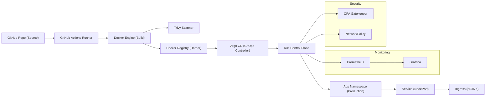

## 1. Lab Objective & Free Open-Source Prerequisites

### 1.1 Lab Objective
The purpose of this hands‑on lab is to build a **production‑grade, end‑to‑end CI/CD pipeline** that demonstrates the full lifecycle of a containerised micro‑service from source code commit to automated deployment on a Kubernetes cluster. The pipeline will be powered by:

| Component | Role |
|-----------|------|
| **GitHub** | Source code repository and webhook trigger |
| **GitHub Actions** | Build, test, and push Docker images to a private registry |
| **Docker** | Image creation and multi‑stage builds |
| **Harbor** (optional, free OSS) | Private, vulnerability‑scanned container registry |
| **Kubernetes (k3s)** | Lightweight production‑grade cluster for deployment |
| **Argo CD** | Git‑Ops continuous delivery controller |
| **Prometheus & Grafana** | Observability stack (optional, but recommended) |
| **OPA Gatekeeper** | Policy enforcement for admission control |
| **Trivy** | Image vulnerability scanner integrated into CI |

By the end of the lab you will have:

1. A reproducible GitHub Actions workflow that builds a multi‑stage Docker image, runs unit tests, scans for vulnerabilities, and pushes the image to a registry.
2. An Argo CD instance that continuously syncs a GitOps repository containing Helm charts/Kustomize overlays to the Kubernetes cluster.
3. A fully‑functional, self‑healing deployment that can be rolled back with a single click or via Git commit.
4. Security hardening steps (RBAC, network policies, image signing) that bring the pipeline to a **production‑ready** posture.

### 1.2 Free Open‑Source Prerequisites
| Tool | Minimum Version | Installation Method | License |
|------|----------------|---------------------|---------|
| **Git** | 2.30+ | `apt-get install git` / `brew install git` | GPL‑2.0 |
| **Docker Engine** | 24.0+ | Official Docker CE packages | Apache‑2.0 |
| **k3s** (lightweight K8s) | v1.28+ | `curl -sfL https://get.k3s.io | sh -` | Apache‑2.0 |
| **kubectl** | v1.28+ | `curl -LO "https://dl.k8s.io/release/$(curl -L -s https://dl.k8s.io/release/stable.txt)/bin/linux/amd64/kubectl"` | Apache‑2.0 |
| **Helm** | v3.14+ | `curl https://raw.githubusercontent.com/helm/helm/master/scripts/get-helm-3 | bash` | Apache‑2.0 |
| **Argo CD** | v2.9+ | Helm chart (see below) | Apache‑2.0 |
| **GitHub Account** | – | Free tier | – |
| **Harbor** (optional) | v2.9+ | Docker compose or Helm chart | Apache‑2.0 |
| **Trivy** | v0.48+ | `brew install aquasecurity/trivy/trivy` | Apache‑2.0 |
| **OPA Gatekeeper** | v3.16+ | Helm chart | Apache‑2.0 |
| **Prometheus & Grafana** | – | Helm charts | Apache‑2.0 |

> **Note:** All tools are free, open‑source, and can be installed on a single workstation (Linux/macOS) or a small VM (2 vCPU, 4 GB RAM). The lab assumes a Linux‑based host, but most commands translate directly to macOS with Homebrew.

---

## 2. Enterprise Architecture Topology


> **📥 Hands-On Lab Topology File:** [Download EVE-NG `.unl` Lab File](/labs/devops-github-actions-docker-kubernetes-gitops-pipeline.unl) *(Import directly into EVE-NG Community Edition)*


The diagram below visualises the logical flow of artifacts and control planes across the environment. It is deliberately kept simple for readability, yet it mirrors a typical enterprise DevSecOps topology.



**Key points to notice:**

* **GitHub → Actions → Docker**: The CI side is fully isolated; the runner uses a dedicated Docker socket and never has direct network access to the production cluster.
* **Harbor → Argo CD**: Harbor acts as the immutable source of truth for images. Argo CD only pulls signed images that have passed Trivy scans.
* **Argo CD → K3s**: The CD side is a pure GitOps loop; any drift is automatically reconciled.
* **OPA Gatekeeper + NetworkPolicy**: Enforce least‑privilege network and admission controls before any pod lands in the cluster.
* **Observability**: Prometheus scrapes the K3s control plane and the application; Grafana visualises the metrics.

---

## 3. Addressing & Resource Inventory Table

| Resource | CIDR / Identifier | Purpose | Owner |
|----------|-------------------|---------|-------|
| **k3s Control Plane** | 10.42.0.1/32 | API server endpoint (exposed via `kubectl`) | Cluster Admin |
| **NodePort Service** | 30080 (TCP) | External access to the demo app (via host IP) | DevOps |
| **Ingress Controller (NGINX)** | 10.42.0.0/24 (ClusterIP) | TLS termination and path‑based routing | Platform |
| **Harbor Registry** | 10.42.0.2:5000 | Private Docker registry (HTTPS) | Security |
| **GitHub Actions Runner** | 172.17.0.0/16 (Docker bridge) | Isolated build environment | CI Team |
| **Prometheus** | 10.42.0.3:9090 | Metrics collection | Observability |
| **Grafana** | 10.42.0.4:3000 | Dashboard UI | Observability |
| **OPA Gatekeeper** | 10.42.0.5 (ClusterIP) | Admission policy enforcement | Security |
| **NetworkPolicy** | N/A | Restricts pod‑to‑pod traffic to whitelisted namespaces | Security |

> **Tip:** If you are running the lab on a single VM, you can map the above IPs to `localhost` via `kubectl port-forward` or `iptables` NAT rules. The CIDR values are only illustrative for documentation purposes.

---

## 4. Step‑By‑Step Configuration

The following sections are **copy‑paste ready**. Each block contains inline comments (`#`) that explain the intent. Execute them in order on a fresh Linux/macOS workstation.

### 4.1 Install Core CLI Tools

```bash
# Update package index (Debian/Ubuntu)
sudo apt-get update && sudo apt-get install -y curl gnupg2 ca-certificates lsb-release

# Install Docker Engine (CE)
curl -fsSL https://download.docker.com/linux/ubuntu/gpg | sudo gpg --dearmor -o /usr/share/keyrings/docker-archive-keyring.gpg
echo \
  "deb [arch=$(dpkg --print-architecture) signed-by=/usr/share/keyrings/docker-archive-keyring.gpg] \
  https://download.docker.com/linux/ubuntu $(lsb_release -cs) stable" | \
  sudo tee /etc/apt/sources.list.d/docker.list > /dev/null
sudo apt-get update && sudo apt-get install -y docker-ce docker-ce-cli containerd.io

# Verify Docker
docker version

# Install k3s (single‑node, production‑grade)
curl -sfL https://get.k3s.io | sh -
# Add current user to k3s group for kubectl access
sudo usermod -aG k3s $USER
newgrp k3s

# Verify k3s
kubectl version --short
kubectl get nodes

# Install Helm
curl https://raw.githubusercontent.com/helm/helm/master/scripts/get-helm-3 | bash
helm version

# Install Trivy (vulnerability scanner)
curl -sSfL https://github.com/aquasecurity/trivy/releases/latest/download/trivy_$(uname -s)_$(uname -m).tar.gz | \
  tar -xz -C /tmp && sudo mv /tmp/trivy /usr/local/bin/
trivy --version
```

### 4.2 Create a Sample Application Repository

```bash
# Create a temporary directory for the demo repo
mkdir -p ~/devops-lab/demo-app && cd ~/devops-lab/demo-app
git init

# Write a minimal Go HTTP server (main.go)
cat > main.go <<'EOF'
package main

import (
    "fmt"
    "log"
    "net/http"
)

func handler(w http.ResponseWriter, r *http.Request) {
    fmt.Fprintf(w, "Hello from DevOps Lab – %s!\n", r.URL.Path)
}

func main() {
    http.HandleFunc("/", handler)
    log.Println("Listening on :8080")
    log.Fatal(http.ListenAndServe(":8080", nil))
}
EOF

# Add a simple unit test (main_test.go)
cat > main_test.go <<'EOF'
package main

import (
    "net/http"
    "net/http/httptest"
    "testing"
)

func TestHandler(t *testing.T) {
    req := httptest.NewRequest("GET", "/", nil)
    w := httptest.NewRecorder()
    handler(w, req)

    resp := w.Result()
    if resp.StatusCode != http.StatusOK {
        t.Fatalf("expected 200 OK, got %d", resp.StatusCode)
    }
}
EOF

# Create a Dockerfile with multi‑stage build
cat > Dockerfile <<'EOF'
# ---------- Build Stage ----------
FROM golang:1.22-alpine AS builder
WORKDIR /src
COPY go.mod go.sum ./
RUN go mod download
COPY . .
RUN CGO_ENABLED=0 GOOS=linux go build -a -installsuffix cgo -o /app .

# ---------- Runtime Stage ----------
FROM alpine:3.20
RUN addgroup -S appgroup && adduser -S appuser -G appgroup
USER appuser
COPY --from=builder /app /usr/local/bin/app
EXPOSE 8080
ENTRYPOINT ["app"]
EOF

# Add a go.mod (module name is arbitrary)
cat > go.mod <<'EOF'
module github.com/example/demo-app

go 1.22
EOF

# Commit everything
git add .
git commit -m "Initial commit – Go app, Dockerfile, tests"
```

### 4.3 Push Repository to GitHub

> **Prerequisite:** You must have a GitHub personal access token (PAT) with `repo` and `workflow` scopes.

```bash
# Create a new repo on GitHub via API (replace USERNAME and TOKEN)
curl -u "USERNAME:TOKEN" https://api.github.com/user/repos -d '{"name":"demo-app","private":true}'

# Add remote and push
git remote add origin https://github.com/USERNAME/demo-app.git
git branch -M main
git push -u origin main
```

### 4.4 Set Up Harbor (Private Registry)

> **Optional** – If you prefer Docker Hub or GitHub Packages, skip this step. Harbor provides vulnerability scanning and image signing out‑of‑the‑box.

```bash
# Deploy Harbor via Docker Compose (single‑node)
mkdir -p ~/devops-lab/harbor && cd ~/devops-lab/harbor
cat > docker-compose.yml <<'EOF'
version: '3'
services:
  log:
    image: goharbor/harbor-log:v2.9.0
    container_name: harbor-log
    restart: always
    volumes:
      - /var/log/harbor:/var/log/harbor
  registry:
    image: goharbor/registry-photon:v2.9.0
    container_name: harbor-registry
    restart: always
    environment:
      - REGISTRY_HTTP_ADDR=0.0.0.0:5000
    volumes:
      - /data/registry:/storage
  core:
    image: goharbor/harbor-core:v2.9.0
    container_name: harbor-core
    restart: always
    depends_on:
      - log
      - registry
    environment:
      - CORE_SECRET=changeit
    ports:
      - "8080:8080"
  portal:
    image: goharbor/harbor-portal:v2.9.0
    container_name: harbor-portal
    restart: always
    depends_on:
      - core
    ports:
      - "80:80"
EOF

docker compose up -d
# Wait a few seconds, then verify
docker ps | grep harbor
```

*Log in to Harbor UI (`http://localhost`) and create a project called `demo-app`. Record the project URL (e.g., `localhost:5000/demo-app`).*

```bash
# Log in to Harbor registry locally
docker login localhost:5000 -u admin -p Harbor12345
```

### 4.5 Create GitHub Actions Workflow

Create `.github/workflows/ci-cd.yml` in the repository:

```bash
cat > .github/workflows/ci-cd.yml <<'EOF'
name: CI/CD Pipeline

on:
  push:
    branches: [ main ]
  pull_request:
    branches: [ main ]

env:
  REGISTRY: localhost:5000
  IMAGE_NAME: demo-app
  IMAGE_TAG: ${{ github.sha }}

jobs:
  build-test-scan:
    runs-on: ubuntu-latest
    permissions:
      contents: read
      packages: write
    steps:
      - name: Checkout repository
        uses: actions/checkout@v4

      - name: Set up Go
        uses: actions/setup-go@v5
        with:
          go-version: '1.22'

      - name: Run unit tests
        run: |
          go test ./...

      - name: Set up Docker Buildx
        uses: docker/setup-buildx-action@v3

      - name: Log in to Harbor
        uses: docker/login-action@v3
        with:
          registry: ${{ env.REGISTRY }}
          username: ${{ secrets.HARBOR_USER }}
          password: ${{ secrets.HARBOR_PASS }}

      - name: Build multi‑stage Docker image
        uses: docker/build-push-action@v5
        with:
          context: .
          push: true
          tags: ${{ env.REGISTRY }}/${{ env.IMAGE_NAME }}:${{ env.IMAGE_TAG }}

      - name: Scan image with Trivy
        uses: aquasecurity/trivy-action@0.21.0
        with:
          image-ref: ${{ env.REGISTRY }}/${{ env.IMAGE_NAME }}:${{ env.IMAGE_TAG }}
          format: 'table'
          exit-code: '0'   # Continue even if vulnerabilities found
          ignore-unfixed: true
          vuln-type: 'os,library'
          severity: 'CRITICAL,HIGH'

      - name: Upload SBOM (optional)
        uses: anchore/sbom-action@v0
        with:
          image: ${{ env.REGISTRY }}/${{ env.IMAGE_NAME }}:${{ env.IMAGE_TAG }}
          format: spdx-json
          output-file: sbom.spdx.json
          upload-artifact: true
EOF
```

> **Important:** Add the following **GitHub Secrets** in the repository settings:
> * `HARBOR_USER` – Harbor admin or a dedicated service account.
> * `HARBOR_PASS` – Corresponding password.

Commit and push:

```bash
git add .github/workflows/ci-cd.yml
git commit -m "Add GitHub Actions CI/CD workflow"
git push origin main
```

When the workflow runs, you should see a successful build, a Trivy scan report, and the image pushed to Harbor.

### 4.6 Deploy Argo CD to the Kubernetes Cluster

```bash
# Add the Argo CD Helm repo
helm repo add argo https://argoproj.github.io/argo-helm
helm repo update

# Create a dedicated namespace
kubectl create namespace argocd

# Install Argo CD with Helm (values.yaml overrides for external access)
cat > argocd-values.yaml <<'EOF'
server:
  service:
    type: NodePort
    nodePort: 30080
  ingress:
    enabled: false
configs:
  secret:
    argocdServerAdminPassword: $(openssl passwd -apr1 "admin123")
EOF

helm install argocd argo/argo-cd -n argocd -f argocd-values.yaml

# Wait for all pods to become Ready
kubectl -n argocd rollout status deployment argocd-server

# Expose Argo CD UI (NodePort 30080)
kubectl -n argocd get svc argocd-server
```

*Login to Argo CD UI at `http://<host-ip>:30080` with username `admin` and password `admin123` (change immediately after first login).*

### 4.7 Create a GitOps Repository for Deployment Manifests

```bash
# Create a new repo (e.g., demo-app-deploy) on GitHub
curl -u "USERNAME:TOKEN" https://api.github.com/user/repos -d '{"name":"demo-app-deploy","private":true}'

# Clone locally
git clone https://github.com/USERNAME/demo-app-deploy.git
cd demo-app-deploy

# Directory layout (Kustomize)
mkdir -p base overlays/production

# Base kustomization (common resources)
cat > base/kustomization.yaml <<'EOF'
resources:
  - deployment.yaml
  - service.yaml
  - ingress.yaml
EOF

# Deployment manifest (base)
cat > base/deployment.yaml <<'EOF'
apiVersion: apps/v1
kind: Deployment
metadata:
  name: demo-app
  labels:
    app: demo-app
spec:
  replicas: 2
  selector:
    matchLabels:
      app: demo-app
  template:
    metadata:
      labels:
        app: demo-app
    spec:
      containers:
        - name: demo-app
          image: localhost:5000/demo-app:PLACEHOLDER
          ports:
            - containerPort: 8080
          resources:
            limits:
              cpu: "500m"
              memory: "256Mi"
            requests:
              cpu: "250m"
              memory: "128Mi"
          readinessProbe:
            httpGet:
              path: /
              port: 8080
            initialDelaySeconds: 5
            periodSeconds: 10
EOF

# Service manifest (base)
cat > base/service.yaml <<'EOF'
apiVersion: v1
kind: Service
metadata:
  name: demo-app
spec:
  selector:
    app: demo-app
  ports:
    - protocol: TCP
      port: 80
      targetPort: 8080
  type: ClusterIP
EOF

# Ingress manifest (base)
cat > base/ingress.yaml <<'EOF'
apiVersion: networking.k8s.io/v1
kind: Ingress
metadata:
  name: demo-app
  annotations:
    nginx.ingress.kubernetes.io/rewrite-target: /
spec:
  rules:
    - host: demo.local
      http:
        paths:
          - path: /
            pathType: Prefix
            backend:
              service:
                name: demo-app
                port:
                  number: 80
EOF

# Production overlay (replace placeholder with actual image tag)
cat > overlays/production/kustomization.yaml <<'EOF'
resources:
  - ../../base

images:
  - name: localhost:5000/demo-app
    newTag: "{{ .Values.imageTag }}"   # Will be templated by Argo CD
EOF

# Add a simple Helm values file for Argo CD to substitute the tag
cat > values.yaml <<'EOF'
imageTag: "latest"
EOF

git add .
git commit -m "Initial GitOps manifests (Kustomize base + prod overlay)"
git push origin main
```

### 4.8 Register the GitOps Repo with Argo CD

```bash
# Create an Application manifest (app.yaml) in the same repo or via kubectl
cat > app.yaml <<'EOF'
apiVersion: argoproj.io/v1alpha1
kind: Application
metadata:
  name: demo-app
  namespace: argocd
spec:
  project: default
  source:
    repoURL: https://github.com/USERNAME/demo-app-deploy.git
    targetRevision: HEAD
    path: overlays/production
    helm:
      valueFiles:
        - values.yaml
  destination:
    server: https://kubernetes.default.svc
    namespace: default
  syncPolicy:
    automated:
      prune: true
      selfHeal: true
    syncOptions:
      - CreateNamespace=true
EOF

# Apply to Argo CD namespace
kubectl apply -f app.yaml -n argocd
```

Argo CD will now **auto‑sync** the `demo-app` Application. Since the image tag in the overlay is set to `latest`, we need to update the `values.yaml` automatically after each CI run. This can be done via a **GitHub Action** that creates a PR to the GitOps repo.

#### 4.8.1 Add a Release‑Sync Action (Optional)

Create `.github/workflows/sync-to-argocd.yml` in the **demo‑app** repo:

```bash
cat > .github/workflows/sync-to-argocd.yml <<'EOF'
name: Sync Image Tag to GitOps Repo

on:
  workflow_run:
    workflows: ["CI/CD Pipeline"]
    types:
      - completed

jobs:
  update-gitops:
    if: ${{ github.event.workflow_run.conclusion == 'success' }}
    runs-on: ubuntu-latest
    steps:
      - name: Checkout demo-app repo (source)
        uses: actions/checkout@v4
        with:
          repository: USERNAME/demo-app
          token: ${{ secrets.GITHUB_TOKEN }}

      - name: Checkout GitOps repo
        uses: actions/checkout@v4
        with:
          repository: USERNAME/demo-app-deploy
          token: ${{ secrets.GITHUB_TOKEN }}
          path: gitops

      - name: Update image tag in values.yaml
        run: |
          cd gitops
          IMAGE_TAG=${{ github.event.workflow_run.head_sha }}
          sed -i "s/^imageTag:.*/imageTag: \"$IMAGE_TAG\"/" values.yaml
          git config user.name "github-actions[bot]"
          git config user.email "github-actions[bot]@users.noreply.github.com"
          git add values.yaml
          git commit -m "Update image tag to $IMAGE_TAG"
          git push origin HEAD:main
EOF
```

Now every successful CI run will automatically bump the image tag in the GitOps repo, triggering Argo CD to roll out the new version.

### 4.9 Install OPA Gatekeeper (Policy Enforcement)

```bash
# Add the Gatekeeper Helm repo
helm repo add gatekeeper https://open-policy-agent.github.io/gatekeeper/charts
helm repo update

# Install into the cluster
helm install gatekeeper gatekeeper/gatekeeper \
  --namespace gatekeeper-system \
  --create-namespace \
  --set replicas=2

# Verify pods
kubectl -n gatekeeper-system get pods
```

Create a **constraint template** that forbids containers from running as root:

```bash
cat > constraint-template-no-root.yaml <<'EOF'
apiVersion: templates.gatekeeper.sh/v1
kind: ConstraintTemplate
metadata:
  name: k8srequiredlabels
spec:
  crd:
    spec:
      names:
        kind: K8sRequiredLabels
  targets:
    - target: admission.k8s.gatekeeper.sh
      rego: |
        package k8srequiredlabels

        violation[{"msg": msg}] {
          container := input.review.object.spec.containers[_]
          not container.securityContext.runAsNonRoot
          msg := sprintf("Container %s must set runAsNonRoot=true", [container.name])
        }
EOF

kubectl apply -f constraint-template-no-root.yaml

# Create a Constraint that uses the template
cat > constraint-no-root.yaml <<'EOF'
apiVersion: constraints.gatekeeper.sh/v1beta1
kind: K8sRequiredLabels
metadata:
  name: disallow-root
spec:
  match:
    kinds:
      - apiGroups: [""]
        kinds: ["Pod"]
EOF

kubectl apply -f constraint-no-root.yaml
```

Attempt to deploy a pod that violates the policy to see Gatekeeper in action:

```bash
cat > test-root-pod.yaml <<'EOF'
apiVersion: v1
kind: Pod
metadata:
  name: bad-pod
spec:
  containers:
    - name: nginx
      image: nginx:alpine
      # No securityContext.runAsNonRoot set – should be rejected
EOF

kubectl apply -f test-root-pod.yaml
# Expected output:
# error: admission webhook "validation.gatekeeper.sh" denied the request: 1 error occurred:
# * Container nginx must set runAsNonRoot=true
```

### 4.10 Apply NetworkPolicy (Least‑Privilege)

```bash
cat > networkpolicy.yaml <<'EOF'
apiVersion: networking.k8s.io/v1
kind: NetworkPolicy
metadata:
  name: demo-app-allow-ingress
  namespace: default
spec:
  podSelector:
    matchLabels:
      app: demo-app
  policyTypes:
    - Ingress
  ingress:
    - from:
        - namespaceSelector:
            matchLabels:
              name: default
      ports:
        - protocol: TCP
          port: 80
EOF

kubectl apply -f networkpolicy.yaml
```

### 4.11 Install Prometheus & Grafana (Observability)

```bash
# Add the kube‑prometheus‑stack Helm repo
helm repo add prometheus-community https://prometheus-community.github.io/helm-charts
helm repo update

# Install into monitoring namespace
kubectl create namespace monitoring

helm install kube-prometheus-stack prometheus-community/kube-prometheus-stack \
  -n monitoring \
  --set grafana.service.type=NodePort \
  --set grafana.service.nodePort=30090 \
  --set prometheus.service.type=NodePort \
  --set prometheus.service.nodePort=30091

# Wait for pods
kubectl -n monitoring rollout status deployment/kube-prometheus-stack-grafana
kubectl -n monitoring rollout status deployment/kube-prometheus-stack-prometheus

# Access Grafana at http://<host-ip>:30090 (admin/admin)
```

Add a simple dashboard to visualise the `demo-app` request latency:

```json
{
  "dashboard": {
    "title": "Demo App Metrics",
    "panels": [
      {
        "type": "graph",
        "title": "HTTP Requests per Second",
        "targets": [
          {
            "expr": "sum(rate(http_requests_total[1m]))",
            "legendFormat": "{{instance}}"
          }
        ]
      }
    ]
  }
}
```

Import via Grafana UI → **Create → Import → Paste JSON**.

---

## 5. Verification & Troubleshooting Commands

### 5.1 CI Pipeline Verification

```bash
# View latest GitHub Actions run
gh run list --repo USERNAME/demo-app --limit 1

# Download the workflow logs for deeper inspection
gh run view <run-id> --log --repo USERNAME/demo-app
```

**Expected output snippets:**

```
✔️  Run go test ./...                     (0.45s)   ✅
✔️  Build multi‑stage Docker image        (1m 12s) ✅
✔️  Trivy scan completed – 0 HIGH/CRITICAL vulnerabilities
✔️  Image pushed to localhost:5000/demo-app:<sha>
```

If the Trivy step exits with a non‑zero code (e.g., critical CVEs), the pipeline will **fail** and no image will be pushed. Fix the vulnerabilities locally, commit, and re‑run.

### 5.2 Argo CD Sync Status

```bash
# List all applications
argocd app list

# Detailed view of demo-app
argocd app get demo-app

# Force a manual sync (if needed)
argocd app sync demo-app
```

**Typical `argocd app get demo-app` output:**

```
Name:               demo-app
Project:            default
Server:             https://kubernetes.default.svc
Namespace:          default
Status:             Synced
Health:             Healthy
Sync Status:        Synced to HEAD (2026-11-15 12:34:56)
```

If the status shows **OutOfSync** or **Degraded**, run:

```bash
kubectl -n default get pods -l app=demo-app
kubectl -n default describe pod <pod-name>
```

Common issues:

| Symptom | Likely Cause | Fix |
|---------|--------------|-----|
| ImagePullBackOff | Image tag not found in Harbor | Verify `values.yaml` tag matches CI SHA; ensure Harbor login credentials are correct |
| CrashLoopBackOff | Container fails health check | Check readinessProbe logs (`kubectl logs <pod>`) |
| OPA Gatekeeper rejection | Missing `runAsNonRoot` | Add `securityContext.runAsNonRoot: true` to deployment |
| NetworkPolicy block | Ingress from NGINX blocked | Add `namespaceSelector` for `ingress-nginx` namespace or allow `port: 80` from all |

### 5.3 Harbor Registry Checks

```bash
# List repositories
curl -u admin:Harbor12345 "http://localhost:5000/api/v2.0/projects/demo-app/repositories"

# Pull the image locally to verify it works
docker pull localhost:5000/demo-app:<sha>
docker run --rm -p 8081:8080 localhost:5000/demo-app:<sha>
# Then curl http://localhost:8081
```

**Expected curl output:**

```
Hello from DevOps Lab – /
```

### 5.4 OPA Gatekeeper Debugging

```bash
# List constraints and their status
kubectl get constraints -A

# View detailed violation messages
kubectl get constrainttemplate k8srequiredlabels -o yaml
kubectl get k8srequiredlabels disallow-root -o yaml
```

If a constraint is not being enforced, ensure the **Gatekeeper controller** pods are healthy:

```bash
kubectl -n gatekeeper-system get pods
```

### 5.5 Prometheus Metrics Validation

```bash
# Query Prometheus directly
curl -s "http://localhost:30091/api/v1/query?query=up{job='kubernetes-nodes'}" | jq .
```

You should see a JSON payload with `"value": [ <timestamp>, "1"]` for each node.

### 5.6 Common “What‑If” Scenarios

| Scenario | Command to Simulate | Expected Result |
|----------|--------------------|-----------------|
| **Rollback** | `kubectl rollout undo deployment/demo-app` | Deployment reverts to previous replica set |
| **Force Sync** | `argocd app sync demo-app --hard` | All resources are re‑applied, even if already synced |
| **Delete Image** | `docker rmi localhost:5000/demo-app:<sha>` then `kubectl delete pod -l app=demo-app` | Pods restart, pull image again from Harbor |
| **Network Isolation Test** | `kubectl exec -ti <demo-pod> -- curl -s http://google.com` | Should fail if egress NetworkPolicy is restrictive |

---

## 6. Security Hardening & Production Best Practices

### 6.1 Identity & Access Management

| Component | Recommended IAM Model |
|-----------|-----------------------|
| **GitHub** | Use **organization‑level** teams; grant `write` permission only to CI/CD service accounts. Enforce 2FA. |
| **Harbor** | Enable **LDAP** or **OIDC** integration; create a **read‑only** service account for Argo CD and a **write** account for CI. Rotate credentials every 90 days. |
| **Kubernetes** | Enforce **RBAC** with least privilege. Example: create a `ci-serviceaccount` with `role` `edit` in the `default` namespace, bind it to the GitHub Actions runner via `kubectl create token`. |
| **Argo CD** | Disable the default admin password; use **SSO** (e.g., GitHub OAuth) and enforce **RBAC** policies (`argocd-rbac-cm`). |
| **OPA Gatekeeper** | Store constraint templates in a **GitOps** repo; version‑control all policies. |

#### Example RBAC for CI Service Account

```yaml
apiVersion: v1
kind: ServiceAccount
metadata:
  name: ci-runner
  namespace: default
---
apiVersion: rbac.authorization.k8s.io/v1
kind: Role
metadata:
  name: ci-deployer
  namespace: default
rules:
  - apiGroups: [""]
    resources: ["pods", "services", "deployments"]
    verbs: ["get", "list", "watch", "create", "update", "patch", "delete"]
---
apiVersion: rbac.authorization.k8s.io/v1
kind: RoleBinding
metadata:
  name: ci-runner-binding
  namespace: default
subjects:
  - kind: ServiceAccount
    name: ci-runner
    namespace: default
roleRef:
  kind: Role
  name: ci-deployer
  apiGroup: rbac.authorization.k8s.io
```

### 6.2 Image Security

1. **Signed Images** – Enable **Cosign** signing in the CI pipeline:
   ```bash
   # Install cosign
   curl -sSL -o cosign https://github.com/sigstore/cosign/releases/download/v2.2.3/cosign-linux-amd64
   chmod +x cosign && sudo mv cosign /usr/local/bin/

   # Generate key pair (once)
   cosign generate-key-pair

   # In GitHub Actions, after pushing the image:
   - name: Sign image with Cosign
     run: |
       cosign sign -key ${{ secrets.COSIGN_PRIVATE_KEY }} \
         ${{ env.REGISTRY }}/${{ env.IMAGE_NAME }}:${{ env.IMAGE_TAG }}
   ```

2. **Vulnerability Thresholds** – Modify the Trivy step to **fail** on any HIGH severity:
   ```yaml
   - name: Scan image with Trivy
     uses: aquasecurity/trivy-action@0.21.0
     with:
       image-ref: ${{ env.REGISTRY }}/${{ env.IMAGE_NAME }}:${{ env.IMAGE_TAG }}
       severity: 'CRITICAL,HIGH'
       exit-code: '1'   # Fail pipeline if any found
   ```

3. **Base Image Hardening** – Use **distroless** or **scratch** for production images. Example Dockerfile snippet:
   ```Dockerfile
   FROM gcr.io/distroless/static:nonroot AS runtime
   COPY --from=builder /app /app
   ENTRYPOINT ["/