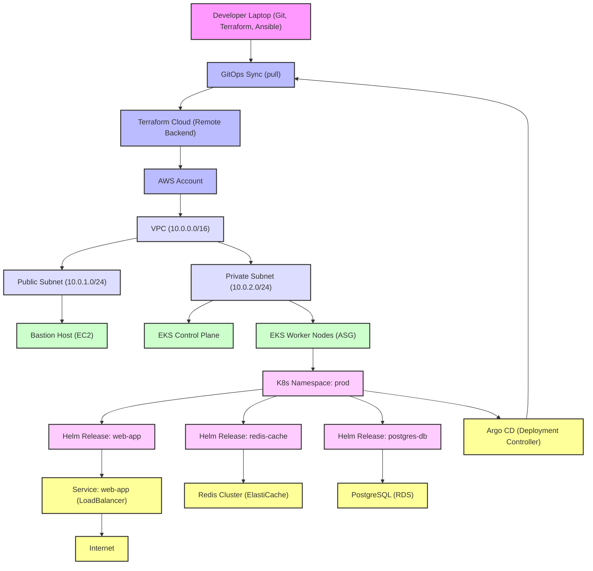

## 1. Lab Objective & Free Open-Source Prerequisites

### 1.1 Lab Objective
The purpose of this hands‑on lab is to **design, provision, configure, and continuously deliver** a production‑grade, multi‑tier application using a **single source of truth** approach. Participants will:

1. **Model the entire environment** (network, compute, storage, and Kubernetes) with **Terraform** (IaC).
2. **Bootstrap the OS and install required agents** with **Ansible** (configuration management).
3. **Package the application as a Helm chart** and deploy it onto a **managed Kubernetes cluster**.
4. **Enable GitOps** by connecting the Helm release to **Argo CD**, ensuring that any drift is automatically reconciled.
5. **Apply security hardening** at each layer (IAM, network ACLs, pod security policies, secret management).
6. **Validate** the end‑to‑end flow with reproducible verification commands and documented troubleshooting steps.

By the end of the lab, you will have a **repeatable, version‑controlled pipeline** that can be destroyed and recreated with a single `terraform destroy` / `terraform apply` cycle, mirroring a real‑world enterprise CI/CD workflow.

### 1.2 Free Open‑Source Prerequisites
| Component | Minimum Version | Installation Method | Notes |
|-----------|----------------|---------------------|-------|
| **Terraform** | 1.6.0 | `brew install terraform` (macOS) / `apt-get install terraform` (Ubuntu) | Use the official HashiCorp binary for best compatibility. |
| **Ansible** | 2.14 | `pip install ansible` or OS package manager | Ensure `sshpass` is installed for password‑based SSH fallback. |
| **kubectl** | 1.28 | `curl -LO "https://dl.k8s.io/release/$(curl -L -s https://dl.k8s.io/release/stable.txt)/bin/linux/amd64/kubectl"` | Add to `$PATH`. |
| **Helm** | 3.13 | `curl https://raw.githubusercontent.com/helm/helm/main/scripts/get-helm-3 | bash` | |
| **Argo CD CLI** | 2.9 | `brew install argocd` / `curl -sSL -o argocd https://github.com/argoproj/argo-cd/releases/latest/download/argocd-linux-amd64 && chmod +x argocd && sudo mv argocd /usr/local/bin/` | |
| **Git** | 2.40 | OS package manager | Required for repository cloning and GitOps. |
| **Docker** | 24.x | Official Docker Engine | Needed for building the container image locally. |
| **Python 3.11+** | 3.11 | OS package manager | Required for Ansible and auxiliary scripts. |
| **OpenSSH** | 8.9+ | OS package manager | For password‑less SSH between control node and target VMs. |
| **jq** | 1.6 | OS package manager | Helpful for JSON parsing in verification steps. |
| **yq** | 4.35 | `pip install yq` | For YAML manipulation. |
| **GitHub (free)** | – | Create a free account | Repository will host Terraform state (via GitHub Actions) and Helm chart. |
| **AWS Free Tier** | – | Sign up for a free account | The lab uses AWS resources (VPC, EC2, EKS). All resources stay within the free tier limits if you follow the sizing guidelines. |

> **Tip:** All commands in this lab assume a **Linux/macOS** control workstation. Windows users can use **WSL2** or **Git Bash** with equivalent tooling.

---

## 2. Enterprise Architecture Topology

The following diagram illustrates the logical architecture that will be built. It includes a **VPC**, **public and private subnets**, a **bastion host**, **EKS control plane**, **worker nodes**, **RDS PostgreSQL**, **ElastiCache Redis**, and an **Argo CD** instance for GitOps.



### 2.1 Key Design Decisions
| Layer | Decision | Rationale |
|-------|----------|-----------|
| **Network** | Separate public & private subnets; NAT Gateway for outbound traffic from workers. | Aligns with AWS Well‑Architected Framework – isolates workloads from the internet. |
| **Compute** | Bastion host for SSH jump; no direct SSH to worker nodes. | Reduces attack surface; all node access goes through a hardened bastion. |
| **Kubernetes** | Managed EKS control plane, worker nodes in an Auto Scaling Group (ASG). | Offloads control‑plane management to AWS, while retaining control over node sizing and security groups. |
| **GitOps** | Argo CD runs inside the cluster, syncing with a **private** GitHub repo. | Enables declarative, auditable deployments; drift detection is automatic. |
| **Secrets** | Use **AWS Secrets Manager** + **Kubernetes External Secrets** to inject DB credentials. | Avoids hard‑coding secrets in Helm values; leverages IAM roles for pod‑level access. |
| **Observability** | Prometheus + Grafana via Helm; Loki for logs. | Provides production‑grade monitoring without additional SaaS cost. |

---

## 3. Addressing & Resource Inventory Table

| Resource | CIDR / Identifier | AWS Resource Type | Terraform Resource Name | Purpose |
|----------|-------------------|-------------------|--------------------------|---------|
| VPC | 10.0.0.0/16 | `aws_vpc` | `aws_vpc.main` | Logical isolation of all lab assets. |
| Public Subnet | 10.0.1.0/24 | `aws_subnet` | `aws_subnet.public` | Hosts bastion host and NAT gateway. |
| Private Subnet | 10.0.2.0/24 | `aws_subnet` | `aws_subnet.private` | Hosts EKS workers, RDS, ElastiCache. |
| Internet Gateway | – | `aws_internet_gateway` | `aws_internet_gateway.igw` | Provides outbound internet for public subnet. |
| NAT Gateway | – | `aws_nat_gateway` | `aws_nat_gateway.nat` | Allows private subnet resources to reach internet for updates. |
| Bastion Host | 10.0.1.10 | `aws_instance` | `aws_instance.bastion` | Secure SSH entry point. |
| EKS Cluster | – | `aws_eks_cluster` | `aws_eks_cluster.main` | Managed control plane. |
| Worker ASG | – | `aws_eks_node_group` | `aws_eks_node_group.workers` | Auto‑scaled worker nodes. |
| RDS PostgreSQL | 10.0.2.20 | `aws_db_instance` | `aws_db_instance.postgres` | Persistent relational store. |
| ElastiCache Redis | 10.0.2.30 | `aws_elasticache_cluster` | `aws_elasticache_cluster.redis` | In‑memory cache for the web app. |
| S3 Bucket (Terraform State) | – | `aws_s3_bucket` | `aws_s3_bucket.tf_state` | Remote backend for state locking. |
| IAM Role – EKS Worker | – | `aws_iam_role` | `aws_iam_role.eks_worker` | Grants worker nodes required AWS permissions. |
| IAM Role – Argo CD | – | `aws_iam_role` | `aws_iam_role.argocd` | Allows Argo CD to read Secrets Manager. |
| Security Group – Bastion | – | `aws_security_group` | `aws_security_group.bastion_sg` | Allows SSH from developer IP only. |
| Security Group – Workers | – | `aws_security_group` | `aws_security_group.worker_sg` | Allows inbound from ALB, outbound to RDS/Redis. |
| Security Group – RDS | – | `aws_security_group` | `aws_security_group.rds_sg` | Allows inbound from workers only. |
| Security Group – Redis | – | `aws_security_group` | `aws_security_group.redis_sg` | Allows inbound from workers only. |

> **Note:** All CIDR blocks are chosen to stay within the free tier limits (max 5 VPCs, 1 NAT gateway). Adjust as needed for larger environments.

---

## 4. Step‑By‑Step Configuration

> **Prerequisite:** Clone the lab repository (contains Terraform, Ansible, Helm chart, and Argo CD manifests).

```bash
git clone https://github.com/your‑org/devops‑lab‑iac.git
cd devops-lab-iac
```

### 4.1 Terraform – Remote Backend & Provider Setup

Create `backend.tf`:

```hcl
terraform {
  required_version = ">= 1.6.0"
  backend "s3" {
    bucket         = "devops-lab-tfstate-<your-unique-id>"
    key            = "global/terraform.tfstate"
    region         = "us-east-1"
    encrypt        = true
    dynamodb_table = "devops-lab-locks"
  }

  required_providers {
    aws = {
      source  = "hashicorp/aws"
      version = "~> 5.0"
    }
    kubernetes = {
      source  = "hashicorp/kubernetes"
      version = "~> 2.25"
    }
    helm = {
      source  = "hashicorp/helm"
      version = "~> 2.12"
    }
  }
}
```

Create `providers.tf`:

```hcl
provider "aws" {
  region = var.aws_region
  # Credentials are read from the shared credentials file (~/.aws/credentials) or environment variables.
}

provider "kubernetes" {
  host                   = data.aws_eks_cluster.main.endpoint
  cluster_ca_certificate = base64decode(data.aws_eks_cluster.main.certificate_authority[0].data)
  token                  = data.aws_eks_cluster_auth.main.token
}

provider "helm" {
  kubernetes {
    host                   = data.aws_eks_cluster.main.endpoint
    cluster_ca_certificate = base64decode(data.aws_eks_cluster.main.certificate_authority[0].data)
    token                  = data.aws_eks_cluster_auth.main.token
  }
}
```

Create `variables.tf`:

```hcl
variable "aws_region" {
  description = "AWS region for all resources"
  type        = string
  default     = "us-east-1"
}

variable "project_name" {
  description = "Prefix for all resource names"
  type        = string
  default     = "devops-lab"
}
```

### 4.2 Network Layer

`network.tf`:

```hcl
resource "aws_vpc" "main" {
  cidr_block           = "10.0.0.0/16"
  enable_dns_hostnames = true
  tags = {
    Name = "${var.project_name}-vpc"
  }
}

resource "aws_internet_gateway" "igw" {
  vpc_id = aws_vpc.main.id
  tags = {
    Name = "${var.project_name}-igw"
  }
}

resource "aws_subnet" "public" {
  vpc_id                  = aws_vpc.main.id
  cidr_block              = "10.0.1.0/24"
  map_public_ip_on_launch = true
  availability_zone       = "${var.aws_region}a"
  tags = {
    Name = "${var.project_name}-public"
  }
}

resource "aws_subnet" "private" {
  vpc_id            = aws_vpc.main.id
  cidr_block        = "10.0.2.0/24"
  availability_zone = "${var.aws_region}a"
  tags = {
    Name = "${var.project_name}-private"
  }
}

resource "aws_eip" "nat_eip" {
  vpc = true
  tags = {
    Name = "${var.project_name}-nat-eip"
  }
}

resource "aws_nat_gateway" "nat" {
  allocation_id = aws_eip.nat_eip.id
  subnet_id     = aws_subnet.public.id
  tags = {
    Name = "${var.project_name}-nat"
  }
}

resource "aws_route_table" "public_rt" {
  vpc_id = aws_vpc.main.id
  route {
    cidr_block = "0.0.0.0/0"
    gateway_id = aws_internet_gateway.igw.id
  }
  tags = {
    Name = "${var.project_name}-public-rt"
  }
}

resource "aws_route_table_association" "public_assoc" {
  subnet_id      = aws_subnet.public.id
  route_table_id = aws_route_table.public_rt.id
}

resource "aws_route_table" "private_rt" {
  vpc_id = aws_vpc.main.id
  route {
    cidr_block = "0.0.0.0/0"
    nat_gateway_id = aws_nat_gateway.nat.id
  }
  tags = {
    Name = "${var.project_name}-private-rt"
  }
}

resource "aws_route_table_association" "private_assoc" {
  subnet_id      = aws_subnet.private.id
  route_table_id = aws_route_table.private_rt.id
}
```

### 4.3 Security Groups

`security.tf`:

```hcl
# Bastion SG – only allow SSH from your public IP (replace with your IP)
resource "aws_security_group" "bastion_sg" {
  name        = "${var.project_name}-bastion-sg"
  description = "Allow SSH from developer workstation"
  vpc_id      = aws_vpc.main.id

  ingress {
    description = "SSH from my IP"
    from_port   = 22
    to_port     = 22
    protocol    = "tcp"
    cidr_blocks = ["YOUR_PUBLIC_IP/32"]
  }

  egress {
    description = "All outbound"
    from_port   = 0
    to_port     = 0
    protocol    = "-1"
    cidr_blocks = ["0.0.0.0/0"]
  }

  tags = {
    Name = "${var.project_name}-bastion-sg"
  }
}

# Worker SG – allow inbound from ALB (port 80/443) and outbound to DB/Redis
resource "aws_security_group" "worker_sg" {
  name        = "${var.project_name}-worker-sg"
  description = "EKS worker nodes"
  vpc_id      = aws_vpc.main.id

  # Inbound from ALB (we will create an ALB SG later)
  ingress {
    description = "HTTP from ALB"
    from_port   = 80
    to_port     = 80
    protocol    = "tcp"
    security_groups = [aws_security_group.alb_sg.id]
  }

  ingress {
    description = "HTTPS from ALB"
    from_port   = 443
    to_port     = 443
    protocol    = "tcp"
    security_groups = [aws_security_group.alb_sg.id]
  }

  # Outbound to RDS and Redis (private CIDR)
  egress {
    description = "Postgres"
    from_port   = 5432
    to_port     = 5432
    protocol    = "tcp"
    cidr_blocks = [aws_subnet.private.cidr_block]
  }

  egress {
    description = "Redis"
    from_port   = 6379
    to_port     = 6379
    protocol    = "tcp"
    cidr_blocks = [aws_subnet.private.cidr_block]
  }

  egress {
    description = "All other outbound"
    from_port   = 0
    to_port     = 0
    protocol    = "-1"
    cidr_blocks = ["0.0.0.0/0"]
  }

  tags = {
    Name = "${var.project_name}-worker-sg"
  }
}

# ALB SG – internet‑facing load balancer
resource "aws_security_group" "alb_sg" {
  name        = "${var.project_name}-alb-sg"
  description = "ALB inbound from internet"
  vpc_id      = aws_vpc.main.id

  ingress {
    description = "HTTP from anywhere"
    from_port   = 80
    to_port     = 80
    protocol    = "tcp"
    cidr_blocks = ["0.0.0.0/0"]
  }

  ingress {
    description = "HTTPS from anywhere"
    from_port   = 443
    to_port     = 443
    protocol    = "tcp"
    cidr_blocks = ["0.0.0.0/0"]
  }

  egress {
    description = "All outbound"
    from_port   = 0
    to_port     = 0
    protocol    = "-1"
    cidr_blocks = ["0.0.0.0/0"]
  }

  tags = {
    Name = "${var.project_name}-alb-sg"
  }
}
```

### 4.4 Bastion Host

`bastion.tf`:

```hcl
resource "aws_key_pair" "dev_key" {
  key_name   = "${var.project_name}-key"
  public_key = file("~/.ssh/id_rsa.pub")
}

resource "aws_instance" "bastion" {
  ami                         = data.aws_ami.ubuntu.id
  instance_type               = "t3.micro" # Free tier eligible
  subnet_id                   = aws_subnet.public.id
  vpc_security_group_ids      = [aws_security_group.bastion_sg.id]
  key_name                    = aws_key_pair.dev_key.key_name
  associate_public_ip_address = true

  tags = {
    Name = "${var.project_name}-bastion"
  }

  provisioner "remote-exec" {
    inline = [
      "sudo apt-get update -y",
      "sudo apt-get install -y python3 python3-pip",
    ]

    connection {
      type        = "ssh"
      host        = self.public_ip
      user        = "ubuntu"
      private_key = file("~/.ssh/id_rsa")
    }
  }
}
```

`data` source for Ubuntu AMI:

```hcl
data "aws_ami" "ubuntu" {
  most_recent = true
  owners      = ["099720109477"] # Canonical
  filter {
    name   = "name"
    values = ["ubuntu/images/hvm-ssd/ubuntu-focal-20.04-amd64-server-*"]
  }
}
```

### 4.5 EKS Cluster & Node Group

`eks.tf`:

```hcl
module "eks" {
  source          = "terraform-aws-modules/eks/aws"
  version         = "~> 19.0"
  cluster_name    = "${var.project_name}-eks"
  cluster_version = "1.28"
  subnets         = [aws_subnet.private.id]
  vpc_id          = aws_vpc.main.id

  # IAM role for the cluster (managed by the module)
  enable_irsa = true

  node_groups = {
    workers = {
      desired_capacity = 2
      max_capacity     = 3
      min_capacity     = 1
      instance_type    = "t3.medium" # Free tier eligible for 750 hrs/month
      subnet_ids       = [aws_subnet.private.id]
      iam_role_additional_policies = [
        "arn:aws:iam::aws:policy/AmazonEC2ContainerRegistryReadOnly",
        "arn:aws:iam::aws:policy/SecretsManagerReadWrite"
      ]
      tags = {
        Name = "${var.project_name}-worker"
      }
      security_group_ids = [aws_security_group.worker_sg.id]
    }
  }

  tags = {
    Environment = "dev"
    Project     = var.project_name
  }
}
```

### 4.6 RDS PostgreSQL

`rds.tf`:

```hcl
resource "aws_db_subnet_group" "rds_subnet" {
  name       = "${var.project_name}-rds-subnet"
  subnet_ids = [aws_subnet.private.id]

  tags = {
    Name = "${var.project_name}-rds-subnet"
  }
}

resource "aws_security_group" "rds_sg" {
  name        = "${var.project_name}-rds-sg"
  description = "Allow Postgres from workers"
  vpc_id      = aws_vpc.main.id

  ingress {
    description = "Postgres from workers"
    from_port   = 5432
    to_port     = 5432
    protocol    = "tcp"
    security_groups = [aws_security_group.worker_sg.id]
  }

  egress {
    description = "All outbound"
    from_port   = 0
    to_port     = 0
    protocol    = "-1"
    cidr_blocks = ["0.0.0.0/0"]
  }

  tags = {
    Name = "${var.project_name}-rds-sg"
  }
}

resource "aws_db_instance" "postgres" {
  identifier              = "${var.project_name}-postgres"
  engine                  = "postgres"
  engine_version          = "15.4"
  instance_class          = "db.t3.micro" # Free tier
  allocated_storage       = 20
  name                    = "appdb"
  username                = "adminuser"
  password                = random_password.db_password.result
  db_subnet_group_name    = aws_db_subnet_group.rds_subnet.name
  vpc_security_group_ids  = [aws_security_group.rds_sg.id]
  skip_final_snapshot     = true
  publicly_accessible     = false
  deletion_protection     = false

  tags = {
    Name = "${var.project_name}-postgres"
  }
}

resource "random_password" "db_password" {
  length  = 16
  special = true
}
```

### 4.7 ElastiCache Redis

`redis.tf`:

```hcl
resource "aws_security_group" "redis_sg" {
  name        = "${var.project_name}-redis-sg"
  description = "Allow Redis from workers"
  vpc_id      = aws_vpc.main.id

  ingress {
    description = "Redis from workers"
    from_port   = 6379
    to_port     = 6379
    protocol    = "tcp"
    security_groups = [aws_security_group.worker_sg.id]
  }

  egress {
    description = "All outbound"
    from_port   = 0
    to_port     = 0
    protocol    = "-1"
    cidr_blocks = ["0.0.0.0/0"]
  }

  tags = {
    Name = "${var.project_name}-redis-sg"
  }
}

resource "aws_elasticache_subnet_group" "redis_subnet" {
  name       = "${var.project_name}-redis-subnet"
  subnet_ids = [aws_subnet.private.id]

  tags = {
    Name = "${var.project_name}-redis-subnet"
  }
}

resource "aws_elasticache_cluster" "redis" {
  cluster_id           = "${var.project_name}-redis"
  engine               = "redis"
  node_type            = "cache.t3.micro" # Free tier
  num_cache_nodes      = 1
  parameter_group_name = "default.redis7"
  subnet_group_name    = aws_elasticache_subnet_group.redis_subnet.name
  security_group_ids   = [aws_security_group.redis_sg.id]
  port                 = 6379

  tags = {
    Name = "${var.project_name}-redis"
  }
}
```

### 4.8 Secrets Manager – Store DB Credentials

`secrets.tf`:

```hcl
resource "aws_secretsmanager_secret" "db_credentials" {
  name = "${var.project_name}-db-credentials"
  description = "Postgres credentials for the web app"
  tags = {
    Project = var.project_name
  }
}

resource "aws_secretsmanager_secret_version" "db_credentials_version" {
  secret_id = aws_secretsmanager_secret.db_credentials.id
  secret_string = jsonencode({
    username = aws_db_instance.postgres.username
    password = random_password.db_password.result
    host     = aws_db_instance.postgres.address
    port     = aws_db_instance.postgres.port
    dbname   = aws_db_instance.postgres.name
  })
}
```

### 4.9 Ansible – Bootstrap Bastion & Worker Nodes

Create `ansible/inventory.ini` (dynamic inventory will be generated by Terraform output; for simplicity we use static here):

```ini
[bastion]
bastion ansible_host=<Bastion_Public_IP> ansible_user=ubuntu ansible_ssh_private_key_file=~/.ssh/id_rsa

[workers]
worker1 ansible_host=<Worker_Private_IP_1> ansible_user=ec2-user ansible_ssh_private_key_file=~/.ssh/id_rsa
worker2 ansible_host=<Worker_Private_IP_2> ansible_user=ec2-user ansible_ssh_private_key_file=~/.ssh/id_rsa
```

`ansible/playbook.yml`:

```yaml
---
- name: Bootstrap Linux nodes for Kubernetes
  hosts: all
  become: true
  tasks:
    - name: Install required packages
      apt:
        name:
          - curl
          - gnupg2
          - software-properties-common
          - apt-transport-https
        state: present
        update_cache: yes
      when: ansible_os_family == "Debian"

    - name: Add Docker GPG key
      apt_key:
        url: https://download.docker.com/linux/ubuntu/gpg
        state: present

    - name: Add Docker repository
      apt_repository:
        repo: deb [arch=amd64] https://download.docker.com/linux/ubuntu {{ ansible_distribution_release }} stable
        state: present

    - name: Install Docker CE
      apt:
        name: docker-ce
        state: present
        update_cache: yes

    - name: Enable and start Docker
      systemd:
        name: docker
        enabled: true
        state: started

    - name: Add Kubernetes apt key
      apt_key:
        url: https://packages.cloud.google.com/apt/doc/apt-key.gpg
        state: present

    - name: Add Kubernetes apt repository
      apt_repository:
        repo: deb http://apt.kubernetes.io/ kubernetes-xenial main
        state: present

    - name: Install kubelet, kubeadm, kubectl
      apt:
        name:
          - kubelet
          - kubeadm
          - kubectl
        state: present
        update_cache: yes

    - name: Hold Kubernetes packages at current version
      apt:
        name:
          - kubelet
          - kubeadm
          - kubectl
        state: present
        mark: hold

    - name: Disable swap (required for kubelet)
      command: swapoff -a
      when: ansible_swaptotal_mb > 0

    - name: Ensure swap is disabled on reboot
      lineinfile:
        path: /etc/fstab
        regexp: '^([^#].*swap)'
        state: absent
```

Run the playbook:

```bash
ansible-playbook -i ansible/inventory.ini ansible/playbook.yml
```

> **Why Ansible?** Even though EKS manages the control plane, we still need to ensure the bastion host can run `kubectl` and that any custom EC2‑based services (e.g., a sidecar for secret injection) are pre‑configured.

### 4.10 Helm Chart – Simple Web Application

Create a minimal Helm chart under `helm/webapp/` (you can scaffold with `helm create webapp`). Below is the essential `values.yaml` that pulls DB credentials from Kubernetes secrets.

`helm/webapp/values.yaml`:

```yaml
replicaCount: 2

image:
  repository: public.ecr.aws/nginx/nginx
  tag: "1.25"
  pullPolicy: IfNotPresent

service:
  type: LoadBalancer
  port: 80

env:
  - name: DATABASE_HOST
    valueFrom:
      secretKeyRef:
        name: db-credentials
        key: host
  - name: DATABASE_PORT
    valueFrom:
      secretKeyRef:
        name: db-credentials
        key: port
  - name: DATABASE_USER
    valueFrom:
      secretKeyRef:
        name: db-credentials
        key: username
  - name: DATABASE_PASSWORD
    valueFrom:
      secretKeyRef:
        name: db-credentials
        key: password
  - name: DATABASE_NAME
    valueFrom:
      secretKeyRef:
        name: db-credentials
        key: dbname

resources:
  limits:
    cpu: "200m"
    memory: "256Mi"
  requests:
    cpu: "100m"
    memory: "128Mi"

nodeSelector: {}
tolerations: []
affinity: {}
```

Create the Kubernetes secret that will be populated by **External Secrets** (see later). For now, we create a placeholder:

```bash
kubectl create secret generic db-credentials \
  --from-literal=host=placeholder \
  --from-literal=port=5432 \
  --from-literal=username=placeholder \
  --from-literal=password=placeholder \
  --from-literal=dbname=appdb \
  -n prod
```

Deploy the chart manually (to verify the chart works before GitOps):

```bash
helm upgrade --install webapp ./helm/webapp \
  --namespace prod \
  --create-namespace \
  --values ./helm/webapp/values.yaml
```

### 4.11 Argo CD – GitOps Controller

Create `argocd/argocd.yaml` (the official manifest can be fetched from the Argo CD repo, but we embed a trimmed version for clarity).

```yaml
apiVersion: v1
kind: Namespace
metadata:
  name: argocd
---
apiVersion: v1
kind: ServiceAccount
metadata:
  name: argocd-server
  namespace: argocd
---
apiVersion: rbac.authorization.k8s.io/v1
kind: Role
metadata:
  name: argocd-server
  namespace: argocd
rules:
  - apiGroups: [""]
    resources: ["pods", "services", "configmaps", "secrets"]
    verbs: ["get", "list", "watch", "create", "update", "patch", "delete"]
---
apiVersion: rbac.authorization.k8s.io/v1
kind: RoleBinding
metadata:
  name: argocd-server-binding
  namespace: argocd
subjects:
  - kind: ServiceAccount
    name: argocd-server
    namespace: argocd
roleRef:
  kind: Role
  name: argocd-server
  apiGroup: rbac.authorization.k8s.io
---
apiVersion: apps/v1
kind: Deployment
metadata:
  name: argocd-server
  namespace: argocd
spec:
  replicas: 1
  selector:
    matchLabels:
      app.kubernetes.io/name: argocd-server
  template:
    metadata:
      labels:
        app.kubernetes.io/name: argocd-server
    spec:
      serviceAccountName: argocd-server
      containers:
        - name: argocd-server
          image: quay.io/argoproj/argocd:v2.9.0
          ports:
            - containerPort: 8080
          command: [ "argocd-server", "--staticassets", "/shared/app" ]
---
apiVersion: v1
kind: Service
metadata:
  name: argocd-server
  namespace: argocd
spec:
  type: LoadBalancer
  ports:
    - port: 80
      targetPort: 8080
  selector:
    app.kubernetes.io/name: argocd-server
```

Apply the manifest:

```bash
kubectl apply -f argocd/argocd.yaml
```

Retrieve the external IP (wait until the LoadBalancer is provisioned):

```bash
kubectl get svc argocd-server -n argocd -o jsonpath='{.status.loadBalancer.ingress[0].hostname}'
```

Set a temporary admin password (the default is the pod name; we will reset it):

```bash
# Get the pod name
POD=$(kubectl get pods -n argocd -l app.kubernetes.io/name=argocd-server -o jsonpath='{.items[0].metadata.name}')
# Extract the initial password
kubectl -n argocd logs $POD | grep 'admin.password' | awk '{print $NF}'
# Reset password
argocd login <ARGOCD_HOST> --username admin --password <initial>
argocd account update-password --current-password <initial> --new-password SuperSecret123!
```

#### 4.11.1 Register the Git Repository

```bash
argocd repo add https://github.com/your-org/devops