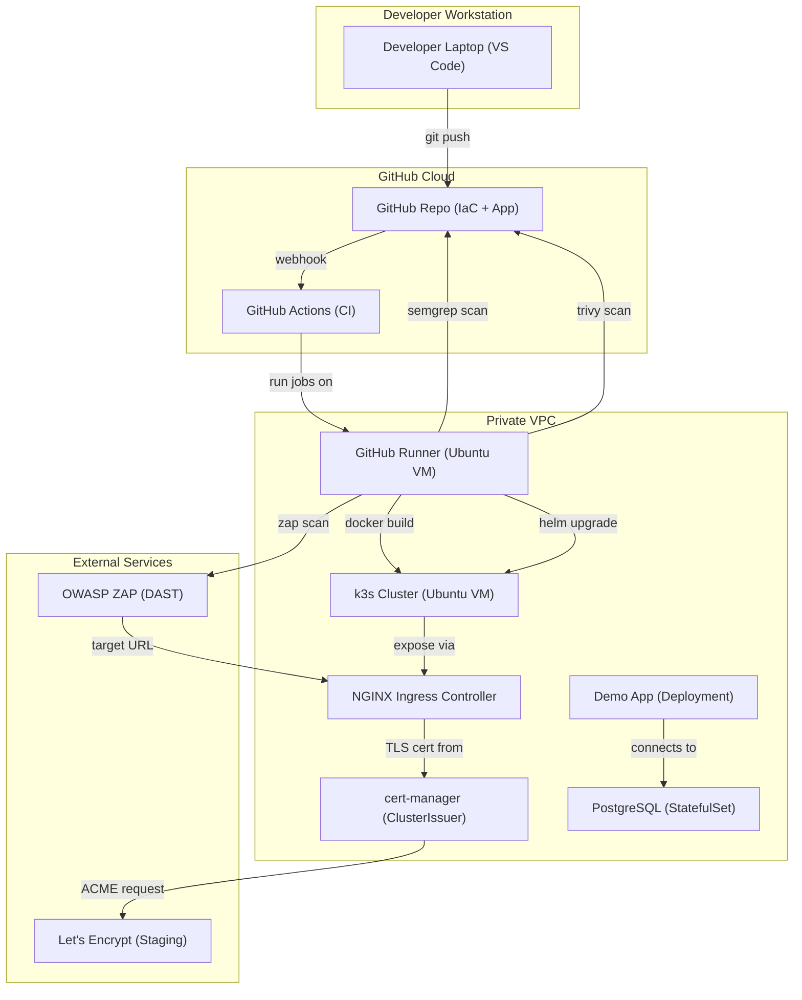

## 1. Lab Objective & Free Open-Source Prerequisites

### 1.1 Lab Objective
The purpose of this lab is to build a **production‑grade, end‑to‑end DevSecOps pipeline** that automatically:

1. **Static Application Security Testing (SAST)** – scans source code for insecure patterns before a build is produced.  
2. **Dynamic Application Security Testing (DAST)** – exercises the running containerized service to discover runtime vulnerabilities.  
3. **Container Image Scanning** – validates the built image against known CVEs, misconfigurations, and secret leakage.  

All three security gates will be **enforced in a GitOps‑style CI/CD workflow** using **GitHub Actions**, **Trivy**, **Semgrep**, and **OWASP ZAP**. The lab demonstrates how to:

* Wire up a **self‑hosted GitHub Runner** inside a private VPC.  
* Deploy a **Kubernetes cluster** (k3s) on a single‑node Ubuntu VM.  
* Publish the application via **Ingress** with TLS termination (cert‑manager + Let's Encrypt staging).  
* Fail the pipeline automatically when any security gate exceeds a configurable threshold.  

By the end of the lab you will have a reproducible repository that can be cloned, modified, and promoted to production with minimal friction.

### 1.2 Free Open‑Source Prerequisites

| Component | Version (minimum) | License | Why it’s needed |
|-----------|-------------------|---------|-----------------|
| Ubuntu Server | 22.04 LTS | GPLv2 | Host OS for all VMs and containers |
| Docker Engine | 24.0+ | Apache‑2.0 | Build and run container images |
| k3s (Lightweight K8s) | 1.28+ | Apache‑2.0 | Local Kubernetes cluster |
| GitHub (Free tier) | – | MIT/Proprietary | Source control & Actions |
| GitHub Runner (self‑hosted) | latest | MIT | Execute jobs inside VPC |
| Semgrep | 1.73+ | LGPL‑3.0 | SAST engine |
| Trivy | 0.48+ | Apache‑2.0 | Container image scanner |
| OWASP ZAP | 2.13+ | Apache‑2.0 | DAST engine |
| cert‑manager | v1.13+ | Apache‑2.0 | Automated TLS certs |
| NGINX Ingress Controller | v1.9+ | BSD‑3 | Expose services |
| Helm | 3.13+ | Apache‑2.0 | Package K8s manifests |
| jq, curl, yq | latest | MIT | JSON/YAML manipulation |
| OpenSSH | latest | BSD‑3 | Secure remote access |

> **Note:** All tools are freely available via official apt repositories, Docker Hub, or GitHub releases. No commercial licenses are required for the scope of this lab.

### 1.3 Hardware / Cloud Footprint

| Resource | Minimum Spec | Recommended |
|----------|--------------|-------------|
| VM for GitHub Runner & Docker | 2 vCPU, 4 GB RAM, 50 GB SSD | 4 vCPU, 8 GB RAM, 100 GB SSD |
| VM for k3s master (single‑node) | 2 vCPU, 4 GB RAM, 30 GB SSD | 4 vCPU, 8 GB RAM, 60 GB SSD |
| Network | Private /24 subnet | /24 with NAT gateway |
| Optional: External DNS (e.g., Cloudflare free tier) | – | – |

> The lab can be executed on a single physical workstation using **Multipass** or **Vagrant** to spin up the two VMs, or on any cloud provider offering free‑tier VMs (AWS t2.micro, GCP f1‑micro, Azure B1s).

---

## 2. Enterprise Architecture Topology

The following diagram visualises the logical flow from **developer commit → CI pipeline → secure container → production ingress**. All components reside inside a **private VPC** with a single NAT gateway for outbound internet access (required for pulling base images, Let's Encrypt, and GitHub API calls).



*All node labels are double‑quoted as required by the **CRITICAL MERMAID RULE**.*

---

## 3. Addressing & Resource Inventory Table

| # | Resource | Hostname / DNS | IP Address (CIDR) | Purpose | Owner |
|---|----------|----------------|-------------------|---------|-------|
| 1 | GitHub Runner VM | `runner.devsecops.local` | `10.10.10.10/24` | Executes CI jobs, holds Docker daemon | DevOps Engineer |
| 2 | k3s Node VM | `k3s.devsecops.local` | `10.10.10.20/24` | Hosts the Kubernetes control plane & workloads | Platform Team |
| 3 | NAT Gateway | `nat.devsecops.local` | `10.10.10.1/24` | Outbound internet for apt, Docker Hub, ACME | Network Team |
| 4 | Ingress LoadBalancer IP | `10.10.10.30` | `10.10.10.30/32` | Public entry point (via port‑forward for lab) | Platform Team |
| 5 | PostgreSQL Service (ClusterIP) | `postgres.devsecops.svc.cluster.local` | `10.42.0.10` | Persistent DB for demo app | DB Admin |
| 6 | OWASP ZAP Container (Standalone) | `zap.devsecops.local` | `10.10.10.40/32` | DAST engine, runs on Runner VM | Security Engineer |
| 7 | External DNS (optional) | `app.example.com` | – | CNAME → Ingress public IP (via port‑forward) | Ops |

> **Tip:** Use `ipcalc` or `cidrcalc` to verify that all addresses belong to the same `/24` network and do not overlap with any existing corporate subnets.

---

## 4. Step‑by‑Step Configuration

> All commands are **copy‑paste ready**. Inline comments (`#`) explain each step.  
> The lab assumes you have **SSH access** to the two VMs (`runner` and `k3s`) as the `ubuntu` user with password‑less sudo.

### 4.1 Prepare the Ubuntu VMs

```bash
# On both VMs (runner & k3s)
sudo apt update && sudo apt -y upgrade
sudo apt install -y curl gnupg2 ca-certificates lsb-release software-properties-common \
    apt-transport-https git jq yq unzip

# Install Docker Engine (official script)
curl -fsSL https://get.docker.com | sudo sh
sudo usermod -aG docker $USER   # Add current user to docker group
newgrp docker                  # Refresh group membership

# Verify Docker
docker version
```

#### 4.1.1 Install k3s (only on the k3s node)

```bash
# Install k3s as a systemd service, disabling traefik (we’ll use NGINX)
curl -sfL https://get.k3s.io | INSTALL_K3S_EXEC="--disable=traefik" sh -
# Verify node status
sudo k3s kubectl get nodes
# Export alias for convenience
alias k="sudo k3s kubectl"
```

#### 4.1.2 Install Helm (both nodes, but we’ll use it on the k3s node)

```bash
curl https://raw.githubusercontent.com/helm/helm/main/scripts/get-helm-3 | bash
helm version
```

### 4.2 Deploy Ingress Controller & cert‑manager

```bash
# Create a dedicated namespace
k create namespace ingress-nginx
k create namespace cert-manager

# Add the official Helm repos
helm repo add ingress-nginx https://kubernetes.github.io/ingress-nginx
helm repo add jetstack https://charts.jetstack.io
helm repo update

# Install NGINX Ingress (NodePort for lab)
helm upgrade --install ingress-nginx ingress-nginx/ingress-nginx \
  --namespace ingress-nginx \
  --set controller.kind=DaemonSet \
  --set controller.service.type=NodePort \
  --set controller.service.nodePorts.http=30080 \
  --set controller.service.nodePorts.https=30443

# Install cert‑manager CRDs and the chart
kubectl apply -f https://github.com/cert-manager/cert-manager/releases/download/v1.13.3/cert-manager.crds.yaml
helm upgrade --install cert-manager jetstack/cert-manager \
  --namespace cert-manager \
  --set installCRDs=false \
  --set webhook.timeoutSeconds=30

# Wait for pods to become Ready
k wait --namespace ingress-nginx --for=condition=ready pod -l app.kubernetes.io/component=controller --timeout=120s
k wait --namespace cert-manager --for=condition=ready pod -l app=webhook --timeout=120s
```

#### 4.2.1 Create a ClusterIssuer (Let's Encrypt Staging)

```yaml
# Save as clusterissuer-staging.yaml
cat <<'EOF' > clusterissuer-staging.yaml
apiVersion: cert-manager.io/v1
kind: ClusterIssuer
metadata:
  name: letsencrypt-staging
spec:
  acme:
    # Staging endpoint avoids rate‑limits during lab
    server: https://acme-staging-v02.api.letsencrypt.org/directory
    email: devsecops@example.com
    privateKeySecretRef:
      name: letsencrypt-staging-key
    solvers:
    - http01:
        ingress:
          class: nginx
EOF

# Apply
k apply -f clusterissuer-staging.yaml
```

### 4.3 Prepare the Application Repository

Create a **GitHub repository** (public or private) named `devsecops-demo`. Clone it locally on your workstation.

```bash
git clone https://github.com/<your‑org>/devsecops-demo.git
cd devsecops-demo
```

#### 4.3.1 Directory Layout

```
devsecops-demo/
├── .github/
│   └── workflows/
│       └── ci.yml
├── helm/
│   └── demo-app/
│       ├── Chart.yaml
│       ├── values.yaml
│       └── templates/
│           ├── deployment.yaml
│           ├── service.yaml
│           └── ingress.yaml
├── src/
│   └── app.py          # Simple Flask API
├── requirements.txt
└── Dockerfile
```

#### 4.3.2 Sample Flask Application (`src/app.py`)

```python
# src/app.py
from flask import Flask, jsonify
import os
import psycopg2

app = Flask(__name__)

@app.route("/health")
def health():
    return jsonify(status="UP")

@app.route("/data")
def data():
    # Simple DB query to prove connectivity
    conn = psycopg2.connect(
        host=os.getenv("POSTGRES_HOST", "postgres"),
        dbname=os.getenv("POSTGRES_DB", "demo"),
        user=os.getenv("POSTGRES_USER", "demo"),
        password=os.getenv("POSTGRES_PASSWORD", "demo")
    )
    cur = conn.cursor()
    cur.execute("SELECT now()")
    now = cur.fetchone()[0]
    cur.close()
    conn.close()
    return jsonify(timestamp=str(now))

if __name__ == "__main__":
    app.run(host="0.0.0.0", port=8080)
```

#### 4.3.3 `requirements.txt`

```
Flask==3.0.2
psycopg2-binary==2.9.9
```

#### 4.3.4 Dockerfile (multi‑stage)

```dockerfile
# Dockerfile
FROM python:3.12-slim AS builder
WORKDIR /app
COPY requirements.txt .
RUN pip install --user -r requirements.txt

FROM python:3.12-slim
WORKDIR /app
COPY --from=builder /root/.local /root/.local
ENV PATH=/root/.local/bin:$PATH
COPY src/ .
EXPOSE 8080
CMD ["python", "app.py"]
```

#### 4.3.5 Helm Chart (`helm/demo-app/Chart.yaml`)

```yaml
apiVersion: v2
name: demo-app
description: A minimal Flask demo app
type: application
version: 0.1.0
appVersion: "1.0"
```

#### 4.3.6 Helm Values (`helm/demo-app/values.yaml`)

```yaml
replicaCount: 2

image:
  repository: ghcr.io/<your‑org>/devsecops-demo
  pullPolicy: IfNotPresent
  tag: "latest"

service:
  type: ClusterIP
  port: 80

ingress:
  enabled: true
  className: nginx
  annotations:
    cert-manager.io/cluster-issuer: letsencrypt-staging
  hosts:
    - host: demo.devsecops.local
      paths:
        - path: /
          pathType: Prefix
  tls:
    - secretName: demo-tls
      hosts:
        - demo.devsecops.local

resources:
  limits:
    cpu: "500m"
    memory: "256Mi"
  requests:
    cpu: "250m"
    memory: "128Mi"

postgres:
  enabled: true
  auth:
    username: demo
    password: demo
    database: demo
```

#### 4.3.7 Helm Templates (deployment, service, ingress)

`templates/deployment.yaml`

```yaml
apiVersion: apps/v1
kind: Deployment
metadata:
  name: {{ include "demo-app.fullname" . }}
  labels:
    {{- include "demo-app.labels" . | nindent 4 }}
spec:
  replicas: {{ .Values.replicaCount }}
  selector:
    matchLabels:
      app.kubernetes.io/name: {{ include "demo-app.name" . }}
  template:
    metadata:
      labels:
        app.kubernetes.io/name: {{ include "demo-app.name" . }}
    spec:
      containers:
        - name: {{ .Chart.Name }}
          image: "{{ .Values.image.repository }}:{{ .Values.image.tag }}"
          imagePullPolicy: {{ .Values.image.pullPolicy }}
          ports:
            - containerPort: 8080
          env:
            - name: POSTGRES_HOST
              value: "postgres"
            - name: POSTGRES_DB
              value: {{ .Values.postgres.auth.database | quote }}
            - name: POSTGRES_USER
              value: {{ .Values.postgres.auth.username | quote }}
            - name: POSTGRES_PASSWORD
              value: {{ .Values.postgres.auth.password | quote }}
          resources:
            {{- toYaml .Values.resources | nindent 12 }}
```

`templates/service.yaml`

```yaml
apiVersion: v1
kind: Service
metadata:
  name: {{ include "demo-app.fullname" . }}
  labels:
    {{- include "demo-app.labels" . | nindent 4 }}
spec:
  type: {{ .Values.service.type }}
  ports:
    - port: {{ .Values.service.port }}
      targetPort: 8080
      protocol: TCP
      name: http
  selector:
    app.kubernetes.io/name: {{ include "demo-app.name" . }}
```

`templates/ingress.yaml`

```yaml
{{- if .Values.ingress.enabled -}}
apiVersion: networking.k8s.io/v1
kind: Ingress
metadata:
  name: {{ include "demo-app.fullname" . }}
  annotations:
    {{- range $key, $value := .Values.ingress.annotations }}
    {{ $key }}: "{{ $value }}"
    {{- end }}
spec:
  ingressClassName: {{ .Values.ingress.className }}
  rules:
    {{- range .Values.ingress.hosts }}
    - host: {{ .host }}
      http:
        paths:
          {{- range .paths }}
          - path: {{ .path }}
            pathType: {{ .pathType }}
            backend:
              service:
                name: {{ include "demo-app.fullname" $ }}
                port:
                  number: {{ $.Values.service.port }}
          {{- end }}
    {{- end }}
  tls:
    {{- range .Values.ingress.tls }}
    - hosts:
        {{- range .hosts }}
        - {{ . }}
        {{- end }}
      secretName: {{ .secretName }}
    {{- end }}
{{- end }}
```

### 4.4 Configure the Self‑Hosted GitHub Runner

On the **runner VM**:

```bash
# Create a dedicated user for the runner (optional but recommended)
sudo adduser --disabled-password --gecos "" gh-runner
sudo usermod -aG docker gh-runner

# Switch to the runner user
sudo su - gh-runner

# Download the latest runner package (replace <arch> if needed)
RUNNER_VERSION=$(curl -s https://api.github.com/repos/actions/runner/releases/latest | jq -r .tag_name)
curl -O -L https://github.com/actions/runner/releases/download/${RUNNER_VERSION}/actions-runner-linux-x64-${RUNNER_VERSION:1}.tar.gz
tar xzf actions-runner-linux-x64-${RUNNER_VERSION:1}.tar.gz
./config.sh \
  --url https://github.com/<your‑org>/devsecops-demo \
  --token <PAT_WITH_repo_and_workflow_scope> \
  --labels self-hosted,linux,ubuntu \
  --name runner-devsecops \
  --work _work

# Install as a systemd service
sudo ./svc.sh install
sudo ./svc.sh start

# Verify
systemctl status actions.runner.*.service
```

> **Security tip:** Store the registration token in a vault (e.g., HashiCorp Vault) and inject it via a short‑lived environment variable when provisioning the runner.

### 4.5 CI Workflow (`.github/workflows/ci.yml`)

```yaml
name: CI / DevSecOps Pipeline

on:
  push:
    branches: [ main ]
  pull_request:
    branches: [ main ]

permissions:
  contents: read
  packages: write
  id-token: write   # Required for OIDC token exchange with GHCR

jobs:
  sast:
    name: Static Application Security Testing (Semgrep)
    runs-on: self-hosted
    steps:
      - name: Checkout code
        uses: actions/checkout@v4

      - name: Install Semgrep
        run: |
          python3 -m pip install --user semgrep

      - name: Run Semgrep
        id: semgrep
        run: |
          ~/.local/bin/semgrep --config=auto --json -o semgrep-report.json src/
          # Fail if any rule severity >= "high"
          HIGH=$(jq '[.results[] | select(.severity=="high")] | length' semgrep-report.json)
          if [ "$HIGH" -gt 0 ]; then
            echo "::error ::High severity findings detected"
            exit 1
          fi

      - name: Upload Semgrep SARIF
        uses: github/codeql-action/upload-sarif@v2
        with:
          sarif_file: semgrep-report.json

  build-and-scan:
    name: Build Image & Container Scan (Trivy)
    runs-on: self-hosted
    needs: sast
    steps:
      - name: Checkout code
        uses: actions/checkout@v4

      - name: Set up Docker Buildx
        uses: docker/setup-buildx-action@v3

      - name: Log in to GHCR
        uses: docker/login-action@v3
        with:
          registry: ghcr.io
          username: ${{ github.actor }}
          password: ${{ secrets.GITHUB_TOKEN }}

      - name: Build Docker image
        id: build
        run: |
          IMAGE=ghcr.io/${{ github.repository }}:sha-${{ github.sha }}
          docker build -t $IMAGE .
          echo "image=$IMAGE" >> $GITHUB_OUTPUT

      - name: Scan image with Trivy (Vuln + Config)
        env:
          TRIVY_IGNORE_UNFIXED: "true"
        run: |
          docker run --rm -v /var/run/docker.sock:/var/run/docker.sock \
            aquasec/trivy:latest \
            image --severity HIGH,CRITICAL --ignore-unfixed ${{ steps.build.outputs.image }} \
            > trivy-vuln.txt || true

          docker run --rm -v /var/run/docker.sock:/var/run/docker.sock \
            aquasec/trivy:latest \
            config ${{ steps.build.outputs.image }} > trivy-config.txt || true

          # Fail if any HIGH/CRITICAL findings
          if grep -qE "HIGH|CRITICAL" trivy-vuln.txt; then
            echo "::error ::Container image contains HIGH/CRITICAL vulnerabilities"
            cat trivy-vuln.txt
            exit 1
          fi

      - name: Push image to GHCR
        if: success()
        run: |
          docker push ${{ steps.build.outputs.image }}

  deploy:
    name: Deploy to k3s (Helm Upgrade)
    runs-on: self-hosted
    needs: build-and-scan
    steps:
      - name: Checkout repo
        uses: actions/checkout@v4

      - name: Install Helm
        run: |
          curl https://raw.githubusercontent.com/helm/helm/main/scripts/get-helm-3 | bash

      - name: Deploy Helm chart
        env:
          KUBECONFIG: /home/gh-runner/.kube/config
        run: |
          # Ensure kubeconfig points to the k3s node (copy from runner to k3s via scp)
          scp ubuntu@10.10.10.20:/etc/rancher/k3s/k3s.yaml $KUBECONFIG
          # Replace server IP with internal address
          yq eval '.clusters[0].cluster.server = "https://10.10.10.20:6443"' -i $KUBECONFIG

          helm upgrade --install demo-app ./helm/demo-app \
            --set image.tag=sha-${{ github.sha }} \
            --namespace default \
            --create-namespace

  dast:
    name: Dynamic Application Security Testing (OWASP ZAP)
    runs-on: self-hosted
    needs: deploy
    steps:
      - name: Wait for service to be ready
        run: |
          for i in {1..30}; do
            curl -k https://10.10.10.30/health && break || sleep 10
          done

      - name: Run OWASP ZAP baseline scan
        env:
          ZAP_TARGET: https://demo.devsecops.local
        run: |
          docker run -t owasp/zap2docker-stable zap-baseline.py \
            -t $ZAP_TARGET \
            -r zap-report.html || true

          # Extract high/critical alerts
          HIGH=$(docker run -t owasp/zap2docker-stable zap-cli alerts -l High -r $ZAP_TARGET | wc -l)
          if [ "$HIGH" -gt 0 ]; then
            echo "::error ::DAST detected High severity alerts"
            exit 1
          fi

      - name: Archive ZAP report
        uses: actions/upload-artifact@v4
        with:
          name: zap-report
          path: zap-report.html
```

**Explanation of key sections:**

* **SAST** – Uses `semgrep` with the `auto` rule set. The job fails on any `high` severity finding.  
* **Container Scan** – Trivy runs both vulnerability and configuration scans. The `--ignore-unfixed` flag mirrors production policy where only fixed CVEs are actionable.  
* **Deploy** – Helm upgrades the chart, passing the image digest derived from the commit SHA. The runner copies the `k3s.yaml` from the k3s node over SSH; in a real environment you would store the kubeconfig in a secret manager.  
* **DAST** – OWASP ZAP runs a baseline scan against the public ingress (exposed via NodePort 30443). The job fails on any `High` alert.  

### 4.6 Expose the Ingress Locally (Port‑Forward)

Because the lab runs inside a private VPC, we expose the NGINX Ingress via **NodePort** and forward it to the local workstation for manual testing.

```bash
# On your laptop (or any machine with network access to the VPC)
ssh -L 30443:10.10.10.30:30443 ubuntu@10.10.10.20 -N
# Now you can reach the app at https://localhost:30443
```

Add a host entry for the demo domain:

```bash
echo "127.0.0.1 demo.devsecops.local" | sudo tee -a /etc/hosts
```

Visit `https://demo.devsecops.local:30443/health` – you should see `{"status":"UP"}`.

---

## 5. Verification & Troubleshooting Commands

Below are **expected outputs** for a successful run, plus common failure patterns and remediation steps.

### 5.1 Verify SAST (Semgrep)

```bash
$ ~/.local/bin/semgrep --config=auto --json -o semgrep-report.json src/
$ cat semgrep-report.json | jq '.results | length'
0
```

*If you see a non‑zero count with `"severity":"high"`* → Refactor the offending code or add an allow‑list rule. Re‑run until the count is zero.

### 5.2 Verify Container Scan (Trivy)

```bash
$ docker run --rm -v /var/run/docker.sock:/var/run/docker.sock aquasec/trivy:latest image --severity HIGH,CRITICAL ghcr.io/<org>/devsecops-demo:sha-abcdef
2026-11-27T12:34:56.789Z	INFO	Detected OS: ubuntu 22.04
2026-11-27T12:34:57.123Z	INFO	Detected language: python (3.12)
2026-11-27T12:34:58.456Z	INFO	Total vulnerabilities: 0 (UNKNOWN: 0, LOW: 0, MEDIUM: 0, HIGH: 0, CRITICAL: 0)
```

*If you see any HIGH/CRITICAL entries* → Upgrade the base image, apply patches, or add a `--ignore` rule for false positives. Commit the fix and push again.

### 5.3 Verify Helm Deployment

```bash
$ k get pods -l app.kubernetes.io/name=demo-app
NAME                                 READY   STATUS    RESTARTS   AGE
demo-app-6b9c7d5f5c-8k2z9            1/1     Running   0          2m
demo-app-6b9c7d5f5c-9l4p2            1/1     Running   0          2m

$ k get ingress demo-app -o yaml
apiVersion: networking.k8s.io/v1
...
spec:
  tls:
  - hosts:
    - demo.devsecops.local
    secretName: demo-tls
  rules:
  - host: demo.devsecops.local
    http:
      paths:
      - backend:
          service:
            name: demo-app
            port:
              number: 80
        path: /
        pathType: Prefix
```

*If the Ingress shows `ADDRESS: <none>`* → Check that cert‑manager has issued a certificate:

```bash
$ k get certificate demo-tls
NAME        READY   SECRET        AGE
demo-tls    True    demo-tls-tls  1m
```

If `READY` is `False`, inspect the `cert-manager` logs:

```bash
$ k logs -n cert-manager -l app=cert-manager
```

Typical issues: missing DNS A record, rate‑limit on Let's Encrypt (use staging), or firewall blocking port 80/443.

### 5.4 Verify DAST (OWASP ZAP)

```bash
$ curl -k https://demo.devsecops.local:30443/health
{"status":"UP"}

# Run ZAP baseline manually (outside CI) for debugging
$ docker run -t owasp/zap2docker-stable zap-baseline.py -t https://demo.devsecops.local:30443 -r zap-report.html
2026-11-27 12:45:01 INFO  - Loading URLs from file: 
2026-11-27 12:45:02 INFO  - Starting scan on target: https://demo.devsecops.local:30443
...
2026-11-27 12:45:45 INFO  - Scan completed with 0 alerts.
```

*If alerts appear* → Review the HTML report (`zap-report.html`) for the exact request/response that triggered the finding. Common false positives include missing `X-Content-Type-Options` header; add it via an NGINX snippet.

### 5.5 Common Runner Issues

| Symptom | Likely Cause | Fix |
|---------|--------------|-----|
| `Runner not picking up jobs` | Runner service stopped or token expired | `sudo systemctl restart actions.runner.*.service` and re‑register with a fresh PAT |
| `Docker daemon not reachable` | Runner user not in `docker` group | `sudo usermod -aG docker $USER && newgrp docker` |
| `Permission denied while pulling from GHCR` | Missing `GITHUB_TOKEN` scope | Ensure the workflow has `packages: write` permission and the token is not expired |
| `kubectl: command not found` | Helm step didn't install `k3s` client | Add `sudo apt install -y kubectl` or copy `k3s kubectl` to `$PATH` |

---

## 6. Security Hardening & Production Best Practices

### 6.1 Network Segmentation
* **Separate subnets** for CI runners, Kubernetes nodes, and external services.  
* Apply **security groups / firewall rules** that only allow:
  * Runner → Docker Hub (HTTPS 443)  
  * Runner → GitHub API (HTTPS 443)  
  * Runner ↔ k3s node (TCP 22, 6443)  
  * k3s node ↔ Ingress (NodePort 30080/30443)  
  * Ingress ↔ Internet (HTTPS) – **no inbound SSH**.

### 6.2 Least‑Privilege IAM
* Use **GitHub OIDC** to exchange short‑lived tokens for GHCR pushes, eliminating static PATs.  
* Store any long‑lived secrets (e.g., DB passwords) in **Kubernetes Secrets** encrypted at rest with **SealedSecrets** or **Vault**.

### 6.3 Container Hardening
* Build images **FROM `python:3.12-slim`** – minimal attack surface.  
* Run containers as **non‑root** (add `USER 1000:1000` in Dockerfile).  
* Enable **Docker Content Trust** (`DOCKER_CONTENT_TRUST=1`) on the runner to verify signed images.

### 6.4 SAST/DAST Policy Management
* Keep a **centralized Semgrep rule set** in a separate repo; version it with Git tags.  
* Configure Trivy to use a **custom policy file** (`--policy ./policy.yaml`) that enforces organization‑specific controls (e.g., disallow `root` user, require `noexec` mount options).  
* Schedule **nightly full scans** with higher thresholds to catch drift.

### 6.5 Image Signing & Provenance
* After a successful build, sign the image with **cosign**:

```bash
cosign sign --key env://COSIGN_PRIVATE_KEY ${{ steps.build.outputs.image }}
```

* Store the public key in a ConfigMap and enforce verification in the admission controller (e.g., `gatekeeper` with a `sigstore` constraint).

### 6.6 Runtime Security
* Deploy **Falco** or **kube‑audit** as a DaemonSet to monitor syscalls and Kubernetes API events.  
* Enable **Pod Security Standards** (baseline) via a `PodSecurity` admission controller:

```yaml
apiVersion: policy/v1beta1
kind: PodSecurityPolicy
metadata:
  name: restricted-psp
spec:
  privileged: false
  runAsUser:
    rule: MustRunAsNonRoot
  seLinux:
    rule: RunAsAny
  supplementalGroups:
    rule: MustRunAs
    ranges:
    - min: 1000
      max: 65535
  volumes:
    - configMap
    - secret
    - emptyDir
```

### 6.7 Logging, Monitoring, and Alerting
* **Prometheus** + **Grafana** for metrics (container CPU, memory, Trivy scan results via exporter).  
* **ELK stack** or ** Loki** for log aggregation; forward GitHub Actions logs via the `actions/upload-artifact` step.  
* Set up **Alertmanager** rules to fire on:
  * New HIGH/CRITICAL CVEs in images.  
  * SAST findings that exceed a threshold.  
  * DAST alerts flagged as `High` or `Critical`.

### 6.8 Disaster Recovery & Rollback
* Tag each successful image with both `sha-<commit>` and a **semantic version** (`v1.2.3`).  
* Use Helm’s `--revision` flag to rollback:

```bash
helm rollback demo-app 3   # Roll back to revision 3
```

* Keep a **Git tag** for each production release; the CI pipeline should automatically create a GitHub Release with the associated image digest.

### 6.9 Compliance Automation
* Export scan results to **