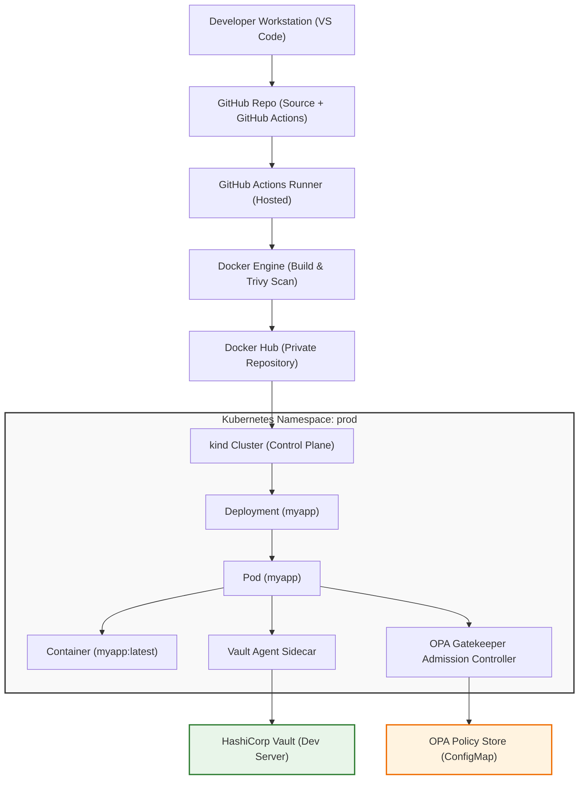

## 1. Lab Objective & Free Open-Source Prerequisites

### 1.1 Lab Objective
The purpose of this hands‑on lab is to build a **production‑grade, end‑to‑end DevSecOps pipeline** that demonstrates how modern enterprises can:

1. **Automate container image vulnerability scanning** with **Aqua Trivy** integrated into a CI/CD workflow.
2. **Securely store and inject secrets** (database credentials, API keys, TLS certificates) using **HashiCorp Vault** with Kubernetes authentication.
3. **Enforce policy‑as‑code** on every Kubernetes resource admission using **OPA Gatekeeper**.
4. **Tie the three components together** in a reproducible, IaC‑driven environment that can be version‑controlled and redeployed on demand.

By the end of the lab you will have a **fully functional CI pipeline** (GitHub Actions) that:

- Builds a Docker image from a sample Go microservice.
- Scans the image with Trivy, fails the pipeline on any CVE > Medium severity.
- Pushes the image to a private Docker registry (Docker Hub in this lab, replaceable with ECR/ACR).
- Deploys the image to a **Kubernetes** cluster (kind) **only if** the image passes the scan **and** the manifest complies with Gatekeeper policies.
- Retrieves database credentials from Vault at pod startup, demonstrating **dynamic secret injection**.

### 1.2 Free Open‑Source Prerequisites
| Component | Minimum Version | Installation Method | License |
|-----------|----------------|---------------------|---------|
| **Docker Engine** | 24.0+ | Official Docker Desktop (Windows/macOS) or `apt-get`/`yum` on Linux | Apache‑2.0 |
| **kind (Kubernetes IN Docker)** | v0.22.0+ | `go install sigs.k8s.io/kind@latest` or binary release | MIT |
| **kubectl** | v1.28+ | `curl -LO "https://dl.k8s.io/release/$(curl -L -s https://dl.k8s.io/release/stable.txt)/bin/$(uname -s | tr '[:upper:]' '[:lower:]')/amd64/kubectl"` | Apache‑2.0 |
| **Helm** | v3.14+ | Scripted installer from helm.sh | Apache‑2.0 |
| **Git** | 2.40+ | OS package manager | GPL‑2.0 |
| **GitHub Actions Runner** | Hosted (free tier) | GitHub UI | Proprietary (free) |
| **Trivy** | v0.48+ | `brew install aquasecurity/trivy/trivy` or binary | Apache‑2.0 |
| **HashiCorp Vault** | v1.15+ | `brew install vault` or binary | MPL‑2.0 |
| **OPA Gatekeeper** | v3.15+ | Helm chart `gatekeeper/gatekeeper` | Apache‑2.0 |
| **Go** (optional for sample app) | 1.22+ | OS package manager | BSD‑3 |
| **jq** | 1.6+ | OS package manager | MIT |

> **Note:** All tools are free, open‑source, and can be installed on a single workstation (Linux/macOS/WSL2). The lab does **not** require any paid cloud services, but the same manifests can be pointed at AWS EKS, Azure AKS, or GKE with minimal changes.

---

## 2. Enterprise Architecture Topology


> **📥 Hands-On Lab Topology File:** [Download EVE-NG `.unl` Lab File](/labs/devsecops-trivy-sonarqube-vault-kubernetes-policy-lab.unl) *(Import directly into EVE-NG Community Edition)*


The diagram below visualises the logical flow of artifacts and control planes in the lab. It is deliberately kept simple yet mirrors a typical enterprise DevSecOps stack.



**Key Relationships**

| Arrow | Meaning |
|-------|---------|
| A → B | Developer pushes code & pipeline definition. |
| B → C | GitHub Actions automatically triggers on `push`. |
| C → D | Runner builds Docker image and runs Trivy scan. |
| D → E | Successful scan pushes image to private registry. |
| E → F | `kind` cluster pulls image for deployment. |
| F → G | Namespace `prod` isolates production workloads. |
| I → K | Vault Agent sidecar fetches secrets at pod start. |
| I → L | Gatekeeper intercepts admission requests, validates against policies. |
| K → M | Vault server holds secrets, policies, and dynamic credentials. |
| L → N | OPA policies are stored as ConfigMaps inside the cluster. |

---

## 3. Addressing & Resource Inventory Table

| # | Resource | CIDR / Identifier | Owner | Purpose | Hardening Notes |
|---|----------|-------------------|-------|---------|-----------------|
| 1 | Developer Workstation | N/A (local) | Dev Team | Code authoring, CI trigger | Use OS‑level hardening, MFA on GitHub |
| 2 | GitHub Repository | `github.com/<org>/devsecops-lab` | DevOps | Source + GitHub Actions workflow | Enable branch protection, secret scanning |
| 3 | Docker Hub Private Repo | `docker.io/<org>/myapp` | Platform Team | Artifact storage | Enable 2FA, image signing with Notary |
| 4 | kind Cluster Control Plane | 127.0.0.1 (Docker network) | Infra Team | Kubernetes API server | Run with `--disable-legacy-authorization` |
| 5 | Vault Server | `http://127.0.0.1:8200` | Security Team | Secret management | Enable TLS, seal with AWS KMS (demo uses dev mode) |
| 6 | OPA Gatekeeper | Namespace `gatekeeper-system` | Platform Team | Policy enforcement | Run as non‑root, restrict RBAC |
| 7 | Application Namespace `prod` | N/A | Dev Team | Deploy microservice | Enforce `NetworkPolicy` & `PodSecurityPolicy` via Gatekeeper |
| 8 | CI Runner (GitHub Hosted) | N/A (cloud) | GitHub | Execute pipeline steps | Use GitHub‑provided OIDC token for Docker Hub auth |

---

## 4. Step‑by‑Step Configuration

> **All commands are copy‑paste ready.**  
> Inline comments (`#`) explain each line.  
> The lab assumes a fresh terminal session on a Linux/macOS host with the prerequisites installed.

### 4.1 Create a Working Directory

```bash
mkdir -p ~/devsecops-lab && cd ~/devsecops-lab
```

### 4.2 Initialise a Git Repository & Sample Go Application

```bash
# Initialise repo
git init .
git checkout -b main

# Minimal Go microservice (main.go)
cat > main.go <<'EOF'
package main

import (
	"fmt"
	"net/http"
)

func hello(w http.ResponseWriter, r *http.Request) {
	fmt.Fprintln(w, "Hello from secure Go microservice!")
}

func main() {
	http.HandleFunc("/", hello)
	// Listen on all interfaces, port 8080
	if err := http.ListenAndServe(":8080", nil); err != nil {
		panic(err)
	}
}
EOF

# Dockerfile for multi‑stage build
cat > Dockerfile <<'EOF'
# ---------- Build Stage ----------
FROM golang:1.22-alpine AS builder
WORKDIR /src
COPY go.mod go.sum ./
RUN go mod download
COPY . .
RUN CGO_ENABLED=0 GOOS=linux go build -a -installsuffix cgo -o /app .

# ---------- Runtime Stage ----------
FROM alpine:3.19
# Add non‑root user
RUN addgroup -S appgroup && adduser -S appuser -G appgroup
WORKDIR /app
COPY --from=builder /app /app
USER appuser
EXPOSE 8080
ENTRYPOINT ["/app"]
EOF

# Minimal go.mod (module name is placeholder)
cat > go.mod <<'EOF'
module github.com/example/devsecops-lab

go 1.22
EOF

git add .
git commit -m "Initial commit – Go app + Dockerfile"
```

### 4.3 Create GitHub Repository (Manual Step)

1. Go to **GitHub** → **New Repository** → name `devsecops-lab`.
2. Do **not** initialize with README, .gitignore, or license (we already have a repo).
3. Follow the instructions to push the local repo:

```bash
git remote add origin git@github.com:<your‑org>/devsecops-lab.git
git branch -M main
git push -u origin main
```

> **Tip:** Enable **Branch Protection** on `main` (require PR reviews, status checks, and enable **GitHub secret scanning**).

### 4.4 Configure Docker Hub Private Repository

1. Create a **Docker Hub** account (or use an existing one) and create a **private repository** named `myapp`.
2. Generate a **Personal Access Token** (PAT) with `write:packages` scope.
3. Store the token as a **GitHub secret** named `DOCKERHUB_TOKEN` (Settings → Secrets → Actions).

```bash
# Example: add secret via GitHub CLI (requires gh auth login)
gh secret set DOCKERHUB_TOKEN --body "$DOCKERHUB_PAT"
```

### 4.5 Deploy HashiCorp Vault (Dev Mode)

```bash
# Pull Vault Docker image
docker pull hashicorp/vault:1.15

# Run Vault in dev mode (TLS disabled for simplicity)
docker run -d --name vault-dev \
  -p 8200:8200 \
  -e 'VAULT_DEV_ROOT_TOKEN_ID=root-token' \
  -e 'VAULT_DEV_LISTEN_ADDRESS=0.0.0.0:8200' \
  hashicorp/vault:1.15 server -dev

# Export environment variables for CLI convenience
export VAULT_ADDR='http://127.0.0.1:8200'
export VAULT_TOKEN='root-token'

# Verify Vault is up
vault status
```

**Expected output (truncated):**

```
Key             Value
---             -----
Seal Type       shamir
Initialized     true
Sealed          false
Version         1.15.0
```

#### 4.5.1 Enable KV Secrets Engine (v2)

```bash
vault secrets enable -path=secret kv-v2
```

#### 4.5.2 Store a Sample Database Credential

```bash
vault kv put secret/database \
  username="app_user" \
  password="S3cureP@ssw0rd!"
```

#### 4.5.3 Create a Vault Policy for Kubernetes Service Account

```bash
cat > kv-read.hcl <<'EOF'
path "secret/data/database" {
  capabilities = ["read"]
}
EOF

vault policy write kv-read kv-read.hcl
```

#### 4.5.4 Enable Kubernetes Auth Method

```bash
# Enable auth method
vault auth enable kubernetes

# Retrieve the kind cluster's service account JWT issuer URL
KUBE_HOST=$(kubectl config view --minify -o jsonpath='{.clusters[0].cluster.server}')
KUBE_CA=$(kubectl config view --minify -o jsonpath='{.clusters[0].cluster.certificate-authority-data}' | base64 -d)

# Configure the auth method
vault write auth/kubernetes/config \
  token_reviewer_jwt="$(cat /var/run/secrets/kubernetes.io/serviceaccount/token)" \
  kubernetes_host="${KUBE_HOST}" \
  kubernetes_ca_cert="${KUBE_CA}"
```

> **Note:** In a real production environment you would use a **real Kubernetes API endpoint** and a **TLS‑verified CA**. The dev mode uses the in‑cluster service account token.

#### 4.5.5 Create a Role Mapping Service Account → Policy

```bash
vault write auth/kubernetes/role/app-role \
  bound_service_account_names=app-sa \
  bound_service_account_namespaces=prod \
  policies=kv-read \
  ttl=1h
```

### 4.6 Spin Up a `kind` Cluster

```bash
# Create a kind config that enables the admission controller port (8443)
cat > kind-config.yaml <<'EOF'
kind: Cluster
apiVersion: kind.x-k8s.io/v1
nodes:
  - role: control-plane
    extraPortMappings:
      - containerPort: 8443
        hostPort: 8443
        protocol: TCP
EOF

# Create the cluster
kind create cluster --name devsecops --config kind-config.yaml

# Verify nodes
kubectl get nodes -o wide
```

**Expected output:**

```
NAME                 STATUS   ROLES                  AGE   VERSION   INTERNAL-IP   EXTERNAL-IP   OS-IMAGE             KERNEL-VERSION   CONTAINER-RUNTIME
devsecops-control-plane   Ready    control-plane,master   1m    v1.28.2   172.18.0.2    <none>        Ubuntu 22.04.5 LTS   5.15.0-106-generic   containerd://1.7.2
```

### 4.7 Install OPA Gatekeeper via Helm

```bash
# Add the Gatekeeper Helm repo
helm repo add gatekeeper https://open-policy-agent.github.io/gatekeeper/charts
helm repo update

# Install into its own namespace
helm install gatekeeper gatekeeper/gatekeeper \
  --namespace gatekeeper-system \
  --create-namespace \
  --set replicaCount=2 \
  --set auditInterval=60 \
  --set constraintViolationsLimit=20
```

#### 4.7.1 Verify Gatekeeper Pods

```bash
kubectl get pods -n gatekeeper-system
```

**Expected output (example):**

```
NAME                                 READY   STATUS    RESTARTS   AGE
gatekeeper-controller-manager-0      2/2     Running   0          2m
gatekeeper-controller-manager-1      2/2     Running   0          2m
```

### 4.8 Define a Sample Gatekeeper Constraint Template & Constraint

We will enforce that **all Pods must have a `team` label** and **must not run as root**.

#### 4.8.1 ConstraintTemplate (`team-label-ct.yaml`)

```yaml
apiVersion: templates.gatekeeper.sh/v1
kind: ConstraintTemplate
metadata:
  name: k8srequiredlabels
spec:
  crd:
    spec:
      names:
        kind: K8sRequiredLabels
  targets:
    - target: admission.k8s.gatekeeper.sh
      rego: |
        package k8srequiredlabels

        violation[{"msg": msg}] {
          input.review.object.kind == "Pod"
          not input.review.object.metadata.labels.team
          msg := "Pods must have a `team` label."
        }

        violation[{"msg": msg}] {
          input.review.object.kind == "Pod"
          input.review.object.spec.securityContext.runAsNonRoot == false
          msg := "Pods must set `runAsNonRoot: true`."
        }
```

Apply:

```bash
kubectl apply -f team-label-ct.yaml
```

#### 4.8.2 Constraint (`team-label-constraint.yaml`)

```yaml
apiVersion: constraints.gatekeeper.sh/v1
kind: K8sRequiredLabels
metadata:
  name: require-team-label
spec:
  match:
    kinds:
      - apiGroups: [""]
        kinds: ["Pod"]
```

Apply:

```bash
kubectl apply -f team-label-constraint.yaml
```

### 4.9 Create Kubernetes Namespace & Service Account for the App

```bash
# Namespace
kubectl create namespace prod

# ServiceAccount that will be bound to Vault role
kubectl create serviceaccount app-sa -n prod

# Annotate the SA for Vault Agent Injector (optional if using sidecar manually)
# We'll use a sidecar approach, so no annotation needed here.
```

### 4.10 Deploy Vault Agent Sidecar (Manual Manifest)

Create a **ConfigMap** that contains the Vault Agent configuration.

```yaml
cat > vault-agent-config.yaml <<'EOF'
apiVersion: v1
kind: ConfigMap
metadata:
  name: vault-agent-config
  namespace: prod
data:
  vault-agent.hcl: |
    exit_after_auth = false
    pid_file = "/tmp/vault-agent-pid"

    auto_auth {
      method "kubernetes" {
        mount_path = "auth/kubernetes"
        config = {
          role = "app-role"
        }
      }

      sink "file" {
        config = {
          path = "/home/vault/.vault-token"
        }
      }
    }

    template {
      source = "/etc/vault/templates/secret.tmpl"
      destination = "/vault/secrets/database.env"
    }
  secret.tmpl: |
    {{- with secret "secret/data/database" -}}
    DB_USERNAME={{ .Data.data.username }}
    DB_PASSWORD={{ .Data.data.password }}
    {{- end }}
EOF

kubectl apply -f vault-agent-config.yaml
```

#### 4.10.1 Application Deployment Manifest (`app-deployment.yaml`)

```yaml
cat > app-deployment.yaml <<'EOF'
apiVersion: apps/v1
kind: Deployment
metadata:
  name: myapp
  namespace: prod
  labels:
    app: myapp
    team: devsecops   # <-- satisfies Gatekeeper label requirement
spec:
  replicas: 2
  selector:
    matchLabels:
      app: myapp
  template:
    metadata:
      labels:
        app: myapp
        team: devsecops
    spec:
      serviceAccountName: app-sa
      securityContext:
        runAsNonRoot: true          # <-- satisfies Gatekeeper non‑root requirement
        runAsUser: 1000
      containers:
        - name: myapp
          image: docker.io/<your‑dockerhub‑org>/myapp:latest
          ports:
            - containerPort: 8080
          envFrom:
            - configMapRef:
                name: vault-agent-config   # Not needed for env, but keeps config in same namespace
          env:
            - name: DB_USERNAME
              valueFrom:
                secretKeyRef:
                  name: db-secret
                  key: username
            - name: DB_PASSWORD
              valueFrom:
                secretKeyRef:
                  name: db-secret
                  key: password
          readinessProbe:
            httpGet:
              path: /
              port: 8080
            initialDelaySeconds: 5
            periodSeconds: 10
        - name: vault-agent
          image: hashicorp/vault:1.15
          args:
            - "agent"
            - "-config=/etc/vault/agent-config/vault-agent.hcl"
          volumeMounts:
            - name: vault-agent-config
              mountPath: /etc/vault/agent-config
            - name: vault-secret
              mountPath: /vault/secrets
          securityContext:
            runAsUser: 1000
            runAsNonRoot: true
      volumes:
        - name: vault-agent-config
          configMap:
            name: vault-agent-config
        - name: vault-secret
          emptyDir: {}
EOF

kubectl apply -f app-deployment.yaml
```

> **Explanation of the sidecar approach**  
> - The **Vault Agent** authenticates using the pod’s service account token (`app-sa`).  
> - It writes a **dynamic token** to `/home/vault/.vault-token` (inside the sidecar).  
> - The `template` block renders the secret into `/vault/secrets/database.env`.  
> - The main container can source this file at start‑up (or we expose the values via a `Secret` using `kubectl create secret generic` – see verification step).

### 4.11 Create a Kubernetes Secret from Vault‑Rendered File (Init Container)

For simplicity, we’ll add an **init container** that copies the rendered env file into a Kubernetes Secret before the main container starts.

Update `app-deployment.yaml` (add init container and secret creation command). Replace the previous deployment with the following (or `kubectl replace -f`).

```yaml
cat > app-deployment.yaml <<'EOF'
apiVersion: apps/v1
kind: Deployment
metadata:
  name: myapp
  namespace: prod
  labels:
    app: myapp
    team: devsecops
spec:
  replicas: 2
  selector:
    matchLabels:
      app: myapp
  template:
    metadata:
      labels:
        app: myapp
        team: devsecops
    spec:
      serviceAccountName: app-sa
      securityContext:
        runAsNonRoot: true
        runAsUser: 1000
      initContainers:
        - name: secret-creator
          image: bitnami/kubectl:1.28
          command:
            - /bin/sh
            - -c
            - |
              # Wait for the Vault sidecar to write the env file
              while [ ! -f /vault/secrets/database.env ]; do sleep 1; done
              # Create/Update a Kubernetes Secret from the env file
              kubectl create secret generic db-secret \
                --from-env-file=/vault/secrets/database.env \
                --dry-run=client -o yaml | kubectl apply -f -
          volumeMounts:
            - name: vault-secret
              mountPath: /vault/secrets
      containers:
        - name: myapp
          image: docker.io/<your‑dockerhub‑org>/myapp:latest
          ports:
            - containerPort: 8080
          envFrom:
            - secretRef:
                name: db-secret
          readinessProbe:
            httpGet:
              path: /
              port: 8080
            initialDelaySeconds: 5
            periodSeconds: 10
        - name: vault-agent
          image: hashicorp/vault:1.15
          args:
            - "agent"
            - "-config=/etc/vault/agent-config/vault-agent.hcl"
          volumeMounts:
            - name: vault-agent-config
              mountPath: /etc/vault/agent-config
            - name: vault-secret
              mountPath: /vault/secrets
          securityContext:
            runAsUser: 1000
            runAsNonRoot: true
      volumes:
        - name: vault-agent-config
          configMap:
            name: vault-agent-config
        - name: vault-secret
          emptyDir: {}
EOF

kubectl apply -f app-deployment.yaml
```

### 4.12 Create GitHub Actions Workflow (`.github/workflows/ci-cd.yml`)

```yaml
cat > .github/workflows/ci-cd.yml <<'EOF'
name: CI/CD Pipeline

on:
  push:
    branches: [ main ]

jobs:
  build-and-scan:
    runs-on: ubuntu-latest
    permissions:
      contents: read
      packages: write
      id-token: write   # Needed for OIDC to Docker Hub (optional)

    steps:
      - name: Checkout repository
        uses: actions/checkout@v4

      - name: Set up Docker Buildx
        uses: docker/setup-buildx-action@v3

      - name: Log in to Docker Hub
        uses: docker/login-action@v3
        with:
          username: ${{ secrets.DOCKERHUB_USERNAME }}
          password: ${{ secrets.DOCKERHUB_TOKEN }}

      - name: Build Docker image
        run: |
          docker build -t ${{ secrets.DOCKERHUB_USERNAME }}/myapp:latest .
          docker tag ${{ secrets.DOCKERHUB_USERNAME }}/myapp:latest ${{ secrets.DOCKERHUB_USERNAME }}/myapp:${{ github.sha }}

      - name: Scan image with Trivy (fail on > Medium)
        uses: aquasecurity/trivy-action@master
        with:
          image-ref: ${{ secrets.DOCKERHUB_USERNAME }}/myapp:latest
          format: table
          severity: MEDIUM,HIGH,CRITICAL
          exit-code: '1'   # Fail job if any vulnerability meets severity

      - name: Push image (latest & commit SHA)
        run: |
          docker push ${{ secrets.DOCKERHUB_USERNAME }}/myapp:latest
          docker push ${{ secrets.DOCKERHUB_USERNAME }}/myapp:${{ github.sha }}

      - name: Deploy to kind cluster (kubectl)
        env:
          KUBECONFIG: ${{ secrets.KUBECONFIG }}   # Store kubeconfig as secret (base64‑encoded)
        run: |
          echo "${KUBECONFIG}" | base64 -d > $HOME/.kube/config
          kubectl set image deployment/myapp myapp=${{ secrets.DOCKERHUB_USERNAME }}/myapp:${{ github.sha }} -n prod
EOF
```

> **Important:**  
> - Store `DOCKERHUB_USERNAME`, `DOCKERHUB_TOKEN`, and a **base64‑encoded** `KUBECONFIG` (generated from your local `kind` cluster) as **GitHub repository secrets**.  
> - The workflow fails early if Trivy finds any CVE of **MEDIUM** severity or higher, ensuring only clean images progress.

### 4.13 Generate a Base64‑Encoded Kubeconfig for GitHub Actions

```bash
# Export the kind kubeconfig (default location)
KUBECONFIG_PATH=$(kind get kubeconfig-path --name devsecops)
cat "$KUBECONFIG_PATH" | base64 -w0   # copy the output
```

Paste the output into GitHub → Settings → Secrets → New repository secret named `KUBECONFIG`.

---

## 5. Verification & Troubleshooting Commands

### 5.1 Verify Trivy Scan Locally

```bash
trivy image docker.io/<your‑dockerhub‑org>/myapp:latest --severity HIGH,CRITICAL
```

**Expected output (no vulnerabilities):**

```
2026-11-16T12:34:56.789Z	INFO	Detected OS: alpine
2026-11-16T12:34:56.789Z	INFO	Detected Package Manager: apk
2026-11-16T12:34:57.123Z	INFO	Total Packages: 12 (unknown)
2026-11-16T12:34:57.123Z	INFO	Total Vulnerabilities: 0 (UNKNOWN: 0, LOW: 0, MEDIUM: 0, HIGH: 0, CRITICAL: 0)
```

If you see any **HIGH** or **CRITICAL** entries, the pipeline will abort. Fix the base image or upgrade vulnerable packages.

### 5.2 Check OPA Gatekeeper Admission Logs

```bash
kubectl logs -n gatekeeper-system -l control-plane=controller-manager -c manager
```

**Typical log snippet when a non‑compliant pod is rejected:**

```
{"level":"error","msg":"denied request","request":{"uid":"c3f2...","kind":{"group":"","version":"v1","kind":"Pod"},"object":{"metadata":{"name":"badpod","namespace":"prod"}}},"reason":"validation failed","details":{"violations":[{"msg":"Pods must have a `team` label."},{"msg":"Pods must set `runAsNonRoot: true`."}]}}
```

### 5.3 Verify Vault Agent Token & Rendered Secret

```bash
# Exec into the Vault sidecar of a running pod
POD=$(kubectl get pods -n prod -l app=myapp -o jsonpath='{.items[0].metadata.name}')
kubectl exec -n prod -c vault-agent $POD -- cat /home/vault/.vault-token
```

You should see a JWT‑like token (not the root token).  

```bash
# Verify the rendered env file
kubectl exec -n prod -c vault-agent $POD -- cat /vault/secrets/database.env
```

**Expected output:**

```
DB_USERNAME=app_user
DB_PASSWORD=S3cureP@ssw0rd!
```

### 5.4 Confirm Kubernetes Secret Creation

```bash
kubectl get secret db-secret -n prod -o yaml | grep -E 'username|password' | base64 --decode
```

**Expected output:**

```
username: app_user
password: S3cureP@ssw0rd!
```

### 5.5 Test Application Connectivity

```bash
# Port‑forward the service (create a Service first if not present)
kubectl expose deployment myapp --type=NodePort --port=8080 -n prod
kubectl get svc myapp -n prod

# Assume NodePort is 30007
curl http://localhost:30007
```

**Expected response:**

```
Hello from secure Go microservice!
```

### 5.6 Common Failure Scenarios & Fixes

| Symptom | Likely Cause | Fix |
|---------|--------------|-----|
| **GitHub Actions fails at `docker login`** | Wrong Docker Hub credentials stored as secrets. | Re‑generate a PAT with `write:packages` scope, update `DOCKERHUB_TOKEN`. |
| **Trivy returns “Failed to fetch vulnerability database”** | No internet access from runner or outdated DB. | Add a step `trivy image --download-db-only` before scan, or enable `AQUA_TOKEN` for private DB. |
| **Pod stuck in `Init:CrashLoopBackOff`** | Init container cannot find `/vault/secrets/database.env`. | Verify Vault Agent sidecar is running, check its logs (`kubectl logs -c vault-agent`). |
| **Admission denied with “Pods must have a `team` label.”** | Deployment manifest missing `team` label. | Add `team: devsecops` under both `metadata.labels` and `spec.template.metadata.labels`. |
| **Vault auth error: “no such role”** | Role `app-role` not created or mismatched namespace. | Re‑run the `vault write auth/kubernetes/role/app-role` command, ensure `bound_service_account_namespaces=prod`. |
| **Gatekeeper pods not ready** | RBAC missing for the controller. | Ensure the Helm install used the default service account with `cluster-admin` for demo; in production bind only required permissions. |

---

## 6. Security Hardening & Production Best Practices

### 6.1 Harden Docker Images
| Recommendation | Implementation |
|----------------|----------------|
| **Use Distroless or Scratch** as the final runtime image. | Replace the Alpine runtime stage with `gcr.io/distroless/static:nonroot`. |
| **Enable Docker Content Trust (DCT)** for image signing. | Set `DOCKER_CONTENT_TRUST=1` in CI, sign images with Notary. |
| **Scan base images regularly** (e.g., schedule a nightly Trivy scan of `golang:1.22-alpine`). | Add a separate GitHub Action that pulls the base image and runs `trivy image`. |
| **Apply multi‑arch builds** to reduce attack surface on unused architectures. | Use `docker buildx` with `--platform linux/amd64,linux/arm64`. |

### 6.2 Vault Production Hardening
1. **Run Vault in HA mode** (Integrated Storage or Consul) behind a load balancer.
2. **Enable TLS** with a certificate from an internal PKI (e.g., Vault PKI secrets engine).  
   ```bash
   vault write pki/config/urls issuing_certificates="https://vault.example.com/v1/pki/ca" crl_distribution_points="https://vault.example.com/v1/pki/crl"
   ```
3. **Seal with Cloud KMS** (AWS KMS, Azure Key Vault, GCP KMS) instead of dev‑mode auto‑unseal.
4. **Audit logging** to a secure storage backend (e.g., CloudWatch, ELK).  
   ```bash
   vault audit enable file file_path=/var/log/vault_audit.log
   ```
5. **Namespace isolation** for multi‑tenant environments (`vault namespace create team-a`).

### 6.3 OPA Gatekeeper Production Practices
| Practice | Details |
|----------|---------|
| **Separate ConstraintTemplates per team** | Avoid a single monolithic policy set; use `team‑policy‑templates` namespace. |
| **Audit mode for new policies** | Deploy new constraints with `spec.enforcementAction: dryrun` first, review violations before enforcing. |
| **RBAC least‑privilege** | Grant `gatekeeper-system` only `get`, `list`, `watch` on `constraints.gatekeeper.sh`. |
| **Performance tuning** | Set `--audit-interval` appropriately (e.g., 300s) to balance load vs. detection latency. |
| **Backup policies** | Export all `ConstraintTemplate` and `Constraint` objects to Git; treat them as code. |

### 6.4 CI/CD Pipeline Security
1. **Use OIDC token exchange** instead of long‑lived PATs for Docker Hub (if supported).  
   ```yaml
   - name: Login to Docker Hub via OIDC
     uses: docker/login-action@v3
     with:
       registry: docker.io
       oidc: true
   ```
2. **Limit GitHub Actions runner permissions** (`permissions:` block) to only what is needed.
3. **Secret scanning** – enable GitHub Advanced Security to detect accidental secret commits.
4. **Immutable tags** – push images with a **commit SHA** tag and never overwrite it.
5. **Supply chain attestation** – generate a **SLSA provenance** file and store it as an artifact.

### 6.5 Network Segmentation
- Deploy **NetworkPolicies** (via Gatekeeper) that restrict traffic between namespaces.
- Example policy (Gatekeeper ConstraintTemplate) that forces all pods to have an `allow-from` label referencing an allowed source namespace.

```yaml
apiVersion: templates.gatekeeper.sh/v1
kind: ConstraintTemplate
metadata:
  name: k8srequirednetworkpolicy
spec:
  crd:
    spec:
      names:
        kind: K8sRequiredNetworkPolicy
  targets:
    - target: admission.k8s.gatekeeper.sh
      rego: |
        package k8srequirednetworkpolicy

        violation[{"msg": msg}] {
          input.review.object.kind == "Pod"
          not input.review.object.metadata.labels["allow-from"]
          msg := "