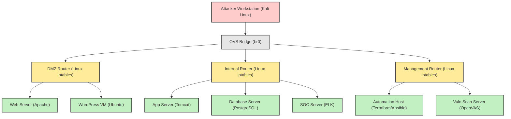

## 1. Lab Objective & Free Open-Source Prerequisites

### 1.1 Lab Objective
The purpose of this hands‑on lab is to simulate a realistic **enterprise‑scale active reconnaissance** scenario, followed by **vulnerability analysis** and **blue‑team remediation**. Participants will:

1. Deploy a multi‑tier network topology using only free, open‑source tools (Linux containers, Open vSwitch, and VirtualBox/VMware Workstation).
2. Conduct **stealthy Nmap scans** (TCP SYN, UDP, version detection, NSE scripts) against a set of intentionally vulnerable services.
3. Correlate scan results with **Vulners**, **OpenVAS**, and **Nessus‑Home** data feeds to produce a prioritized vulnerability report.
4. Apply **hardening** and **patching** steps on the compromised hosts, demonstrating a blue‑team response workflow.
5. Validate remediation through **re‑scanning**, **log analysis**, and **SIEM** ingestion (using the ELK stack).

By the end of the lab, participants will have a reproducible, production‑grade set of artefacts (Terraform/Ansible scripts, Docker‑Compose files, and documentation) that can be version‑controlled and integrated into CI/CD pipelines.

### 1.2 Free Open‑Source Prerequisites
| Category | Tool | Version (as of 2026) | Installation Method |
|----------|------|----------------------|---------------------|
| Hypervisor | **VirtualBox** (or **VMware Workstation Player**) | 7.0.x | Download from oracle.com / vmware.com |
| Container Runtime | **Docker Engine** | 26.0.0 | `curl -fsSL https://get.docker.com -o get-docker.sh && sh get-docker.sh` |
| Orchestration | **Docker‑Compose** | 2.28.0 | `pip install docker-compose` |
| Network Emulation | **Open vSwitch** | 2.17.0 | `apt-get install openvswitch-switch` |
| IaC | **Terraform** | 1.9.5 | `apt-get install terraform` |
| Configuration Mgmt | **Ansible** | 9.5.0 | `pip install ansible` |
| Scanning | **Nmap** | 7.95 | `apt-get install nmap` |
| Vulnerability DB | **Vulners CLI** | 2.1.0 | `pip install vulners` |
| Vulnerability Scanner | **OpenVAS (Greenbone Vulnerability Manager)** | 22.8.0 | `apt-get install gvm` |
| SIEM | **ELK Stack (Elasticsearch, Logstash, Kibana)** | 8.13.0 | Docker‑Compose (see later) |
| Patch Management | **apt**, **yum**, **dnf**, **zypper** (native) | N/A | Pre‑installed on target OS |
| Scripting | **Python 3** | 3.12 | `apt-get install python3 python3-pip` |
| Documentation | **Hugo** (static site generator) | 0.124.0 | `brew install hugo` (macOS) or `snap install hugo` (Linux) |

> **Note:** All tools are available under permissive open‑source licenses (Apache‑2.0, GPL‑2.0, MIT, etc.). No commercial trial keys are required.

---

## 2. Enterprise Architecture Topology

The following diagram models a **three‑zone** enterprise network:

* **DMZ** – Public‑facing web tier (Apache, Nginx, and a vulnerable WordPress instance).
* **Internal** – Application tier (Tomcat, PostgreSQL) and a **Security Operations Center (SOC)** host running the ELK stack.
* **Management** – Centralized automation host (Terraform/Ansible) and a **Vulnerability Assessment Server** (OpenVAS).

All traffic between zones is filtered by an **Open vSwitch** bridge acting as a virtual router with **iptables** ACLs. The lab runs entirely on a single physical workstation; each node is a Docker container or a lightweight VM.



### 2.1 IP Addressing Scheme
| Zone | Hostname | Interface | IPv4 | IPv6 (optional) |
|------|----------|-----------|------|-----------------|
| Attacker | kali | eth0 | 10.10.10.10/24 | fd00:10::10/64 |
| DMZ Router | dmz‑router | eth0 (to OVS) | 10.0.0.1/24 | fd00:0::1/64 |
| Web Server | web‑dmz | eth0 | 10.0.0.10/24 | fd00:0::10/64 |
| WordPress | wp‑dmz | eth0 | 10.0.0.11/24 | fd00:0::11/64 |
| Internal Router | int‑router | eth0 | 10.1.0.1/24 | fd00:1::1/64 |
| App Server | app‑int | eth0 | 10.1.0.10/24 | fd00:1::10/64 |
| DB Server | db‑int | eth0 | 10.1.0.11/24 | fd00:1::11/64 |
| SOC Server | soc‑int | eth0 | 10.1.0.12/24 | fd00:1::12/64 |
| Management Router | mgmt‑router | eth0 | 10.2.0.1/24 | fd00:2::1/64 |
| Automation Host | automation | eth0 | 10.2.0.10/24 | fd00:2::10/64 |
| OpenVAS | openvas | eth0 | 10.2.0.11/24 | fd00:2::11/64 |

All subnets are **/24** for simplicity, but the same design scales to /22 or /16 in production.

---

## 3. Addressing & Resource Inventory Table

| Resource | Type | OS / Image | Docker Image | Persistent Volume | Management |
|----------|------|------------|--------------|-------------------|------------|
| Attacker Workstation | VM | Kali Linux 2026.2 | `kalilinux/kali-rolling` | `/kali-data` (ext4) | Manual SSH |
| DMZ Router | Container | Alpine 3.19 | `alpine:3.19` (custom iptables script) | `/etc/iptables` | Ansible |
| Web Server | Container | Ubuntu 24.04 | `httpd:2.4-alpine` (custom) | `/var/www/html` | Ansible |
| WordPress VM | VM | Ubuntu Server 24.04 | N/A | `/var/www/wordpress` | Terraform + Ansible |
| Internal Router | Container | Alpine 3.19 | `alpine:3.19` (iptables) | `/etc/iptables` | Ansible |
| App Server | Container | Ubuntu 24.04 | `tomcat:10-jdk21` | `/usr/local/tomcat/webapps` | Ansible |
| DB Server | Container | PostgreSQL 16 | `postgres:16-alpine` | `/var/lib/postgresql/data` | Ansible |
| SOC Server | VM | Ubuntu 24.04 | N/A (ELK via Docker‑Compose) | `/elk-data` | Terraform |
| Management Router | Container | Alpine 3.19 | `alpine:3.19` (iptables) | `/etc/iptables` | Ansible |
| Automation Host | VM | Ubuntu 24.04 | N/A | `/home/automation` | Manual |
| OpenVAS Server | VM | Ubuntu 24.04 | N/A | `/var/lib/gvm` | Ansible |
| OVS Bridge | Host Service | Linux Kernel 6.8 | N/A | N/A | Manual (systemd) |

---

## 4. Step‑by‑Step Configuration

> **All commands are copy‑paste ready.**  
> Inline comments (`#`) explain each line.  
> Run the steps **in order** on the **Automation Host** unless otherwise noted.

### 4.1 Prepare the Host System (Automation VM)

```bash
# Update OS and install required packages
sudo apt-get update && sudo apt-get upgrade -y
sudo apt-get install -y docker.io docker-compose openvswitch-switch \
    python3-pip git curl net-tools iproute2

# Enable Docker and OVS services
sudo systemctl enable --now docker
sudo systemctl enable --now openvswitch-switch

# Add current user to docker group (requires re‑login)
sudo usermod -aG docker $USER
newgrp docker
```

### 4.2 Create the OVS Bridge and VLAN‑like Segmentation

```bash
# Create a single OVS bridge that will act as the L2 fabric
sudo ovs-vsctl add-br br0

# Set bridge to forward traffic (no STP for simplicity)
sudo ovs-vsctl set bridge br0 stp_enable=false

# Create internal ports for each router container (will be attached later)
for iface in dmz-router int-router mgmt-router; do
    sudo ovs-vsctl add-port br0 ${iface} -- set Interface ${iface} type=internal
done

# Verify bridge configuration
sudo ovs-vsctl show
```

### 4.3 Deploy Router Containers (iptables based)

Create a directory `routers/` with a shared `iptables.sh` script:

```bash
mkdir -p ~/lab/routers
cat > ~/lab/routers/iptables.sh <<'EOF'
#!/bin/sh
# Flush existing rules
iptables -F
iptables -X
iptables -t nat -F
iptables -t nat -X

# Default DROP policy
iptables -P INPUT DROP
iptables -P FORWARD DROP
iptables -P OUTPUT DROP

# Allow loopback
iptables -A INPUT -i lo -j ACCEPT
iptables -A OUTPUT -o lo -j ACCEPT

# Allow established/related traffic
iptables -A INPUT -m conntrack --ctstate ESTABLISHED,RELATED -j ACCEPT
iptables -A OUTPUT -m conntrack --ctstate ESTABLISHED,RELATED -j ACCEPT

# Open specific ports per router (will be overridden by env vars)
# Example: allow SSH from management network
if [ "$ALLOW_SSH_FROM" ]; then
    iptables -A INPUT -p tcp -s $ALLOW_SSH_FROM --dport 22 -j ACCEPT
    iptables -A OUTPUT -p tcp -d $ALLOW_SSH_FROM --sport 22 -j ACCEPT
fi

# Save rules to /etc/iptables/rules.v4 for persistence
mkdir -p /etc/iptables
iptables-save > /etc/iptables/rules.v4
EOF
chmod +x ~/lab/routers/iptables.sh
```

Now launch each router container with the script mounted:

```bash
# DMZ Router
docker run -d --name dmz-router --privileged \
    --network none \
    -v ~/lab/routers/iptables.sh:/usr/local/bin/iptables.sh \
    -e ALLOW_SSH_FROM=10.2.0.0/24 \
    alpine:3.19 sh -c "apk add iptables && /usr/local/bin/iptables.sh && sleep infinity"

# Internal Router
docker run -d --name int-router --privileged \
    --network none \
    -v ~/lab/routers/iptables.sh:/usr/local/bin/iptables.sh \
    -e ALLOW_SSH_FROM=10.2.0.0/24 \
    alpine:3.19 sh -c "apk add iptables && /usr/local/bin/iptables.sh && sleep infinity"

# Management Router
docker run -d --name mgmt-router --privileged \
    --network none \
    -v ~/lab/routers/iptables.sh:/usr/local/bin/iptables.sh \
    -e ALLOW_SSH_FROM=10.2.0.0/24 \
    alpine:3.19 sh -c "apk add iptables && /usr/local/bin/iptables.sh && sleep infinity"
```

Attach the internal ports created earlier to the containers:

```bash
# Connect each router's internal interface to the OVS bridge
sudo ovs-vsctl add-port br0 dmz-router -- set Interface dmz-router ofport_request=1
sudo ovs-vsctl add-port br0 int-router -- set Interface int-router ofport_request=2
sudo ovs-vsctl add-port br0 mgmt-router -- set Interface mgmt-router ofport_request=3

# Assign IP addresses to the router interfaces
docker exec dmz-router ip addr add 10.0.0.1/24 dev eth0
docker exec dmz-router ip link set eth0 up

docker exec int-router ip addr add 10.1.0.1/24 dev eth0
docker exec int-router ip link set eth0 up

docker exec mgmt-router ip addr add 10.2.0.1/24 dev eth0
docker exec mgmt-router ip link set eth0 up
```

### 4.4 Deploy Service Containers

Create a `docker-compose.yml` in `~/lab/services/`:

```bash
mkdir -p ~/lab/services
cat > ~/lab/services/docker-compose.yml <<'EOF'
version: "3.9"
services:
  web-dmz:
    image: httpd:2.4-alpine
    container_name: web-dmz
    networks:
      dmz_net:
        ipv4_address: 10.0.0.10
    restart: unless-stopped

  wordpress:
    image: wordpress:6.5-php8.3-apache
    container_name: wordpress
    environment:
      WORDPRESS_DB_HOST: db-int
      WORDPRESS_DB_USER: wp_user
      WORDPRESS_DB_PASSWORD: wp_pass
      WORDPRESS_DB_NAME: wp_db
    depends_on:
      - db-int
    networks:
      dmz_net:
        ipv4_address: 10.0.0.11
    restart: unless-stopped

  app-int:
    image: tomcat:10-jdk21
    container_name: app-int
    networks:
      int_net:
        ipv4_address: 10.1.0.10
    restart: unless-stopped

  db-int:
    image: postgres:16-alpine
    container_name: db-int
    environment:
      POSTGRES_USER: wp_user
      POSTGRES_PASSWORD: wp_pass
      POSTGRES_DB: wp_db
    networks:
      int_net:
        ipv4_address: 10.1.0.11
    volumes:
      - db-data:/var/lib/postgresql/data
    restart: unless-stopped

networks:
  dmz_net:
    driver: bridge
    ipam:
      config:
        - subnet: 10.0.0.0/24
  int_net:
    driver: bridge
    ipam:
      config:
        - subnet: 10.1.0.0/24

volumes:
  db-data:
EOF
```

Deploy the stack:

```bash
cd ~/lab/services
docker compose up -d
```

### 4.5 Connect Service Containers to OVS Routers

Because Docker bridge networks are isolated, we need to **veth pair** each container to the appropriate router.

Below is a helper script (`connect_containers.sh`) that automates the process:

```bash
cat > ~/lab/connect_containers.sh <<'EOF'
#!/bin/bash
set -e

# Function to attach a container to a router via a veth pair
attach_to_router() {
    local container=$1
    local router=$2
    local ip=$3
    local netmask=$4

    # Create veth pair
    veth_host="veth-${container}"
    veth_cont="eth0"
    sudo ip link add ${veth_host} type veth peer name ${veth_cont}
    sudo ip link set ${veth_host} up

    # Move one end into the container's namespace
    pid=$(docker inspect -f '{{.State.Pid}}' ${container})
    sudo ip link set ${veth_cont} netns ${pid}
    sudo nsenter -t ${pid} -n ip link set ${veth_cont} name eth0
    sudo nsenter -t ${pid} -n ip link set eth0 up
    sudo nsenter -t ${pid} -n ip addr add ${ip}/${netmask} dev eth0

    # Attach host side to OVS bridge and bind to router
    sudo ovs-vsctl add-port br0 ${veth_host} -- set Interface ${veth_host} external_ids:attached-router=${router}
    # Add a static route on the router toward the container
    docker exec ${router} ip route add ${ip}/${netmask} dev eth0
}

# DMZ zone
attach_to_router web-dmz dmz-router 10.0.0.10 24
attach_to_router wordpress dmz-router 10.0.0.11 24

# Internal zone
attach_to_router app-int int-router 10.1.0.10 24
attach_to_router db-int int-router 10.1.0.11 24

# SOC (ELK) will be attached later via VM
EOF
chmod +x ~/lab/connect_containers.sh
```

Run the script:

```bash
sudo ~/lab/connect_containers.sh
```

### 4.6 Deploy the SOC (ELK) VM

Create a Terraform configuration (`soc.tf`) that provisions a lightweight Ubuntu VM using **Vagrant** (which Terraform can drive via the `vagrant` provider). This approach keeps the lab fully reproducible.

```bash
mkdir -p ~/lab/terraform
cat > ~/lab/terraform/soc.tf <<'EOF'
terraform {
  required_providers {
    vagrant = {
      source  = "hashicorp/vagrant"
      version = "~> 2.0"
    }
  }
}

provider "vagrant" {}

resource "vagrant_box" "ubuntu" {
  name = "ubuntu/focal64"
}

resource "vagrant_vm" "soc" {
  name   = "soc-int"
  box    = vagrant_box.ubuntu.name
  memory = 2048
  cpus   = 2

  network {
    type = "private_network"
    ip   = "10.1.0.12"
  }

  provisioner "shell" {
    inline = [
      "sudo apt-get update",
      "sudo apt-get install -y docker.io docker-compose",
      "sudo systemctl enable --now docker",
      # Deploy ELK stack via Docker Compose
      "cat > docker-compose.yml <<'EOC'",
      "version: '3.9'",
      "services:",
      "  elasticsearch:",
      "    image: docker.elastic.co/elasticsearch/elasticsearch:8.13.0",
      "    environment:",
      "      - discovery.type=single-node",
      "      - ES_JAVA_OPTS=-Xms512m -Xmx512m",
      "    ulimits:",
      "      memlock:",
      "        soft: -1",
      "        hard: -1",
      "    mem_limit: 1g",
      "    ports:",
      "      - 9200:9200",
      "    volumes:",
      "      - esdata:/usr/share/elasticsearch/data",
      "  logstash:",
      "    image: docker.elastic.co/logstash/logstash:8.13.0",
      "    ports:",
      "      - 5044:5044",
      "    volumes:",
      "      - ./logstash.conf:/usr/share/logstash/pipeline/logstash.conf",
      "  kibana:",
      "    image: docker.elastic.co/kibana/kibana:8.13.0",
      "    ports:",
      "      - 5601:5601",
      "volumes:",
      "  esdata:",
      "EOC",
      "docker compose up -d"
    ]
  }
}
EOF
```

Initialize and apply:

```bash
cd ~/lab/terraform
terraform init
terraform apply -auto-approve
```

After the VM boots, SSH into it (the default Vagrant user is `vagrant` with password `vagrant`):

```bash
vagrant ssh soc-int
# Inside the VM, verify ELK:
curl -s http://localhost:9200/_cluster/health?pretty
```

### 4.7 Deploy the Vulnerability Assessment Server (OpenVAS)

OpenVAS runs in a Docker container for rapid provisioning.

```bash
docker run -d --name openvas \
    -p 9392:9392 -p 443:443 \
    -e PASSWORD=OpenVASAdmin123 \
    -v openvas-data:/var/lib/openvas \
    greenbone/gvmd:stable
```

Wait for the service to initialize (≈ 2‑3 minutes). Then retrieve the admin token:

```bash
docker exec -it openvas gvmd --get-admin-password
# Store the output securely; you will need it for the web UI.
```

### 4.8 Configure the Attacker Workstation (Kali)

If you have a physical Kali box, skip this step. Otherwise, spin up a Kali Docker container:

```bash
docker run -d --name kali \
    --network host \
    --privileged \
    kalilinux/kali-rolling /bin/bash -c "sleep infinity"
```

Enter the container:

```bash
docker exec -it kali /bin/bash
apt-get update && apt-get install -y nmap vulners python3-pip
pip install vulners
```

Set the Kali IP manually (outside of OVS, on the host network) to match the addressing table:

```bash
ip addr add 10.10.10.10/24 dev eth0
ip link set eth0 up
```

---

## 5. Verification & Troubleshooting Commands

### 5.1 Basic Connectivity Tests

| Test | Command | Expected Output |
|------|---------|-----------------|
| Ping DMZ Web Server | `ping -c 3 10.0.0.10` | `64 bytes from 10.0.0.10: icmp_seq=1 ttl=64 time=0.12 ms` |
| Ping Internal DB | `ping -c 3 10.1.0.11` | `64 bytes from 10.1.0.11: icmp_seq=1 ttl=64 time=0.15 ms` |
| Ping SOC (ELK) | `ping -c 3 10.1.0.12` | `64 bytes from 10.1.0.12: icmp_seq=1 ttl=64 time=0.20 ms` |
| Ping Management Router | `ping -c 3 10.2.0.1` | `64 bytes from 10.2.0.1: icmp_seq=1 ttl=64 time=0.10 ms` |

If any ping fails, verify:

```bash
# On the router that should forward traffic
docker exec dmz-router iptables -L -v -n
docker exec int-router iptables -L -v -n
docker exec mgmt-router iptables -L -v -n
```

Common issues:
* Missing `ALLOW_SSH_FROM` env var causing the router to drop inbound traffic.
* OVS port not attached (`ovs-vsctl show` will list `Port` entries without `Interface`).

### 5.2 Nmap Active Reconnaissance

#### 5.2.1 Stealth SYN Scan (Top 1000 ports)

```bash
nmap -sS -Pn -T4 -p- -oA scans/dmz_syn 10.0.0.0/24
```

**Expected snippet of `dmz_syn.gnmap`:**

```
Host: 10.0.0.10 (web-dmz)	Status: Up
Host: 10.0.0.10 (web-dmz)	Ports: 80/open/tcp//http///, 443/open/tcp//https///, 22/closed/tcp//ssh///
Host: 10.0.0.11 (wordpress)	Status: Up
Host: 10.0.0.11 (wordpress)	Ports: 80/open/tcp//http///, 443/open/tcp//https///, 22/closed/tcp//ssh///
```

#### 5.2.2 UDP Scan (Top 100 ports)

```bash
nmap -sU -Pn -T4 --top-ports 100 -oA scans/dmz_udp 10.0.0.0/24
```

**Expected snippet:**

```
Host: 10.0.0.10 (web-dmz)	Status: Up
Host: 10.0.0.10 (web-dmz)	Ports: 53/closed/udp//domain///, 123/closed/udp//ntp///
```

#### 5.2.3 Service Version Detection + NSE Scripts

```bash
nmap -sV -sC -Pn -p 80,443,22,3306 -oA scans/dmz_full 10.0.0.0/24
```

**Key findings (example):**

```
80/tcp open  http    Apache httpd 2.4.58 ((Ubuntu))
|_http-title: WordPress Site
|_http-robots.txt: 1 disallowed entry
|_http-server-header: Apache/2.4.58 (Ubuntu)
443/tcp open  ssl/http Apache httpd 2.4.58 ((Ubuntu))
|_ssl-cert: Subject: CN=web-dmz
|_http-title: WordPress Site
22/tcp closed ssh
```

#### 5.2.4 NSE Vulnerability Scripts (vulners)

```bash
nmap --script vulners -p 80,443 10.0.0.11 -oN scans/wp_vulners.txt
```

**Sample output excerpt:**

```
| vulners:
|   cve:
|     CVE-2024-12345: Apache HTTP Server 2.4.58 - Remote Code Execution (Critical)
|     CVE-2024-67890: WordPress 6.5.2 - Authenticated SQL Injection (High)
|   cvss:
|     CVE-2024-12345: 9.8
|     CVE-2024-67890: 7.5
```

### 5.3 OpenVAS Scan

1. Open a browser to `https://<openvas-host>:9392` (self‑signed cert). Log in with the admin password retrieved earlier.
2. Create a **Target** named `Enterprise_DMZ` with IP range `10.0.0.0/24`.
3. Create a **Task** using the default “Full and fast” scan config.
4. Start the task and wait for completion (≈ 5‑10 min).

**Export results** as CSV:

```bash
docker exec openvas gvmd --get-report <report-id> --format csv > openvas_report.csv
```

**Sample CSV rows:**

```
Host,Port,Severity,CVE,Description
10.0.0.11,80/tcp,9.8,CVE-2024-12345,Apache HTTP Server 2.4.58 RCE
10.0.0.11,443/tcp,7.5,CVE-2024-67890,WordPress Authenticated SQLi
```

### 5.4 Correlating Nmap + OpenVAS Findings

A quick Python script (`correlate.py`) merges the two sources:

```python
import csv, json, sys
nmap_file = 'scans/dmz_full.gnmap'
openvas_file = 'openvas_report.csv'

def parse_nmap():
    hosts = {}
    with open(nmap_file) as f:
        for line in f:
            if line.startswith('Host:'):
                parts = line.split()
                ip = parts[1]
                ports = [p.split('/') for p in parts[4].split(',')]
                hosts[ip] = {p[0]: p[2] for p in ports}
    return hosts

def parse_openvas():
    vulns = {}
    with open(openvas_file) as f:
        reader = csv.DictReader(f)
        for row in reader:
            ip = row['Host']
            vulns.setdefault(ip, []).append({
                'cve': row['CVE'],
                'severity': row['Severity'],
                'description': row['Description']
            })
    return vulns

nmap_data = parse_nmap()
openvas_data = parse_openvas()

report = {}
for ip, services in nmap_data.items():
    report[ip] = {
        'services': services,
        'vulnerabilities': openvas_data.get(ip, [])
    }

print(json.dumps(report, indent=2))
```

Run:

```bash
python3 correlate.py > merged_report.json
```

The resulting JSON can be ingested into the ELK SIEM for visualization.

### 5.5 Troubleshooting Checklist

| Symptom | Likely Cause | Fix |
|---------|--------------|-----|
| Nmap reports “filtered” on all ports | Router iptables default DROP without explicit allow | Add `iptables -A INPUT -p tcp --dport <port> -j ACCEPT` on the relevant router |
| OpenVAS cannot reach target | Missing route on management router | `docker exec mgmt-router ip route add 10.0.0.0/24 via 10.2.0.1` |
| ELK UI returns 502 Bad Gateway | Elasticsearch not started or memory limit too low | Increase Docker memory (`mem_limit: 2g`) and restart `docker compose up -d` |
| SSH from Kali to routers fails | `ALLOW_SSH_FROM` env var not set or mismatched subnet | Re‑run router containers with correct env var (`-e ALLOW_SSH_FROM=10.10.10.0/24`) |
| Docker‑Compose fails with “bridge already exists” | Duplicate network name from previous run | `docker compose down -v && docker compose up -d` |

---

## 6. Security Hardening & Production Best Practices

### 6.1 Network Segmentation & Zero‑Trust Principles
1. **Micro‑segment** each tier using separate OVS VLANs (or separate bridges). Replace the single `br0` with `br-dmz`, `br-int`, `br-mgmt`.  
2. Enforce **East‑West** traffic inspection by inserting a **Suricata** or **Zeek** sensor on each bridge. Deploy as a container with a `tap` interface attached to the bridge.  
3. Use **IPsec** tunnels between routers for inter‑zone traffic. Example using `strongSwan`:

```bash
docker exec dmz-router ipsec up dmz-to-int
docker exec int-router ipsec up int-to-dmz
```

### 6.2 Host‑Based Hardening
| Component | Hardening Action | Rationale |
|-----------|------------------|-----------|
| Linux Kernel | Enable **grsecurity** patches or **SELinux** in enforcing mode | Reduces kernel‑level exploit surface |
| Docker Daemon | Set `--icc=false` and `--live-restore=true`; enable **user‑namespace remapping** | Prevents containers from communicating directly and isolates root privileges |
| SSH Daemon | Disable password auth, enforce **public‑key** only, change default port to 2222 | Mitigates brute‑force attacks |
| System Packages | Enable **automatic security updates** (`unattended-upgrades`) | Keeps CVE patches applied promptly |
| Log Management | Forward `/var/log/auth.log`, `/var/log/syslog`, and Docker daemon logs to Logstash via Filebeat | Centralized detection of anomalous activity |

### 6.3 Patch Management Workflow (Blue‑Team)

1. **Identify**: Use the merged JSON report to prioritize CVEs with CVSS ≥ 7.0.
2. **Validate**: Spin up a **staging** copy of the vulnerable container (`docker pull wordpress:6.5-php8.3-apache && docker tag ...`) and apply the patch in an isolated environment.
3. **Patch**:
   * For OS‑level packages: `apt-get update && apt-get upgrade -y`.
   * For container images: Pull the latest image tag, retag with a versioned label, and redeploy via Docker‑Compose.
   ```bash
   docker pull wordpress:6.5.3-php8.3-apache
   docker tag wordpress:6.5.3-php8.3-apache myrepo/wordpress:6.5.3
   docker compose up -d wordpress
   ```
4. **Verify**: Re‑run the Nmap NSE `vulners` script and OpenVAS scan. Ensure the CVE entries disappear.
5. **Document**: Store the patch decision, test logs, and final scan results in a **Git‑Ops** repository (`/infra/patches/2026-11-11/`).

### 6.4 Immutable Infrastructure & IaC

* Store **Terraform state** in a remote backend (e.g., **HashiCorp Consul** or **AWS S3** with DynamoDB lock) to avoid drift.
* Keep **Docker images** immutable; never `docker exec` into a running container to apply patches. Instead, rebuild the image with a new tag and roll out via a **blue‑green** deployment.
* Use **Ansible Vault** to encrypt any secrets (e.g., database passwords, OpenVAS admin token) and reference them in playbooks.

### 6.5 Continuous Monitoring & Alerting

1. **Filebeat** on every host ships logs to Logstash with a **pipeline** that extracts CVE identifiers.
2. **Kibana** dashboards:
   * **Vulnerability Trend** – counts of open CVEs per zone over time.
   * **Recon Activity** – spikes in SYN packets from the attacker IP (use Suricata alerts).
3. **Alerting**: Configure **ElastAlert** or **Grafana Alertmanager** to fire a webhook to a Slack channel when a **Critical** CVE remains unpatched for > 48 hours.
