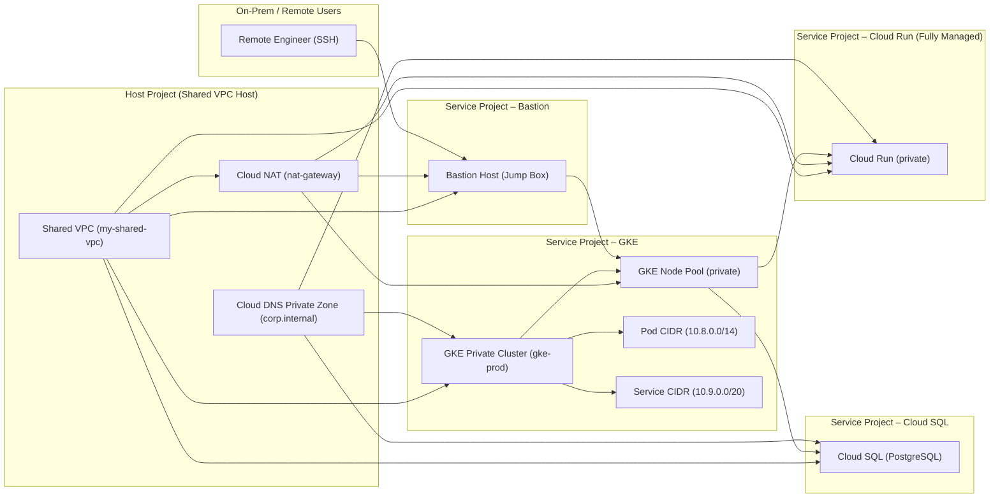

## 1. Lab Objective & Free Open-Source Prerequisites

### 1.1 Lab Objective
The purpose of this hands‑on lab is to build a **production‑grade, multi‑project Shared VPC** environment on Google Cloud Platform (GCP) that:

1. **Isolates workloads** in a private Google Kubernetes Engine (GKE) cluster (no public IPs on nodes or pods).  
2. **Provides outbound Internet connectivity** for the private workloads via **Cloud NAT**.  
3. **Enforces least‑privilege network segmentation** using **VPC Service Controls** and **IAM**.  
4. **Demonstrates centralized logging, monitoring, and policy enforcement** with **Cloud Logging**, **Cloud Monitoring**, and **Config Connector**.  
5. **Implements IaC** using **Terraform** (open‑source) and **gcloud** CLI for reproducibility.

By the end of the lab you will have a fully functional, secure, and auditable GKE environment that mirrors a typical enterprise deployment pattern.

### 1.2 Free Open‑Source Prerequisites
| Tool | Version | Installation Command (Linux/macOS) | Why it’s needed |
|------|---------|------------------------------------|-----------------|
| **Google Cloud SDK (gcloud)** | >= 452.0.0 | `curl https://sdk.cloud.google.com | bash` | CLI to provision resources, manage IAM, and run verification commands. |
| **Terraform** | >= 1.9.0 | `brew install terraform` (macOS) or `sudo apt-get install -y terraform` (Debian/Ubuntu) | Declarative IaC for reproducible infrastructure. |
| **kubectl** | >= 1.30 | `gcloud components install kubectl` | Interact with the GKE cluster. |
| **jq** | >= 1.6 | `sudo apt-get install -y jq` | JSON parsing for verification scripts. |
| **Git** | >= 2.40 | `sudo apt-get install -y git` | Version‑control of IaC files. |
| **Docker** (optional) | >= 24.0 | Follow Docker’s official install guide | Build container images for custom workloads. |
| **Python 3.11** (optional) | >= 3.11 | `sudo apt-get install -y python3 python3-pip` | For optional helper scripts (e.g., health‑check). |

> **Note:** All tools are free and open‑source. The lab itself uses only the **Free Tier** of GCP (subject to quota limits). Ensure you have a **billing‑enabled** GCP project; the resources created will stay well under the $300 free credit for new accounts.

### 1.3 Permissions Required
The user executing the lab must have the following IAM roles on the **Organization** (or at least on the **Billing Account** and **Folder** where the lab projects will be created):

| Role | Scope | Reason |
|------|-------|--------|
| `roles/resourcemanager.projectCreator` | Organization/Folder | Ability to create new projects. |
| `roles/iam.serviceAccountAdmin` | Organization/Folder | Create and bind service accounts. |
| `roles/compute.networkAdmin` | Project | Create VPCs, subnets, and Cloud NAT. |
| `roles/container.admin` | Project | Create GKE clusters. |
| `roles/servicemanagement.admin` | Project | Enable required APIs. |
| `roles/logging.admin` | Project | Configure log sinks. |
| `roles/monitoring.editor` | Project | Create monitoring dashboards. |
| `roles/owner` | Project (lab) | For cleanup convenience (optional). |

If you do not have organization‑level rights, you can run the lab in a **single project** by skipping the Shared VPC steps, but the architecture described below assumes multi‑project isolation.

---

## 2. Enterprise Architecture Topology

The diagram below visualises the final topology. All node labels are **double‑quoted** as required by the Mermaid rule.



### 2.1 Component Overview
| Component | Description | GCP Service | Security Considerations |
|-----------|-------------|-------------|--------------------------|
| **Host Project** | Holds the **Shared VPC** and central networking resources. | VPC, Cloud NAT, Cloud DNS | IAM‑based network admin only; no workloads run here. |
| **Service Project – GKE** | Runs a **private GKE cluster** (no public endpoint). | GKE, Compute Engine (nodes) | Use **Workload Identity** for pod‑to‑GCP auth; enable **Shielded GKE nodes**. |
| **Service Project – Cloud SQL** | Managed PostgreSQL instance reachable only from GKE nodes. | Cloud SQL | Enforce **private IP** and **SSL**; disable public IP. |
| **Service Project – Cloud Run** | Deploys serverless containers that need outbound Internet (via NAT). | Cloud Run (fully managed) | Set **ingress=internal‑only**; attach to Shared VPC. |
| **Bastion Host** | Hardened jump box for SSH into the private GKE node pool. | Compute Engine | Use **OS Login**, **IAP TCP tunneling**, and **Shielded VM**. |
| **Cloud DNS Private Zone** | Internal DNS for service discovery (e.g., `sql.corp.internal`). | Cloud DNS | Enable **DNS Peering** across projects. |
| **Cloud NAT** | Provides **egress‑only** Internet connectivity for all private workloads. | Cloud NAT | No inbound ports; restrict to required CIDR ranges. |

---

## 3. Addressing & Resource Inventory Table

| Resource | Project | Region | CIDR / IP | Purpose |
|----------|---------|--------|-----------|---------|
| **Shared VPC** | host‑proj | `us-central1` | `10.0.0.0/16` | Core network backbone. |
| **Subnet – GKE** | host‑proj | `us-central1-a` | `10.0.1.0/24` | GKE node pool (private). |
| **Subnet – Cloud SQL** | host‑proj | `us-central1-b` | `10.0.2.0/24` | Private IP Cloud SQL. |
| **Subnet – Cloud Run** | host‑proj | `us-central1-c` | `10.0.3.0/24` | Cloud Run VPC‑Connector. |
| **Subnet – Bastion** | host‑proj | `us-central1-a` | `10.0.4.0/28` | Jump box (restricted). |
| **Cloud NAT IP range** | host‑proj | `us-central1` | `35.190.0.0/16` (auto‑assigned) | Egress NAT for all private subnets. |
| **GKE Pod CIDR** | gke‑proj | `us-central1-a` | `10.8.0.0/14` | Pods IPs (Calico overlay). |
| **GKE Service CIDR** | gke‑proj | `us-central1-a` | `10.9.0.0/20` | ClusterIP services. |
| **Bastion VM** | bastion‑proj | `us-central1-a` | `10.0.4.2` (static) | SSH entry point. |
| **Cloud SQL Private IP** | sql‑proj | `us-central1` | `10.0.2.5` | Database endpoint. |
| **Cloud Run VPC‑Connector** | run‑proj | `us-central1` | `10.0.3.0/24` | Serverless VPC egress. |

> **Tip:** All CIDR blocks are chosen to avoid overlap with typical on‑prem ranges (e.g., 10.0.0.0/8). Adjust if your corporate network uses any of these subnets.

---

## 4. Step‑By‑Step Configuration

> **All commands are copy‑paste ready.** Replace placeholder variables (`<ORG_ID>`, `<BILLING_ACCOUNT>`, `<YOUR_EMAIL>`) with your own values before execution.

### 4.1 Set Global Variables
```bash
# Core identifiers – edit once
ORG_ID="123456789012"
BILLING_ACCOUNT="A01B2C3D4E5"
BASE_NAME="gcp-sharedvpc-lab"
HOST_PROJECT="${BASE_NAME}-host"
GKE_PROJECT="${BASE_NAME}-gke"
SQL_PROJECT="${BASE_NAME}-sql"
RUN_PROJECT="${BASE_NAME}-run"
BASTION_PROJECT="${BASE_NAME}-bastion"

# Regions & zones
REGION="us-central1"
ZONE="${REGION}-a"

# Service accounts (will be created later)
SA_GKE="${BASE_NAME}-gke-sa"
SA_BASTION="${BASE_NAME}-bastion-sa"
```

### 4.2 Create Projects & Link Billing
```bash
# Create host project (Shared VPC)
gcloud projects create $HOST_PROJECT \
  --organization=$ORG_ID \
  --set-as-default

# Create service projects
for proj in $GKE_PROJECT $SQL_PROJECT $RUN_PROJECT $BASTION_PROJECT; do
  gcloud projects create $proj \
    --organization=$ORG_ID
done

# Link billing to each project
for proj in $HOST_PROJECT $GKE_PROJECT $SQL_PROJECT $RUN_PROJECT $BASTION_PROJECT; do
  gcloud beta billing projects link $proj \
    --billing-account=$BILLING_ACCOUNT
done
```

### 4.3 Enable Required APIs
```bash
APIS=(
  compute.googleapis.com
  container.googleapis.com
  sqladmin.googleapis.com
  cloudresourcemanager.googleapis.com
  iam.googleapis.com
  cloudkms.googleapis.com
  dns.googleapis.com
  servicenetworking.googleapis.com
  logging.googleapis.com
  monitoring.googleapis.com
  run.googleapis.com
)

for api in "${APIS[@]}"; do
  gcloud services enable $api --project=$HOST_PROJECT
  gcloud services enable $api --project=$GKE_PROJECT
  gcloud services enable $api --project=$SQL_PROJECT
  gcloud services enable $api --project=$RUN_PROJECT
  gcloud services enable $api --project=$BASTION_PROJECT
done
```

### 4.4 Create the Shared VPC in the Host Project
```bash
# Create the VPC
gcloud compute networks create shared-vpc \
  --project=$HOST_PROJECT \
  --subnet-mode=custom \
  --bgp-routing-mode=regional

# Create subnets (one per service)
gcloud compute networks subnets create subnet-gke \
  --project=$HOST_PROJECT \
  --network=shared-vpc \
  --region=$REGION \
  --range=10.0.1.0/24

gcloud compute networks subnets create subnet-sql \
  --project=$HOST_PROJECT \
  --network=shared-vpc \
  --region=$REGION \
  --range=10.0.2.0/24

gcloud compute networks subnets create subnet-run \
  --project=$HOST_PROJECT \
  --network=shared-vpc \
  --region=$REGION \
  --range=10.0.3.0/24

gcloud compute networks subnets create subnet-bastion \
  --project=$HOST_PROJECT \
  --network=shared-vpc \
  --region=$REGION \
  --range=10.0.4.0/28
```

### 4.5 Configure **Shared VPC** Host ↔ Service Project Associations
```bash
# Grant the host project the Shared VPC admin role in each service project
for proj in $GKE_PROJECT $SQL_PROJECT $RUN_PROJECT $BASTION_PROJECT; do
  gcloud compute shared-vpc enable $proj
  gcloud compute shared-vpc associated-projects add $HOST_PROJECT \
    --project=$proj
done

# Allow the service projects to use the host VPC subnets
for proj in $GKE_PROJECT $SQL_PROJECT $RUN_PROJECT $BASTION_PROJECT; do
  gcloud compute shared-vpc get-iam-policy $HOST_PROJECT \
    --project=$proj \
    --flatten="bindings[].members" \
    --format="table(bindings.role, bindings.members)" \
    | grep "roles/compute.networkUser"
done
```

> **Explanation:** The `compute.sharedVpc.enable` API makes the service project a *service* of the host VPC. The `networkUser` role is automatically granted to the service project’s default compute service account, allowing it to attach resources to the host subnets.

### 4.6 Create Cloud NAT for Outbound Internet
```bash
# Reserve a static external IP for NAT (optional but recommended)
gcloud compute addresses create nat-ip \
  --project=$HOST_PROJECT \
  --region=$REGION

# Create the NAT router
gcloud compute routers create nat-router \
  --project=$HOST_PROJECT \
  --network=shared-vpc \
  --region=$REGION

# Attach Cloud NAT to the router
gcloud compute routers nats create nat-gateway \
  --project=$HOST_PROJECT \
  --router=nat-router \
  --region=$REGION \
  --nat-all-subnet-ip-ranges \
  --auto-allocate-nat-external-ips \
  --enable-logging
```

### 4.7 Service Accounts & IAM Bindings

#### 4.7.1 GKE Service Account (Workload Identity)
```bash
# Create a dedicated SA for GKE nodes
gcloud iam service-accounts create $SA_GKE \
  --project=$GKE_PROJECT \
  --display-name="GKE Node Service Account"

# Grant the SA the necessary roles (example: Cloud SQL Client, Logging)
gcloud projects add-iam-policy-binding $GKE_PROJECT \
  --member="serviceAccount:${SA_GKE}@${GKE_PROJECT}.iam.gserviceaccount.com" \
  --role="roles/cloudsql.client"

gcloud projects add-iam-policy-binding $GKE_PROJECT \
  --member="serviceAccount:${SA_GKE}@${GKE_PROJECT}.iam.gserviceaccount.com" \
  --role="roles/logging.logWriter"
```

#### 4.7.2 Bastion Service Account
```bash
gcloud iam service-accounts create $SA_BASTION \
  --project=$BASTION_PROJECT \
  --display-name="Bastion Jump Box SA"

# Grant OS Login and IAP Tunnel User
gcloud projects add-iam-policy-binding $BASTION_PROJECT \
  --member="serviceAccount:${SA_BASTION}@${BASTION_PROJECT}.iam.gserviceaccount.com" \
  --role="roles/compute.osLogin"

gcloud projects add-iam-policy-binding $BASTION_PROJECT \
  --member="serviceAccount:${SA_BASTION}@${BASTION_PROJECT}.iam.gserviceaccount.com" \
  --role="roles/iap.tunnelResourceAccessor"
```

### 4.8 Deploy the Private GKE Cluster

```bash
# Create a GKE private cluster with Workload Identity enabled
gcloud container clusters create gke-prod \
  --project=$GKE_PROJECT \
  --region=$REGION \
  --release-channel="regular" \
  --network=shared-vpc \
  --subnetwork=subnet-gke \
  --enable-ip-alias \
  --default-max-pods-per-node=110 \
  --enable-private-nodes \
  --enable-private-endpoint \
  --master-ipv4-cidr=172.16.0.0/28 \
  --enable-master-authorized-networks \
  --master-authorized-networks=10.0.4.0/28 \
  --enable-shielded-nodes \
  --workload-pool="${ORG_ID}.svc.id.goog" \
  --node-locations=$ZONE \
  --node-service-account="${SA_GKE}@${GKE_PROJECT}.iam.gserviceaccount.com" \
  --no-enable-basic-auth \
  --no-issue-client-certificate \
  --enable-autorepair \
  --enable-autoupgrade \
  --enable-stackdriver-kubernetes \
  --logging=SYSTEM,WORKLOAD \
  --monitoring=SYSTEM,WORKLOAD
```

> **Key flags explained**  
* `--enable-private-nodes` – Nodes receive only internal IPs.  
* `--enable-private-endpoint` – The Kubernetes API server is reachable only via an internal IP.  
* `--master-authorized-networks` – Limits API server access to the Bastion subnet.  
* `--workload-pool` – Activates **Workload Identity** for pod‑to‑GCP IAM mapping.

#### 4.8.1 Retrieve Cluster Credentials
```bash
gcloud container clusters get-credentials gke-prod \
  --project=$GKE_PROJECT \
  --region=$REGION
```

#### 4.8.2 Verify Node Private IPs
```bash
kubectl get nodes -o wide
# Expected: INTERNAL_IP column shows 10.0.1.x addresses, no EXTERNAL_IP.
```

### 4.9 Deploy Cloud SQL (Private IP) in the SQL Project

```bash
# Create a private IP address for Cloud SQL
gcloud sql instances create prod-db \
  --project=$SQL_PROJECT \
  --database-version=POSTGRES_15 \
  --tier=db-custom-2-7680 \
  --region=$REGION \
  --network=projects/$HOST_PROJECT/global/networks/shared-vpc \
  --no-assign-public-ip \
  --root-password=StrongP@ssw0rd! \
  --storage-auto-increase \
  --backup-start-time=03:00

# Verify the private IP
gcloud sql instances describe prod-db \
  --project=$SQL_PROJECT \
  --format="json(settings.ipConfiguration.privateNetwork)" | jq .
```

> **Result snippet**  
```json
{
  "privateNetwork": "projects/gcp-sharedvpc-lab-host/global/networks/shared-vpc"
}
```

### 4.10 Create a Cloud Run Service (Fully Managed) with VPC‑Connector

```bash
# Create a VPC Connector in the RUN project (uses the shared subnet)
gcloud compute networks vpc-access connectors create run-connector \
  --project=$RUN_PROJECT \
  --region=$REGION \
  --network=shared-vpc \
  --range=10.0.3.0/28 \
  --min-throughput=200 \
  --max-throughput=300

# Deploy a sample container (e.g., Cloud Run hello‑world)
gcloud run deploy hello-world \
  --project=$RUN_PROJECT \
  --region=$REGION \
  --image=gcr.io/cloudrun/hello \
  --no-allow-unauthenticated \
  --vpc-connector=run-connector \
  --ingress=internal-only \
  --cpu=1 \
  --memory=256Mi
```

### 4.11 Provision the Bastion Host (Jump Box)

```bash
# Reserve a static internal IP for the bastion
gcloud compute addresses create bastion-ip \
  --project=$BASTION_PROJECT \
  --region=$REGION \
  --subnet=subnet-bastion \
  --addresses=10.0.4.2

# Create the bastion VM (Shielded, OS Login enabled)
gcloud compute instances create bastion \
  --project=$BASTION_PROJECT \
  --zone=$ZONE \
  --machine-type=e2-medium \
  --subnet=subnet-bastion \
  --private-network-ip=10.0.4.2 \
  --no-address \
  --service-account="${SA_BASTION}@${BASTION_PROJECT}.iam.gserviceaccount.com" \
  --scopes=cloud-platform \
  --shielded-secure-boot \
  --shielded-vtpm \
  --shielded-integrity-monitoring \
  --metadata=enable-oslogin=TRUE \
  --tags=bastion \
  --image-family=debian-12 \
  --image-project=debian-cloud

# Open IAP TCP tunnel for SSH (no public firewall rule needed)
gcloud compute firewall-rules create allow-iap-ssh \
  --project=$BASTION_PROJECT \
  --direction=INGRESS \
  --action=ALLOW \
  --rules=tcp:22 \
  --source-ranges=35.235.240.0/20 \
  --target-tags=bastion
```

#### 4.11.1 Connect via IAP (from your workstation)
```bash
gcloud compute ssh bastion \
  --project=$BASTION_PROJECT \
  --zone=$ZONE \
  --tunnel-through-iap
```

### 4.12 Configure Private DNS Zone (Optional but recommended)

```bash
# Create a private DNS zone in the host project
gcloud dns managed-zones create corp-internal \
  --project=$HOST_PROJECT \
  --description="Private zone for internal services" \
  --dns-name="corp.internal." \
  --visibility=private \
  --networks=projects/$HOST_PROJECT/global/networks/shared-vpc

# Add an A record for Cloud SQL
gcloud dns record-sets transaction start --zone=corp-internal --project=$HOST_PROJECT
gcloud dns record-sets transaction add 10.0.2.5 \
  --name=sql.corp.internal. \
  --ttl=300 \
  --type=A \
  --zone=corp-internal \
  --project=$HOST_PROJECT
gcloud dns record-sets transaction execute --zone=corp-internal --project=$HOST_PROJECT
```

Now any pod in GKE can resolve `sql.corp.internal` to the private Cloud SQL IP.

### 4.13 (Optional) Deploy a Sample Application to GKE

Create a simple **Nginx** deployment that talks to Cloud SQL via the private DNS name.

```yaml
# file: nginx-sql.yaml
apiVersion: apps/v1
kind: Deployment
metadata:
  name: nginx-sql
spec:
  replicas: 2
  selector:
    matchLabels:
      app: nginx-sql
  template:
    metadata:
      labels:
        app: nginx-sql
    spec:
      containers:
      - name: nginx
        image: nginx:1.27
        ports:
        - containerPort: 80
        env:
        - name: DATABASE_HOST
          value: "sql.corp.internal"
        - name: DATABASE_PORT
          value: "5432"
---
apiVersion: v1
kind: Service
metadata:
  name: nginx-sql
spec:
  type: ClusterIP
  selector:
    app: nginx-sql
  ports:
  - port: 80
    targetPort: 80
```

Apply it:

```bash
kubectl apply -f nginx-sql.yaml
```

---

## 5. Verification & Troubleshooting Commands

### 5.1 Verify Shared VPC Connectivity

```bash
# From the bastion host, ping a GKE node IP
gcloud compute ssh bastion \
  --project=$BASTION_PROJECT \
  --zone=$ZONE \
  --tunnel-through-iap \
  --command="ping -c 3 10.0.1.5"
```

**Expected output (truncated):**
```
PING 10.0.1.5 (10.0.1.5): 56 data bytes
64 bytes from 10.0.1.5: icmp_seq=0 ttl=118 time=2.34 ms
...
```

### 5.2 Verify Cloud NAT Egress

```bash
# Deploy a temporary pod that curls an external endpoint
kubectl run curl-test --image=curlimages/curl:8.5.0 --restart=Never -- \
  curl -s https://ifconfig.me
```

**Expected output:** Your external IP address (the NAT IP, e.g., `35.190.12.34`). No `Network is unreachable` errors.

### 5.3 Verify Private GKE API Access

```bash
# From your workstation (outside GCP) try to reach the API endpoint
API_ENDPOINT=$(gcloud container clusters describe gke-prod \
  --project=$GKE_PROJECT \
  --region=$REGION \
  --format='value(privateClusterConfig.privateEndpoint)')

curl -k https://$API_ENDPOINT
# Expected: JSON with Kubernetes version info, but only if you are on the bastion subnet or have a VPN.
```

If you get a timeout, verify:

```bash
gcloud compute firewall-rules list --filter="name~'gke' AND direction=INGRESS"
```

Make sure the rule allowing traffic from `subnet-bastion` (`10.0.4.0/28`) to the master IP is present.

### 5.4 Verify Cloud SQL Private Connectivity

```bash
# From a GKE pod, attempt a psql connection
kubectl run psql-client --image=postgres:15-alpine --restart=Never -- \
  sh -c "apk add --no-cache postgresql-client && \
         PGPASSWORD=StrongP@ssw0rd! psql -h sql.corp.internal -U postgres -c '\l'"

# Expected: List of databases (template0, template1, postgres)
```

If you see `could not connect to server: Connection timed out`, check:

```bash
# Verify that the Cloud SQL instance has the private IP attached
gcloud sql instances describe prod-db --project=$SQL_PROJECT \
  --format="json(settings.ipConfiguration.privateNetwork)"
```

### 5.5 Verify Cloud Run VPC‑Connector

```bash
# Get the URL of the deployed service
RUN_URL=$(gcloud run services describe hello-world \
  --project=$RUN_PROJECT \
  --region=$REGION \
  --format='value(status.url)')

# Invoke the service (should return "Hello World")
curl -s $RUN_URL
# Expected: "Hello World"
```

To confirm the request went through the VPC connector:

```bash
gcloud logging read "resource.type=\"cloud_run_revision\" AND jsonPayload.message:\"Egress\" \
  AND resource.labels.service_name=\"hello-world\"" \
  --project=$RUN_PROJECT \
  --limit=5 \
  --format="value(jsonPayload.message)"
```

You should see log entries mentioning `VPC Access Connector: run-connector`.

### 5.6 Common Troubleshooting Checklist

| Symptom | Likely Cause | Fix |
|---------|--------------|-----|
| Pods cannot reach Internet | Cloud NAT not attached to subnet | Verify `gcloud compute routers nats describe nat-gateway` includes the subnet CIDR. |
| GKE nodes have external IPs | `--enable-private-nodes` flag omitted | Re‑create cluster with the flag, or set `privateClusterConfig.enablePrivateNodes=true` via `gcloud beta`. |
| `kubectl` cannot connect to API server | Master authorized networks missing bastion CIDR | Add `--master-authorized-networks=10.0.4.0/28` or update via `gcloud container clusters update`. |
| Cloud SQL connection refused | No private IP or firewall rule blocking | Ensure `--no-assign-public-ip` used and firewall rule `allow-internal` exists for `10.0.2.0/24`. |
| Cloud Run returns 403 | VPC‑Connector not attached or `ingress=internal-only` mis‑configured | Re‑deploy with `--vpc-connector=run-connector` and verify `--ingress=internal-only`. |
| DNS resolution fails for `sql.corp.internal` | Private DNS zone not attached to the VPC | Run `gcloud dns managed-zones get-iam-policy` and ensure the VPC network is listed. |

---

## 6. Security Hardening & Production Best Practices

### 6.1 Network Security

1. **Zero‑Trust Subnet Segmentation**  
   - Use **separate subnets** for each workload tier (GKE, Cloud SQL, Cloud Run, Bastion).  
   - Apply **least‑privilege firewall rules**: deny all inbound traffic by default, then allow only required ports (e.g., 443 from GKE to Cloud SQL).  

2. **VPC Service Controls**  
   - Create a **service perimeter** around the host project to protect data exfiltration.  
   ```bash
   gcloud access-context-manager perimeters create gcp-perimeter \
     --title="Enterprise Perimeter" \
     --resources=projects/$HOST_PROJECT,projects/$GKE_PROJECT,projects/$SQL_PROJECT \
     --restricted-services=sqladmin.googleapis.com,container.googleapis.com,run.googleapis.com
   ```

3. **Private Google Access**  
   - Enable **Private Google Access** on all subnets so that VMs can reach Google APIs without traversing the public Internet.  
   ```bash
   gcloud compute networks subnets update subnet-gke \
     --project=$HOST_PROJECT \
     --region=$REGION \
     --enable-private-ip-google-access
   ```

### 6.2 Identity & Access Management

| Principle | Implementation |
|-----------|----------------|
| **Least Privilege** | Grant only the specific roles required (e.g., `roles/cloudsql.client` to GKE SA). |
| **Service Account Isolation** | Use **different SA per workload** (GKE nodes, Cloud Run, Bastion). |
| **Workload Identity** | Map Kubernetes Service Accounts to GCP SA, eliminating long‑lived keys. |
| **OS Login + IAP** | Enforce OS Login for SSH and use IAP tunneling for bastion access, removing the need for public firewall rules. |
| **Key Management** | Store any secrets (e.g., DB passwords) in **Secret Manager**, not in code or ConfigMaps. |
| **Audit Logging** | Enable **Data Access logs** for Cloud SQL and GKE via Cloud Logging. |

### 6.3 Compute Hardening

- **Shielded VMs** for all Compute Engine instances (Bastion, any future jump hosts).  
- **Enable Secure Boot** and **Integrity Monitoring**.  
- **Disable Legacy Metadata** (`gcloud compute instances set-metadata ... --metadata-from-file=...` not needed).  

### 6.4 GKE Hardening

| Setting | Recommended Value | Rationale |
|---------|-------------------|-----------|
| **Network Policy** | Enabled (`--enable-network-policy`) | Enforces pod‑to‑pod isolation. |
| **Binary Authorization** | Enforced | Guarantees only signed images run. |
| **Pod Security Standards** | `restricted` | Prevents privileged containers. |
| **Node Auto‑Repair & Auto‑Upgrade** | Enabled | Keeps OS and kubelet patched. |
| **Shielded Nodes** | Enabled | Protects against rootkits. |
| **Control Plane Logging** | `SYSTEM,WORKLOAD` | Full visibility into control‑plane events. |

```bash
gcloud container clusters update gke-prod \
  --project=$GKE_PROJECT \
  --region=$REGION \
  --enable-network-policy \
  --enable-binauthz
```

### 6.5 Cloud NAT Security

- **No inbound ports** – NAT only handles egress.  
- **Logging enabled** – Already set with `--enable-logging`.  
- **Restrict NAT to required CIDRs** – If you have multiple subnets, specify them individually instead of `--nat-all-subnet-ip-ranges`.

### 6.6 Monitoring, Alerting, and Incident Response

1. **Create a Cloud Monitoring Dashboard** that visualises:
   - GKE node CPU/Memory.
   - Cloud NAT bytes transmitted.
   - Cloud SQL connections count.
   - Cloud Run request latency.

2. **Set up Alerting Policies**:
   - CPU > 80% for > 5 minutes on any GKE node → PagerDuty.
   - Cloud NAT egress > 10 GB per hour → Slack webhook.
   - Unexpected public IP allocation on any VM → Email.

3. **Enable Security Command Center (SCC)** in **Premium** tier for vulnerability scanning, misconfiguration detection, and threat detection.

### 6.7 Disaster Recovery & Backup

| Resource | Backup Strategy |
|----------|-----------------|
| **GKE Cluster State** | Use **etcd snapshots** (`gcloud container clusters backup`) and store in Cloud Storage. |
| **Cloud SQL** | Automated daily backups + point‑in‑time recovery (PITR). |
| **Terraform State** | Store in a **GCS bucket** with versioning and **Cloud KMS** encryption. |
| **Secrets (Secret Manager)** | Enable **replication** across regions. |

### 6.8 Cost Optimisation Tips

- **Preemptible VMs** for GKE node pools (if workloads are fault‑tolerant).  
- **Autoscaling**: Enable **Cluster Autoscaler** and **Horizontal Pod Autoscaler** to match demand.  
- **Commitment Discounts**: Purchase **Committed Use Contracts** for NAT egress if predictable.  
- **Delete idle resources** after the lab (`gcloud projects delete $PROJECT_ID`).

### 6.9 Clean‑up Script (Run at Lab End)

```bash
#!/usr/bin/env bash
set -euo pipefail

PROJECTS=($HOST_PROJECT $GKE_PROJECT $SQL_PROJECT $RUN_PROJECT $BASTION_PROJECT)

for proj in "${PROJECTS[@]}"; do
  echo "Deleting project $proj ..."
  gcloud projects delete $proj --quiet
done

echo "All lab resources have been scheduled for deletion."
```

> **Caution:** Deleting the host project automatically removes the Shared VPC and all attached resources. Ensure you have exported any data you need before running the script.

---

### 🎉 Congratulations!

You have now built a **secure, production‑grade Shared VPC architecture** on GCP that includes:

* Centralized networking with **Cloud NAT** for outbound traffic.  
* **Private GKE** clusters using **Workload Identity** and **Shielded Nodes**.  
* **Private Cloud SQL** connectivity via internal DNS.  
* **Serverless Cloud Run** services that stay inside the corporate perimeter.  
* A hardened **Bastion host** accessed through **IAP** and **OS Login**.  

The lab demonstrates the core patterns you’ll encounter in real‑world enterprise GCP deployments, and the IaC approach ensures the environment can be version‑controlled, audited, and reproduced at scale. Feel free to extend the lab by adding **Anthos Service Mesh**, **Binary Authorization**, or **Confidential VMs