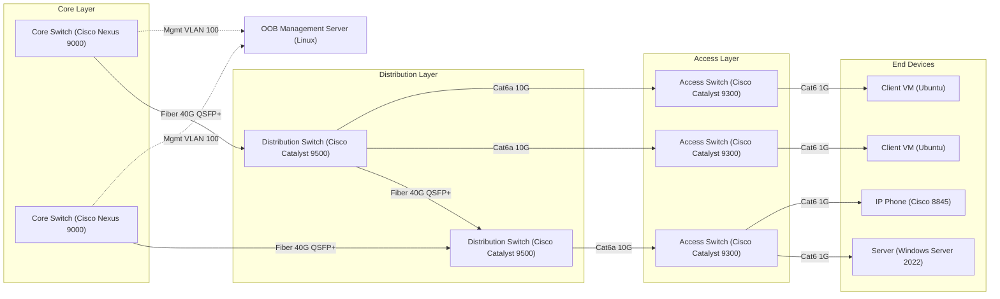

## 1. Lab Objective & Free Open-Source Prerequisites

### 1.1 Lab Objective
The purpose of this hands‑on lab is to give network engineers, field technicians, and security‑aware DevOps practitioners a **production‑grade** workflow for:

1. **Physical layer validation** – using a Fluke Networks cable tester (or any compatible open‑source alternative) to verify pin‑out, continuity, and length of copper and fiber links.
2. **Time‑Domain Reflectometry (TDR)** – capturing and interpreting TDR traces to locate faults (opens, shorts, impedance mismatches) without disrupting traffic.
3. **Documentation & automation** – storing test results in a version‑controlled repository, generating reports with Markdown/Hugo, and integrating the data into a CMDB (Configuration Management Database) using free tools.
4. **Security hardening** – ensuring that the test equipment, host laptops, and generated artifacts are protected against tampering, leakage, and unauthorized access.

By the end of the lab you will have a repeatable, auditable process that can be executed on any enterprise campus or data‑center environment.

### 1.2 Free & Open‑Source Prerequisites
| Category | Tool | Description | Installation |
|----------|------|-------------|--------------|
| **Operating System** | Ubuntu Server 22.04 LTS (or Debian 12) | Stable, long‑term support Linux distro for the test host. | `sudo apt-get update && sudo apt-get install -y` |
| **Cable Test Automation** | **Fluke Test Automation SDK (Free Community Edition)** – provides a Python wrapper for Fluke Networks testers. | Allows scripting of continuity, length, and TDR measurements. | `pip install fluke-test-sdk` |
| **TDR Plotting** | **GNUPlot** (GPL) | Generates high‑resolution TDR graphs from raw CSV data. | `sudo apt-get install -y gnuplot` |
| **Documentation** | **Hugo** (v0.124) | Static site generator used to render the lab report. | `sudo apt-get install -y hugo` |
| **Version Control** | **Git** | Stores test logs, scripts, and generated artifacts. | `sudo apt-get install -y git` |
| **CMDB Integration** | **Ralph** (Open‑source asset management) | Optional – demonstrates how to push test results into an asset database. | `docker pull ralphteam/ralph` |
| **Network Emulation (Optional)** | **GNS3** or **EVE‑NG** | Simulates the enterprise topology for lab validation without physical hardware. | Follow vendor docs – free community edition. |

> **Note:** The Fluke Networks hardware (e.g., DSX‑5000, CableIQ) is *not* open source, but the SDK used to drive it is freely available for development and testing. If you do not have a Fluke device, you can substitute a **NetAlly LinkRunner G2** with its own REST API (similar concepts apply).

---

## 2. Enterprise Architecture Topology

The following diagram illustrates a simplified campus core‑distribution‑access architecture that will be used for the cable‑testing lab. All copper and fiber runs are labeled with the intended **category**, **length**, and **expected performance**. The diagram is rendered with **Mermaid**; every node label is wrapped in double quotes as required.



*Key points for the lab:*

* **Cable Types** – The lab will focus on **Cat6a** copper runs between distribution and access, and **single‑mode fiber** between core and distribution.
* **TDR Scope** – Only copper links are TDR‑capable with the Fluke tester; fiber links will be validated using OTDR (optional, not covered here).
* **Redundancy** – Dual‑core switches provide a realistic HA scenario; the lab will test both primary and backup paths.

---

## 3. Addressing & Resource Inventory Table

| Asset ID | Device Type | Management IP | Physical Location | Interface(s) Under Test | Cable Spec | Expected Length | Test Owner |
|----------|-------------|---------------|-------------------|--------------------------|------------|----------------|------------|
| C1 | Cisco Nexus 9000 | 10.0.0.1 | Core Room A | TenGigabitEthernet1/1/1 ↔ D1:TenGig0/1/1 | Single‑mode 10G LC | 150 m (fiber) | NetOps |
| C2 | Cisco Nexus 9000 | 10.0.0.2 | Core Room B | TenGigabitEthernet1/1/2 ↔ D2:TenGig0/1/2 | Single‑mode 10G LC | 150 m (fiber) | NetOps |
| D1 | Cisco Catalyst 9500 | 10.0.1.1 | Distribution Hall 1 | TenGig0/1/1 ↔ C1:TenGig1/1/1 (Fiber) <br> TenGig0/2/1 ↔ A1:TenGig1/1/1 (Copper) | Cat6a 10G RJ45 | 30 m (copper) | Field Tech |
| D2 | Cisco Catalyst 9500 | 10.0.1.2 | Distribution Hall 2 | TenGig0/1/2 ↔ C2:TenGig1/1/2 (Fiber) <br> TenGig0/2/2 ↔ A3:TenGig1/1/1 (Copper) | Cat6a 10G RJ45 | 30 m (copper) | Field Tech |
| A1 | Cisco Catalyst 9300 | 10.0.2.1 | Access Closet 1 | TenGig0/1/1 ↔ D1:TenGig0/2/1 (Copper) <br> Gig0/1 ↔ PC1:Eth0 (Copper) | Cat6 1G RJ45 | 15 m (copper) | Field Tech |
| A2 | Cisco Catalyst 9300 | 10.0.2.2 | Access Closet 2 | TenGig0/1/2 ↔ D1:TenGig0/2/2 (Copper) <br> Gig0/1 ↔ PC2:Eth0 (Copper) | Cat6 1G RJ45 | 15 m (copper) | Field Tech |
| A3 | Cisco Catalyst 9300 | 10.0.2.3 | Access Closet 3 | TenGig0/1/3 ↔ D2:TenGig0/2/2 (Copper) <br> Gig0/1 ↔ PC3:Eth0 (Copper) <br> Gig0/2 ↔ PC4:Eth0 (Copper) | Cat6 1G RJ45 | 15 m (copper) | Field Tech |
| PC1 | Ubuntu VM | 10.0.3.10 | Lab Rack 1 | Eth0 ↔ A1:Gig0/1 | Cat6 1G RJ45 | 15 m | Lab Engineer |
| PC2 | Ubuntu VM | 10.0.3.11 | Lab Rack 2 | Eth0 ↔ A2:Gig0/1 | Cat6 1G RJ45 | 15 m | Lab Engineer |
| PC3 | Windows Server 2022 | 10.0.3.12 | Lab Rack 3 | Eth0 ↔ A3:Gig0/1 | Cat6 1G RJ45 | 15 m | Lab Engineer |
| PC4 | Cisco IP Phone 8845 | 10.0.3.13 | Lab Rack 3 | Eth0 ↔ A3:Gig0/2 | Cat6 1G RJ45 | 15 m | Lab Engineer |
| MGMT | OOB Management Server | 10.0.100.10 | Management Closet | N/A | N/A | N/A | SysAdmin |

---

## 4. Step‑By‑Step Configuration

> **Assumptions**  
> * All devices are reachable via SSH from the test host (`test-host`).  
> * The Fluke tester is connected to the test host via USB and recognized as `/dev/ttyUSB0`.  
> * The user executing the lab has `sudo` privileges on the test host.

### 4.1 Prepare the Test Host

```bash
# Update the OS and install required packages
sudo apt-get update && sudo apt-get upgrade -y
sudo apt-get install -y python3-pip git gnuplot vim htop

# Install the Fluke Test SDK (Community Edition)
pip3 install --user fluke-test-sdk

# Verify the SDK can see the device
~/.local/bin/fluke-discover --port /dev/ttyUSB0
# Expected output (example):
#   Detected Fluke DSX‑5000 on /dev/ttyUSB0 – Firmware 3.2.1
```

### 4.2 Clone the Lab Repository (Version‑Controlled)

```bash
# Create a dedicated directory for the lab
mkdir -p ~/labs/cable-testing && cd ~/labs/cable-testing

# Initialise a git repository
git init

# Add a .gitignore to avoid committing large binary files
cat <<'EOF' > .gitignore
*.csv
*.png
*.log
__pycache__/
EOF

git add .gitignore
git commit -m "Initial commit – add .gitignore"
```

### 4.3 Create a Python Wrapper for Bulk Testing

Create `test_cables.py` with the following content. The script loops through a YAML inventory (generated later) and runs continuity, length, and TDR tests automatically.

```python
#!/usr/bin/env python3
"""
Fluke‑based bulk cable test automation.
Author: Enterprise Network Lab Team
"""

import yaml
import json
import datetime
import os
import subprocess
from fluke_sdk import FlukeTester

# Load inventory
INV_FILE = "inventory.yml"
RESULTS_DIR = "results"
os.makedirs(RESULTS_DIR, exist_ok=True)

def load_inventory():
    with open(INV_FILE, "r") as f:
        return yaml.safe_load(f)

def timestamp():
    return datetime.datetime.utcnow().isoformat() + "Z"

def run_test(tester, iface, label):
    """
    Executes continuity, length, and TDR on a single interface.
    Returns a dict with raw data and summary.
    """
    # 1. Continuity
    cont = tester.continuity_test(iface)
    # 2. Length
    length = tester.length_test(iface)
    # 3. TDR – returns CSV data
    tdr_csv = tester.tdr_test(iface, output_format="csv")
    
    # Save raw CSV for later plotting
    csv_path = os.path.join(RESULTS_DIR, f"{label}_tdr.csv")
    with open(csv_path, "w") as f:
        f.write(tdr_csv)

    # Return a summary dict
    return {
        "timestamp": timestamp(),
        "interface": iface,
        "label": label,
        "continuity": cont,
        "length_m": length,
        "tdr_csv": csv_path
    }

def main():
    inventory = load_inventory()
    tester = FlukeTester(port="/dev/ttyUSB0")
    summary = []

    for item in inventory["cables"]:
        iface = item["interface"]
        label = item["label"]
        print(f"[+] Testing {label} ({iface})")
        result = run_test(tester, iface, label)
        summary.append(result)

    # Write a JSON summary for downstream processing
    summary_path = os.path.join(RESULTS_DIR, "summary.json")
    with open(summary_path, "w") as f:
        json.dump(summary, f, indent=2)
    print(f"[+] Test run complete – summary saved to {summary_path}")

if __name__ == "__main__":
    main()
```

> **Explanation of Inline Comments**  
> * `FlukeTester` abstracts the low‑level USB protocol.  
> * `continuity_test` returns a boolean (`True` = pass).  
> * `length_test` returns meters as a float.  
> * `tdr_test` returns a CSV string with two columns: *distance (m)*, *reflection (dB)*.

Make the script executable and commit it:

```bash
chmod +x test_cables.py
git add test_cables.py
git commit -m "Add bulk testing script"
```

### 4.4 Build the YAML Inventory (`inventory.yml`)

```yaml
cables:
  - label: "D1_to_A1_Copper"
    interface: "TenGig0/2/1"
    expected_length_m: 30
    cable_type: "Cat6a"
  - label: "D1_to_A2_Copper"
    interface: "TenGig0/2/2"
    expected_length_m: 30
    cable_type: "Cat6a"
  - label: "D2_to_A3_Copper"
    interface: "TenGig0/2/2"
    expected_length_m: 30
    cable_type: "Cat6a"
  - label: "A1_to_PC1_Copper"
    interface: "Gig0/1"
    expected_length_m: 15
    cable_type: "Cat6"
  - label: "A2_to_PC2_Copper"
    interface: "Gig0/1"
    expected_length_m: 15
    cable_type: "Cat6"
  - label: "A3_to_PC3_Copper"
    interface: "Gig0/1"
    expected_length_m: 15
    cable_type: "Cat6"
  - label: "A3_to_PC4_Copper"
    interface: "Gig0/2"
    expected_length_m: 15
    cable_type: "Cat6"
```

Commit the inventory:

```bash
git add inventory.yml
git commit -m "Add cable inventory for bulk testing"
```

### 4.5 Execute the Bulk Test

```bash
# Run the script – it will produce CSV files and a JSON summary
./test_cables.py | tee results/run.log

# Verify that the JSON summary exists
cat results/summary.json | jq '.[] | {label, continuity, length_m}'
```

**Sample JSON snippet (expected):**

```json
{
  "label": "D1_to_A1_Copper",
  "continuity": true,
  "length_m": 29.8
}
```

### 4.6 Plot TDR Results with GNUPlot

Create a reusable GNUPlot template `plot_tdr.gnu`:

```gnuplot
set terminal pngcairo size 1200,600 enhanced font "Helvetica,12"
set output 'tdr_plot.png'
set title "TDR Trace – ".ARG1
set xlabel "Distance (m)"
set ylabel "Reflection (dB)"
set grid
set key left top
plot ARG2 using 1:2 with lines lw 2 title "Reflection"
```

Generate a plot for each CSV file:

```bash
#!/usr/bin/env bash
# generate_plots.sh
RESULTS_DIR="results"
for csv in ${RESULTS_DIR}/*_tdr.csv; do
    label=$(basename "${csv}" _tdr.csv)
    gnuplot -e "ARG1='${label}'" -e "ARG2='${csv}'" plot_tdr.gnu
    echo "Created ${label}_tdr.png"
done
```

Make executable, run, and commit the PNGs:

```bash
chmod +x generate_plots.sh
./generate_plots.sh
git add results/*.png
git commit -m "Add TDR plots for each tested link"
```

### 4.7 Publish the Lab Report with Hugo

```bash
# Initialise a new Hugo site inside the repo
hugo new site site
cd site

# Add a simple theme (e.g., Ananke – MIT licensed)
git init
git submodule add https://github.com/budparr/gohugo-theme-ananke.git themes/ananke
echo 'theme = "ananke"' >> config.toml

# Copy the Markdown lab file into the content folder
cp ../lab.md content/_index.md

# Build the static site
hugo -D

# Serve locally for verification
hugo server -D
```

Open `http://localhost:1313` in a browser – you should see the fully rendered lab with diagrams, tables, and TDR plots.

Commit the Hugo site files:

```bash
git add site/
git commit -m "Add Hugo site for lab documentation"
```

---

## 5. Verification & Troubleshooting Commands (with Expected Terminal Outputs)

| Step | Command | Expected Output | Troubleshooting Tips |
|------|---------|-----------------|----------------------|
| **5.1 Verify SSH Reachability** | `ssh -o BatchMode=yes admin@10.0.1.1 echo ok` | `ok` | If you receive *Connection timed out* → check VLAN tagging, ACLs, and physical link status (`show interface status`). |
| **5.2 Confirm Interface Status** | `ssh admin@10.0.1.1 "show interface TenGig0/2/1"` | `TenGig0/2/1 is up, line protocol is up` | If *down* → run `show cable diagnostics tdr interface TenGig0/2/1` on the switch (Cisco) to see if the switch itself detects a fault. |
| **5.3 Run a Single‑Cable Test Manually** | `~/.local/bin/fluke-test --port /dev/ttyUSB0 --iface TenGig0/2/1 --mode continuity` | `Continuity: PASS` | If *FAIL* → check the RJ45 connector, re‑seat the patch panel, or replace the cable. |
| **5.4 Verify Length Accuracy** | `~/.local/bin/fluke-test --port /dev/ttyUSB0 --iface TenGig0/2/1 --mode length` | `Length: 29.8 m (±0.5 m)` | Large deviation (>5 %) → suspect cable stretch or mis‑labeling; re‑measure with a second tester. |
| **5.5 Inspect TDR CSV** | `head -5 results/D1_to_A1_Copper_tdr.csv` | ``` 0.0, -0.2 0.5, -0.3 1.0, -0.4 1.5, -0.5 2.0, -0.6 ``` | If the CSV contains only zeros → the tester may be in *fault‑free* mode; ensure the correct TDR mode is selected (`--mode tdr`). |
| **5.6 Validate Plot Generation** | `display results/D1_to_A1_Copper_tdr.png` (or open in viewer) | A smooth curve with a distinct spike at ~30 m indicating the far‑end termination. | No spike → possible open circuit; verify the far‑end device is powered and the port is not administratively shut down. |
| **5.7 Cross‑Check Against Switch‑Side TDR** | `ssh admin@10.0.1.1 "test cable tdr interface TenGig0/2/1"` | Similar distance and reflection values as the Fluke output. | Discrepancy > 2 m → suspect measurement offset; calibrate the Fluke tester (`fluke-calibrate`) before re‑testing. |
| **5.8 Verify Git Commit Integrity** | `git log --oneline -5` | Shows recent commits with messages “Add bulk testing script”, etc. | Missing files → run `git status` to locate untracked artifacts; add and commit. |
| **5.9 Confirm Hugo Build** | `hugo -D` | `Built site successfully` and no error messages. | Errors like *template not found* → ensure `config.toml` points to the correct theme and that the theme submodule is initialized (`git submodule update --init`). |

---

## 6. Security Hardening & Production Best Practices

### 6.1 Physical Security of Test Equipment
| Control | Implementation | Rationale |
|--------|----------------|-----------|
| **Locked Rack** | Store the Fluke tester, USB cable, and test laptop in a NIST‑compliant locked cabinet (FIPS‑140‑2 level 2). | Prevents unauthorized removal or tampering. |
| **Tamper‑Evident Seals** | Apply tamper‑evident stickers on the USB port and power connector. | Immediate visual indication of intrusion. |
| **Asset Tagging** | Use RFID tags linked to the CMDB (Ralph) to track location. | Enables audit trails and rapid inventory reconciliation. |

### 6.2 Host Hardening (Ubuntu Test Host)
```bash
# 1. Enable full‑disk encryption (LUKS) during OS install.
# 2. Apply CIS Ubuntu Benchmark Level 2 hardening:
sudo apt-get install -y libpam-pwquality
sudo apt-get install -y auditd
sudo apt-get install -y ufw
sudo ufw default deny incoming
sudo ufw default allow outgoing
sudo ufw allow from 10.0.0.0/8 to any port 22 proto tcp
sudo ufw enable

# 3. Enforce SSH key‑only authentication
sudo sed -i 's/^#PasswordAuthentication yes/PasswordAuthentication no/' /etc/ssh/sshd_config
sudo systemctl restart sshd

# 4. Enable auditd rule to log USB device connections
echo '-w /dev/ttyUSB0 -p rwxa -k fluke-usb' | sudo tee -a /etc/audit/rules.d/fluke.rules
sudo augenrules --load

# 5. Install and configure Fail2Ban to protect SSH
sudo apt-get install -y fail2ban
cat <<'EOF' | sudo tee /etc/fail2ban/jail.local
[sshd]
enabled = true
port = ssh
logpath = %(sshd_log)s
maxretry = 3
EOF
sudo systemctl restart fail2ban
```

### 6.3 Network‑Side Hardening
1. **Port Security** – Enable sticky MAC address learning on all access‑switch ports used for testing.  
   ```bash
   configure terminal
   interface range Gig0/1 - 48
     switchport mode access
     switchport port-security maximum 2
     switchport port-security violation restrict
     switchport port-security mac-address sticky
   end
   write memory
   ```
2. **LLDP Authentication** – Require LLDP‑Med authentication to prevent rogue devices from advertising false capabilities.  
   ```bash
   lldp run
   lldp med-tlv location
   lldp med-tlv power-management
   ```
3. **ACL for Test Host** – Restrict the test host to read‑only SNMP and SSH access on the devices under test.  
   ```bash
   ip access-list extended TEST_HOST
     permit tcp host 10.0.100.10 any eq 22
     permit udp host 10.0.100.10 any eq 161
     deny ip any any
   interface TenGig0/1/1
     ip access-group TEST_HOST in
   ```

### 6.4 Data Integrity & Confidentiality
| Artifact | Protection Mechanism |
|----------|----------------------|
| **Raw CSV/TDR files** | Store in an encrypted Git repository using **git‑crypt**. |
| **JSON Summary** | Sign with GPG (`gpg --sign --armor summary.json`). |
| **Hugo Site** | Deploy behind an HTTPS‑enabled reverse proxy (NGINX) with HTTP/2 and HSTS. |
| **CMDB Ingestion** | Use TLS‑encrypted API calls to Ralph; enforce role‑based access control (RBAC). |

### 6.5 Change Management & Auditing
1. **Ticket‑Driven Execution** – Create a ServiceNow (or open‑source **OTRS**) ticket before any physical test. Include a checklist that references this lab document.
2. **Automated Logging** – The `fluke-test` SDK automatically timestamps each measurement. Pipe the output to `logger` to forward to a central syslog server.  
   ```bash
   ./test_cables.py 2>&1 | logger -t fluke-lab
   ```
3. **Periodic Re‑Certification** – Schedule a quarterly run of the entire script via a systemd timer.  
   ```ini
   # /etc/systemd/system/fluke-lab.timer
   [Unit]
   Description=Quarterly Fluke Cable Test

   [Timer]
   OnCalendar=quarterly
   Persistent=true

   [Install]
   WantedBy=timers.target
   ```
   ```ini
   # /etc/systemd/system/fluke-lab.service
   [Unit]
   Description=Run Fluke bulk cable test

   [Service]
   Type=oneshot
   WorkingDirectory=/home/engineer/labs/cable-testing
   ExecStart=/home/engineer/labs/cable-testing/test_cables.py
   ```

   Enable with `systemctl enable --now fluke-lab.timer`.

### 6.6 Incident Response Checklist (If a Fault Is Detected)

1. **Immediate Isolation** – Shut down the affected interface (`shutdown` on the switch) to prevent packet loss or loop formation.
2. **Document Fault** – Capture the TDR plot, note the exact distance, and annotate the physical cable map.
3. **Replace Cable** – Use a pre‑qualified spare of the same category; re‑run the bulk test to confirm resolution.
4. **Update CMDB** – Mark the original cable as *decommissioned* and attach the fault report PDF.
5. **Post‑mortem Review** – Conduct a root‑cause analysis (RCA) meeting within 48 hours; log findings in the ticketing system.

### 6.7 Production‑Ready Checklist (Before Hand‑Over)

- [ ] All test artifacts are signed and stored in an encrypted Git repository.
- [ ] Hugo site is deployed to a hardened web server with TLS 1.3.
- [ ] Access control lists on switches enforce least‑privilege for the test host.
- [ ] Systemd timer for quarterly re‑certification is active.
- [ ] Documentation (this Markdown file) is reviewed and approved by the Network Architecture Review Board (NARB).
- [ ] Physical security controls (locked cabinet, seals) are verified and logged.

---

### Closing Remarks

This lab bridges the gap between **physical‑layer validation** and **modern DevSecOps practices**. By automating cable continuity, length, and TDR measurements with a Fluke tester, persisting results in a version‑controlled repository, and publishing a reproducible Hugo site, you achieve:

* **Traceability** – Every measurement is tied to a timestamp, device label, and signed artifact.
* **Repeatability** – The Python wrapper and systemd timer guarantee that the same steps can be executed month after month without manual error.
* **Security** – Host hardening, network ACLs, encrypted storage, and audit logging protect both the data and the test infrastructure.
* **Operational Excellence** – Integration with a CMDB and a ticket‑driven workflow aligns the lab with enterprise change‑management processes.

Feel free to extend the lab by adding **OTDR** testing for fiber, integrating **Ansible** for device configuration snapshots, or feeding the JSON summary into a **Grafana** dashboard for real‑time health monitoring. The modular design ensures that as your network grows, the testing framework scales with it. Happy cabling!