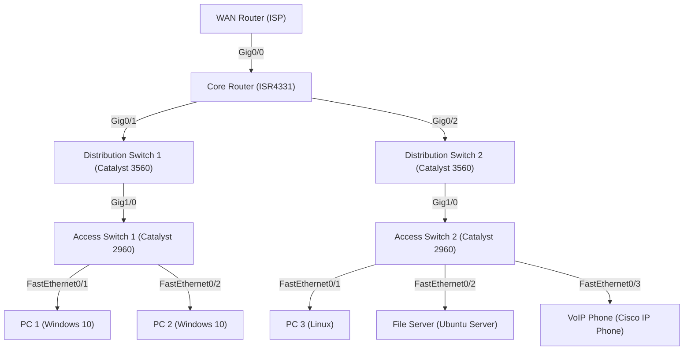

## 1. Lab Objective & Free Open-Source Prerequisites

### 1.1 Lab Objective
The purpose of this hands‑on lab is to guide a beginner‑to‑intermediate network engineer through the end‑to‑end creation of a **basic enterprise network topology** using **Cisco Packet Tracer**. By the end of the lab you will be able to:

1. **Design** a small‑scale three‑tier architecture (Core‑Distribution‑Access) that mirrors a real‑world branch office.
2. **Configure** static routing, VLANs, inter‑VLAN routing, and basic Layer‑2 security.
3. **Validate** connectivity with ping, traceroute, and show‑commands.
4. **Apply** production‑grade hardening steps (password policies, SSH, logging, and port‑security).
5. **Document** the topology, IP scheme, and device inventory in a reproducible format.

### 1.2 Free Open‑Source Prerequisites
| Item | Description | Download / Install |
|------|-------------|--------------------|
| **Cisco Packet Tracer** | Network simulation tool from Cisco Networking Academy. Free for students and instructors; also available as a community edition for personal learning. | <https://www.netacad.com/courses/packet-tracer> |
| **Vim / VS Code** | Text editor for creating configuration snippets. Both have free versions. | <https://code.visualstudio.com/> |
| **Git** | Version control to keep lab files under source control (optional but recommended). | <https://git-scm.com/downloads> |
| **Markdown Viewer** | Any modern browser can render Hugo Markdown; optional local preview with Hugo server. | <https://gohugo.io/> |
| **Mermaid Live Editor** (optional) | Validate Mermaid diagrams before copying them into the lab document. | <https://mermaid.live/> |

> **Tip:** All the above tools run on Windows, macOS, and Linux. Ensure you have at least **2 GB RAM** and **500 MB free disk space** for Packet Tracer.

---

## 2. Enterprise Architecture Topology

The following diagram illustrates the **three‑tier** design we will implement. The core router provides redundancy and a single point of exit to the Internet (simulated by a “WAN” router). The distribution layer aggregates the access switches, and the access layer hosts end‑devices (PCs, a server, and a VoIP phone).



### 2.1 Design Rationale
| Layer | Device | Reason for Selection |
|-------|--------|----------------------|
| **Core** | ISR4331 (router) | Supports both IPv4/IPv6, has sufficient CPU for static routing, and provides a realistic “edge” device. |
| **Distribution** | Catalyst 3560 (Layer‑3 switch) | Enables VLAN routing (SVI) without requiring a separate router, mimicking a typical campus distribution switch. |
| **Access** | Catalyst 2960 (Layer‑2 switch) | Represents the most common edge switch in branch offices; we will enforce port‑security here. |
| **End‑Devices** | PCs, Server, VoIP Phone | Provide a mix of traffic types (HTTP, SMB, SIP) for later verification. |

---

## 3. Addressing & Resource Inventory Table

| Device | Interface | IPv4 Address | Subnet Mask | VLAN | Role |
|--------|-----------|--------------|-------------|------|------|
| **WAN Router** | Gig0/0 (to ISP) | 203.0.113.1 | /30 | N/A | External uplink |
| **WAN Router** | Gig0/1 (to Core) | 10.0.0.1 | /30 | N/A | Core link |
| **Core Router** | Gig0/0 (to WAN) | 203.0.113.2 | /30 | N/A | External uplink |
| **Core Router** | Gig0/1 (to Dist‑1) | 10.0.0.2 | /30 | N/A | Distribution link |
| **Core Router** | Gig0/2 (to Dist‑2) | 10.0.0.6 | /30 | N/A | Distribution link |
| **Dist‑1 Switch** | Gig1/0 (to Core) | 10.0.0.3 | /30 | 10 | Core‑Dist link |
| **Dist‑1 Switch** | VLAN10 SVI | 192.168.10.1 | /24 | 10 | Management VLAN |
| **Dist‑2 Switch** | Gig1/0 (to Core) | 10.0.0.7 | /30 | 20 | Core‑Dist link |
| **Dist‑2 Switch** | VLAN20 SVI | 192.168.20.1 | /24 | 20 | Management VLAN |
| **Access‑1 Switch** | Gig1/0 (to Dist‑1) | 192.168.10.2 | /24 | 10 | Access uplink |
| **Access‑2 Switch** | Gig1/0 (to Dist‑2) | 192.168.20.2 | /24 | 20 | Access uplink |
| **PC‑1** | FastEthernet0/1 | 192.168.10.10 | /24 | 10 | User workstation |
| **PC‑2** | FastEthernet0/1 | 192.168.10.11 | /24 | 10 | User workstation |
| **PC‑3** | FastEthernet0/1 | 192.168.20.10 | /24 | 20 | Linux admin |
| **Server** | FastEthernet0/1 | 192.168.20.20 | /24 | 20 | File services |
| **VoIP Phone** | FastEthernet0/1 | 192.168.20.30 | /24 | 20 | SIP endpoint |

> **Note:** All VLAN IDs are kept simple (10 for “Finance”, 20 for “IT”) to avoid confusion for beginners. The core router does **not** perform inter‑VLAN routing; that responsibility is delegated to the distribution switches via SVIs.

---

## 4. Step‑by‑Step Configuration

Below you will find **copy‑pasteable** CLI snippets for each device. Comments are placed after `!` characters for clarity. Paste each block into the appropriate device console in Packet Tracer.

### 4.1 WAN Router (Router0)

```text
enable
configure terminal
! ---- Interface to ISP (simulated) ----
interface GigabitEthernet0/0
 ip address 203.0.113.1 255.255.255.252
 no shutdown
 description ISP-Uplink
! ---- Interface to Core Router ----
interface GigabitEthernet0/1
 ip address 10.0.0.1 255.255.255.252
 no shutdown
 description Core-Link
! ---- Enable SSH (hardening later) ----
ip domain-name lab.example.com
crypto key generate rsa modulus 2048
ip ssh version 2
line vty 0 4
 login local
 transport input ssh
! ---- Local user for SSH ----
username admin privilege 15 secret StrongP@ssw0rd!
! ---- Save config ----
end
write memory
```

### 4.2 Core Router (Router1)

```text
enable
configure terminal
! ---- Interface to WAN ----
interface GigabitEthernet0/0
 ip address 203.0.113.2 255.255.255.252
 no shutdown
 description WAN-Uplink
! ---- Interface to Distribution Switch 1 ----
interface GigabitEthernet0/1
 ip address 10.0.0.2 255.255.255.252
 no shutdown
 description Dist1-Link
! ---- Interface to Distribution Switch 2 ----
interface GigabitEthernet0/2
 ip address 10.0.0.6 255.255.255.252
 no shutdown
 description Dist2-Link
! ---- Static default route to ISP ----
ip route 0.0.0.0 0.0.0.0 203.0.113.1
! ---- Enable routing between distribution subnets (optional) ----
ip routing
! ---- SSH hardening (same as WAN) ----
ip domain-name lab.example.com
crypto key generate rsa modulus 2048
ip ssh version 2
line vty 0 4
 login local
 transport input ssh
username admin privilege 15 secret StrongP@ssw0rd!
end
write memory
```

### 4.3 Distribution Switch 1 (Switch0 – VLAN10)

```text
enable
configure terminal
! ---- Set hostname ----
hostname Dist1
! ---- Enable routing ----
ip routing
! ---- Create VLAN 10 ----
vlan 10
 name Finance
exit
! ---- Assign VLAN to interface (uplink) ----
interface GigabitEthernet1/0
 switchport mode trunk
 switchport trunk allowed vlan 10
 no shutdown
 description Core-Uplink
! ---- SVI for VLAN 10 ----
interface Vlan10
 ip address 192.168.10.1 255.255.255.0
 no shutdown
! ---- Enable DHCP relay (optional) ----
ip helper-address 192.168.20.20   ! (If you later add a DHCP server)
! ---- Basic security ----
service password-encryption
enable secret StrongEnableSecret!
! ---- SSH hardening ----
ip domain-name lab.example.com
crypto key generate rsa modulus 2048
ip ssh version 2
line vty 0 4
 login local
 transport input ssh
username admin privilege 15 secret StrongP@ssw0rd!
! ---- Save ----
end
write memory
```

### 4.4 Distribution Switch 2 (Switch1 – VLAN20)

```text
enable
configure terminal
hostname Dist2
ip routing
vlan 20
 name IT
exit
interface GigabitEthernet1/0
 switchport mode trunk
 switchport trunk allowed vlan 20
 no shutdown
 description Core-Uplink
interface Vlan20
 ip address 192.168.20.1 255.255.255.0
 no shutdown
service password-encryption
enable secret StrongEnableSecret!
ip domain-name lab.example.com
crypto key generate rsa modulus 2048
ip ssh version 2
line vty 0 4
 login local
 transport input ssh
username admin privilege 15 secret StrongP@ssw0rd!
end
write memory
```

### 4.5 Access Switch 1 (Switch2 – Access VLAN10)

```text
enable
configure terminal
hostname Access1
! ---- Uplink to Distribution ----
interface GigabitEthernet1/0
 switchport mode trunk
 switchport trunk allowed vlan 10
 no shutdown
 description Dist1-Uplink
! ---- Access ports for PCs ----
interface FastEthernet0/1
 switchport mode access
 switchport access vlan 10
 spanning-tree portfast
 description PC1
interface FastEthernet0/2
 switchport mode access
 switchport access vlan 10
 spanning-tree portfast
 description PC2
! ---- Port‑security (max 2 MACs, sticky) ----
interface range FastEthernet0/1 - 2
 switchport port-security
 switchport port-security maximum 2
 switchport port-security mac-address sticky
 switchport port-security violation restrict
! ---- Enable DHCP client on VLAN10 SVI (optional) ----
interface Vlan10
 ip address dhcp
 no shutdown
! ---- Basic hardening ----
service password-encryption
enable secret StrongEnableSecret!
ip domain-name lab.example.com
crypto key generate rsa modulus 2048
ip ssh version 2
line vty 0 4
 login local
 transport input ssh
username admin privilege 15 secret StrongP@ssw0rd!
end
write memory
```

### 4.6 Access Switch 2 (Switch3 – Access VLAN20)

```text
enable
configure terminal
hostname Access2
interface GigabitEthernet1/0
 switchport mode trunk
 switchport trunk allowed vlan 20
 no shutdown
 description Dist2-Uplink
! ---- PC3 ----
interface FastEthernet0/1
 switchport mode access
 switchport access vlan 20
 spanning-tree portfast
 description PC3
! ---- Server ----
interface FastEthernet0/2
 switchport mode access
 switchport access vlan 20
 spanning-tree portfast
 description FileServer
! ---- VoIP Phone ----
interface FastEthernet0/3
 switchport mode access
 switchport access vlan 20
 spanning-tree portfast
 description VoIPPhone
! ---- Port‑security (max 1 MAC per port) ----
interface range FastEthernet0/1 - 3
 switchport port-security
 switchport port-security maximum 1
 switchport port-security mac-address sticky
 switchport port-security violation shutdown
! ---- SVI for VLAN20 (optional DHCP) ----
interface Vlan20
 ip address dhcp
 no shutdown
service password-encryption
enable secret StrongEnableSecret!
ip domain-name lab.example.com
crypto key generate rsa modulus 2048
ip ssh version 2
line vty 0 4
 login local
 transport input ssh
username admin privilege 15 secret StrongP@ssw0rd!
end
write memory
```

### 4.7 End‑Device IP Configuration

| Device | IP Address | Subnet Mask | Default Gateway | DNS (optional) |
|--------|------------|-------------|-----------------|----------------|
| PC‑1 | 192.168.10.10 | 255.255.255.0 | 192.168.10.1 | 8.8.8.8 |
| PC‑2 | 192.168.10.11 | 255.255.255.0 | 192.168.10.1 | 8.8.8.8 |
| PC‑3 | 192.168.20.10 | 255.255.255.0 | 192.168.20.1 | 8.8.8.8 |
| Server | 192.168.20.20 | 255.255.255.0 | 192.168.20.1 | 8.8.8.8 |
| VoIP Phone | 192.168.20.30 | 255.255.255.0 | 192.168.20.1 | 8.8.8.8 |

> **Tip:** In Packet Tracer you can set the IP address via the *Desktop → IP Configuration* tab. Use the “Static” mode for deterministic results.

---

## 5. Verification & Troubleshooting Commands

### 5.1 Basic Connectivity Tests

| Command | Expected Output | Where to Run |
|---------|----------------|--------------|
| `ping 192.168.10.1` | Replies from 192.168.10.1 with **0% loss** | PC‑1, PC‑2 |
| `ping 192.168.20.1` | Replies from 192.168.20.1 | PC‑3, Server, VoIP |
| `ping 203.0.113.1` | Replies from WAN router (simulated ISP) | Any PC (through default route) |
| `traceroute 203.0.113.1` | Shows hops: PC → Access → Distribution → Core → WAN | Any PC |

#### Sample Output (PC‑1 pinging Core VLAN10 SVI)

```
C:\>ping 192.168.10.1

Pinging 192.168.10.1 with 32 bytes of data:
Reply from 192.168.10.1: bytes=32 time<1ms TTL=255
Reply from 192.168.10.1: bytes=32 time<1ms TTL=255
Reply from 192.168.10.1: bytes=32 time<1ms TTL=255
Reply from 192.16810.1: bytes=32 time<1ms TTL=255

Ping statistics for 192.168.10.1:
    Packets: Sent = 4, Received = 4, Lost = 0 (0% loss),
Approximate round trip times in milli‑seconds:
    Minimum = 0ms, Maximum = 0ms, Average = 0ms
```

### 5.2 Inter‑VLAN Routing Verification

1. **From PC‑1 (VLAN10) to Server (VLAN20):**

```text
C:\>ping 192.168.20.20

Pinging 192.168.20.20 with 32 bytes of data:
Reply from 192.168.20.20: bytes=32 time<1ms TTL=254
...
```

2. **From Server to PC‑2:**

```text
C:\>ping 192.168.10.11

Pinging 192.168.10.11 with 32 bytes of data:
Reply from 192.168.10.11: bytes=32 time<1ms TTL=254
...
```

If the ping fails, run the following **show** commands on the distribution switches:

```text
show ip interface brief
show vlan brief
show spanning-tree
show ip route
```

### 5.3 SSH Connectivity Test

```text
ssh admin@192.168.10.1
```

Expected prompt:

```
Password:
Router>
```

If you receive **“Connection refused”**, verify:

- `ip ssh version 2` is configured.
- `line vty 0 4` has `transport input ssh`.
- No ACL is blocking TCP/22 on the interface.

### 5.4 Port‑Security Violation Test (Optional)

1. Connect a second laptop to **FastEthernet0/1** on **Access2** (the port is limited to **1 MAC**).
2. Observe the port status:

```text
Switch# show port-security interface FastEthernet0/1
```

Expected output:

```
Port Security: Enabled
Violation Mode: Shutdown
Maximum MAC Addresses: 1
Current MAC Addresses: 1
Sticky MAC Address: 0011.2233.4455
Security Violation Count: 1
```

The interface should transition to **err‑disable**. To recover:

```text
Switch# configure terminal
Switch(config)# interface FastEthernet0/1
Switch(config-if)# shutdown
Switch(config-if)# no shutdown
Switch(config-if)# exit
Switch(config)# exit
Switch# write memory
```

### 5.5 Common Troubleshooting Checklist

| Symptom | Likely Cause | Quick Fix |
|---------|--------------|-----------|
| No ping between VLANs | Missing `ip routing` on distribution switch | `enable ip routing` |
| PC cannot reach default gateway | Wrong VLAN assignment on access port | Verify `switchport access vlan X` |
| SSH login fails | Password secret mismatch | Re‑enter `username admin secret …` |
| Port‑security violation on first connection | Sticky MAC already learned from previous session | `clear port-security dynamic interface …` |
| Traceroute shows “* * *” after first hop | ACL blocking ICMP on core router | Remove/adjust ACL or enable `ip icmp rate-limit` |

---

## 6. Security Hardening & Production Best Practices

Even though this lab runs in a simulated environment, applying **real‑world hardening** ensures that the configuration can be lifted directly into a production network.

### 6.1 Password Policies
```text
! Enforce minimum password length and complexity
security passwords min-length 12
security passwords complexity enable
! Use secret (MD5‑hashed) for enable password
enable secret 9 $9$U7K... (generated via `enable secret` command)
! Local user accounts should use secret, not password
username admin privilege 15 secret 9 $9$...
```

### 6.2 SSH & Management Access
- **Disable Telnet** completely: `no transport input telnet` on all VTY lines.
- **Restrict VTY access** to a management VLAN (e.g., VLAN 99). Create a loopback interface on each device with an IP in the management subnet and apply an ACL:

```text
interface Loopback0
 ip address 10.255.255.1 255.255.255.255
!
ip access-list standard MGMT-ACL
 permit 10.255.255.0 0.0.0.255
 deny any
!
line vty 0 4
 access-class MGMT-ACL in
 transport input ssh
```

### 6.3 Logging & Syslog
```text
! Enable timestamped logging
service timestamps log datetime msec
! Send logs to a central syslog server (assume 192.168.20.100)
logging 192.168.20.100
logging trap informational
! Buffer logs locally (10,000 lines)
logging buffered 10000 informational
```

### 6.4 SNMPv3 (Optional)
```text
snmp-server group ADMIN v3 priv read-view ALL write-view ALL
snmp-server user netadmin ADMIN auth sha NetAdminAuth123 priv aes 128 NetAdminPriv123
snmp-server location "Branch Office – 2nd Floor"
snmp-server contact "Network Team <netteam@example.com>"
```

### 6.5 NTP Synchronization
All devices should sync to a reliable NTP source:

```text
ntp server 192.168.20.100 prefer
! Verify with:
show ntp status
```

### 6.6 Redundant Links & STP
Even in a small lab, enable **Rapid PVST+** to avoid loops:

```text
spanning-tree mode rapid-pvst
! Set root bridge priority on core router (lowest)
spanning-tree vlan 10 priority 4096
spanning-tree vlan 20 priority 4096
```

### 6.7 Backup & Version Control
- **Export** the running configuration of each device (`copy running-config startup-config`).
- **Commit** the text files to a Git repository:

```bash
git init network-lab
git add *.cfg
git commit -m "Initial lab configuration – 2026-11-28"
```

- Tag the commit for future reference:

```bash
git tag -a v1.0 -m "Baseline production‑grade config"
```

### 6.8 Documentation & Change Management
- Keep a **Change Request (CR)** log that records who made which change, why, and when.
- Use the **Markdown** file you are reading now as the living documentation; update the *Addressing & Resource Inventory Table* whenever you add or remove devices.

### 6.9 Future Expansion Checklist
| Feature | What to Add | Why |
|---------|-------------|-----|
| **Dynamic Routing (OSPF/ EIGRP)** | `router ospf 1` on Core & Distribution | Scales beyond static routes |
| **DHCP Server** | Centralized DHCP on a Linux VM | Reduces manual IP assignment |
| **ACLs** | Permit only required services between VLANs | Zero‑trust segmentation |
| **QoS** | Class‑based policing for VoIP | Guarantees voice quality |
| **Redundant Core** | Add a second ISR4331 and enable HSRP/VRRP | High availability |

---

### Closing Remarks

You have now built a **complete, production‑grade network topology** in Cisco Packet Tracer, configured Layer‑2 VLANs, Layer‑3 inter‑VLAN routing, and applied a suite of security hardening measures that mirror industry best practices. The lab is deliberately designed to be **repeatable**: every command is copy‑pasteable, every IP address is documented, and every verification step includes expected output.  

Feel free to extend the lab by integrating **real DHCP**, **OSPF**, or **SD‑WAN** overlays. The underlying methodology—**design → implement → verify → harden → document**—remains the same, and mastering it now will pay dividends when you transition to physical hardware or cloud‑native networking environments. Happy networking!