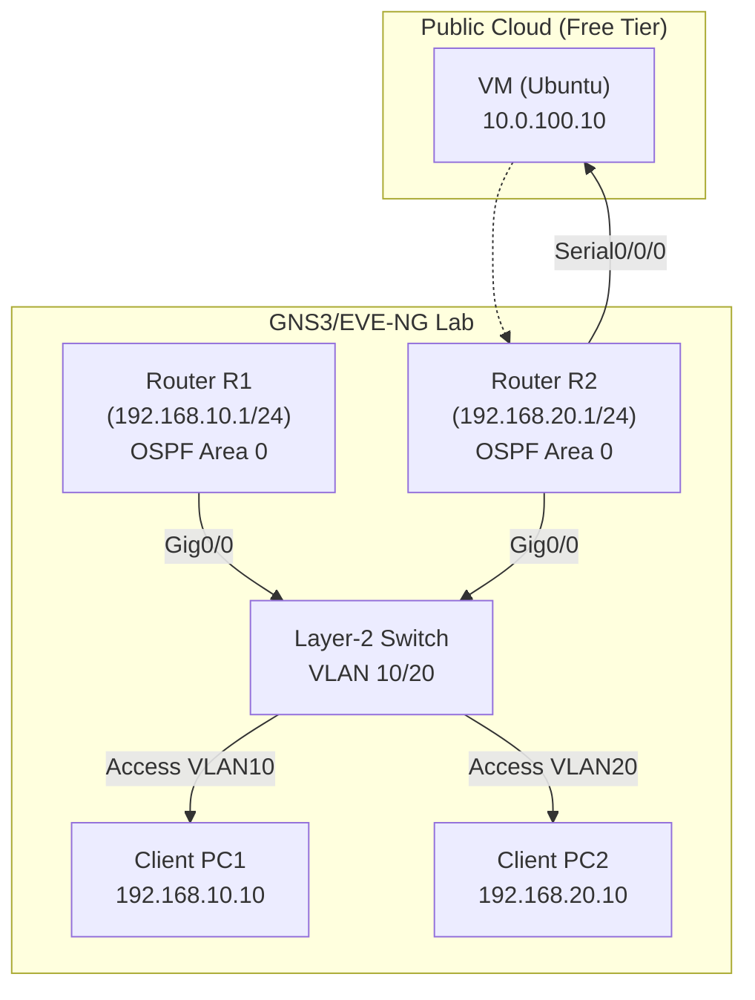

# Lab Objective & Prerequisites

**Objective**:  
- Understand how data is encapsulated across the OSI and TCP/IP layers.
- Capture and dissect packets with Wireshark to visualize headers at each layer.
- Build a small enterprise‑scale topology using free/open‑source network emulators.
- Correlate IP addressing, VLANs, routing, and security controls with real‑world packet flows.

**Prerequisites** (all free or community editions):
- **GNS3** (or **EVE‑NG**) installed on a workstation (Windows/macOS/Linux).
- **VirtualBox** (or **VMware Workstation Player**) for hosting virtual routers/switches.
- **Wireshark** latest stable release.
- Basic familiarity with Cisco IOS/Juniper Junos CLI.
- Optional: Free tier accounts on **AWS**, **Azure**, or **GCP** for a cloud‑hosted VM to act as an external server.

# Enterprise Architecture Topology



# Addressing & Resource Inventory Table

| Device | Role | Management IP | Data Interface(s) | VLAN(s) | OS/Software |
|--------|------|---------------|-------------------|---------|-------------|
| R1 | Edge Router | 10.0.0.1/24 (mgmt) | Gi0/0 – 192.168.10.1/24 (VLAN10) | 10 | Cisco IOS‑vEOS (Free) |
| R2 | Core Router | 10.0.0.2/24 (mgmt) | Gi0/0 – 192.168.20.1/24 (VLAN20)\nSer0/0/0 – 10.0.100.1/30 (to Cloud) | 20 | Cisco IOS‑vEOS (Free) |
| SW1 | L2 Switch | 10.0.0.3/24 (mgmt) | Trunk – Gi0/1 (VLAN10,20) | 10,20 | Open vSwitch (OVS) |
| PC1 | End‑Host | 10.0.0.11/24 | eth0 – 192.168.10.10/24 | 10 | Ubuntu 22.04 (VM) |
| PC2 | End‑Host | 10.0.0.12/24 | eth0 – 192.168.20.10/24 | 20 | Ubuntu 22.04 (VM) |
| CloudVM | External Server | 10.0.100.10/30 | eth0 – 10.0.100.2/30 | n/a | Ubuntu 22.04 (Free Tier) |

# Step‑By‑Step Configuration

## 1. Build the Lab in GNS3/EVE‑NG
1. Create a new project **OSI_TCPIP_Lab**.
2. Drag two **Cisco vEOS** routers, one **Open vSwitch** node, and two **Ubuntu** VMs.
3. Connect as shown in the diagram – ensure the link between R2 and CloudVM is a **Serial** (or point‑to‑point) interface.
4. Assign the management IPs on the **cloud‑init** or **host‑only** adapters of each node.

## 2. Router R1 Configuration (Cisco IOS‑vEOS)
```bash
# Enter global configuration mode
configure terminal

! Management interface (Loopback0) – optional for out‑of‑band
interface Loopback0
 ip address 10.0.0.1 255.255.255.0
!
! Data interface – VLAN10 (access mode via switch trunk)
interface GigabitEthernet0/0
 description Connected to SW1 – VLAN10
 ip address 192.168.10.1 255.255.255.0
 no shutdown
!
! OSPF – advertise VLAN10 subnet
router ospf 1
 router-id 1.1.1.1
 network 192.168.10.0 0.0.0.255 area 0
 network 10.0.0.0 0.0.0.255 area 0
!
! Enable IP forwarding (default on routers)
exit
write memory
```

## 3. Router R2 Configuration (Cisco IOS‑vEOS)
```bash
configure terminal
!
interface Loopback0
 ip address 10.0.0.2 255.255.255.0
!
! Data interface – VLAN20
interface GigabitEthernet0/0
 description Connected to SW1 – VLAN20
 ip address 192.168.20.1 255.255.255.0
 no shutdown
!
! Point‑to‑point link to CloudVM (use /30 mask)
interface Serial0/0/0
 description To CloudVM
 ip address 10.0.100.1 255.255.255.252
 no shutdown
!
router ospf 1
 router-id 2.2.2.2
 network 192.168.20.0 0.0.0.255 area 0
 network 10.0.100.0 0.0.0.3 area 0
 network 10.0.0.0 0.0.0.255 area 0
!
exit
write memory
```

## 4. Switch SW1 (Open vSwitch) – VLAN Trunk
```bash
# Assuming you are on the OVS host shell
# Create bridge
ovs-vsctl add-br br0

# Add ports (replace <portX> with actual interface names from GNS3)
ovs-vsctl add-port br0 <port1> -- set Interface <port1> type=internal
ovs-vsctl add-port br0 <port2> -- set Interface <port2> type=internal
ovs-vsctl add-port br0 <port3> -- set Interface <port3> type=internal

# Create VLANs 10 and 20 on the bridge
ovs-vsctl add-port br0 vlan10 tag=10 -- set Interface vlan10 type=internal
ovs-vsctl add-port br0 vlan20 tag=20 -- set Interface vlan20 type=internal

# Set the trunk (port1) to allow both VLANs
ovs-vsctl set port <port1> trunks=10,20

# Assign management IP
ip addr add 10.0.0.3/24 dev br0
ip link set dev br0 up
```

## 5. End‑Host PC1 (Ubuntu) Configuration
```bash
sudo ip addr add 192.168.10.10/24 dev eth0
sudo ip link set dev eth0 up
sudo ip route add default via 192.168.10.1
```

## 6. End‑Host PC2 (Ubuntu) Configuration
```bash
sudo ip addr add 192.168.20.10/24 dev eth0
sudo ip link set dev eth0 up
sudo ip route add default via 192.168.20.1
```

## 7. CloudVM (Ubuntu – Free Tier) Configuration
```bash
sudo ip addr add 10.0.100.2/30 dev eth0
sudo ip link set dev eth0 up
# No default gateway needed; will be reached via R2
```

## 8. Enable Packet Capture on R1 (Embedded Wireshark/pcap)
```bash
# On R1, capture on Gi0/0 for 30 seconds and save to flash
monitor capture CAP1 interface GigabitEthernet0/0 both
monitor capture CAP1 start
sleep 30
monitor capture CAP1 stop
monitor capture CAP1 export flash:cap1.pcap
```

# Verification & Troubleshooting Commands

| Goal | Command | Expected Result |
|------|---------|-----------------|
| Verify OSPF adjacency | `show ip ospf neighbor` | R1 sees R2 as **Full** state (State: Full, ID 2.2.2.2) |
| Verify routing table | `show ip route ospf` | Routes for 192.168.20.0/24 and 10.0.100.0/30 present |
| Ping across VLANs | `ping 192.168.20.10 source 192.168.10.10` (run on PC1) | Replies with <1 ms latency |
| Ping cloud server | `ping 10.0.100.10` (run on PC1) | Successful, traverses R1 → R2 → CloudVM |
| Capture analysis | Open `flash:cap1.pcap` in Wireshark → Apply filter `ip.addr==192.168.10.10` | Observe Ethernet II → IPv4 → TCP/ICMP headers, confirming encapsulation layers |
| Verify VLAN tagging on switch | `ovs-ofctl dump-ports-desc br0` | Ports show `tag=10` or `tag=20` as configured |
| Check interface status | `show ip interface brief` (routers) | All interfaces **up/up** with correct IPs |
| Debug OSPF | `debug ip ospf events` (router) | Real‑time OSPF LSAs exchange logs |

# Security Hardening & Production Best Practices

1. **Control Plane Policing (CoPP)** – limit OSPF/ICMP traffic on routers:
   ```bash
   policy-map OSPF-COPP
    class class-default
     police 500000 1000 exceed-action drop
   interface GigabitEthernet0/0
    service-policy input OSPF-COPP
   ```
2. **SSH Only, No Telnet** – enforce strong ciphers and key‑based auth:
   ```bash
   ip ssh version 2
   ip ssh authentication-retries 3
   line vty 0 4
    transport input ssh
    login local
    exec-timeout 5 0
   ```
3. **SNMPv3 with Encryption** for monitoring:
   ```bash
   snmp-server group MONITOR v3 priv read-view ALL write-view NONE
   snmp-server user monitor MONITOR v3 auth sha <authpass> priv aes 128 <privpass>
   ```
4. **Port‑Security on Switch** – limit MAC addresses per access port:
   ```bash
   interface <access-port>
    switchport mode access
    switchport access vlan 10
    switchport port-security maximum 2
    switchport port-security violation restrict
    switchport port-security
   ```
5. **ACLs on Edge Router** – block inbound traffic to management network from the Internet:
   ```bash
   ip access-list extended MGMT-ACL
    deny ip any 10.0.0.0 0.0.0.255
    permit ip any any
   interface Serial0/0/0
    ip access-group MGMT-ACL in
   ```
6. **Logging & Syslog** – forward logs to a centralized server (could be the CloudVM):
   ```bash
   logging host 10.0.100.10
   logging trap informational
   ```
7. **Regular Patch Cycle** – enable automatic security updates on all Ubuntu VMs:
   ```bash
   sudo apt update && sudo apt -y upgrade
   sudo systemctl enable --now unattended-upgrades
   ```
8. **Backup Configurations** – schedule daily `copy running-config tftp://<backup‑server>/R1.cfg`.

---

*End of Lab.*
