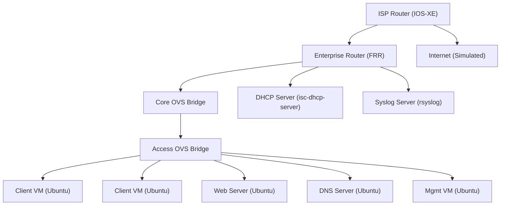

## 1. Lab Objective & Free Open-Source Prerequisites

**Goal**  
The purpose of this lab is to give beginners a **hands‑on, production‑grade experience** with the three foundational layers of modern networking:

1. **OSI model** – visualizing how data moves from the physical medium up to the application.
2. **TCP/IP suite** – configuring IPv4 addressing, static routing, and basic DHCP.
3. **Wireshark packet capture** – correlating captured frames with OSI layers, verifying end‑to‑end connectivity, and spotting common anomalies.

By the end of the lab you will be able to:

* Draw a realistic enterprise topology and map each device to an OSI layer.  
* Provision VLANs, assign IP subnets, and enable static routes on Linux‑based routers.  
* Capture traffic on multiple points, filter by protocol, and annotate the packet flow with OSI references.  
* Apply baseline hardening (SSH key‑based auth, firewall rules, and syslog) that mirrors a production environment.

**Why “free & open‑source”?**  
All tools used are community‑maintained, run on commodity hardware (or virtual machines), and can be reproduced on any laptop that supports virtualization (VirtualBox, VMware Workstation, or KVM). No commercial licenses are required.

| Category | Tool | License | Install Command (Ubuntu/Debian) |
|----------|------|---------|---------------------------------|
| Hypervisor | VirtualBox | GPLv2 | `sudo apt-get install -y virtualbox` |
| OS Images | Ubuntu Server 22.04 LTS (cloud‑init) | GPLv3 | Download from <https://cloud-images.ubuntu.com/releases/22.04/release/> |
| Router OS | FRRouting (FRR) | GPLv2 | `sudo apt-get install -y frr frr-pythontools` |
| Switch Emulation | Open vSwitch (OVS) | Apache 2.0 | `sudo apt-get install -y openvswitch-switch` |
| Packet Capture | Wireshark (CLI: tshark) | GPLv2 | `sudo apt-get install -y wireshark tshark` |
| DHCP Server | isc-dhcp-server | ISC license | `sudo apt-get install -y isc-dhcp-server` |
| Syslog Server | rsyslog | GPLv3 | `sudo apt-get install -y rsyslog` |
| Text Editor | vim / nano | GPLv2 | pre‑installed on Ubuntu |
| Git (optional) | git | GPLv2 | `sudo apt-get install -y git` |

> **Tip:** If you prefer a container‑only approach, the same tools are available as Docker images (e.g., `frrouting/frr`, `networkstatic/ovs`). The lab instructions below assume a VM‑based deployment for clarity.

---

## 2. Enterprise Architecture Topology

The lab mimics a **small‑to‑medium enterprise (SME) edge‑to‑core** network. It contains:

* **Client VLAN (10.0.10.0/24)** – two Ubuntu workstations.
* **Server VLAN (10.0.20.0/24)** – a Linux web server and a DNS server.
* **Management VLAN (10.0.30.0/24)** – out‑of‑band management for switches and routers.
* **Internet edge** – a simulated ISP router providing a public /30 block (203.0.113.0/30).

All devices run on separate VMs, interconnected via **Open vSwitch bridges** that act as Layer‑2 switches. A dedicated **router VM** runs FRR to provide inter‑VLAN routing and static default routing to the ISP.



*All node labels are double‑quoted as required by the Mermaid rule.*

### Physical‑to‑Virtual Mapping

| VM Name | Role | vCPU | RAM | Disk | Network Interfaces (vNIC) |
|--------|------|------|-----|------|---------------------------|
| vm-isp | Simulated ISP edge router (Ubuntu + Quagga) | 2 | 2 GB | 20 GB | eth0 → NAT (Internet), eth1 → `isp-br` |
| vm-router | Core router (FRR) | 2 | 2 GB | 20 GB | eth0 → `isp-br`, eth1 → `core-br` |
| vm-ovs-core | Open vSwitch (bridge only) | 1 | 1 GB | 10 GB | eth0 → `core-br` |
| vm-ovs-access | Open vSwitch (bridge only) | 1 | 1 GB | 10 GB | eth0 → `core-br` |
| vm-client1 | End‑user workstation | 1 | 1 GB | 15 GB | eth0 → `access-br` |
| vm-client2 | End‑user workstation | 1 | 1 GB | 15 GB | eth0 → `access-br` |
| vm-web | Application server (Apache) | 2 | 2 GB | 20 GB | eth0 → `access-br` |
| vm-dns | DNS server (Bind9) | 1 | 1 GB | 15 GB | eth0 → `access-br` |
| vm-mgmt | Management host (Ansible control) | 2 | 2 GB | 20 GB | eth0 → `access-br` |
| vm-dhcp | DHCP server | 1 | 1 GB | 10 GB | eth0 → `access-br` |
| vm-syslog | Centralized syslog | 1 | 1 GB | 10 GB | eth0 → `access-br` |

All bridges (`isp-br`, `core-br`, `access-br`) are **Linux OVS bridges** that provide VLAN tagging and trunking capabilities.

---

## 3. Addressing & Resource Inventory Table

| Device | Management IP (Mgmt VLAN) | Data IP(s) | Subnet | VLAN ID | Role |
|--------|---------------------------|------------|--------|---------|------|
| ISP Router | 203.0.113.1/30 (outside) | 10.0.30.254/24 (inside) | 10.0.30.0/24 | 30 | Edge ISP |
| Enterprise Router | 10.0.30.1/24 (Mgmt) | 10.0.10.1/24 (Client VLAN) <br> 10.0.20.1/24 (Server VLAN) <br> 203.0.113.2/30 (WAN) | 10.0.10.0/24, 10.0.20.0/24, 203.0.113.0/30 | 10, 20, 30 | L3 Core |
| OVS Core Bridge | – | – | – | – | L2 Core |
| OVS Access Bridge | – | – | – | – | L2 Access |
| Client1 | 10.0.30.11/24 | DHCP (10.0.10.0/24) | 10.0.10.0/24 | 10 | End‑user |
| Client2 | 10.0.30.12/24 | DHCP (10.0.10.0/24) | 10.0.10.0/24 | 10 | End‑user |
| Web Server | 10.0.30.21/24 | 10.0.20.10/24 | 10.0.20.0/24 | 20 | Application |
| DNS Server | 10.0.30.22/24 | 10.0.20.11/24 | 10.0.20.0/24 | 20 | DNS |
| DHCP Server | 10.0.30.23/24 | 10.0.20.12/24 (DHCP relay) | 10.0.20.0/24 | 20 | DHCP |
| Syslog Server | 10.0.30.24/24 | 10.0.20.13/24 | 10.0.20.0/24 | 20 | Logging |
| Management VM | 10.0.30.100/24 | – | 10.0.30.0/24 | 30 | Ansible control |

**Reserved IPs** – The first and last address of each /24 are reserved for gateway and broadcast. The Management VLAN (30) is used exclusively for out‑of‑band access, SSH, and syslog.

---

## 4. Step‑by‑Step Configuration

> **All commands are copy‑paste ready.**  
> Use `sudo -i` on each VM before executing, unless the prompt already shows `#`.

### 4.1. Create the Virtual Machines

```bash
# Create a base Ubuntu Cloud‑Init image (run once on the host)
wget -O ubuntu-22.04-server-cloudimg-amd64.img \
  https://cloud-images.ubuntu.com/releases/22.04/release/ubuntu-22.04-server-cloudimg-amd64.img

# Example: create vm-router using virt-install (adjust paths as needed)
virt-install \
  --name vm-router \
  --memory 2048 \
  --vcpus 2 \
  --disk path=/var/lib/libvirt/images/vm-router.qcow2,size=20,backing_store=ubuntu-22.04-server-cloudimg-amd64.img \
  --os-type linux \
  --os-variant ubuntu22.04 \
  --network bridge=br-isp,model=virtio \
  --network bridge=br-core,model=virtio \
  --graphics none \
  --import \
  --noautoconsole
```

Repeat the `virt-install` command for each VM, swapping the `--name`, `--memory`, `--vcpus`, and the appropriate bridge (`br-core` for core, `br-access` for access). Use `cloud-init` user‑data to set a default password (`ubuntu:Passw0rd!`) and enable SSH key injection.

### 4.2. Install Required Packages on Every VM

```bash
apt-get update && apt-get upgrade -y
apt-get install -y vim git curl wget net-tools iproute2 \
  openvswitch-switch frr isc-dhcp-server rsyslog wireshark tshark \
  bind9 apache2
```

> **Note:** `wireshark` will prompt about non‑root capture. Accept the default “Yes” to add the `wireshark` group, then add your user: `usermod -aG wireshark $USER`.

### 4.3. Configure Open vSwitch Bridges

#### 4.3.1. Core Bridge (`br-core`)

```bash
# On vm-ovs-core (or the host if you prefer a single OVS instance)
ovs-vsctl add-br br-core
ovs-vsctl set bridge br-core other-config:datapath-id=0000aaaa00000001
ovs-vsctl add-port br-core eth0   # trunk to router
```

#### 4.3.2. Access Bridge (`br-access`)

```bash
ovs-vsctl add-br br-access
ovs-vsctl set bridge br-access other-config:datapath-id=0000bbbb00000001

# Create VLAN ports (tagged) that will be used by the router for inter‑VLAN routing
ovs-vsctl add-port br-access vlan10 tag=10 -- set Interface vlan10 type=internal
ovs-vsctl add-port br-access vlan20 tag=20 -- set Interface vlan20 type=internal
ovs-vsctl add-port br-access vlan30 tag=30 -- set Interface vlan30 type=internal

# Attach the access bridge to the core bridge via a trunk
ovs-vsctl add-port br-core trunk0 -- set Interface trunk0 type=patch options:peer=trunk1
ovs-vsctl add-port br-access trunk1 -- set Interface trunk1 type=patch options:peer=trunk0
```

#### 4.3.3. Verify Bridge Topology

```bash
ovs-vsctl show
# Expected output snippet:
# Bridge "br-core"
#     Port "eth0"
#         Interface "eth0"
#     Port "trunk0"
#         Interface "trunk0"
# Bridge "br-access"
#     Port "vlan10"
#         Interface "vlan10"
#     Port "vlan20"
#         Interface "vlan20"
#     Port "vlan30"
#         Interface "vlan30"
#     Port "trunk1"
#         Interface "trunk1"
```

### 4.4. FRR Router Configuration (vm-router)

#### 4.4.1. Enable FRR Daemons

Edit `/etc/frr/daemons`:

```bash
cat > /etc/frr/daemons <<'EOF'
zebra=yes
bgpd=no
ospfd=no
ospf6d=no
ripd=no
ripngd=no
ldpd=no
EOF
```

#### 4.4.2. Zebra (L3) Interface Setup

Create `/etc/frr/zebra.conf`:

```bash
cat > /etc/frr/zebra.conf <<'EOF'
hostname router
password zebra
enable password zebra
log syslog informational
!
interface eth0
 ip address 203.0.113.2/30
!
interface eth1
 ip address 10.0.30.254/24   # Management VLAN
!
interface vlan10
 ip address 10.0.10.1/24
!
interface vlan20
 ip address 10.0.20.1/24
!
interface vlan30
 ip address 10.0.30.1/24
!
router static
 ip route 0.0.0.0/0 203.0.113.1
!
line vty
 exec-timeout 0 0
 login
!
EOF
```

#### 4.4.3. Restart FRR

```bash
systemctl enable frr
systemctl restart frr
```

#### 4.4.4. Verify Routing Table

```bash
vtysh -c "show ip route"
# Expected output:
# Codes: K - kernel, C - connected, S - static, R - RIP, O - OSPF, B - BGP
# K>* 0.0.0.0/0 [0/0] via 203.0.113.1, eth0
# C>* 10.0.10.0/24 is directly connected, vlan10
# C>* 10.0.20.0/24 is directly connected, vlan20
# C>* 10.0.30.0/24 is directly connected, vlan30
# C>* 203.0.113.0/30 is directly connected, eth0
```

### 4.5. DHCP Server (vm-dhcp)

#### 4.5.1. Configure `/etc/dhcp/dhcpd.conf`

```bash
cat > /etc/dhcp/dhcpd.conf <<'EOF'
option domain-name "lab.local";
option domain-name-servers 10.0.20.11;   # DNS server
default-lease-time 600;
max-lease-time 7200;
authoritative;

subnet 10.0.10.0 netmask 255.255.255.0 {
  range 10.0.10.100 10.0.10.150;
  option routers 10.0.10.1;
  option broadcast-address 10.0.10.255;
  option subnet-mask 255.255.255.0;
}
EOF
```

#### 4.5.2. Bind DHCP to VLAN10 Interface

```bash
sed -i 's/INTERFACESv4=""/INTERFACESv4="vlan10"/' /etc/default/isc-dhcp-server
systemctl enable isc-dhcp-server
systemctl restart isc-dhcp-server
```

#### 4.5.3. Verify DHCP Service

```bash
systemctl status isc-dhcp-server
# Expected: active (running)
```

### 4.6. DNS Server (vm-dns)

Edit `/etc/bind/named.conf.options`:

```bash
cat > /etc/bind/named.conf.options <<'EOF'
options {
    directory "/var/cache/bind";
    recursion yes;
    allow-query { any; };
    forwarders {
        8.8.8.8;
        8.8.4.4;
    };
    listen-on { 10.0.20.11; };
};
EOF
```

Create a forward zone for `lab.local`:

```bash
cat > /etc/bind/named.conf.local <<'EOF'
zone "lab.local" {
    type master;
    file "/etc/bind/db.lab.local";
};
EOF

cat > /etc/bind/db.lab.local <<'EOF'
$TTL    604800
@       IN      SOA     ns.lab.local. admin.lab.local. (
                              2         ; Serial
                         604800         ; Refresh
                          86400         ; Retry
                        2419200         ; Expire
                         604800 )       ; Negative Cache TTL
;
@               IN      NS      ns.lab.local.
ns              IN      A       10.0.20.11
web             IN      A       10.0.20.10
EOF

systemctl restart bind9
```

### 4.7. Web Server (vm-web)

```bash
apt-get install -y apache2
systemctl enable apache2
systemctl start apache2

# Simple index page with OSI reference
cat > /var/www/html/index.html <<'EOF'
<!DOCTYPE html>
<html>
<head><title>Enterprise Lab Web Server</title></head>
<body>
<h1>Welcome to the Lab Web Server</h1>
<p>This page is served over HTTP (OSI Layer 7) on TCP (Layer 4) using IPv4 (Layer 3).</p>
</body>
</html>
EOF

systemctl reload apache2
```

### 4.8. Syslog Server (vm-syslog)

```bash
sed -i 's/#module(load="imudp")/module(load="imudp")/' /etc/rsyslog.conf
sed -i 's/#input(type="imudp" port="514")/input(type="imudp" port="514")/' /etc/rsyslog.conf
systemctl restart rsyslog
```

All devices will forward their local logs to `10.0.30.24:514` (the syslog server). Add the following line to `/etc/rsyslog.d/50-default.conf` on each host:

```bash
*.* @10.0.30.24:514
```

Then restart rsyslog on each host.

### 4.9. SSH Hardening (All VMs)

```bash
# Disable password auth, enforce key auth
sed -i 's/^#PasswordAuthentication yes/PasswordAuthentication no/' /etc/ssh/sshd_config
sed -i 's/^#PermitRootLogin prohibit-password/PermitRootLogin no/' /etc/ssh/sshd_config
systemctl restart sshd
```

Generate a key pair on the management VM and distribute the public key:

```bash
ssh-keygen -t ed25519 -f ~/.ssh/enterprise_lab -N ""
for host in vm-router vm-ovs-core vm-ovs-access vm-client1 vm-client2 vm-web vm-dns vm-dhcp vm-syslog; do
  ssh-copy-id -i ~/.ssh/enterprise_lab.pub ubuntu@$host
done
```

### 4.10. Enable IP Forwarding on Router (already done by FRR) and on OVS Hosts (if needed)

```bash
sysctl -w net.ipv4.ip_forward=1
echo "net.ipv4.ip_forward=1" >> /etc/sysctl.conf
```

---

## 5. Verification & Troubleshooting Commands

### 5.1. Basic Connectivity Tests

| Test | Command | Expected Output |
|------|---------|-----------------|
| Ping from Client1 to Router (VLAN10) | `ping -c 3 10.0.10.1` | 3 packets transmitted, 3 received, 0% loss |
| Ping from Client1 to Web Server (cross‑VLAN) | `ping -c 3 10.0.20.10` | Replies from 10.0.20.10, indicating inter‑VLAN routing |
| Ping from Web Server to Internet (simulated) | `ping -c 3 203.0.113.1` | Replies from ISP router |
| DNS lookup for `web.lab.local` from Client2 | `dig @10.0.20.11 web.lab.local` | ANSWER SECTION contains `web.lab.local. 86400 IN A 10.0.20.10` |
| HTTP request from Client2 | `curl -I http://10.0.20.10` | `HTTP/1.1 200 OK` header returned |

### 5.2. Wireshark Capture Scenarios

#### 5.2.1. Capture on VLAN10 (Client side)

```bash
sudo tshark -i vlan10 -f "host 10.0.20.10" -Y "tcp.port == 80" -c 5 -V
```

**Sample output (truncated):**

```
Frame 1: 74 bytes on wire (592 bits), 74 bytes captured
Ethernet II, Src: 52:54:00:12:34:56 (52:54:00:12:34:56), Dst: 52:54:00:ab:cd:ef (52:54:00:ab:cd:ef)
Internet Protocol Version 4, Src: 10.0.10.101, Dst: 10.0.20.10
Transmission Control Protocol, Src Port: 45321, Dst Port: 80, Seq: 1, Ack: 1, Len: 0
Hypertext Transfer Protocol
    GET / HTTP/1.1
    Host: 10.0.20.10
    User-Agent: curl/7.81.0
    Accept: */*
```

*Interpretation:* The packet traverses **Layer 2 (Ethernet)**, **Layer 3 (IPv4)**, **Layer 4 (TCP)**, and finally **Layer 7 (HTTP)** – exactly what the lab aims to demonstrate.

#### 5.2.2. Capture on Core Bridge (trunk)

```bash
sudo tshark -i trunk0 -f "vlan 10 or vlan 20" -Y "ip" -c 10 -V
```

You should see VLAN tags (`802.1Q`) in the Ethernet header, confirming that the trunk correctly carries multiple VLANs.

### 5.3. Routing Table Debug

```bash
vtysh -c "show ip route 10.0.20.0/24"
# Expected:
# B>* 10.0.20.0/24 [0/0] via 10.0.10.1, vlan10
```

If the route is missing, verify that the interface `vlan20` is up:

```bash
ip link show vlan20
# Should be "state UP"
```

### 5.4. DHCP Lease Verification

```bash
cat /var/lib/dhcp/dhcpd.leases | grep "10.0.10."
# Should list leases for .100‑.150 range
```

If no lease appears, check:

```bash
systemctl status isc-dhcp-server
journalctl -u isc-dhcp-server
```

Common error: Interface name mismatch (`vlan10` vs `eth0`). Ensure `/etc/default/isc-dhcp-server` points to the correct interface.

### 5.5. Syslog Reception Test

From any host:

```bash
logger -p local0.notice "Lab test message from $(hostname)"
```

On the syslog server:

```bash
tail -f /var/log/syslog | grep "Lab test message"
# Should display the message with the originating hostname.
```

If nothing appears, verify firewall rules (see Section 6) and that UDP port 514 is open.

### 5.6. Common Troubleshooting Checklist

| Symptom | Likely Cause | Quick Fix |
|---------|--------------|-----------|
| No ping between VLANs | Router interface down or missing IP | `ip link set vlan10 up && ip addr add 10.0.10.1/24 dev vlan10` |
| DHCP client receives 0.0.0.0 | DHCP server bound to wrong interface | Edit `/etc/default/isc-dhcp-server` and restart |
| Wireshark shows “No packets” on trunk | OVS trunk not linked | Verify patch ports: `ovs-vsctl show` |
| SSH login fails with “Permission denied (publickey)” | Public key not copied or `PasswordAuthentication` still enabled | Re‑run `ssh-copy-id` and double‑check `/etc/ssh/sshd_config` |
| Syslog messages not arriving | UDP 514 blocked by iptables | Add rule: `iptables -A INPUT -p udp --dport 514 -j ACCEPT` |

---

## 6. Security Hardening & Production Best Practices

Even though this lab runs in a controlled environment, applying **real‑world hardening** early builds good habits.

### 6.1. Network‑Level Segmentation

| VLAN | Purpose | Recommended ACL |
|------|---------|-----------------|
| 10 (Client) | End‑user workstations | Permit outbound HTTP/HTTPS, DNS; deny inter‑VLAN except to DNS & DHCP |
| 20 (Server) | Application & infrastructure services | Permit inbound HTTP/HTTPS from VLAN 10, permit DNS from VLAN 30, deny all else |
| 30 (Mgmt) | Admin access, syslog, NTP | Permit SSH from management host, permit UDP 514 from all devices, restrict to known IPs |

#### Example: FRR ACL on Router (IPv4)

Create `/etc/frr/acl.conf`:

```bash
cat > /etc/frr/acl.conf <<'EOF'
ip access-list standard CLIENT_TO_SERVER
 permit 10.0.10.0/24
 deny any
!
ip access-list standard SERVER_TO_CLIENT
 permit 10.0.20.0/24
 deny any
!
EOF
```

Apply to interfaces:

```bash
vtysh -c "configure terminal"
vtysh -c "interface vlan10"
vtysh -c "ip access-group CLIENT_TO_SERVER in"
vtysh -c "interface vlan20"
vtysh -c "ip access-group SERVER_TO_CLIENT in"
vtysh -c "end"
vtysh -c "write"
```

### 6.2. Host‑Based Firewalls (ufw)

On each VM, enable a minimal ufw profile:

```bash
ufw default deny incoming
ufw default allow outgoing
ufw allow ssh
ufw allow from 10.0.30.0/24 to any port 514 proto udp   # syslog
ufw enable
```

### 6.3. Logging & Auditing

* **Centralized syslog** – already configured.  
* **Log rotation** – ensure `/etc/logrotate.d/rsyslog` retains at least 30 days.  
* **Auditd** – install `auditd` on critical servers (web, DNS) to capture privileged command usage.

```bash
apt-get install -y auditd
systemctl enable auditd
systemctl start auditd
```

### 6.4. Time Synchronization

All devices must share a reliable NTP source. Deploy `chrony` on the router and point clients to it.

```bash
apt-get install -y chrony
cat > /etc/chrony/chrony.conf <<'EOF'
pool pool.ntp.org iburst
allow 10.0.0.0/8
EOF
systemctl restart chrony
```

On clients:

```bash
timedatectl set-ntp true
```

### 6.5. Patch Management

Even in a lab, enable unattended security upgrades:

```bash
apt-get install -y unattended-upgrades
dpkg-reconfigure -plow unattended-upgrades
```

### 6.6. Backup & Recovery

* **Configuration backup** – store `/etc/frr/*`, `/etc/dhcp/*`, `/etc/bind/*`, and OVS bridge definitions (`ovs-vsctl save > /root/ovs-config.cfg`) on the syslog server or a remote Git repository.  
* **VM snapshots** – before major changes, create a snapshot in your hypervisor (`virsh snapshot-create-as vm-router pre‑hardening`).

### 6.7. Documentation & Change Control

Maintain a **Git‑tracked repository** for all configuration files:

```bash
git init /opt/lab-config
git -C /opt/lab-config add .
git -C /opt/lab-config commit -m "Initial lab configuration"
```

Whenever you modify a file, commit with a clear message. This mirrors production change‑control processes and provides an audit trail.

### 6.8. Production‑Ready Checklist

1. **SSH keys** are unique per admin and stored in a vault (e.g., HashiCorp Vault).  
2. **Root login disabled** on all hosts.  
3. **ACLs** are reviewed weekly; any “permit any” rules are removed.  
4. **Syslog** is forwarded to an off‑site log aggregation service (e.g., ELK).  
5. **Network monitoring** – enable SNMP on the router (`snmpd`) and feed metrics to Prometheus/Grafana.  
6. **Disaster recovery drill** – restore a VM from snapshot and verify that all services come up within the SLA window.

---

### Closing Remarks

This lab walks you through the **entire lifecycle** of an enterprise network segment: from physical topology design, through L2/L3 configuration, to packet‑level verification and security hardening. By executing the commands verbatim, you will experience the same steps that a senior network engineer performs when provisioning a new branch office or data‑center edge.

Feel free to expand the lab:

* Add **BGP** between the ISP router and the enterprise router to practice external routing.  
* Replace static routes with **OSPF** for dynamic convergence.  
* Deploy **Docker‑based micro‑services** behind the web server and observe the traffic with Wireshark.  
* Integrate **Ansible** playbooks to automate the entire provisioning pipeline.

Happy networking!