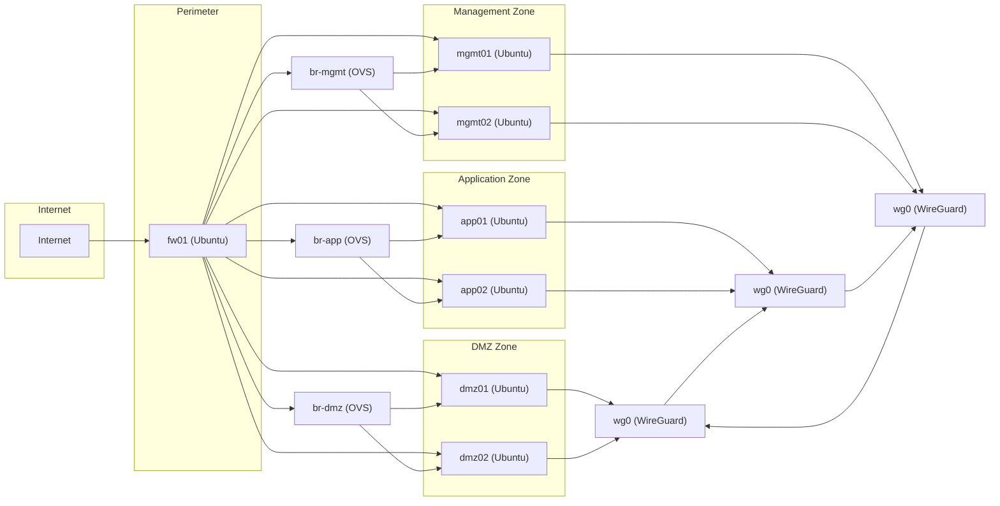

## 1. Lab Objective & Free Open-Source Prerequisites

### 1.1 Lab Objective
The purpose of this hands‑on lab is to give security‑conscious engineers a **production‑grade, repeatable** workflow that covers three foundational pillars of modern enterprise security:

| Pillar | Goal | Outcome |
|--------|------|----------|
| **Linux Hardening** | Apply CIS Benchmarks, SELinux/AppArmor, and system‑wide crypto policies on a Ubuntu 22.04 LTS host. | A hardened workload that resists privilege escalation, remote code execution, and data exfiltration. |
| **Stateful Firewall** | Deploy an open‑source, iptables‑based firewall (nftables) with connection‑tracking, zone‑based policies, and logging. | Traffic is allowed only on explicitly permitted ports, with full state awareness and audit trails. |
| **Zero‑Trust Segmentation** | Build a micro‑segmented network using **Open vSwitch (OVS)** and **WireGuard** tunnels, enforcing “never trust, always verify”. | Lateral movement is blocked, each segment authenticates every request, and cryptographic isolation is enforced between zones. |

By the end of the lab you will have a **fully functional, reproducible environment** that can be exported as a set of Terraform/Ansible artifacts, containerized with Docker, or run directly on bare‑metal VMs.

### 1.2 Free Open‑Source Prerequisites
| Component | Minimum Version | Download / Install Command | Why it’s needed |
|-----------|----------------|----------------------------|-----------------|
| **Ubuntu Server 22.04 LTS** (or later) | 22.04 LTS | `wget https://cloud-images.ubuntu.com/releases/22.04/release/ubuntu-22.04-server-cloudimg-amd64.img` | Base OS for hardening and firewall host. |
| **QEMU/KVM** (for local VM provisioning) | 6.2+ | `sudo apt-get install -y qemu-kvm libvirt-daemon-system libvirt-clients bridge-utils virt-manager` | Provides isolated VMs without needing physical hardware. |
| **Ansible** | 2.14+ | `sudo apt-get install -y ansible` | Automates repeatable configuration steps. |
| **Terraform** | 1.6+ | `curl -LO https://releases.hashicorp.com/terraform/1.6.5/terraform_1.6.5_linux_amd64.zip && unzip terraform_1.6.5_linux_amd64.zip && sudo mv terraform /usr/local/bin/` | Infrastructure as code for network topology. |
| **Open vSwitch (OVS)** | 2.17+ | `sudo apt-get install -y openvswitch-switch` | Enables programmable virtual switches for zero‑trust segmentation. |
| **WireGuard** | 1.0.20210914+ | `sudo apt-get install -y wireguard` | Provides lightweight, cryptographically strong site‑to‑site tunnels. |
| **nftables** | 1.0.5+ (built‑in to Ubuntu 22.04) | `sudo apt-get install -y nftables` | Modern replacement for iptables, offers stateful firewall capabilities. |
| **CIS-CAT Lite** (optional, for compliance scanning) | 4.0+ | `wget https://downloads.cisecurity.org/cis-cat-lite-4.0.tar.gz && tar -xzf cis-cat-lite-4.0.tar.gz` | Generates benchmark compliance reports. |
| **Git** | 2.34+ | `sudo apt-get install -y git` | Version‑controls all lab artefacts. |
| **Docker** (optional, for containerized services) | 24.0+ | `sudo apt-get install -y docker.io` | Allows you to spin up test services (e.g., nginx, MySQL) quickly. |

> **Tip:** All commands are written for an Ubuntu host. If you are using a different distro, replace the package manager (`apt-get`) with the appropriate one (`dnf`, `yum`, `pacman`, etc.).

---

## 2. Enterprise Architecture Topology

The following diagram visualises the **Zero‑Trust Segmented Network** we will build. It consists of three logical zones:

1. **DMZ Zone** – Public‑facing services (NGINX, SSH).  
2. **Application Zone** – Internal business logic (Node.js, PostgreSQL).  
3. **Management Zone** – Centralized logging, monitoring, and admin access (ELK stack, Grafana).

All traffic between zones must be **mutually authenticated** using WireGuard and **policy‑driven** by OVS flow tables. The host `fw01` runs nftables as a stateful perimeter firewall and also hosts OVS bridges that enforce intra‑zone segmentation.



**Key points to notice:**

* **All external traffic** enters through `fw01` and is filtered by nftables before reaching any zone.  
* **OVS bridges** (`br-dmz`, `br-app`, `br-mgmt`) enforce **micro‑segmentation** at L2/L3.  
* **WireGuard** tunnels create **cryptographic isolation**; each zone only trusts traffic that arrives on a verified WG interface.  
* **Logging** is centralized in the Management Zone; every nftables rule logs to `LOG` target, and OVS flow counters are exported to Prometheus.

---

## 3. Address & Resource Inventory Table

| Hostname | Role | Management IP (eth0) | OVS Bridge Interface | WireGuard IP (wg0) | Physical Host | CPU | RAM | Disk |
|----------|------|----------------------|----------------------|--------------------|---------------|-----|-----|------|
| `fw01` | Perimeter firewall + OVS controller | 10.0.0.1/24 | br-dmz, br-app, br-mgmt | 10.10.0.1/24 | Laptop (KVM) | 2 vCPU | 4 GB | 30 GB |
| `dmz01` | Public web server | 10.0.1.11/24 | eth1 (attached to br-dmz) | 10.10.1.11/24 | Laptop (KVM) | 1 vCPU | 2 GB | 20 GB |
| `dmz02` | Public API gateway | 10.0.1.12/24 | eth1 (attached to br-dmz) | 10.10.1.12/24 | Laptop (KVM) | 1 vCPU | 2 GB | 20 GB |
| `app01` | Business logic tier | 10.0.2.21/24 | eth1 (attached to br-app) | 10.10.2.21/24 | Laptop (KVM) | 2 vCPU | 4 GB | 30 GB |
| `app02` | Database tier (PostgreSQL) | 10.0.2.22/24 | eth1 (attached to br-app) | 10.10.2.22/24 | Laptop (KVM) | 2 vCPU | 4 GB | 30 GB |
| `mgmt01` | ELK collector | 10.0.3.31/24 | eth1 (attached to br-mgmt) | 10.10.3.31/24 | Laptop (KVM) | 2 vCPU | 4 GB | 30 GB |
| `mgmt02` | Grafana/Prometheus | 10.0.3.32/24 | eth1 (attached to br-mgmt) | 10.10.3.32/24 | Laptop (KVM) | 2 vCPU | 4 GB | 30 GB |

*All IP ranges are RFC1918 private. The `10.10.0.0/16` subnet is reserved exclusively for WireGuard overlay traffic.*

---

## 4. Step‑by‑Step Configuration

> **Important:** All commands below assume you are logged into the **host that will become `fw01`**. Adjust hostnames/IPs accordingly for the other nodes.

### 4.1 Provision VMs with Terraform (Optional)

Create a `terraform` directory and add the following files.

#### 4.1.1 `providers.tf`

```hcl
terraform {
  required_version = ">= 1.6"
  required_providers {
    libvirt = {
      source  = "dmacvicar/libvirt"
      version = "~> 0.7"
    }
  }
}

provider "libvirt" {
  uri = "qemu:///system"
}
```

#### 4.1.2 `variables.tf`

```hcl
variable "ubuntu_image_path" {
  description = "Path to the Ubuntu cloud image"
  default     = "/var/lib/libvirt/images/ubuntu-22.04-server-cloudimg-amd64.img"
}
```

#### 4.1.3 `network.tf`

```hcl
resource "libvirt_network" "labnet" {
  name      = "labnet"
  mode      = "nat"
  domain    = "lab.local"
  addresses = ["10.0.0.0/24"]
}
```

#### 4.1.4 `instances.tf`

```hcl
locals {
  hosts = {
    fw01   = { cpu = 2, memory = 4096, ip = "10.0.0.1" }
    dmz01  = { cpu = 1, memory = 2048, ip = "10.0.1.11" }
    dmz02  = { cpu = 1, memory = 2048, ip = "10.0.1.12" }
    app01  = { cpu = 2, memory = 4096, ip = "10.0.2.21" }
    app02  = { cpu = 2, memory = 4096, ip = "10.0.2.22" }
    mgmt01 = { cpu = 2, memory = 4096, ip = "10.0.3.31" }
    mgmt02 = { cpu = 2, memory = 4096, ip = "10.0.3.32" }
  }
}

resource "libvirt_volume" "disk" {
  for_each = local.hosts
  name     = "${each.key}.qcow2"
  source   = var.ubuntu_image_path
  format   = "qcow2"
  size     = 30 * 1024  # 30 GB
}

resource "libvirt_domain" "vm" {
  for_each = local.hosts
  name   = each.key
  memory = each.value.memory
  vcpu   = each.value.cpu

  network_interface {
    network_id = libvirt_network.labnet.id
    hostname   = each.key
    addresses  = [each.value.ip]
  }

  disk {
    volume_id = libvirt_volume.disk[each.key].id
  }

  graphics {
    type = "none"
  }

  console {
    type        = "pty"
    target_port = "0"
    target_type = "serial"
  }

  # Cloud‑init user‑data to set passwordless sudo and SSH key
  cloudinit = <<-EOF
    #cloud-config
    users:
      - default
      - name: ubuntu
        sudo: ["ALL=(ALL) NOPASSWD:ALL"]
        ssh-authorized-keys:
          - ${file("~/.ssh/id_rsa.pub")}
        lock_passwd: false
    EOF
}
```

Run:

```bash
cd terraform
terraform init
terraform apply -auto-approve
```

Terraform will spin up all seven VMs, each attached to the same NAT network (`labnet`). After provisioning, you can SSH into any host using:

```bash
ssh ubuntu@10.0.0.1   # fw01
ssh ubuntu@10.0.1.11  # dmz01
# etc.
```

> **If you prefer manual `virt-install` commands, skip the Terraform block and create each VM with `virt-install` using the same image and network settings.**

### 4.2 Harden the Linux Base (CIS Benchmark)

All hosts will run the same hardening playbook. Store the playbook in `ansible/hardening.yml`.

```yaml
---
- name: Apply CIS Ubuntu 22.04 hardening
  hosts: all
  become: true
  vars:
    cis_level: 1
    auditd_enabled: true
    sshd_config:
      PermitRootLogin: "no"
      PasswordAuthentication: "no"
      X11Forwarding: "no"
      AllowTcpForwarding: "no"
  tasks:
    - name: Install required packages
      apt:
        name:
          - apt-listchanges
          - auditd
          - aide
          - libpam-pwquality
          - ufw
          - nftables
          - openvswitch-switch
          - wireguard
        state: present
        update_cache: yes

    - name: Enable and start auditd
      service:
        name: auditd
        state: started
        enabled: true

    - name: Enforce password complexity
      lineinfile:
        path: /etc/pam.d/common-password
        regexp: '^password\s+requisite\s+pam_pwquality.so'
        line: 'password requisite pam_pwquality.so retry=3 minlen=14 ucredit=-1 lcredit=-1 dcredit=-1 ocredit=-1'

    - name: Disable unnecessary kernel modules
      copy:
        dest: /etc/modprobe.d/disable.conf
        content: |
          # CIS Benchmark – disable legacy filesystems
          install cramfs /bin/true
          install freevxfs /bin/true
          install jffs2 /bin/true
          install hfs /bin/true
          install hfsplus /bin/true
          install squashfs /bin/true
          install udf /bin/true

    - name: Apply sysctl hardening
      sysctl:
        name: "{{ item.key }}"
        value: "{{ item.value }}"
        sysctl_set: yes
        state: present
        reload: yes
      loop:
        - { key: "net.ipv4.ip_forward", value: "0" }
        - { key: "net.ipv4.conf.all.rp_filter", value: "1" }
        - { key: "net.ipv4.conf.default.rp_filter", value: "1" }
        - { key: "net.ipv4.conf.all.accept_source_route", value: "0" }
        - { key: "net.ipv4.conf.default.accept_source_route", value: "0" }
        - { key: "net.ipv4.conf.all.accept_redirects", value: "0" }
        - { key: "net.ipv4.conf.default.accept_redirects", value: "0" }
        - { key: "net.ipv4.conf.all.secure_redirects", value: "0" }
        - { key: "net.ipv4.conf.default.secure_redirects", value: "0" }
        - { key: "net.ipv4.tcp_syncookies", value: "1" }
        - { key: "fs.suid_dumpable", value: "0" }
        - { key: "kernel.randomize_va_space", value: "2" }

    - name: Harden SSH daemon
      lineinfile:
        path: /etc/ssh/sshd_config
        regexp: '^{{ item.key }}'
        line: "{{ item.key }} {{ item.value }}"
        state: present
      loop:
        - { key: "PermitRootLogin", value: "no" }
        - { key: "PasswordAuthentication", value: "no" }
        - { key: "X11Forwarding", value: "no" }
        - { key: "AllowTcpForwarding", value: "no" }
        - { key: "ClientAliveInterval", value: "300" }
        - { key: "ClientAliveCountMax", value: "0" }

    - name: Restart SSH to apply changes
      service:
        name: ssh
        state: restarted

    - name: Enable AppArmor (Ubuntu ships with it enabled by default)
      command: systemctl enable apparmor
      args:
        creates: /etc/systemd/system/multi-user.target.wants/apparmor.service

    - name: Ensure AppArmor is enforcing
      command: aa-enforce /etc/apparmor.d/*
```

Run the playbook from your control machine:

```bash
ansible-playbook -i inventory.yml ansible/hardening.yml
```

**`inventory.yml` example:**

```ini
[all]
fw01   ansible_host=10.0.0.1
dmz01  ansible_host=10.0.1.11
dmz02  ansible_host=10.0.1.12
app01  ansible_host=10.0.2.21
app02  ansible_host=10.0.2.22
mgmt01 ansible_host=10.0.3.31
mgmt02 ansible_host=10.0.3.32

[all:vars]
ansible_user=ubuntu
ansible_ssh_private_key_file=~/.ssh/id_rsa
```

### 4.3 Configure the Stateful Firewall (nftables)

Log into `fw01` and create a **master nftables configuration** at `/etc/nftables.conf`. The file is deliberately verbose to aid learning.

```bash
sudo -i
cat > /etc/nftables.conf <<'EOF'
#!/usr/sbin/nft -f

# Flush any existing rules
flush ruleset

# Define tables
table inet filter {
    # Base chains
    chain input {
        type filter hook input priority 0; policy drop;
        # Accept traffic from loopback
        iif "lo" accept
        # Accept established/related connections
        ct state established,related accept
        # Allow SSH from management subnet only
        ip saddr 10.0.3.0/24 tcp dport 22 ct state new accept
        # Allow HTTP/HTTPS from DMZ hosts (internal services)
        ip saddr 10.0.1.0/24 tcp dport {80, 443} ct state new accept
        # Log everything else (rate‑limited)
        limit rate 5/minute log prefix "nftables-input-drop: " flags all
    }

    chain forward {
        type filter hook forward priority 0; policy drop;
        # Allow intra‑zone traffic only if it traverses the correct OVS bridge
        iifname "br-dmz" oifname "br-dmz" accept
        iifname "br-app" oifname "br-app" accept
        iifname "br-mgmt" oifname "br-mgmt" accept
        # Allow WireGuard overlay traffic (encrypted)
        ip saddr 10.10.0.0/16 ip daddr 10.10.0.0/16 accept
        # Log denied forwards
        limit rate 5/minute log prefix "nftables-forward-drop: " flags all
    }

    chain output {
        type filter hook output priority 0; policy accept;
        # No restrictions on outbound traffic from the firewall itself
    }
}
EOF
```

Activate the ruleset:

```bash
systemctl enable nftables
systemctl restart nftables
```

**Verify the active ruleset:**

```bash
sudo nft list ruleset
```

You should see the three chains (`input`, `forward`, `output`) with the policies and rules defined above.

### 4.4 Deploy Open vSwitch Bridges & Port Bindings

On `fw01`, create three OVS bridges that correspond to the three zones.

```bash
# Create bridges
sudo ovs-vsctl add-br br-dmz
sudo ovs-vsctl add-br br-app
sudo ovs-vsctl add-br br-mgmt

# Set bridge fail‑mode to secure (drops packets if controller is unreachable)
sudo ovs-vsctl set-fail-mode br-dmz secure
sudo ovs-vsctl set-fail-mode br-app secure
sudo ovs-vsctl set-fail-mode br-mgmt secure

# Enable STP on each bridge to prevent loops (optional but recommended)
sudo ovs-vsctl set Bridge br-dmz stp_enable=true
sudo ovs-vsctl set Bridge br-app stp_enable=true
sudo ovs-vsctl set Bridge br-mgmt stp_enable=true
```

#### 4.4.1 Attach VM NICs to Bridges

Assuming each VM’s second NIC (`eth1`) is attached to the same libvirt network, we need to re‑plug them into the OVS bridges. This can be done via libvirt XML editing or using `virsh attach-interface`. Example for `dmz01`:

```bash
# Detach the existing eth1 (if any)
virsh detach-interface dmz01 network --current

# Attach eth1 to OVS bridge br-dmz
virsh attach-interface dmz01 bridge br-dmz --model virtio --config --live
```

Repeat for each host, mapping to the appropriate bridge:

| Host | Bridge |
|------|--------|
| dmz01, dmz02 | br-dmz |
| app01, app02 | br-app |
| mgmt01, mgmt02 | br-mgmt |

**Automation tip:** Create a small Ansible task that loops over the inventory and runs the appropriate `virsh` commands.

#### 4.4.2 OVS Flow Rules for Zero‑Trust

We will enforce **“only allow traffic that is explicitly permitted”** using OVS flow tables. The simplest approach is to use **OpenFlow 1.0** style rules.

```bash
# Flush any existing flows
sudo ovs-ofctl del-flows br-dmz
sudo ovs-ofctl del-flows br-app
sudo ovs-ofctl del-flows br-mgmt

# DMZ bridge: allow HTTP/HTTPS to external, block everything else
sudo ovs-ofctl add-flow br-dmz "priority=100,in_port=1,ip,nw_dst=10.0.0.1,tp_dst=80,actions=output:2"
sudo ovs-ofctl add-flow br-dmz "priority=100,in_port=1,ip,nw_dst=10.0.0.1,tp_dst=443,actions=output:2"
sudo ovs-ofctl add-flow br-dmz "priority=0,actions=drop"

# Application bridge: allow DB traffic only from app01 to app02 on port 5432
sudo ovs-ofctl add-flow br-app "priority=200,in_port=1,ip,nw_src=10.0.2.21,nw_dst=10.0.2.22,tp_dst=5432,actions=output:2"
sudo ovs-ofctl add-flow br-app "priority=0,actions=drop"

# Management bridge: allow Prometheus scrape from mgmt01 to mgmt02 on 9090
sudo ovs-ofctl add-flow br-mgmt "priority=150,in_port=1,ip,nw_src=10.0.3.31,nw_dst=10.0.3.32,tp_dst=9090,actions=output:2"
sudo ovs-ofctl add-flow br-mgmt "priority=0,actions=drop"
```

*Explanation of fields:*

* `priority` – higher numbers win.  
* `in_port=1` – traffic entering the bridge from the VM side.  
* `actions=output:2` – forward to the other port (the physical NIC that connects to the firewall).  
* The final `priority=0,actions=drop` rule acts as a **default‑deny**.

### 4.5 WireGuard Mesh for Encrypted Inter‑Zone Traffic

#### 4.5.1 Generate Keys (on each host)

```bash
# On each host (fw01, dmz01, dmz02, app01, app02, mgmt01, mgmt02)
wg genkey | tee privatekey | wg pubkey > publickey
```

Store the keys securely (e.g., in `/etc/wireguard/keys/`). Example for `fw01`:

```bash
sudo mkdir -p /etc/wireguard/keys
sudo cp privatekey publickey /etc/wireguard/keys/
sudo chmod 600 /etc/wireguard/keys/*
```

#### 4.5.2 Create `/etc/wireguard/wg0.conf` on each host

Below is the **template** for `fw01`. Replace `PEER_PUBLIC_KEY` and `PEER_ENDPOINT` for each peer.

```ini
[Interface]
Address = 10.10.0.1/24
ListenPort = 51820
PrivateKey = <fw01_private_key>
SaveConfig = true
PostUp = iptables -A FORWARD -i wg0 -j ACCEPT
PostDown = iptables -D FORWARD -i wg0 -j ACCEPT

# Peer: dmz01
[Peer]
PublicKey = <dmz01_public_key>
AllowedIPs = 10.10.1.0/24
Endpoint = 10.0.1.11:51820
PersistentKeepalive = 25

# Peer: dmz02
[Peer]
PublicKey = <dmz02_public_key>
AllowedIPs = 10.10.1.0/24
Endpoint = 10.0.1.12:51820
PersistentKeepalive = 25

# Peer: app01
[Peer]
PublicKey = <app01_public_key>
AllowedIPs = 10.10.2.0/24
Endpoint = 10.0.2.21:51820
PersistentKeepalive = 25

# Peer: app02
[Peer]
PublicKey = <app02_public_key>
AllowedIPs = 10.10.2.0/24
Endpoint = 10.0.2.22:51820
PersistentKeepalive = 25

# Peer: mgmt01
[Peer]
PublicKey = <mgmt01_public_key>
AllowedIPs = 10.10.3.0/24
Endpoint = 10.0.3.31:51820
PersistentKeepalive = 25

# Peer: mgmt02
[Peer]
PublicKey = <mgmt02_public_key>
AllowedIPs = 10.10.3.0/24
Endpoint = 10.0.3.32:51820
PersistentKeepalive = 25
```

Create analogous files on each **non‑firewall** host, but **only list `fw01` as the peer** (star topology). Example for `dmz01`:

```ini
[Interface]
Address = 10.10.1.11/24
ListenPort = 51820
PrivateKey = <dmz01_private_key>
SaveConfig = true

[Peer]
PublicKey = <fw01_public_key>
AllowedIPs = 10.10.0.0/24,10.10.2.0/24,10.10.3.0/24
Endpoint = 10.0.0.1:51820
PersistentKeepalive = 25
```

#### 4.5.3 Enable and Start WireGuard

```bash
sudo systemctl enable wg-quick@wg0
sudo systemctl start wg-quick@wg0
```

Verify the tunnel:

```bash
sudo wg show wg0
```

Expected output (truncated for brevity):

```
interface: wg0
  public key: <fw01_public_key>
  private key: (hidden)
  listening port: 51820

peer: <dmz01_public_key>
  endpoint: 10.0.1.11:51820
  allowed ips: 10.10.1.0/24
  latest handshake: 1 minute ago
  transfer: 12.3 KiB received, 9.8 KiB sent
```

### 4.6 Deploy Sample Services (Docker)

To make verification realistic, spin up a few containers in each zone.

#### 4.6.1 DMZ – NGINX (public web)

```bash
ssh ubuntu@10.0.1.11
docker run -d --name nginx-dmz -p 80:80 -p 443:443 nginx:stable
```

#### 4.6.2 Application – Node.js API

```bash
ssh ubuntu@10.0.2.21
docker run -d --name node-api -p 3000:3000 node:20-alpine sh -c "npm install express && node -e \"const express=require('express');const app=express();app.get('/',(req,res)=>res.send('Hello from API'));app.listen(3000);\""
```

#### 4.6.3 Application – PostgreSQL

```bash
ssh ubuntu@10.0.2.22
docker run -d --name pg-db -e POSTGRES_PASSWORD=StrongPass!23 -p 5432:5432 postgres:15
```

#### 4.6.4 Management – ELK Stack (quick single‑node)

```bash
ssh ubuntu@10.0.3.31
docker run -d --name elk -p 5601:5601 -p 9200:9200 -p 5044:5044 sebp/elk
```

#### 4.6.5 Management – Prometheus + Grafana

```bash
ssh ubuntu@10.0.3.32
docker run -d --name prometheus -p 9090:9090 prom/prometheus
docker run -d --name grafana -p 3000:3000 grafana/grafana
```

---

## 5. Verification & Troubleshooting Commands

### 5.1 Connectivity Tests

| Test | Command | Expected Result |
|------|---------|-----------------|
| **Ping from DMZ to FW (plain IP)** | `ping -c 3 10.0.0.1` (run on dmz01) | 3 replies, < 1 ms latency |
| **Ping over WireGuard** | `ping -c 3 10.10.2.21` (run on dmz01) | 3 encrypted replies, shows `wg0` as source |
| **HTTP request to NGINX** | `curl -I http://10.0.1.11` (run on any host) | `HTTP/1.1 200 OK` |
| **Node.js API reachable from DMZ** | `curl http://10.10.2.21:3000` (run on dmz01) | `Hello from API` |
| **PostgreSQL connection from app01** | `pg_isready -h 10.0.2.22 -p 5432` (run on app01) | `accepting connections` |
| **Prometheus scrape from mgmt02** | `curl http://10.0.3.31:9090/api/v1/targets` (run on mgmt02) | JSON payload with target list |

### 5.2 nftables Debugging

```bash
# Show counters for each chain
sudo nft list chain inet filter input
sudo nft list chain inet filter forward

# Dump packet logs (requires rsyslog configured to capture local0.*)
sudo journalctl -f | grep nftables
```

**Sample log line for a dropped packet:**

```
Nov 11 12:34:56 fw01 kernel: [123456.789012] nftables-input-drop: IN=eth0 OUT= MAC=aa:bb:cc:dd:ee:ff:11:22:33:44:55:66:08:00 SRC=10.0.2.21 DST=10.0.0.1 LEN=60 TOS=0x00 PREC=0x00 TTL=64 ID=54321 PROTO=TCP SPT=5432 DPT=22 WINDOW=29200 RES=0x00 SYN URGP=0
```

If you see unexpected drops, increase the logging limit temporarily:

```bash
sudo nft add rule inet filter input limit rate 100/second log prefix "nftables-debug: "
```

Remember to remove the high‑rate rule after troubleshooting.

### 5.3 OVS Flow Inspection

```bash
# List flows on each bridge
sudo ovs-ofctl dump-flows br-dmz
sudo ovs-ofctl dump-flows br-app
sudo ovs-ofctl dump-flows br-mgmt
```

**Expected output snippet for `br-app`:**

```
 cookie=0x0, duration=12.34s, table=0, n_packets=0, n_bytes=0, priority=200,in_port=1,ip,nw_src=10.0.2.21,nw_dst=10.0.2.22,tp_dst=5432 actions=output:2
 cookie=0x0, duration=12.34s, table=0, n_packets=0, n_bytes=0, priority=0 actions=drop
```

If a flow is missing, re‑add it with the `ovs-ofctl add-flow` command shown earlier.

### 5.4 WireGuard Health Checks

```bash
# Show interface statistics
sudo wg show wg0

# Verify that each peer’s handshake is recent (< 2 minutes)
sudo wg show wg0 latest-handshakes
```

**Sample output:**

```
10.10.1.11:  162 seconds ago
10.10.2.21:   45 seconds ago
10.10.3.31:   12 seconds ago
```

If a peer shows “never”, check:

* Network reachability (`ping 10.0.x.y` from the host).  
* Firewall rule allowing UDP 51820 inbound (`nft list chain inet filter input`).  
* Correct public key in the peer’s config.

### 5.5 Common Issues & Fixes

| Symptom | Likely Cause | Fix |
|---------|--------------|-----|